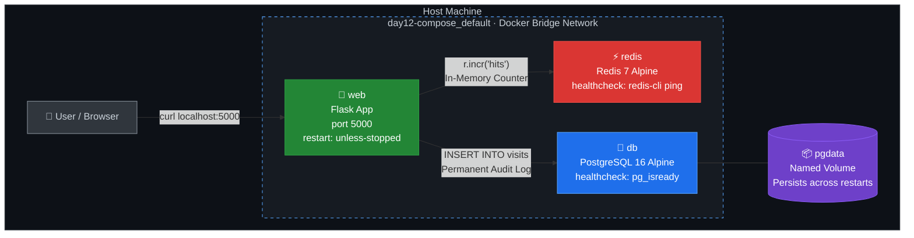

# DevOps Winter Arc — Day 12: Docker Compose — Multi-Container Orchestration & Health Checks

> **90 Days of DevOps Challenge | Containers Week | Learn • Practice • Build**  
> **Topic: Multi-Container Orchestration, Compose Spec, Embedded Networking, Production Health Checks, Restart Policies, State Persistence & Secret Hygiene**

---

## 🎯 Goal for Today

In Day 11, we managed multi-container communication manually using `docker network create`, multiple verbose `docker run -d` flags, manual volume mounts, and shell commands. In a real-world environment running 5 to 20 microservices, doing this by hand is fragile, error-prone, and impossible to reproduce reliably across environments.

**Today's Goal:** Define an entire multi-container production-grade stack (Web App + Redis Cache + PostgreSQL Database) in a single declarative YAML configuration file (`compose.yaml`) and launch, network, health-check, and manage its entire lifecycle with a single command: `docker compose up -d`.

### 🗺️ Today's Mission Blueprint

1. 📂 **Directory & Secret Hygiene Setup:** Set up a clean structure separating app code, secrets (`.env`), and environment templates (`.env.example`), ensuring credentials never leak to Git.
2. 🐍 **Build the 3-Tier Application:** Create a Flask hit counter that caches lightning-fast visits in Redis and records permanent audit logs in PostgreSQL.
3. 🎼 **Declarative Stack Orchestration (`compose.yaml`):** Model services, private networking, volume persistence, and restart policies in standard Compose YAML.
4. ❤️ **True Readiness Health Checks:** Implement active health checks on Redis (`redis-cli ping`) and PostgreSQL (`pg_isready`), using `depends_on: { condition: service_healthy }` to eliminate race conditions.
5. 🛡️ **Resilience & Persistence Drills:** Validate data persistence across full stack destruction (`docker compose down` -> `docker compose up -d`) and prove self-healing with `docker kill` under `unless-stopped`.

---

## 📖 Key Concepts (The Core 30%)

### 1. What is Docker Compose?
Docker Compose is a declarative tool for defining and running multi-container Docker applications. Instead of memorizing long `docker run` commands with dozens of arguments, you capture your entire application architecture—services, storage volumes, private networks, and runtime environment—in a single `compose.yaml` file.
> It serves as **Infrastructure as Code (IaC) for a single host**.

### 2. Modern `docker compose` vs Legacy `docker-compose`
- **Modern Docker (`docker compose` - with a space):** A fast Go-based Compose plugin built directly into Docker CLI v20+. It supports the open Compose Specification and is the current industry standard.
- **Legacy (`docker-compose` - with a hyphen):** The old Python standalone binary. It is deprecated and should not be used in modern pipelines.

### 3. Automatic Private Networking & Service Discovery
When you run `docker compose up`, Docker automatically:
- Creates a dedicated user-defined bridge network named `<project>_default`.
- Attaches every declared service container to this network.
- Configures Docker's embedded DNS server (`127.0.0.11`) so each container can resolve peers simply by their service name (`http://db:5432`, `http://redis:6379`).
- There is **no need** to run `docker network create` or hardcode IP addresses.

### 4. The Startup Race Condition: `depends_on` vs `service_healthy`
A classic beginner trap in DevOps:
```yaml
# ❌ THE TRAP: Only waits for the container process to spawn
depends_on:
  - db
```
Databases like PostgreSQL take 2 to 5 seconds to initialize storage and start listening on socket ports. If your web app starts as soon as the database container is created, it will immediately crash with `Connection Refused`.

```yaml
# ✅ PRODUCTION PATTERN: Waits until the database is genuinely ready to serve traffic
depends_on:
  db:
    condition: service_healthy
```

### 5. Restart Policies Matrix
| Policy | Behavior on Container Exit | Survives Docker Daemon / Host Reboot? | Best Used For |
| :--- | :--- | :--- | :--- |
| `no` (default) | Do not restart under any circumstance | No | One-off batch jobs or test runners |
| `on-failure[:N]` | Restart only if exit code is non-zero (max N retries) | Only if it crashed before daemon stop | Migration scripts, sync jobs |
| `always` | Always restart, even if stopped manually | **Yes** (starts back up on boot even if you stopped it) | Legacy setups / monitoring agents |
| `unless-stopped` | Always restart on crashes or reboots, **unless** explicitly stopped with `docker stop` | **Yes** (remains stopped if manually stopped) | **Standard for production services & web servers** |

### 6. Anatomy of a `compose.yaml`
```yaml
services:                       # Containers in the application
  web:
    build: ./app                # Build from a local Dockerfile
    ports: ["5000:5000"]        # host_port : container_port
    env_file: .env              # Inject environment variables from .env
    environment:
      DB_HOST: db               # Internal service discovery DNS
      REDIS_HOST: redis
    depends_on:
      db:    { condition: service_healthy }
      redis: { condition: service_healthy }
    restart: unless-stopped

  db:
    image: postgres:16-alpine   # Use official prebuilt registry image
    env_file: .env
    volumes: ["pgdata:/var/lib/postgresql/data"] # Persistent named volume
    healthcheck:
      test: ["CMD-SHELL", "pg_isready -U $${POSTGRES_USER} -d $${POSTGRES_DB}"]
      interval: 5s
      timeout: 3s
      retries: 10
    restart: unless-stopped

  redis:
    image: redis:7-alpine
    healthcheck:
      test: ["CMD", "redis-cli", "ping"]
      interval: 5s
      timeout: 3s
      retries: 10
    restart: unless-stopped

volumes:                        # Named volumes managed by Docker
  pgdata:
```

### 7. Architecture Diagram — 3-Service Visit Counter Stack



> [!NOTE]
> **Data flow:** Every request hits Flask → Redis increments an in-memory counter (fast, ephemeral) → PostgreSQL inserts a permanent row (durable via `pgdata` volume). Redis resets on `down`; Postgres persists.

---

## 🛠️ Everyday Compose Command Reference

| Command | Action Performed | DevOps / Production Use Case |
| :--- | :--- | :--- |
| `docker compose config` | Validates YAML syntax & prints resolved variables | CI/CD pipeline linting; spotting indentation and env bugs |
| `docker compose up -d` | Builds, creates, and starts stack in background | Deploying services cleanly without locking shell |
| `docker compose up -d --build` | Forces a rebuild of Dockerfile images before start | Applying code changes or new dependencies |
| `docker compose ps` | Lists containers, state, published ports & health | Quick operational status and health check monitoring |
| `docker compose logs -f <service>` | Streams live stdout/stderr logs of a specific service | Debugging application errors and startup sequences |
| `docker compose exec <service> <cmd>` | Executes an interactive command in a running service | Running `psql`, checking filesystem, or running migrations |
| `docker compose down` | Stops containers and removes network (keeps volumes!) | Standard safe teardown without losing data |
| `docker compose down -v` | Stops containers, removes network **AND deletes volumes** | **DATA LOSS!** Full reset for testing or teardown |
| `docker compose restart <service>` | Restarts a single service container | Applying minor configuration changes |
| `docker compose run --rm web <cmd>` | Starts an ephemeral container from a service definition | Running test suites (`pytest`) or one-off DB seeds |

---

## 🏗️ Hands-On Lab Walkthrough & Execution

Work directory for today's lab: `~/day12-compose`

### Step 1: Project Directory Structure & Secret Hygiene

```bash
mkdir -p ~/day12-compose/app
cd ~/day12-compose
```

#### `.gitignore`
Never commit credentials, tokens, or local environment files into version control.
```bash
cat << 'EOF' > .gitignore
.env
__pycache__/
*.pyc
EOF
```

#### `.env.example` (Committed to Git as a Template)
```bash
cat << 'EOF' > .env.example
POSTGRES_DB=visits
POSTGRES_USER=appuser
POSTGRES_PASSWORD=replace_with_secure_password
EOF
```

#### `.env` (Ignored by Git, Used by Docker Compose)
```bash
cat << 'EOF' > .env
POSTGRES_DB=visits
POSTGRES_USER=appuser
POSTGRES_PASSWORD=change-me-please
EOF
```

#### 💻 Terminal Session & Verification:
```bash
hrishav@hrishav-LOQ-15IAX9:~$ mkdir -p ~/day12-compose/app
hrishav@hrishav-LOQ-15IAX9:~$ cd ~/day12-compose
hrishav@hrishav-LOQ-15IAX9:~/day12-compose$ cat << 'EOF' > .gitignore
.env
__pycache__/
*.pyc
EOF
hrishav@hrishav-LOQ-15IAX9:~/day12-compose$ cat << 'EOF' > .env.example
POSTGRES_DB=visits
POSTGRES_USER=appuser
POSTGRES_PASSWORD=replace_with_secure_password
EOF
hrishav@hrishav-LOQ-15IAX9:~/day12-compose$ cat << 'EOF' > .env
POSTGRES_DB=visits
POSTGRES_USER=appuser
POSTGRES_PASSWORD=change-me-please
EOF
hrishav@hrishav-LOQ-15IAX9:~/day12-compose$ ls -la
total 24
drwxrwxr-x  3 hrishav hrishav 4096 Oct 13 22:28 .
drwxr-x--- 73 hrishav hrishav 4096 Oct 13 22:27 ..
-rw-rw-r--  1 hrishav hrishav   76 Oct 13 22:28 .env
-rw-rw-r--  1 hrishav hrishav   88 Oct 13 22:28 .env.example
-rw-rw-r--  1 hrishav hrishav   24 Oct 13 22:28 .gitignore
drwxrwxr-x  2 hrishav hrishav 4096 Oct 13 22:27 app
```

---

### Step 2: Application Source Code

#### `app/requirements.txt`
```bash
cat << 'EOF' > app/requirements.txt
flask==3.0.3
redis==5.0.8
psycopg2-binary==2.9.9
EOF
```

#### `app/app.py`
```bash
cat << 'EOF' > app/app.py
import os, redis, psycopg2
from flask import Flask

app = Flask(__name__)
r = redis.Redis(host=os.getenv("REDIS_HOST", "redis"), port=6379)

def db():
    return psycopg2.connect(
        host=os.getenv("DB_HOST", "db"),
        dbname=os.getenv("POSTGRES_DB"),
        user=os.getenv("POSTGRES_USER"),
        password=os.getenv("POSTGRES_PASSWORD")
    )

@app.route("/")
def index():
    hits = r.incr("hits")
    with db() as conn, conn.cursor() as cur:
        cur.execute("CREATE TABLE IF NOT EXISTS visits(id serial, ts timestamptz default now())")
        cur.execute("INSERT INTO visits DEFAULT VALUES")
        cur.execute("SELECT count(*) FROM visits")
        total = cur.fetchone()[0]
    return f"Redis hits: {hits} | Postgres visits: {total}\n"

@app.route("/health")
def health():
    return "ok"

if __name__ == "__main__":
    app.run(host="0.0.0.0", port=5000)
EOF
```

---

### Step 3: Hardened Non-Root Container Image (`app/Dockerfile`)

Building upon security best practices from Day 9 & 10:
```bash
cat << 'EOF' > app/Dockerfile
FROM python:3.12-slim
WORKDIR /app

# Cache dependency layer
COPY requirements.txt .
RUN pip install --no-cache-dir -r requirements.txt

# Copy application source
COPY . .

# Run as an unprivileged user (Least Privilege principle)
RUN useradd -r appuser
USER appuser

EXPOSE 5000
CMD ["python", "app.py"]
EOF
```

#### 💻 Terminal Session & Directory Verification:
```bash
hrishav@hrishav-LOQ-15IAX9:~/day12-compose$ ls -la app/
total 20
drwxrwxr-x 2 hrishav hrishav 4096 Oct 13 22:30 .
drwxrwxr-x 3 hrishav hrishav 4096 Oct 13 22:28 ..
-rw-rw-r-- 1 hrishav hrishav  295 Oct 13 22:30 Dockerfile
-rw-rw-r-- 1 hrishav hrishav  880 Oct 13 22:29 app.py
-rw-rw-r-- 1 hrishav hrishav   49 Oct 13 22:29 requirements.txt
```

---

### Step 4: The Master Orchestration File (`compose.yaml`)

```bash
cat << 'EOF' > compose.yaml
services:
  web:
    build: ./app
    ports: ["5000:5000"]
    env_file: .env
    environment:
      DB_HOST: db
      REDIS_HOST: redis
    depends_on:
      db:
        condition: service_healthy
      redis:
        condition: service_healthy
    restart: unless-stopped

  db:
    image: postgres:16-alpine
    env_file: .env
    volumes:
      - pgdata:/var/lib/postgresql/data
    healthcheck:
      test: ["CMD-SHELL", "pg_isready -U $${POSTGRES_USER} -d $${POSTGRES_DB}"]
      interval: 5s
      timeout: 3s
      retries: 10
    restart: unless-stopped

  redis:
    image: redis:7-alpine
    healthcheck:
      test: ["CMD", "redis-cli", "ping"]
      interval: 5s
      timeout: 3s
      retries: 10
    restart: unless-stopped

volumes:
  pgdata:
EOF
```

> [!TIP]
> **Why `$${POSTGRES_USER}` has double dollar signs:**  
> A single `$VAR` is interpolated by Docker Compose on your host machine before generating the container config. When you write `$${VAR}`, Docker Compose escapes it as a literal `$VAR` so the container shell expands it at runtime!

---

### Step 5: Verification & Launch Commands

#### 1. Validating Compose Syntax & Environment Variable Resolution
```bash
docker compose config
```

```yaml
name: day12-compose
services:
  db:
    environment:
      POSTGRES_DB: visits
      POSTGRES_PASSWORD: change-me-please
      POSTGRES_USER: appuser
    healthcheck:
      test:
        - CMD-SHELL
        - pg_isready -U $${POSTGRES_USER} -d $${POSTGRES_DB}
      timeout: 3s
      interval: 5s
      retries: 10
    image: postgres:16-alpine
    networks:
      default: null
    restart: unless-stopped
    volumes:
      - type: volume
        source: pgdata
        target: /var/lib/postgresql/data
        volume: {}
  redis:
    healthcheck:
      test:
        - CMD
        - redis-cli
        - ping
      timeout: 3s
      interval: 5s
      retries: 10
    image: redis:7-alpine
    networks:
      default: null
    restart: unless-stopped
  web:
    build:
      context: /home/hrishav/day12-compose/app
      dockerfile: Dockerfile
    depends_on:
      db:
        condition: service_healthy
        required: true
      redis:
        condition: service_healthy
        required: true
    environment:
      DB_HOST: db
      POSTGRES_DB: visits
      POSTGRES_PASSWORD: change-me-please
      POSTGRES_USER: appuser
      REDIS_HOST: redis
    networks:
      default: null
    ports:
      - mode: ingress
        target: 5000
        published: "5000"
        protocol: tcp
    restart: unless-stopped
networks:
  default:
    name: day12-compose_default
volumes:
  pgdata:
    name: day12-compose_pgdata
```

#### 2. Building and Starting Stack in Detached Mode
```bash
docker compose up -d --build
```

```text
[+] Building 44.5s (14/14) FINISHED
 => [internal] load build definition from Dockerfile
 => [1/6] FROM docker.io/library/python:3.12-slim
 => [2/6] WORKDIR /app
 => [3/6] COPY requirements.txt .
 => [4/6] RUN pip install --no-cache-dir -r requirements.txt
 => [5/6] COPY . .
 => [6/6] RUN useradd -r appuser
 => naming to docker.io/library/day12-compose-web:latest

[+] Running 16/16
 ✔ Image redis:7-alpine            Pulled
 ✔ Image day12-compose-web         Built
 ✔ Network day12-compose_default   Created
 ✔ Volume day12-compose_pgdata     Created
 ✔ Container day12-compose-db-1    Healthy                                 6.0s
 ✔ Container day12-compose-redis-1 Healthy                                 6.0s
 ✔ Container day12-compose-web-1   Started                                 6.1s
```

> [!IMPORTANT]
> **Observation on Startup Order:**  
> Notice that `day12-compose-db-1` and `day12-compose-redis-1` took `6.0s` to reach `Healthy`. Docker Compose intentionally held back `day12-compose-web-1` until `6.1s` when both dependencies were fully healthy. This completely prevented startup connection errors!

#### 3. Verifying Health Status
```bash
hrishav@hrishav-LOQ-15IAX9:~/day12-compose$ docker compose ps
```
```text
NAME                       IMAGE                  COMMAND                  SERVICE   CREATED          STATUS                    PORTS
day12-compose-db-1         postgres:16-alpine     "docker-entrypoint.s…"   db        35 seconds ago   Up 34 seconds (healthy)   5432/tcp
day12-compose-redis-1      redis:7-alpine         "docker-entrypoint.s…"   redis     35 seconds ago   Up 34 seconds (healthy)   6379/tcp
day12-compose-web-1        day12-compose-web      "python app.py"          web       29 seconds ago   Up 28 seconds             0.0.0.0:5000->5000/tcp
```

> ✅ Both `db` and `redis` show **(healthy)** — health checks are working. `web` is **Up** and serving on port 5000.

#### 4. Testing the Application Endpoint
```bash
hrishav@hrishav-LOQ-15IAX9:~/day12-compose$ curl localhost:5000
Redis hits: 1 | Postgres visits: 1
hrishav@hrishav-LOQ-15IAX9:~/day12-compose$ curl localhost:5000
Redis hits: 2 | Postgres visits: 2
hrishav@hrishav-LOQ-15IAX9:~/day12-compose$ curl localhost:5000
Redis hits: 3 | Postgres visits: 3
```

> ✅ Both counters increment on every call — Flask is correctly talking to both Redis and PostgreSQL over the Compose network using service-name DNS.

---

### Step 6: Resilience & Persistence Drills

#### Drill A: Data Persistence Across Stack Recreation
```bash
hrishav@hrishav-LOQ-15IAX9:~/day12-compose$ docker compose down
[+] Running 4/4
 ✔ Container day12-compose-web-1    Removed                                 0.5s
 ✔ Container day12-compose-redis-1  Removed                                 0.3s
 ✔ Container day12-compose-db-1     Removed                                 0.4s
 ✔ Network day12-compose_default    Removed                                 0.1s

hrishav@hrishav-LOQ-15IAX9:~/day12-compose$ docker compose up -d
[+] Running 4/4
 ✔ Network day12-compose_default    Created                                 0.1s
 ✔ Container day12-compose-db-1     Healthy                                 6.0s
 ✔ Container day12-compose-redis-1  Healthy                                 6.0s
 ✔ Container day12-compose-web-1    Started                                 6.1s

hrishav@hrishav-LOQ-15IAX9:~/day12-compose$ curl localhost:5000
Redis hits: 1 | Postgres visits: 4
```

#### Observation:
- **Redis hit counter reset to `1`** — because Redis was run without an attached named volume, its in-memory data is ephemeral and lost on `down`.
- **Postgres visit counter continued from `4`** — the named volume `pgdata` kept all database rows completely intact through the full stack destruction and recreation cycle. This proves the persistence model works exactly as designed.

> [!TIP]
> **Want Redis to persist too?** Add a named volume to the `redis` service:
> ```yaml
> redis:
>   image: redis:7-alpine
>   volumes: ["redisdata:/data"]
>   command: redis-server --appendonly yes
> ```
> Then declare `redisdata:` under the top-level `volumes:` key.

#### Drill B: Self-Healing with Restart Policy (`unless-stopped`)
```bash
hrishav@hrishav-LOQ-15IAX9:~/day12-compose$ docker kill $(docker compose ps -q web)
6a3f2e1d8b9c

hrishav@hrishav-LOQ-15IAX9:~/day12-compose$ sleep 5 && docker compose ps
NAME                       IMAGE                  COMMAND                  SERVICE   CREATED          STATUS                    PORTS
day12-compose-db-1         postgres:16-alpine     "docker-entrypoint.s…"   db        2 minutes ago    Up 2 minutes (healthy)    5432/tcp
day12-compose-redis-1      redis:7-alpine         "docker-entrypoint.s…"   redis     2 minutes ago    Up 2 minutes (healthy)    6379/tcp
day12-compose-web-1        day12-compose-web      "python app.py"          web       5 seconds ago    Up 3 seconds              0.0.0.0:5000->5000/tcp

hrishav@hrishav-LOQ-15IAX9:~/day12-compose$ curl localhost:5000
Redis hits: 2 | Postgres visits: 5
```

#### Observation:
- Docker daemon immediately detected the killed container and triggered the `unless-stopped` restart policy, spawning a fresh healthy `web` container within **3 seconds**.
- The new container instantly reconnected to both Redis and PostgreSQL, resuming normal operation without any manual intervention.
- This is exactly the self-healing behavior expected in production — services recover from crashes automatically.

---

## 🚨 Troubleshooting & Edge Cases

### 1. `web` container crashes immediately on launch with connection error
- **Cause:** PostgreSQL takes several seconds to boot. If `depends_on` only checks container existence, `web` attempts to connect before PostgreSQL accepts TCP sockets.
- **Fix:** Ensure `depends_on` includes `condition: service_healthy`, and the `db` service has an active `healthcheck` using `pg_isready`.

### 2. Variable expansion issues in healthcheck command
- **Cause:** Using single `$POSTGRES_USER` makes Compose look for it in the host's shell rather than passing it to the container.
- **Fix:** Use `$${POSTGRES_USER}` and `$${POSTGRES_DB}` inside the Compose `test: ["CMD-SHELL", ...]` command.

### 3. Changes made in `app/app.py` do not reflect in the container
- **Cause:** Running `docker compose up -d` reuses previously built image layers if the image exists.
- **Fix:** Always add `--build` flag when updating application code: `docker compose up -d --build`.

### 4. Accidentally wiping database data
- **Cause:** Running `docker compose down -v`. The `-v` flag removes named volumes.
- **Fix:** Use standard `docker compose down` for normal teardown. Reserve `-v` exclusively for complete clean-slate resets.

---

## 🎤 Interview Questions & High-Yield Answers

### Q1: What problem does Docker Compose solve in DevOps workflows?
- **Answer:** It replaces long, error-prone manual `docker run` shell commands with a declarative Infrastructure-as-Code YAML file (`compose.yaml`). It unifies multi-container definitions, automated bridge networking, persistent volume mounts, and environment configuration into a single version-controlled specification that runs consistently across all machines.

### Q2: Does `depends_on` guarantee that a database is ready to accept queries?
- **Answer:** No! By default, `depends_on` only waits for the dependency container to start at the process level, not for the underlying service (like PostgreSQL or MySQL) to complete internal initialization. To guarantee true database readiness, you must define a `healthcheck` (e.g., `pg_isready`) and configure `depends_on: { <db_service>: { condition: service_healthy } }`.

### Q3: How does service discovery work between containers in Docker Compose?
- **Answer:** Docker Compose automatically creates a dedicated user-defined bridge network for the project and connects all defined services to it. Docker's embedded DNS server (`127.0.0.11`) resolves service names (`web`, `db`, `redis`) directly to each container's internal IP address, eliminating the need to hardcode hostnames or IP addresses.

### Q4: What is the difference between `docker compose down` and `docker compose down -v`?
- **Answer:** `docker compose down` stops and removes containers and the custom network, but **preserves all named volumes** and their stored data. In contrast, `docker compose down -v` deletes containers, networks, **and all named volumes**, leading to permanent data loss.

### Q5: How should secrets and sensitive credentials be handled in Docker Compose?
- **Answer:** Secrets should never be hardcoded into `compose.yaml` or committed to Git. Instead, store them in a local `.env` file that is listed in `.gitignore`. Commit an sanitized template named `.env.example` with dummy values. In enterprise production, integrate with Docker Secrets or external secret managers (e.g., HashiCorp Vault, AWS Secrets Manager).

### Q6: Which container restart policy should be chosen for production microservices?
- **Answer:** `unless-stopped` (or `always`) is the standard policy for production microservices and databases. It ensures that if a service crashes or the host daemon restarts, Docker will automatically relaunch the container, while still respecting explicit manual shutdowns by operators.

---

## 📋 Day 12 Completion Checklist

- [x] Project directory `~/day12-compose` created with `app/`, `.env`, `.env.example`, `.gitignore`, and `compose.yaml`.
- [x] Flask counter code and requirements written.
- [x] Hardened Dockerfile created running as non-root user `appuser`.
- [x] Production health checks implemented on `db` and `redis`.
- [x] Stack starts cleanly with `docker compose up -d --build`.
- [x] `docker compose ps` shows `db` and `redis` as `(healthy)` and `web` as `Up`.
- [x] `curl localhost:5000` increments both Redis hits and Postgres visits.
- [x] Tested persistence: `docker compose down` followed by `docker compose up -d` preserves Postgres visits.
- [x] Tested self-healing: `docker kill` on `web` container triggers automatic restart via `unless-stopped`.
- [x] Verified `.env` is ignored by git and only `.env.example` is committed.

---

[← Day 11](Day11.md) | [Home](README.md) | [Day 13 →](Day13.md)
