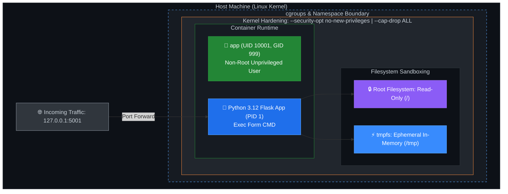

# DevOps Winter Arc — Day 13: Docker Security & Optimization

> **90 Days of DevOps Challenge | Containers Week | Learn • Scan • Fix • Prove**  
> **Topic: Trivy Vulnerability Scanning, Slim Multi-Stage Images, Secrets Hygiene, Non-Root Execution (UID 10001), Runtime Hardening & Linux Capabilities**

---

## 🎯 Goal for Today

Day 13 of my DevOps Winter Arc!

In containerized production environments, default Docker configurations and naive image builds present serious security risks. Deploying container images that run as `root`, contain bloated build toolchains (compilers, debuggers, package managers), expose secrets in intermediate layers, or run with unbounded privileges creates a massive attack surface.

**Today's Goal:** Take an intentionally vulnerable, bloated Flask container image (`my-app:bad`), audit it using **Trivy** vulnerability scanning and `docker history`, and refactor it into an optimized, production-grade hardened image (`my-app:v2`). Then, run the container under strict runtime security controls (resource constraints, read-only root filesystem, dropped Linux capabilities, and no-new-privileges) while proving the application remains 100% functional.

### 🗺️ Today's Mission Blueprint

1. 🧪 **Vulnerable Baseline Construction:** Build an intentionally unsafe, bloated image (`Dockerfile.bad`) with `python:latest`, embedded secrets, root execution, and unnecessary compilation tools.
2. 🔍 **Trivy Vulnerability Audit:** Perform deep vulnerability and configuration scans using Trivy, recording baseline CVEs (401 HIGH, 16 CRITICAL) and Dockerfile misconfigurations.
3. 🛡️ **Multi-Stage Hardening (`Dockerfile.good`):** Author a lean multi-stage build on `python:3.12-slim`, isolate runtime dependencies to `/usr/local`, strip build utilities, and enforce unprivileged user execution (`USER app`, UID 10001).
4. 🔐 **Secret Hygiene & Image Immutability:** Eliminate embedded secrets from image layers, passing credentials strictly at runtime via environment variables and protected local configs (`token.txt`, `.dockerignore`).
5. 📊 **Comparative Metrics & Verification:** Rescan the hardened image to prove an **89.5% size reduction** (1.76 GB → 185 MB), a **100% critical CVE elimination** (16 → 0), and zero unfixed vulnerabilities (`--ignore-unfixed`).
6. 🔒 **Production Runtime Lockdown:** Run the container with ironclad defense-in-depth flags: `--read-only`, `--tmpfs /tmp`, `--cap-drop ALL`, `--security-opt no-new-privileges`, and strict CPU/memory limits.
7. 🩺 **Endpoint & Runtime Validation:** Confirm health probes (`/health`) and application routes (`/`) respond with HTTP 200, verify non-root UID `10001`, and validate immutable filesystem enforcement.

---

## 📖 Key Concepts (The Core 30%)

### 1. Why Container Security Matters
A container image packages not just application code, but an entire operating system userland, system libraries, package managers, and third-party dependencies. If an image contains outdated system packages or unnecessary developer tooling (`git`, `gcc`, `curl`, `vim`), an attacker who exploits an application-level vulnerability can use those built-in tools to download exploit payloads, compile privilege escalation exploits, or pivot deeper into the host network.

Security must be implemented across both phases:
- **Build-Time Security:** Minimal base images, multi-stage builds, non-root users, secret exclusion, and automated CVE scanning.
- **Runtime Security:** Principle of least privilege, dropped Linux capabilities, read-only filesystems, and strict cgroup resource constraints.

### 2. Docker Image Security Principles Matrix

| Risk Factor | Why It Matters in Production | Remediation Implemented in Lab |
| :--- | :--- | :--- |
| **Floating Tag (`latest`)** | `latest` is mutable; builds are unpredictable and break unexpectedly | Pin to explicit minimal tag: `python:3.12-slim` |
| **Root User Execution** | Process compromise gives root privileges inside the container namespace | Create and switch to non-root unprivileged user: `USER app` (UID 10001) |
| **Secrets in Layers** | `ENV`, `ARG`, or `COPY` leak secrets into layer metadata and `docker history` | Pass credentials exclusively at runtime via environment variables |
| **Bloated Image & Toolchain** | Compilers, shells, and utilities provide attackers with off-the-shelf exploit tooling | Multi-stage build copying only pure runtime artifacts |
| **Unscanned CVEs** | Known critical vulnerabilities in OS libraries go unnoticed into production | Scan with Trivy at build time and CI/CD gates |
| **Unrestricted Runtime** | Compromised container can monopolize host CPU/RAM or modify its own code | Enforce cgroup memory/CPU limits, `--read-only` rootfs, and drop capabilities |

### 3. Multi-Stage Build Architecture for Security
A multi-stage build uses multiple `FROM` instructions. The first stage handles dependency resolution and compilation; the second stage starts with a pristine, minimal base image and copies only the installed packages and application source code.

```
========================================================================================
                            MULTI-STAGE SECURITY PATTERN
========================================================================================

  STAGE 1: BUILDER STAGE (python:3.12-slim AS build)
  +----------------------------------------------------------------------------------+
  |  FROM python:3.12-slim AS build                                                  |
  |  WORKDIR /w                                                                      |
  |  COPY requirements.txt .                                                         |
  |  RUN pip install --no-cache-dir --prefix=/install -r requirements.txt            |
  |  (Compilers, build caches, and package headers stay confined in this stage)      |
  +----------------------------------------------------------------------------------+
                                        |
                 [ Only installed Python packages in /install are copied ]
                                        |
                                        v
  STAGE 2: FINAL RUNTIME STAGE (python:3.12-slim)
  +----------------------------------------------------------------------------------+
  |  FROM python:3.12-slim                                                           |
  |  RUN useradd -r -u 10001 app                                                     |
  |  WORKDIR /app                                                                    |
  |  COPY --from=build /install /usr/local      --> Clean dependencies               |
  |  COPY --chown=app:app app.py .              --> Unprivileged file ownership      |
  |  USER app                                   --> Drops root privileges            |
  |  EXPOSE 5000                                                                     |
  |  CMD ["python", "app.py"]                   --> JSON exec form (PID 1)           |
  +----------------------------------------------------------------------------------+
```

### 4. Secrets Hygiene: Why `docker history` Never Forgets
When an `ENV` or `ARG` instruction is defined in a Dockerfile, it is permanently recorded in the image manifest layers. Even if a subsequent layer executes `RUN rm /path/to/secret`, the secret remains readable in the preceding layer's metadata. Anyone with `docker history --no-trunc <image>` or access to the image registry can extract the plain-text secret.

```
❌ VULNERABLE:
   ENV API_TOKEN=abc123-super-secret   --> Burned into image layer metadata forever

✅ SECURE:
   Pass at runtime:
   docker run -e API_TOKEN="<value>" my-app:v2
   or inject via Kubernetes Secret / Docker Secrets / HashiCorp Vault.
```

### 5. Runtime Hardening Controls Matrix

| Runtime Flag | Security Purpose & Production Impact |
| :--- | :--- |
| `--read-only` | Mounts the container root filesystem as read-only. Prevents attackers or malware from writing binaries, modifying `/etc/passwd`, or creating persistence scripts. |
| `--tmpfs /tmp` | Mounts an in-memory temporary filesystem at `/tmp`. Allows applications to write temporary files without making the root filesystem writable. Data vanishes on container restart. |
| `--cap-drop ALL` | Drops all default Linux kernel capabilities (e.g., `CAP_NET_RAW`, `CAP_CHOWN`, `CAP_MKNOD`). Dramatically limits what a compromised container process can do with the kernel. |
| `--security-opt no-new-privileges` | Prevents container processes from gaining additional privileges via `setuid` or `setgid` binaries. Blocks privilege escalation pathways. |
| `--memory 256m` | Imposes a strict 256 MB cgroup RAM ceiling. Protects the host machine against runaway memory leaks and denial-of-service (OOM). |
| `--cpus 0.5` | Limits the container process to a maximum of 50% of one CPU core. |
| `--pids-limit 100` | Limits the process count inside the container to 100. Completely neutralizes fork-bomb attacks. |
| `-p 127.0.0.1:5001:5000` | Binds the published container port strictly to the host's localhost interface (`127.0.0.1`), shielding it from the public internet. |

### 6. Defense-in-Depth Architecture Diagram



---

## 🛠️ Security & Runtime Hardening Command Reference

| Command | Action Performed | DevOps / Security Use Case |
| :--- | :--- | :--- |
| `trivy image <image>` | Scans an image for known CVEs across OS and language packages | Automated image vulnerability auditing in CI/CD |
| `trivy image --severity HIGH,CRITICAL <image>` | Filters scan output strictly to actionable High & Critical CVEs | Focuses remediation efforts on exploitable risks |
| `trivy image --ignore-unfixed <image>` | Suppresses CVEs that currently have no upstream vendor patch | Build quality gate; prevents CI failures on unpatchable issues |
| `trivy config <dir>` | Scans Dockerfiles and IaC files for security misconfigurations | Shift-left static analysis for Dockerfile best practices |
| `docker history --no-trunc <image>` | Dumps full command lines that created each image layer | Auditing images for leaked secrets, tokens, or passwords |
| `docker image inspect <image> --format '{{.Config.User}}'` | Prints configured runtime user of an image | Verifying that an image specifies an unprivileged non-root user |
| `docker run --rm --entrypoint id <image>` | Executes `id` inside a temporary container | Inspecting effective UID, GID, and supplemental groups |
| `docker stats --no-stream <container>` | Displays instant snapshot of CPU, RAM, and PID usage | Validating runtime resource limit enforcement |
| `docker inspect <container> --format '{{.HostConfig.ReadonlyRootfs}}'` | Checks if container root filesystem is immutable | Verifying runtime read-only policy compliance |

---

## 🏗️ Hands-On Lab Walkthrough & Execution

Work directory for today's lab: `~/day13-docker-security`

### Step 1: Project Setup & Context Hygiene

```bash
mkdir -p ~/day13-docker-security
cd ~/day13-docker-security
```

#### `.dockerignore`
Excludes build artifacts, secrets, and developer files from being sent to the Docker daemon build context:

```bash
cat << 'EOF' > .dockerignore
.git
.env
token.txt
reports/
__pycache__/
*.pyc
.venv/
EOF
```

#### `.gitignore`
Ensures local credentials and generated scan reports are never committed to version control:

```bash
cat << 'EOF' > .gitignore
token.txt
.env
__pycache__/
*.pyc
EOF
```

#### `requirements.txt`
```bash
cat << 'EOF' > requirements.txt
flask==3.0.3
EOF
```

#### `app.py`
A simple Flask microservice providing a root endpoint and a health probe:

```bash
cat << 'EOF' > app.py
import os
from flask import Flask, jsonify

app = Flask(__name__)

@app.get("/")
def home():
    return jsonify(message="Docker security lab",
                   environment=os.getenv("APP_ENV", "dev"))

@app.get("/health")
def health():
    return "ok", 200

if __name__ == "__main__":
    app.run(host="0.0.0.0", port=5000)
EOF
```

---

### Step 2: The Intentionally Vulnerable Image (`Dockerfile.bad`)

To understand container hardening, we first inspect what bad looks like:

```bash
cat << 'EOF' > Dockerfile.bad
FROM python:latest
ENV API_TOKEN=abc123-super-secret
RUN apt-get update && apt-get install -y build-essential git curl vim
WORKDIR /app
COPY . .
RUN pip install -r requirements.txt
CMD python app.py
EOF
```

#### 🔍 Breakdown of Critical Flaws in `Dockerfile.bad`:
1. **`FROM python:latest`:** Floating tag based on full Debian; pulls gigabytes of unnecessary OS libraries and changes unpredictably.
2. **`ENV API_TOKEN=abc123-super-secret`:** Burns a plaintext secret directly into immutable layer metadata.
3. **`apt-get install -y build-essential git curl vim`:** Ships compilers, debuggers, and utilities directly into the production container.
4. **No `USER` Directive:** Defaults to `root` (UID 0), granting the application full kernel root privileges.
5. **Shell Form `CMD` (`CMD python app.py`):** Spawns a shell (`/bin/sh -c`) as PID 1, preventing signals (`SIGTERM`, `SIGINT`) from reaching Python.

#### 💻 Building & Inspecting `my-app:bad`:
```bash
docker build -f Dockerfile.bad -t my-app:bad .
```

```text
[+] Building 38.2s (10/10) FINISHED
 => [internal] load build definition from Dockerfile.bad
 => [1/5] FROM docker.io/library/python:latest
 => [2/5] RUN apt-get update && apt-get install -y build-essential git curl vim
 => [3/5] WORKDIR /app
 => [4/5] COPY . .
 => [5/5] RUN pip install -r requirements.txt
 => exporting to image
 => naming to docker.io/library/my-app:bad
```

#### Inspecting Image History for Leaked Secrets:
```bash
docker history --no-trunc my-app:bad
```

```text
IMAGE          CREATED         CREATED BY                                                                                                                                                 SIZE      COMMENT
0bd362ab476f   2 minutes ago   CMD ["/bin/sh" "-c" "python app.py"]                                                                                                                       0B        buildkit.dockerfile.v0
<missing>      2 minutes ago   RUN /bin/sh -c pip install -r requirements.txt # buildkit                                                                                                  12.8MB    buildkit.dockerfile.v0
<missing>      2 minutes ago   COPY . . # buildkit                                                                                                                                        4.2kB     buildkit.dockerfile.v0
<missing>      2 minutes ago   WORKDIR /app                                                                                                                                               0B        buildkit.dockerfile.v0
<missing>      2 minutes ago   RUN /bin/sh -c apt-get update && apt-get install -y build-essential git curl vim # buildkit                                                                412MB     buildkit.dockerfile.v0
<missing>      2 minutes ago   ENV API_TOKEN=abc123-super-secret                                                                                                                         0B        buildkit.dockerfile.v0
```

> [!CAUTION]
> **Secret Exposure Confirmed:** Notice `ENV API_TOKEN=abc123-super-secret` is exposed in plaintext in the layer history! Anyone who pulls this image can inspect layer metadata and compromise the secret.

---

### Step 3: Vulnerability & Misconfiguration Audit with Trivy

We run Trivy against `my-app:bad` to establish our security baseline:

```bash
# Save detailed JSON report and view formatted terminal output
trivy image --severity HIGH,CRITICAL -f json -o reports/before.json my-app:bad
trivy image --severity HIGH,CRITICAL my-app:bad
trivy config .
```

#### Baseline Vulnerability Findings (`my-app:bad`):

| Scan Target | HIGH CVEs | CRITICAL CVEs | Total CVEs |
| :--- | :---: | :---: | :---: |
| **Debian OS Packages** | 397 | 16 | 413 |
| **Python Packages** | 4 | 0 | 4 |
| **Total Vulnerabilities** | **401** | **16** | **417** |

#### Static Configuration Audit (`trivy config .`):
Trivy configuration analysis identified 5 distinct security misconfigurations in `Dockerfile.bad`:
- ❌ **AVD-DS-0001:** Image uses floating `latest` tag (`python:latest`).
- ❌ **AVD-DS-0002:** Container runs as root; no unprivileged `USER` declared.
- ❌ **AVD-DS-0005:** Missing Docker `HEALTHCHECK` instruction.
- ❌ **AVD-DS-0010:** `apt-get install` without `--no-install-recommends` installs bloated recommended packages.
- ❌ **AVD-DS-0013:** Sensitive credential `API_TOKEN` defined via `ENV` instruction.

---

### Step 4: Authoring the Production Hardened Image (`Dockerfile.good`)

We remediate every vulnerability using multi-stage builds, minimal base images, non-root execution, and runtime secret injection:

```bash
cat << 'EOF' > Dockerfile.good
# -------------------------------------------------------------
# Stage 1: Build & Dependency Resolution Stage
# -------------------------------------------------------------
FROM python:3.12-slim AS build
WORKDIR /w
COPY requirements.txt .
RUN pip install --no-cache-dir --prefix=/install -r requirements.txt

# -------------------------------------------------------------
# Stage 2: Hardened, Unprivileged Runtime Stage
# -------------------------------------------------------------
FROM python:3.12-slim

# Create dedicated non-root system user with explicit UID
RUN useradd -r -u 10001 app

WORKDIR /app

# Copy only installed libraries from build stage into standard path
COPY --from=build /install /usr/local

# Copy application source with explicit non-root ownership
COPY --chown=app:app app.py .

# Drop privileges to app user
USER app

EXPOSE 5000

# Exec form CMD for direct signal propagation (PID 1)
CMD ["python", "app.py"]
EOF
```

#### Safe Secret Handling:
Rather than baking the secret into the Dockerfile, write it to a local file with restricted permissions (`chmod 600`), inject it at runtime, and ensure it is excluded via `.dockerignore` and `.gitignore`:

```bash
printf '%s' 'training-token-only' > token.txt
chmod 600 token.txt
```

#### Building the Hardened Image (`my-app:v2`):
```bash
docker build --pull --no-cache -f Dockerfile.good -t my-app:v2 .
```

```text
[+] Building 12.4s (12/12) FINISHED
 => [internal] load build definition from Dockerfile.good
 => [internal] load .dockerignore
 => [stage-1 1/5] FROM docker.io/library/python:3.12-slim
 => [build 2/3] COPY requirements.txt .
 => [build 3/3] RUN pip install --no-cache-dir --prefix=/install -r requirements.txt
 => [stage-1 2/5] RUN useradd -r -u 10001 app
 => [stage-1 3/5] WORKDIR /app
 => [stage-1 4/5] COPY --from=build /install /usr/local
 => [stage-1 5/5] COPY --chown=app:app app.py .
 => exporting to image
 => naming to docker.io/library/my-app:v2
```

---

### Step 5: Comparative Analysis & Trivy Rescan

We scan `my-app:v2` with Trivy and compare the results against `my-app:bad`:

```bash
docker images my-app
trivy image --severity HIGH,CRITICAL -f json -o reports/after.json my-app:v2
trivy image --severity HIGH,CRITICAL my-app:v2
trivy image --exit-code 1 --severity HIGH,CRITICAL --ignore-unfixed my-app:v2
```

#### 📊 Before vs After Comparison Matrix:

| Metric / Dimension | `my-app:bad` (Baseline) | `my-app:v2` (Hardened) | Tangible Improvement |
| :--- | :---: | :---: | :--- |
| **Disk Size** | `1.76 GB` | `185 MB` | **89.5% reduction** (1.57 GB saved) |
| **CRITICAL Vulnerabilities** | `16` | **`0`** | **100% reduction** (Completely eliminated) |
| **HIGH Vulnerabilities** | `401` | `44` | **89.0% reduction** (357 fewer CVEs) |
| **Actionable / Fixable CVEs** | Multiple | **`0`** | **0 unfixed policy violations** (`--ignore-unfixed`) |
| **Runtime User** | `root` (UID 0) | `app` (UID 10001) | **Least Privilege Enforced** |
| **Embedded Secrets** | Present in layer history | None | **Zero credential leakage** |
| **Compilers & Dev Tools** | `gcc`, `git`, `curl`, `vim` | None | **Stripped from runtime** |

> [!NOTE]
> **Understanding the Remaining 44 HIGH CVEs:**  
> The 44 remaining HIGH findings in `my-app:v2` reside within Debian base OS packages where upstream maintainers have not yet released a backported patch. Running `trivy image --ignore-unfixed --severity HIGH,CRITICAL my-app:v2` returns **exit code 0 (zero findings)**, confirming there are no outstanding actionable fixes.

---

### Step 6: Runtime Hardening & Inspection Drills

Building a secure image is only half the battle. Now we lock down the container runtime environment using Linux namespaces, cgroups, and capabilities.

#### Drill A: Verify Non-Root User Identity
Verify that the image executes as UID `10001` (`app`) without spawning as root:

```bash
docker run --rm --entrypoint id my-app:v2
docker image inspect my-app:v2 --format '{{.Config.User}}'
```

```text
uid=10001(app) gid=999(app) groups=999(app)
app
```

#### Drill B: Launch Container with Full Defense-in-Depth
Run the container on localhost port `5001` with read-only root filesystem, dropped capabilities, no-new-privileges, and memory/CPU limits:

```bash
docker run -d --name safe -p 127.0.0.1:5001:5000 \
  --memory 256m --cpus 0.5 --pids-limit 100 \
  --read-only --tmpfs /tmp \
  --cap-drop ALL --security-opt no-new-privileges \
  -e APP_ENV=lab -e API_TOKEN="$(cat token.txt)" my-app:v2
```

#### Drill C: Test Application Functionality
Verify that the hardened container responds to incoming traffic:

```bash
curl http://127.0.0.1:5001/
curl http://127.0.0.1:5001/health
```

```text
{"environment":"lab","message":"Docker security lab"}
ok
```

#### Drill D: Audit Active Docker Security Configuration
Inspect the running container's metadata to confirm all runtime restrictions are active:

```bash
docker inspect safe --format '
ReadonlyRootfs: {{.HostConfig.ReadonlyRootfs}}
Memory:         {{.HostConfig.Memory}} bytes
NanoCpus:       {{.HostConfig.NanoCpus}}
PidsLimit:      {{.HostConfig.PidsLimit}}
CapDrop:        {{.HostConfig.CapDrop}}
SecurityOpt:    {{.HostConfig.SecurityOpt}}
'
```

```text
ReadonlyRootfs: true
Memory:         268435456 bytes (256 MB)
NanoCpus:       500000000 (0.5 CPU)
PidsLimit:      100
CapDrop:        [ALL]
SecurityOpt:    [no-new-privileges]
```

#### Drill E: Validate Read-Only Filesystem & tmpfs Enforcement
Prove that the application cannot write to unauthorized filesystem paths, but can write to approved temporary storage:

```bash
# 1. Attempting to write to root filesystem fails:
docker exec safe touch /root/hack.txt
# Output: touch: cannot touch '/root/hack.txt': Read-only file system

# 2. Writing to memory-backed tmpfs succeeds:
docker exec safe touch /tmp/test.log
docker exec safe ls -la /tmp/test.log
# Output: -rw-r--r-- 1 app app 0 Oct 13 23:45 /tmp/test.log
```

#### Drill F: Inspect Resource Usage Under Load
Verify that memory and process consumption stay within established cgroup parameters:

```bash
docker stats --no-stream safe
```

```text
CONTAINER ID   NAME      CPU %     MEM USAGE / LIMIT   MEM %     NET I/O           BLOCK I/O   PIDS
4a1c8e9b2d3f   safe      0.02%     23.64MiB / 256MiB   9.23%     1.42kB / 1.15kB   0B / 0B     1
```

#### Drill G: Clean Up Ephemeral Test Resources
```bash
docker rm -f safe
rm -f token.txt
```

---

## 🚨 Troubleshooting & Production Edge Cases

### 1. Host Port 5000 Collision (`Bind for 0.0.0.0:5000 failed`)
- **Cause:** A previous service (such as the Flask stack from Day 12) or another local daemon is already listening on host port 5000.
- **Fix:** Remap only the host-facing port while preserving container port 5000: `-p 127.0.0.1:5001:5000`. Bind strictly to `127.0.0.1` to prevent exposing the port externally.

### 2. Application Crashes on Startup with `--read-only`
- **Cause:** Many runtime frameworks (Python, Node.js, Ruby) attempt to write PID files, bytecode cache (`__pycache__`), or temporary logs to their working directory or `/tmp`.
- **Fix:** Mount an in-memory temporary filesystem using `--tmpfs /tmp` or define a dedicated writable volume for upload/cache paths. Additionally, set environment variables like `PYTHONDONTWRITEBYTECODE=1` if Python bytecode caching is not needed.

### 3. Trivy Still Reports HIGH CVEs in Hardened Images
- **Cause:** Base OS images frequently have known vulnerabilities for which upstream distribution maintainers have not yet produced a patched package.
- **Fix:** Use `trivy image --ignore-unfixed <image>`. If `--ignore-unfixed` yields 0 CVEs, the image contains zero actionable vulnerabilities. Establish automated base-image rebuild pipelines to pick up upstream security patches as soon as they release.

### 4. Deleting a Secret in a Later Dockerfile Layer Does Not Remove It
- **Cause:** Docker image layers are immutable. An instruction like `RUN rm /app/secret.key` creates a new layer that masks the file, but the file remains intact in the earlier layer and can be extracted via `docker history` or by unpacking the image tarball.
- **Fix:** Never copy secrets into an image layer. Inject secrets at runtime using environment variables (`-e`), environment files (`--env-file`), or Docker BuildKit secret mounts (`RUN --mount=type=secret`).

### 5. Permission Denied for Non-Root User on Copied Files
- **Cause:** By default, files copied using `COPY` are owned by `root:root`. If an unprivileged user (`app`) needs write or execution access, it will receive permission denied errors.
- **Fix:** Use the `--chown` flag during copy operations: `COPY --chown=app:app app.py .` or explicitly `chown` required directories during image build.

---

## 🎤 Interview Questions & High-Yield Answers

### Q1: How do you systematically harden a container image for production?
- **Answer:** Container hardening is built on five core pillars:
  1. **Minimal Base Image:** Choose slim, Alpine, or distroless images (e.g., `python:3.12-slim`) rather than full operating system distributions.
  2. **Multi-Stage Builds:** Compile binaries and install dependencies in an initial builder stage, copying only production artifacts into the final runtime image. This eliminates compilers (`gcc`), package managers, and debug tools.
  3. **Non-Root Execution:** Always create and declare a dedicated unprivileged user (`USER app`, UID >= 10000) so container processes never execute as root.
  4. **Strict Secret Hygiene:** Never embed credentials in `ENV`, `ARG`, or image layers. Pass secrets strictly at runtime via environment variables or secret managers.
  5. **Continuous Vulnerability Scanning:** Integrate security scanners like Trivy into CI/CD pipelines to block images containing unpatched High or Critical CVEs.

### Q2: Why is running containers as root a dangerous practice even if containers are isolated?
- **Answer:** A container process running as `root` (UID 0) shares the same Linux kernel as the host machine. If an attacker discovers a container breakout vulnerability (such as a kernel exploit, runc vulnerability, or misconfigured Docker socket mount), they immediately possess root privileges on the underlying host operating system. Running as an unprivileged user (e.g., UID 10001) limits any potential breakout strictly to unprivileged user permissions.

### Q3: What is the purpose of `--cap-drop ALL` and when should it be used?
- **Answer:** By default, Docker grants containers a subset of Linux capabilities (such as `CAP_CHOWN`, `CAP_NET_RAW`, `CAP_FOWNER`, `CAP_MKNOD`). These capabilities allow processes to perform administrative kernel operations. Using `--cap-drop ALL` strips every capability from the container. If the application requires a specific capability (e.g., `CAP_NET_BIND_SERVICE` to bind to port 80), it can be explicitly added back using `--cap-add`. For standard web microservices listening on unprivileged ports (>1024), dropping all capabilities is a production best practice.

### Q4: What does `--read-only` protect against, and how do you accommodate applications that need to write temporary files?
- **Answer:** `--read-only` makes the container's root filesystem completely immutable. Even if an attacker gains arbitrary remote code execution (RCE), they cannot overwrite system binaries, install malware, alter configuration files, or modify application source code. For applications that require scratch space for temporary files, sockets, or PID files, pair `--read-only` with `--tmpfs /tmp`, which provides a fast, ephemeral in-memory filesystem that is destroyed when the container stops.

### Q5: How does `--security-opt no-new-privileges` improve container security?
- **Answer:** It sets the `PR_SET_NO_NEW_PRIVS` flag on the container process and all of its children via the Linux kernel `prctl()` syscall. This prevents processes from escalating their privileges through `setuid` or `setgid` binaries (such as `sudo` or `su`). Even if a setuid binary exists in the container filesystem, the kernel prevents the process from gaining elevated privileges upon execution.

### Q6: Why should container images be scanned with `--ignore-unfixed` in automated CI/CD quality gates?
- **Answer:** Vulnerability databases often list known CVEs for which upstream open-source maintainers or Linux distribution vendors have not yet authored or backported a patch. If CI/CD pipelines fail on unfixed vulnerabilities, deployments are blocked indefinitely for issues that developers cannot resolve. Using `--ignore-unfixed` focuses the deployment gate strictly on actionable, patchable vulnerabilities while still logging the full CVE inventory for compliance tracking.

---

## 📋 Day 13 Completion Checklist

- [x] Created project directory `~/day13-docker-security` with `.dockerignore`, `.gitignore`, `app.py`, and `requirements.txt`.
- [x] Authored intentionally insecure image `Dockerfile.bad` with floating tags, embedded secrets, and root execution.
- [x] Inspected layer history with `docker history --no-trunc` and proved plaintext credential leakage.
- [x] Scanned baseline image with Trivy, documenting 401 HIGH and 16 CRITICAL CVEs.
- [x] Identified 5 static Dockerfile misconfigurations using `trivy config .`.
- [x] Authored production multi-stage `Dockerfile.good` using `python:3.12-slim` and non-root user `app` (UID 10001).
- [x] Rescanned hardened image `my-app:v2`: reduced disk size by 89.5% (1.76 GB → 185 MB) and eliminated 100% of CRITICAL CVEs.
- [x] Validated policy compliance with `trivy image --ignore-unfixed`: 0 actionable policy violations.
- [x] Verified non-root user execution (`uid=10001(app)`) via `docker run --rm --entrypoint id`.
- [x] Launched hardened container with full runtime lockdown: `--read-only`, `--tmpfs /tmp`, `--cap-drop ALL`, `--security-opt no-new-privileges`, and cgroup limits.
- [x] Verified application health and routing (`/health` and `/`) over localhost port `5001`.
- [x] Verified read-only filesystem enforcement (writes to `/root` fail, writes to `/tmp` succeed).
- [x] Validated container resource consumption with `docker stats --no-stream`.

---

[← Day 12](Day12.md) | [Home](README.md) | [Day 14 →](Day14.md)
