# DevOps Winter Arc — Day 14: Docker in CI/CD

> **90 Days of DevOps Challenge | Week 2: Docker | Build • Test • Scan • Publish • Deploy**  
> **Topic: GitHub Actions pipelines, Docker Hub publishing, immutable SHA tags, Trivy vulnerability gates, and rollback strategies**

---

## 🎯 Goal for Today

Today I wired up a full CI/CD pipeline for a containerized Flask app using GitHub Actions. Every push to `main` automatically lints the Dockerfile, builds the image, smoke-tests the `/health` endpoint, scans for HIGH/CRITICAL vulnerabilities with Trivy, and publishes the image to Docker Hub tagged with the exact Git commit SHA. Pull requests run the same checks but never get registry credentials. If anything fails, publishing is blocked. I also documented how to roll back to a previous known-good image by its SHA tag.

---

## 🗺️ Pipeline Diagram

```mermaid
flowchart TD
    A["Developer pushes to main"] --> B["Hadolint lints Dockerfile"]
    B --> C["Buildx builds image"]
    C --> D["Smoke test: curl /health"]
    D --> E["Trivy scan: HIGH/CRITICAL gate"]
    E -->|Pass| F["Login to Docker Hub"]
    F --> G["Push image tagged with commit SHA"]
    E -->|Fail| X["❌ Pipeline stops — image NOT published"]
    D -->|Fail| X
    B -->|Fail| X
```



---

## 📖 Key Concepts

### Immutable SHA tags

Every image I publish is tagged with the full Git commit SHA, not `latest`. A SHA tag is immutable — it points to one specific build from one specific commit. This means I can always trace a running container back to the exact source code, and rollback is just pulling an older SHA. The `latest` tag is a moving target and tells you nothing about which version you are actually running.

### Pipeline gates

A pipeline gate is a step that blocks everything after it when it fails. In my workflow, the smoke test and the Trivy scan are both gates. If `/health` does not respond, the scan never runs. If Trivy finds HIGH or CRITICAL vulnerabilities, publishing never happens. This prevents known-bad images from reaching the registry.

### Why secrets are not committed

Registry tokens and SSH keys go into GitHub Secrets (`DOCKERHUB_USERNAME`, `DOCKERHUB_TOKEN`), never into source code, YAML files, or READMEs. If a secret leaks into a commit, it lives in Git history forever. Anyone who clones the repo gets it. Rotate immediately if this happens.

### CI vs Continuous Delivery vs Continuous Deployment

- **CI (Continuous Integration):** Automatically build and test every code change. My pipeline does this on every push and PR.
- **Continuous Delivery:** Every passing change is *ready* to be released, but a human approves the final deploy.
- **Continuous Deployment:** Every passing change is automatically deployed with no manual gate. This requires strong automated tests because there is no human safety net.

---

## 🛠️ How I Set It Up

### The Flask app

I created a small Flask 3.0.3 API with two endpoints: `/` returns a JSON message and `/health` returns `ok` with a 200 status. The app listens on `0.0.0.0:5000` and runs as a non-root user (`app`, UID 10001) inside a `python:3.12-slim` image.

```python
@app.get("/health")
def health():
    return "ok", 200
```

The Dockerfile pins the base image, installs dependencies with `--no-cache-dir`, copies only the app code, creates a non-root user, and uses exec-form `CMD` for proper signal handling.

```dockerfile
FROM python:3.12-slim
ENV PYTHONDONTWRITEBYTECODE=1 PYTHONUNBUFFERED=1
WORKDIR /app
COPY requirements.txt .
RUN pip install --no-cache-dir -r requirements.txt
COPY app.py .
RUN useradd --system --uid 10001 app
USER app
EXPOSE 5000
CMD ["python", "app.py"]
```

The `.dockerignore` keeps `.git`, `.github`, `.env`, `__pycache__/`, and `reports/` out of the build context.

### Local build and test

I built the image locally and ran a quick health check before touching CI:

```bash
docker build -t winter-arc-app:local .
docker run -d --name local-api -p 5001:5000 winter-arc-app:local
curl -f http://localhost:5001/health
```

```text
ok
```

I used port `5001` on the host because port `5000` was still occupied by a container from Day 12.

```bash
docker logs local-api
```

```text
 * Serving Flask app 'app'
 * Running on all addresses (0.0.0.0)
 * Running on http://127.0.0.1:5000
172.17.0.1 - - [23/Oct/2026 13:34:59] "GET /health HTTP/1.1" 200 -
```

```bash
docker rm -f local-api
```

### Docker Hub and GitHub Secrets

I created a repository named `winter-arc-app` on Docker Hub, generated an access token with Read & Write permissions, and added two secrets in GitHub under **Settings → Secrets and variables → Actions**:

- `DOCKERHUB_USERNAME` — my Docker Hub username
- `DOCKERHUB_TOKEN` — the access token (never the value, only the name appears in the workflow)

### The GitHub Actions workflow

The pipeline file lives at [`.github/workflows/docker-ci.yml`](https://github.com/Hrishav-798/Day-14/blob/main/.github/workflows/docker-ci.yml) in my [Day-14](https://github.com/Hrishav-798/Day-14) repository. Here is the full workflow:

```yaml
name: docker-ci

on:
  push:
    branches: [main]
  pull_request:

permissions:
  contents: read

env:
  IMAGE_NAME: hrishav798/winter-arc-app

jobs:
  build-test-scan:
    runs-on: ubuntu-latest
    steps:
      - name: Checkout
        uses: actions/checkout@v4

      - name: Lint Dockerfile
        uses: hadolint/hadolint-action@v3.1.0
        with:
          dockerfile: Dockerfile

      - name: Set up Buildx
        uses: docker/setup-buildx-action@v3

      - name: Build image for test and scan
        uses: docker/build-push-action@v6
        with:
          context: .
          load: true
          tags: ${{ env.IMAGE_NAME }}:${{ github.sha }}
          cache-from: type=gha
          cache-to: type=gha,mode=max

      - name: Smoke test
        run: |
          docker run -d --name api -p 5000:5000 $IMAGE_NAME:${{ github.sha }}
          for i in {1..10}; do
            if curl -fsS http://localhost:5000/health; then exit 0; fi
            sleep 2
          done
          docker logs api
          exit 1

      - name: Scan image with Trivy
        uses: aquasecurity/trivy-action@v0.36.0
        with:
          image-ref: ${{ env.IMAGE_NAME }}:${{ github.sha }}
          format: table
          severity: HIGH,CRITICAL
          ignore-unfixed: true
          exit-code: 1

      - name: Login to Docker Hub
        if: github.event_name == 'push' && github.ref == 'refs/heads/main'
        uses: docker/login-action@v3
        with:
          username: ${{ secrets.DOCKERHUB_USERNAME }}
          password: ${{ secrets.DOCKERHUB_TOKEN }}

      - name: Publish immutable SHA tag
        if: github.event_name == 'push' && github.ref == 'refs/heads/main'
        run: docker push $IMAGE_NAME:${{ github.sha }}
```

The Login and Publish steps only run on pushes to `main`. Pull requests run lint, build, smoke test, and Trivy scan but never receive registry credentials — untrusted code should not have access to secrets.

---

## 🚨 Problems I Hit and How I Fixed Them

### Port 5000 already allocated

A container from Day 12 was still holding host port 5000. I mapped the local test to `5001:5000` instead:

```bash
docker run -d --name local-api -p 5001:5000 winter-arc-app:local
```

### Leftover container blocked the name `local-api`

A previous failed run left a dead container with the same name. Docker refused to create a new one until I removed it:

```bash
docker rm -f local-api
```

### Trivy action version `0.28.0` could not be resolved

The `aquasecurity/trivy-action@0.28.0` tag does not exist — it needs a `v` prefix. Even after adding `v`, the pinned version `v0.28.0` depended on `setup-trivy@v0.2.1` which had been removed from GitHub. I upgraded to `v0.36.0` and the scan ran successfully:

```yaml
# ❌ Failed: tag not found, then dependency removed
uses: aquasecurity/trivy-action@0.28.0

# ✅ Fixed: upgraded to a current release
uses: aquasecurity/trivy-action@v0.36.0
```

### Image tag "invalid reference format" — empty username secret

The image tag came out as `/winter-arc-app:SHA` (note the leading slash with no username) because `DOCKERHUB_USERNAME` was empty. I had mistakenly typed the secret value in the "Name" field and left the "Secret" field blank in GitHub. After fixing the secret, I also hardcoded the non-sensitive image name (`hrishav798/winter-arc-app`) directly in the workflow `env:` block instead of relying on the secret for the name:

```yaml
env:
  IMAGE_NAME: hrishav798/winter-arc-app
```

### Docker Hub push denied — "access token has insufficient scopes"

The initial Docker Hub token was created as read-only. Pushing requires write access. I created a new token with **Read & Write** permission in Docker Hub and updated the `DOCKERHUB_TOKEN` secret in GitHub.

---

## 🔄 Rollback

Rollback means redeploying a previous known-good image by its immutable SHA tag. Before every release, I record the current running SHA so I can go back if the new version breaks.

```bash
# Find the previous known-good SHA from git log or release notes
git log --oneline -5

# Pull the known-good image
docker pull hrishav798/winter-arc-app:PREVIOUS_GOOD_SHA

# Stop and remove the current container
docker rm -f winter-app || true

# Deploy the known-good image
docker run -d --name winter-app -p 5000:5000 \
  --restart unless-stopped hrishav798/winter-arc-app:PREVIOUS_GOOD_SHA

# Verify health
curl -f http://localhost:5000/health
```

Because the SHA tag is immutable, pulling it always gives the exact same tested image. No guesswork, no "which version of latest is this?"

---

## 🎤 Interview Questions

### Why tag images with the Git commit SHA instead of `latest`?

The SHA creates a one-to-one link between the image and the exact source code that built it. I can pull any past release, compare it to the commit, and roll back reliably. `latest` is a moving tag — it overwrites itself and tells you nothing about what is actually running.

### Where should vulnerability scanning happen in a pipeline?

After the build and before publishing. If the scan is a gate with `exit-code: 1`, a failing policy stops the image from ever reaching the registry. Scanning after publishing is too late.

### Where do registry credentials belong?

In the CI platform's secret store (GitHub Secrets in my case). Never in source code, YAML, environment files, or screenshots. For AWS ECR, short-lived OIDC tokens are even better than long-lived credentials.

### What is the difference between continuous delivery and continuous deployment?

Delivery means every passing change is release-ready but a human approves the deploy. Deployment means every passing change goes live automatically. Deployment needs stronger automated testing because there is no manual gate.

### How do you speed up Docker builds in CI?

Order layers so dependencies come before source code (cache-friendly), use BuildKit cache with `cache-from`/`cache-to` in GitHub Actions, keep the build context small with `.dockerignore`, use multi-stage builds, and run independent jobs in parallel.

### Why should pull requests never receive registry credentials?

A PR could come from a fork with malicious code. If that code has access to secrets, it can exfiltrate them. Publishing should only happen from trusted branch events like pushes to `main`.

---

## 📸 Screenshots

<!-- Add screenshots here after running the pipeline -->
- **Successful workflow run:** *(screenshot of the GitHub Actions run with all steps green)*
- **Docker Hub SHA tag:** *(screenshot of Docker Hub showing the image tagged with the full commit SHA)*

---

## 💡 What I Learned

- **A CI/CD pipeline is a chain of gates.** Each step either passes and lets the next one run, or fails and stops everything. This is what keeps bad images out of the registry.
- **Immutable tags are non-negotiable for production.** Using `latest` in a pipeline defeats the entire purpose of traceability and rollback. The commit SHA is free and unique.
- **Debugging CI means debugging secrets, versions, and permissions one at a time.** My pipeline broke four separate times before it worked — wrong Trivy version, empty secret name, read-only token, and a stale container name. Each failure taught me more than the passing run did.
- **Pull requests and pushes should have different trust levels.** PRs run tests but never touch secrets or registries. Only trusted `main` pushes publish.
- **Rollback is just redeploying an older SHA.** No rebuilding, no re-testing. The image already passed the pipeline when it was first published.

---

[← Day 13](Day13.md) | [Home](README.md) | [Day 15 →](Day15.md)
