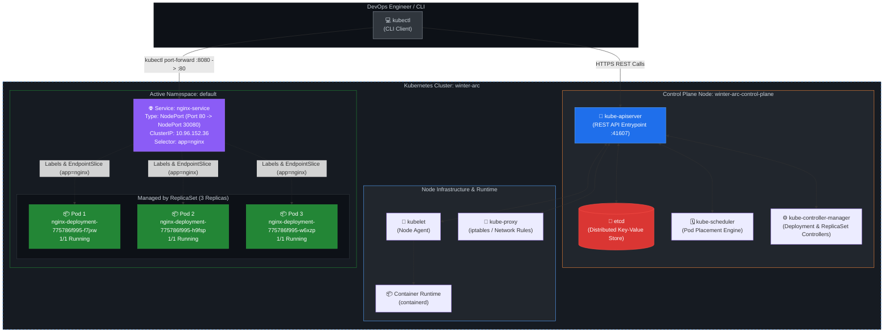

# DevOps Winter Arc — Day 15: Kubernetes Fundamentals

> **90 Days of DevOps Challenge | Week 3: Kubernetes | Learn • Practice • Deploy**  
> **Topic: Cluster Architecture, Control Plane & Worker Nodes, Pods, Deployments, ReplicaSets, Services (NodePort), Declarative YAML Manifests, and kubectl Operations**

---

## 🎯 Goal for Today

Day 15 marks the transition from single-host container management (Docker & Docker Compose) to **distributed multi-host container orchestration with Kubernetes**. While Docker is excellent for packaging and running individual containers on a single machine, running production workloads across clusters of servers requires automated scheduling, self-healing, horizontal scaling, load balancing, and rolling updates without downtime.

**Today's Goal:** Stand up a local Kubernetes cluster using **kind** (Kubernetes in Docker), explore cluster architecture and control-plane components, author declarative YAML manifests for a Deployment and a NodePort Service, deploy an Nginx workload, dynamically scale it from 2 to 3 replicas, and verify local network accessibility using `kubectl port-forward` and `curl`.

### 🗺️ Today's Mission Blueprint

1. ☸️ **Cluster Provisioning & Connectivity:** Provision a local Kubernetes v1.36.1 cluster named `winter-arc` with `kind`, verify context switching (`kind-winter-arc`), and check control-plane endpoints.
2. 🔬 **Cluster State & Node Inspection:** Inspect control-plane nodes and understand why an initial `kubectl get pods` query returns empty in the `default` namespace while system workloads run isolated in `kube-system`.
3. 📝 **Declarative Manifest Authoring:** Author production-standard YAML specifications for an Nginx workload (`deployment.yaml`) and an abstraction layer for network routing (`service.yaml`) in a dedicated project directory (`~/day15-kubernetes/`).
4. 🚀 **Workload Deployment:** Apply declarative manifests using `kubectl apply`, observing the Kubernetes reconciliation loop as it deploys a Deployment, creates an underlying ReplicaSet, and launches 2 healthy Pods.
5. 🌐 **Service Publishing & Discovery:** Create a `NodePort` Service mapping port 80 to target port 80 and node port 30080, connecting the stable Service abstraction to dynamic Pod IPs via label selectors.
6. 📈 **Dynamic Application Scaling:** Scale the Deployment imperatively from 2 to 3 replicas (`kubectl scale`), verifying that Kubernetes schedules the third Pod seamlessly without disrupting existing traffic.
7. 🔌 **Port Forwarding & Verification:** Establish an active local tunnel using `kubectl port-forward service/nginx-service 8080:80`, verify connection handling, and validate HTTP 200 delivery of the Nginx welcome page via `curl`.

---

## 🗺️ Kubernetes Architecture Diagram



---

## 📖 Key Concepts & Revision Notes

### 1. What is Kubernetes and Why is it Needed?
Docker allowed developers to package software into portable, lightweight containers. However, in production, applications run across dozens or hundreds of virtual or physical machines. Docker alone does not provide answers to essential operational questions:
- *What happens when a container crashes at 3:00 AM?*
- *What happens when a physical server loses power or network connectivity?*
- *How do you route web traffic evenly across 20 replicas without hardcoding IP addresses?*
- *How do you roll out a new version of an image without dropping active user connections?*

**Kubernetes (K8s)** is an open-source container orchestration platform originally designed by Google. It automates the deployment, scaling, networking, and lifecycle management of containerized applications across clusters of nodes.

### 2. Docker vs Kubernetes: Clarifying the Responsibility Boundary
A common beginner misconception is that Kubernetes replaces Docker. They operate at completely different layers of the infrastructure stack:

| Dimension | Docker / Container Runtime | Kubernetes (Orchestrator) |
| :--- | :--- | :--- |
| **Primary Scope** | Single host container management | Multi-node cluster orchestration |
| **Core Responsibility** | Builds images, runs individual containers, manages local storage/networks | Schedules workloads, manages replicas, provides service discovery & self-healing |
| **High Availability** | Manual restart or host-level systemd | Automated node-drain, reschedule, and cross-node reconciliation |
| **Relationship** | The engine that executes container processes on each node | The distributed brain directing which node runs which container |

Kubernetes does not build container images itself; it communicates with a compatible container runtime (such as `containerd` or CRI-O) via the **Container Runtime Interface (CRI)** on each cluster node.

---

### 3. Cluster Architecture: Control Plane & Worker Nodes

A Kubernetes cluster consists of two primary operational planes:

#### A. The Control Plane (The Brain)
The control plane makes global decisions about the cluster (e.g., scheduling workloads, detecting failures, maintaining desired replica counts):
1. **`kube-apiserver`:** The central REST communication hub. Every component (including `kubectl`, controllers, and worker nodes) communicates exclusively through the API server. It validates and configures data for Pods, Services, and Deployments.
2. **`etcd`:** A consistent, highly-available distributed key-value store. It holds the complete source of truth for all cluster state, object manifests, and metadata.
3. **`kube-scheduler`:** Watches for newly created Pods that have no assigned node. It evaluates resource requirements, node affinities, taints, and hardware limits to choose the optimal node for each Pod.
4. **`kube-controller-manager`:** Runs daemon controllers in a continuous loop. Examples include:
   - *DeploymentController & ReplicaSetController:* Ensures the number of running Pods matches `spec.replicas`.
   - *NodeController:* Detects when a node goes offline and evicts its workloads.

#### B. Worker Nodes (The Muscle)
Worker nodes run the actual application containers:
1. **`kubelet`:** An agent running on each node. It receives Pod specifications (`PodSpecs`) from the API server and instructs the container runtime to pull images, launch containers, and report container health back to the control plane.
2. **`kube-proxy`:** Maintains network rules on nodes (`iptables` or IPVS), enabling communication to Pods from internal or external network sessions.
3. **Container Runtime:** Software responsible for running containers (e.g., `containerd` inside kind nodes).

---

### 4. Core Kubernetes Objects

#### A. Pod vs Container
- A **Container** is an isolated Linux process running inside namespaces with cgroup restrictions.
- A **Pod** is the smallest deployable atomic unit in Kubernetes. A Pod encapsulates one or more closely coupled containers that share:
  - The same **Network namespace** (same IP address, same port space; containers inside a Pod communicate via `localhost`).
  - Shared **Storage volumes**.
  - Shared IPC and UTS namespaces.
In 95% of standard architectures, a Pod contains a single container. Multi-container Pods are reserved for sidecar patterns (e.g., a logging agent or service mesh proxy running alongside the main application).

#### B. Deployment vs ReplicaSet vs Pod
Kubernetes follows a hierarchical abstraction pattern for stateless workloads:

```
+-------------------------------------------------------------------+
| Deployment: nginx-deployment (Manages strategy, rollouts & versions) |
+-------------------------------------------------------------------+
                                  |
                                  v
+-------------------------------------------------------------------+
| ReplicaSet: nginx-deployment-775786f995 (Guarantees replica count)  |
+-------------------------------------------------------------------+
            |                                         |
            v                                         v
+-----------------------+                 +-----------------------+
| Pod: ...-f7jxw (1/1)  |                 | Pod: ...-h9fsp (1/1)  |
+-----------------------+                 +-----------------------+
```

1. **Pod:** Ephemeral, mortal process. If a Pod dies, Kubernetes will *not* recreate it unless an abstraction controller manages it.
2. **ReplicaSet:** Guarantees that a specified number of Pod replicas matching a label selector are running at any given time.
3. **Deployment:** High-level declarative controller. It manages ReplicaSets, enabling declarative rolling updates, instant rollbacks, pausing, and scaling without manual intervention.

#### C. Service vs Deployment
- A **Deployment** manages the compute processes (spawning, restarting, and updating Pods). Because Pods are mortal, their internal IP addresses change every time they are restarted or rescheduled.
- A **Service** is a durable, stable networking abstraction. It assigns a permanent virtual IP (`ClusterIP`) and DNS name (`nginx-service.default.svc.cluster.local`) that does not change when Pods die. It uses **label selectors** to dynamically route incoming traffic to healthy matching Pods via `EndpointSlices`.

---

### 5. Kubernetes Networking & Port Taxonomy

Understanding port terminology is one of the biggest hurdles in Kubernetes networking:

```
[ External User / Client ]
            |
            | Hits Node on: nodePort (30080)
            v
[ Kubernetes Node (Host) ]
            |
            | Routes to: Service port (80) via ClusterIP (10.96.152.36)
            v
[ Service: nginx-service ]
            |
            | Forwards traffic to: targetPort (80)
            v
[ Pod / Container: containerPort (80) ]
```

| Port Field | Location Defined | What It Represents | In Today's Lab |
| :--- | :--- | :--- | :---: |
| **`containerPort`** | `deployment.spec.template.spec.containers[*].ports` | The port the application process inside the container is listening on. Primarily informational. | `80` |
| **`targetPort`** | `service.spec.ports[*].targetPort` | The port on the Pod to which the Service directs traffic. Must match the application's actual listening port. | `80` |
| **`port`** | `service.spec.ports[*].port` | The internal port exposed by the Service inside the cluster. Other Pods reach the service on `ClusterIP:port`. | `80` |
| **`nodePort`** | `service.spec.ports[*].nodePort` | A dedicated port allocated on every cluster node across the range `30000–32767`. Traffic sent to `<NodeIP>:<NodePort>` routes to the Service. | `30080` |

#### Service Types Comparison:
- **`ClusterIP` (Default):** Exposes the Service on an internal cluster IP. Reachable only from within the cluster.
- **`NodePort`:** Exposes the Service on each Node's IP at a static port (`30000–32767`). Reachable externally by querying `<NodeIP>:<NodePort>`.
- **`LoadBalancer`:** Integrates with cloud provider APIs (AWS ELB, GCP Cloud Load Balancing) to provision an external hardware/cloud load balancer that forwards traffic to the Service.
- **`ExternalName`:** Maps the Service to a DNS name (CNAME record) without proxying.

#### Why NodePort Access via `localhost` Behaves Differently in kind
In a bare-metal or VM-based Kubernetes cluster, connecting to `http://localhost:<nodePort>` works if the node is running on your machine. However, **kind** runs entire Kubernetes nodes as Docker containers on the host. 
- The Kubernetes node has its own bridge IP inside Docker's network (not the host network).
- Unless extra port mappings (`extraPortMappings`) are declared in the kind cluster configuration YAML during creation, the host machine does not bind port `30080` directly to `localhost`.
- Therefore, **`kubectl port-forward`** is the standard, reliable debugging technique to forward traffic from host loopback (`127.0.0.1:8080`) directly into the cluster Service.

---

### 6. Declarative Configuration & The Reconciliation Loop

Kubernetes operates on a **declarative model** rather than an imperative one:
- **Imperative:** Telling the system *how* to do something step-by-step (`docker run`, `apt-get install`).
- **Declarative:** Stating *what* you want the final state to look like in a manifest (`spec.replicas: 3`), and letting Kubernetes figure out how to achieve it.

The core operational pattern of Kubernetes is the **Reconciliation Loop**:

$$\text{Current State} \xrightarrow{\text{Observe}} \text{Compare with Desired State} \xrightarrow{\text{Reconcile (Act)}} \text{Target Achieved}$$

When `kubectl apply -f deployment.yaml` is run:
1. The API server stores the desired manifest in `etcd`.
2. The `DeploymentController` detects a discrepancy: Desired = 2 replicas, Current = 0.
3. It creates a `ReplicaSet`.
4. The `ReplicaSetController` creates 2 Pod objects.
5. The `kube-scheduler` observes unscheduled Pods and assigns them to `winter-arc-control-plane`.
6. The `kubelet` on `winter-arc-control-plane` detects assigned Pods, calls `containerd` to pull `nginx:1.27`, and starts the containers.
7. Status updates propagate back to `etcd`, marking the Deployment as `2/2 Ready`.

---

## 🛠️ Kubernetes Command Reference

| Command | Action Performed | DevOps Production Use Case |
| :--- | :--- | :--- |
| `kind create cluster --name <name>` | Provisions a local K8s cluster running inside Docker | Local testing, CI pipeline sandboxes, and offline validation |
| `kubectl config current-context` | Displays the active cluster context in kubeconfig | Avoiding accidental execution against production clusters |
| `kubectl cluster-info` | Displays control plane and CoreDNS cluster endpoints | Initial connectivity verification and debugging |
| `kubectl get nodes` | Lists all cluster nodes, readiness status, roles, and K8s versions | Capacity planning and node health monitoring |
| `kubectl get pods` | Lists Pods in the current active namespace (`default`) | Application health and lifecycle status checking |
| `kubectl get pods -A` | Lists all Pods across every namespace in the cluster | Inspecting cluster-wide system infrastructure (`kube-system`) |
| `kubectl apply -f <file.yaml>` | Declaratively creates or updates cluster resources | Standard GitOps and CI/CD deployment execution |
| `kubectl get deployments` | Displays desired, current, up-to-date, and available replicas | Monitoring rollout progression and workload health |
| `kubectl get services` | Displays Services, assigned ClusterIPs, and exposed ports | Verifying networking abstractions and service discovery |
| `kubectl scale deployment <name> --replicas=N` | Imperatively updates the desired replica count | Rapid emergency scaling or test load validation |
| `kubectl port-forward service/<svc> <local>:<remote>` | Forwards a local host port to a cluster Service | Secure local testing without exposing public endpoints |
| `kubectl describe <resource>/<name>` | *(Reference)* Outputs deep metadata, conditions, and real-time event logs | Diagnosing failed Pods, image pull errors, or scheduling issues |
| `kubectl get endpointslices` | *(Reference)* Lists dynamic Pod IP mapping objects bound to a Service | Verifying whether a Service selector successfully matched Pods |
| `kubectl get events --sort-by=.metadata.creationTimestamp` | *(Reference)* Dumps chronological cluster event stream | Root-cause analysis during cluster or application anomalies |

### Deconstructing Output Headers:
- **`READY (e.g., 2/2, 1/1)`:** `<healthy containers> / <total defined containers in Pod>`. Indicates readiness probes have succeeded.
- **`UP-TO-DATE`:** Number of replicas that have been synchronized to the latest Pod specification.
- **`AVAILABLE`:** Number of replicas ready and serving traffic for at least the minReadySeconds threshold.
- **`STATUS (Running, Pending, CrashLoopBackOff)`:** Current high-level phase of the Pod lifecycle.
- **`RESTARTS`:** Number of times the container process has crashed and been restarted by the kubelet.
- **`CLUSTER-IP`:** Stable internal virtual IP assigned to the Service by Kubernetes.

---

## 🏗️ Hands-On Lab Walkthrough & Execution

All work for today's lab was conducted on Ubuntu Linux with local cluster management via `kind`.

### Step 1: Cluster Creation & Verification

The local cluster was initialized with `kind` using the cluster name `winter-arc`:

```bash
kind create cluster --name winter-arc
```

```text
Creating cluster "winter-arc" ...
 ✓ Ensuring node image (kindest/node:v1.36.1) 🖼
 ✓ Preparing nodes 📦  
 ✓ Writing configuration 📜 
 ✓ Starting control-plane 🕹️ 
 ✓ Installing CNI 🔌 
 ✓ Installing StorageClass 💾 
Set kubectl context to "kind-winter-arc"
You can now use your cluster with:

kubectl cluster-info --context kind-winter-arc

Have a question, bug, or feature request? Let us know! https://kind.sigs.k8s.io/#community 🙂
```

#### Verifying Context & Endpoints:
```bash
kubectl config current-context
kubectl cluster-info
```

```text
kind-winter-arc

Kubernetes control plane is running at https://127.0.0.1:41607
CoreDNS is running at https://127.0.0.1:41607/api/v1/namespaces/kube-system/services/kube-dns:dns/proxy

To further debug and diagnose cluster problems, use 'kubectl cluster-info dump'.
```

#### Checking Initial Pods & Node Status:
```bash
kubectl get pods
kubectl get nodes
```

```text
No resources found in default namespace.

NAME                       STATUS   ROLES           AGE     VERSION
winter-arc-control-plane   Ready    control-plane   4m29s   v1.36.1
```

> [!NOTE]
> **Why `kubectl get pods` Returned Empty:**  
> When `kubectl get pods` was executed, it returned `No resources found in default namespace.` This is expected behavior. The command only checks the current namespace (`default`), where no user applications had been deployed yet. The core Kubernetes services (API server, etcd, CoreDNS) were actively running inside the `kube-system` namespace. Running `kubectl get pods -A` would reveal these critical cluster Pods.
> 
> The node `winter-arc-control-plane` reported `STATUS: Ready` running Kubernetes version `v1.36.1`.

---

### Step 2: Practical Workspace & Declarative Manifests

A dedicated project directory was created outside the documentation repository:

```bash
mkdir -p ~/day15-kubernetes
cd ~/day15-kubernetes
```

Two declarative YAML manifests were authored inside `~/day15-kubernetes/`:

#### 1. `deployment.yaml`
```yaml
apiVersion: apps/v1
kind: Deployment
metadata:
  name: nginx-deployment
  labels:
    app: nginx
spec:
  replicas: 2
  selector:
    matchLabels:
      app: nginx
  template:
    metadata:
      labels:
        app: nginx
    spec:
      containers:
        - name: nginx
          image: nginx:1.27
          ports:
            - containerPort: 80
```

##### Deep Dive into `deployment.yaml` Fields:
- **`apiVersion: apps/v1`:** Specifies the API group (`apps`) and version (`v1`) that defines the `Deployment` schema.
- **`kind: Deployment`:** Identifies this resource as a Deployment controller.
- **`metadata.name: nginx-deployment`:** The unique identifier for this Deployment inside the namespace.
- **`spec.replicas: 2`:** Declares the desired state: Kubernetes must continuously maintain exactly 2 running Pods.
- **`spec.selector.matchLabels`:** The filter rule used by the Deployment controller to identify which Pods belong to it. Here, any Pod carrying the label `app: nginx` is managed by this Deployment.
- **`spec.template`:** The Pod blueprint. Whenever Kubernetes needs to create a new replica, it uses this template.
  - **`template.metadata.labels`:** The labels stamped onto every created Pod (`app: nginx`). **Must strictly match `matchLabels`**, otherwise the controller cannot recognize the Pods it creates.
  - **`spec.containers[*].name: nginx`:** Name assigned to the container inside the Pod.
  - **`spec.containers[*].image: nginx:1.27`:** The container image to pull and run. Pinned to explicit version `1.27` rather than floating tag `latest`.
  - **`containerPort: 80`:** Informs Kubernetes that the container listens on port 80.

---

#### 2. `service.yaml`
```yaml
apiVersion: v1
kind: Service
metadata:
  name: nginx-service
spec:
  type: NodePort
  selector:
    app: nginx
  ports:
    - port: 80
      targetPort: 80
      nodePort: 30080
```

##### Deep Dive into `service.yaml` Fields:
- **`apiVersion: v1`:** Core API group (no group prefix needed for foundational primitives like Pods, Services, and Namespaces).
- **`kind: Service`:** Identifies this resource as an internal network proxy and load balancer.
- **`spec.type: NodePort`:** Exposes the Service on each node's IP at a static port (`nodePort`), while also automatically creating a `ClusterIP`.
- **`spec.selector (app: nginx)`:** The routing rule. The Service controller queries all Pods with label `app: nginx` and registers their dynamic IP addresses into an `EndpointSlice`.
- **`port: 80`:** The internal cluster port exposed by the Service.
- **`targetPort: 80`:** The destination port on the target Pod container where traffic is delivered.
- **`nodePort: 30080`:** The static port allocated across all cluster nodes (within the valid range `30000–32767`).

---

### Step 3: Applying Manifests & Inspecting Initial Workload

The declarative configurations were submitted to the Kubernetes API server using `kubectl apply`:

```bash
kubectl apply -f deployment.yaml
kubectl apply -f service.yaml
```

```text
deployment.apps/nginx-deployment created
service/nginx-service created
```

#### Verifying Deployment, Pods, and Service:
```bash
kubectl get deployments
kubectl get pods
kubectl get services
```

```text
NAME               READY   UP-TO-DATE   AVAILABLE   AGE
nginx-deployment   2/2     2            2           45s

NAME                                READY   STATUS    RESTARTS   AGE
nginx-deployment-775786f995-f7jxw   1/1     Running   0          56s
nginx-deployment-775786f995-h9fsp   1/1     Running   0          56s

NAME            TYPE        CLUSTER-IP     EXTERNAL-IP   PORT(S)        AGE
kubernetes      ClusterIP   10.96.0.1      <none>        443/TCP        30m
nginx-service   NodePort    10.96.152.36   <none>        80:30080/TCP   54s
```

#### Observations:
- **Deployment Status:** `nginx-deployment` reached `2/2 READY`, `2 UP-TO-DATE`, and `2 AVAILABLE` within 45 seconds.
- **Pod Naming Pattern:** Both Pod names begin with the Deployment name (`nginx-deployment`), followed by the ReplicaSet hash (`775786f995`), followed by a unique Pod identifier (`f7jxw` and `h9fsp`). Both were in state `Running` with `0` restarts.
- **Service Allocation:** `nginx-service` was assigned internal ClusterIP `10.96.152.36`, exposing port `80` mapped to NodePort `30080/TCP`.

---

### Step 4: Scaling the Workload Dynamically

To demonstrate Kubernetes elasticity and replica reconciliation, the Deployment was scaled from 2 to 3 replicas:

```bash
kubectl scale deployment nginx-deployment --replicas=3
```

```text
deployment.apps/nginx-deployment scaled
```

#### Verifying the Scaled State:
```bash
kubectl get deployments
kubectl get pods
```

```text
NAME               READY   UP-TO-DATE   AVAILABLE   AGE
nginx-deployment   3/3     3            3           3m20s

NAME                                READY   STATUS    RESTARTS   AGE
nginx-deployment-775786f995-f7jxw   1/1     Running   0          3m32s
nginx-deployment-775786f995-h9fsp   1/1     Running   0          3m32s
nginx-deployment-775786f995-w6xzp   1/1     Running   0          21s
```

#### Observations:
- `kubectl get deployments` confirmed `3/3 READY` replicas.
- In `kubectl get pods`, the two original Pods (`f7jxw` and `h9fsp`) remained undisturbed with an age of `3m32s`.
- A brand new third Pod (`nginx-deployment-775786f995-w6xzp`) was scheduled, initialized, and placed into `Running` status within **21 seconds**.
- The `nginx-service` automatically discovered the new third Pod and included its IP into load-balancing rotation without needing any service configuration changes.

---

### Step 5: Port-Forwarding & Local HTTP Access Verification

Because `kind` runs the control-plane node inside a Docker container rather than binding directly to the host's physical network interface, we established a local port-forwarding proxy to route host traffic into the Service:

```bash
kubectl port-forward service/nginx-service 8080:80
```

```text
Forwarding from 127.0.0.1:8080 -> 80
Forwarding from [::1]:8080 -> 80
Handling connection for 8080
```

In a second terminal session, an HTTP request was sent to test endpoint delivery:

```bash
curl http://localhost:8080
```

```html
<!DOCTYPE html>
<html>
<head>
<title>Welcome to nginx!</title>
<style>
html { color-scheme: light dark; }
body { width: 35em; margin: 0 auto;
font-family: Tahoma, Verdana, Arial, sans-serif; }
</style>
</head>
<body>
<h1>Welcome to nginx!</h1>
<p>If you see this page, the nginx web server is successfully installed and
working. Further configuration is required.</p>

<p>For online documentation and support please refer to
<a href="http://nginx.org/">nginx.org</a>.<br/>
Commercial support is available at
<a href="http://nginx.com/">nginx.com</a>.</p>

<p><em>Thank you for using nginx.</em></p>
</body>
</html>
```

#### Observations:
- The port-forwarding process intercepted host traffic on `127.0.0.1:8080` and securely proxied it to the `nginx-service` on port 80.
- `Handling connection for 8080` logged the incoming connection.
- `curl` successfully returned HTTP 200 containing the default Nginx welcome page, proving the complete end-to-end communication chain:
  $$\text{Host curl} \longrightarrow \text{kubectl port-forward} \longrightarrow \text{nginx-service (ClusterIP:80)} \longrightarrow \text{nginx Pod (TargetPort:80)}$$

---

## 🚨 Practical Troubleshooting Guide

When managing Kubernetes workloads, issues naturally arise across networking, scheduling, and image handling. Here is a systematic troubleshooting matrix:

### 1. `kubectl` Cannot Connect to the Cluster
- **Symptoms:** `The connection to the server localhost:8080 was refused` or `Unable to connect to the server: dial tcp: i/o timeout`.
- **Root Cause:** Either the Docker daemon is stopped, the kind cluster container is paused/stopped, or kubeconfig is pointing to the wrong context.
- **Diagnostic Commands:**
  ```bash
  docker ps                                # Verify winter-arc-control-plane is running
  kubectl config get-contexts             # Check configured contexts
  kubectl config use-context kind-winter-arc # Switch to valid cluster context
  ```

### 2. Pod Stuck in `Pending`
- **Symptoms:** Pod is created, but `STATUS` remains `Pending` indefinitely.
- **Root Cause:** The `kube-scheduler` cannot place the Pod. Usually caused by insufficient CPU/memory on nodes, node taints that the Pod does not tolerate, or unbound PersistentVolumeClaims (PVCs).
- **Diagnostic Commands:**
  ```bash
  kubectl describe pod <pod-name>
  ```
  *Check the `Events` section at the bottom.* Look for messages such as `0/1 nodes are available: 1 Insufficient cpu`.

### 3. `ImagePullBackOff` / `ErrImagePull`
- **Symptoms:** Pod status transitions through `ImagePullBackOff`.
- **Root Cause:** The container runtime cannot pull the image. Common causes include a typo in the image name, an invalid tag, or attempting to pull from a private registry without configuring `imagePullSecrets`.
- **Diagnostic Commands:**
  ```bash
  kubectl describe pod <pod-name>
  ```
  Look for `Failed to pull image "nginx:invalidtag": rpc error: ... manifest unknown`. Fix the image name/tag in `deployment.yaml` and re-apply.

### 4. `CrashLoopBackOff`
- **Symptoms:** Container starts, immediately exits, and restarts repeatedly.
- **Root Cause:** The application process crashed upon launch (e.g., missing environment variable, syntax error, missing configuration file, or command failed).
- **Diagnostic Commands:**
  ```bash
  kubectl logs <pod-name>                  # View active container logs
  kubectl logs <pod-name> --previous       # View logs of container that just crashed
  kubectl describe pod <pod-name>          # Check Exit Code (e.g., 1, 137 OOMKilled)
  ```

### 5. Deployment Has Fewer Ready Replicas Than Expected
- **Symptoms:** `kubectl get deployments` shows `READY 1/3`.
- **Root Cause:** Readiness probes are failing, containers are crashing, or new nodes are pending.
- **Diagnostic Commands:**
  ```bash
  kubectl get pods -l app=nginx            # Inspect individual pod states
  kubectl describe deployment nginx-deployment
  ```

### 6. Service Has No Endpoints (`Endpoints: <none>`)
- **Symptoms:** Traffic to the Service times out or returns `503 Service Unavailable`.
- **Root Cause:** The `spec.selector` in `service.yaml` does not match the `metadata.labels` on the Pods.
- **Diagnostic Commands:**
  ```bash
  kubectl get pods --show-labels           # Check actual labels on running pods
  kubectl describe service nginx-service   # Check the 'Endpoints' or 'Selector' line
  kubectl get endpointslices               # Inspect EndpointSlice objects
  ```
  If `Endpoints` is `<none>`, verify the spelling of labels in both manifests.

### 7. NodePort Not Accessible on Host Loopback
- **Symptoms:** `curl http://localhost:30080` fails with `Connection refused`.
- **Root Cause:** In kind clusters, the node is isolated inside a Docker container. Unless port 30080 was explicitly forwarded in the `kind-config.yaml` during cluster creation, localhost does not bind to the node's port.
- **Diagnostic Commands / Resolution:**
  ```bash
  # Option A: Use port-forwarding (recommended for ad-hoc testing)
  kubectl port-forward service/nginx-service 8080:80

  # Option B: Query the Docker container IP directly
  docker inspect winter-arc-control-plane --format '{{range .NetworkSettings.Networks}}{{.IPAddress}}{{end}}'
  curl http://<KIND_CONTAINER_IP>:30080
  ```

### 8. Port-Forward Fails: "Address already in use"
- **Symptoms:** `error: unable to listen on any of the requested ports: [{8080 80}]`
- **Root Cause:** Another process on the host machine is already listening on local port 8080.
- **Diagnostic Commands / Resolution:**
  ```bash
  ss -tulpn | grep 8080                    # Find process holding the port
  kubectl port-forward service/nginx-service 8085:80 # Remap to an unused local port
  ```

---

## 🎤 Interview Questions & High-Yield Answers

### Q1: What is Kubernetes?
- **Answer:** Kubernetes is an open-source container orchestration platform designed to automate the deployment, scaling, management, and networking of containerized applications across a distributed cluster of nodes. It provides declarative configuration, automated self-healing, rolling updates, and service discovery.

### Q2: Why is Kubernetes needed when Docker exists?
- **Answer:** Docker is a container runtime built to package and run individual containers on a single host. In production, applications run across dozens or hundreds of servers. Kubernetes provides the higher-level orchestration layer: it decides which server runs each container, automatically restarts or reschedules failed containers, balances network traffic, and scales workloads dynamically without manual intervention.

### Q3: What is a Kubernetes cluster?
- **Answer:** A Kubernetes cluster is a collection of physical or virtual machines working together. It consists of at least one **Control Plane** (which manages cluster state, scheduling, and API requests) and one or more **Worker Nodes** (which execute containerized workloads managed by the kubelet).

### Q4: What is the Control Plane?
- **Answer:** The Control Plane is the operational brain of the cluster. It consists of four core components:
  1. `kube-apiserver`: The REST API gateway.
  2. `etcd`: The distributed key-value store holding the entire cluster state.
  3. `kube-scheduler`: The decision engine assigning unscheduled Pods to suitable nodes.
  4. `kube-controller-manager`: The loop running controllers (Deployment, ReplicaSet, Node) to continuously align real state with desired state.

### Q5: What is a Pod?
- **Answer:** A Pod is the smallest deployable and schedulable unit in Kubernetes. A Pod encapsulates one or more containers that share the same network namespace (IP address and port space), shared storage volumes, and lifecycle. In modern microservices, most Pods contain a single container, though helper sidecars are supported.

### Q6: Why do we use Deployments instead of creating Pods directly?
- **Answer:** Pods are ephemeral; if a standalone Pod crashes or its underlying node fails, it is permanently lost. A Deployment is a higher-level declarative controller that manages ReplicaSets. Deployments provide automated self-healing, declarative scaling, zero-downtime rolling updates, and instant rollbacks to previous revisions.

### Q7: What is a ReplicaSet?
- **Answer:** A ReplicaSet is a lower-level Kubernetes controller whose sole responsibility is to maintain a stable set of running Pod replicas matching a specific label selector. Deployments manage ReplicaSets automatically, so engineers rarely interact with ReplicaSets directly.

### Q8: What is a Service in Kubernetes?
- **Answer:** A Service is an abstraction that defines a logical set of Pods and a policy to access them. Because Pods are created and destroyed dynamically, their internal IP addresses change constantly. A Service provides a stable, permanent IP address (`ClusterIP`) and DNS name, routing traffic to healthy matching Pods via label selectors.

### Q9: What is the difference between ClusterIP and NodePort?
- **Answer:** 
  - **ClusterIP:** The default Service type. It exposes the Service on an internal IP address reachable exclusively within the cluster.
  - **NodePort:** Builds on top of ClusterIP by exposing the Service on a static high-range port (`30000–32767`) across every node's IP address. This allows external clients to access the service by querying `<NodeIP>:<NodePort>`.

### Q10: What is a label selector?
- **Answer:** A label selector is a core grouping mechanism in Kubernetes. Key-value tags (`labels`) are attached to objects like Pods (e.g., `app: nginx`). Controllers (such as Deployments and Services) use `selectors` (e.g., `matchLabels: { app: nginx }`) to dynamically identify, manage, and route network traffic to those objects.

### Q11: What happens when a Pod managed by a Deployment is deleted?
- **Answer:** The `ReplicaSetController` continuously monitors the cluster. When a Pod is deleted, the current count drops below `spec.replicas` (e.g., 2 instead of 3). The controller immediately detects this state discrepancy and reconciles it by instructing the scheduler and kubelet to create a brand new Pod with the same template.

### Q12: How does Kubernetes scale an application?
- **Answer:** An application is scaled by adjusting the `replicas` field on a Deployment (either declaratively in YAML or imperatively via `kubectl scale`). The `ReplicaSetController` observes the new target number and either creates additional Pods or gracefully terminates existing Pods to match the new desired count.

### Q13: What happens when `kubectl apply` is executed?
- **Answer:** `kubectl` converts the YAML manifest into a JSON payload and sends an HTTP POST/PUT/PATCH request to `kube-apiserver`. The API server authenticates and authorizes the request, validates the schema against admission controllers, and writes the desired state into `etcd`. The respective controllers then observe the updated state and reconcile the physical cluster to match.

### Q14: Why are YAML manifests useful in DevOps?
- **Answer:** YAML manifests represent **Infrastructure as Code (IaC)**. They allow complete application architectures to be version-controlled in Git, peer-reviewed via Pull Requests, audited, and deployed identically across multiple environments (dev, staging, production) using automated CI/CD and GitOps pipelines.

### Q15: What is the difference between `containerPort`, `targetPort`, `port`, and `nodePort`?
- **Answer:**
  - `containerPort`: The port the application process listens on inside the container.
  - `targetPort`: The port on the Pod to which the Service forwards incoming traffic (usually matches `containerPort`).
  - `port`: The internal cluster port exposed by the Service.
  - `nodePort`: The external port opened on every cluster node (`30000–32767`) to route outside traffic into the Service.

### Q16: How would you troubleshoot a Pod that is not running?
- **Answer:** Follow a structured 4-step diagnostic workflow:
  1. Check the Pod's status and restart count with `kubectl get pods`.
  2. Inspect cluster events, scheduling decisions, and failure reasons with `kubectl describe pod <pod-name>`.
  3. Inspect stdout/stderr application logs using `kubectl logs <pod-name>` (or `kubectl logs -p <pod-name>` if the container previously crashed).
  4. If the Pod is running but unreachable, inspect the Service endpoints with `kubectl describe service <svc-name>` to verify label selector matching.

### Q17: Why might NodePort fail to open through localhost on a kind cluster?
- **Answer:** `kind` runs Kubernetes nodes as Docker containers on the host machine. The node has its own private IP address within Docker's bridge network. Port `30080` is open on the node container, not automatically forwarded to the host's `localhost` interface unless `extraPortMappings` were configured during cluster creation. Using `kubectl port-forward` bridges the host network directly to the cluster service.

### Q18: What is the difference between a Deployment and a Service?
- **Answer:** A **Deployment** manages compute lifecycle—it controls how containers are deployed, updated, scaled, and restarted across nodes. A **Service** manages network access—it provides a stable IP address, DNS name, and load balancing policy to route network traffic to those dynamically changing Pods.

---

## 💡 Lessons Learned & Next Steps

### Key Lessons from Today's Lab:
1. **Declarative Beats Imperative:** Writing `deployment.yaml` and `service.yaml` provided a repeatable blueprint. Instead of running fragile shell commands, running `kubectl apply` declarative configurations allowed Kubernetes to handle scheduling and deployment.
2. **Decoupling Compute and Networking:** Learning that Pods are designed to die and change IP addresses underscored the necessity of Services. Without Services, routing traffic to dynamic microservices would be unmaintainable.
3. **Labels and Selectors are the Glue:** Kubernetes does not hardcode container IPs or names. The simple key-value pair `app: nginx` connects Deployments to Pods and Services to EndpointSlices.
4. **Local Cluster Tooling (kind):** `kind` provides an ultra-fast, lightweight environment to learn and test Kubernetes without incurring cloud infrastructure costs. Understanding how kind nodes exist inside Docker containers clarified why `kubectl port-forward` is so indispensable for local debugging.

### Follow-Up Exercises for Tomorrow:
- [ ] **Simulate Self-Healing:** Manually delete one running Nginx Pod with `kubectl delete pod <pod-name>` and observe the ReplicaSet instantly spin up a replacement.
- [ ] **Declarative Scaling:** Modify `replicas: 5` directly inside `deployment.yaml` and re-run `kubectl apply -f deployment.yaml` to observe declarative updates in action.
- [ ] **Rolling Updates & Rollbacks:** Update the container image to `nginx:1.28-alpine`, execute a rolling rollout with `kubectl rollout status`, and test rolling back with `kubectl rollout undo`.
- [ ] **Resource Limits:** Add `resources.limits` and `resources.requests` for CPU and memory inside the Pod specification to prevent noisy-neighbor issues.

---

[← Day 14](Day14.md) | [Home](README.md)
