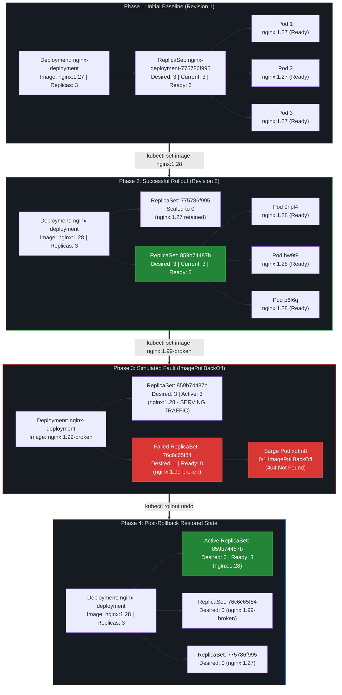

# DevOps Winter Arc — Day 16: Kubernetes Deployments & Rollouts

> **90 Days of DevOps Challenge | Week 3: Kubernetes | Learn • Practice • Deploy**  
> **Topic: Rolling Updates, ReplicaSets, Revision History, Change-Cause Annotations, maxSurge / maxUnavailable, Broken Image Triage, and Zero-Downtime Rollbacks**

---

## 🎯 Goal for Today

In Day 15, we deployed an Nginx workload on a local `kind` cluster, exposed it via a NodePort Service, and explored how Pods and ReplicaSets are scheduled across nodes. That established static workload management. In production, however, applications are never static: container images get updated, new features roll out, security patches get applied, and occasionally, bad releases need to be rolled back instantly without dropping active user connections.

**Today's Goal:** Master the complete deployment lifecycle on the local `kind-winter-arc` Kubernetes cluster following the operational loop: **Release → Observe → Break → Roll Back**. This drill covers auditing releases with `kubernetes.io/change-cause`, executing a zero-downtime rolling update (`nginx:1.27` → `nginx:1.28`), analyzing ReplicaSet scaling dynamics, intentionally deploying an invalid image tag (`nginx:1.99-broken`) to observe failure isolation (`ErrImagePull` / `ImagePullBackOff`), and safely rolling back to the verified known-good revision without dropping traffic.

> [!NOTE]
> **Lab Environment:** Executed locally on a single-node `kind` cluster (`kind-winter-arc`) running Kubernetes v1.36.1 in the `default` namespace. All logs and command outputs below are direct records from the local session.

### 🗺️ Today's Mission Blueprint

1. 🔍 **Pre-Flight Inspection:** Verify active cluster context (`kind-winter-arc`), query existing `nginx-deployment`, and capture baseline ReplicaSet (`nginx-deployment-775786f995`) running 3 healthy `nginx:1.27` replicas.
2. ⚙️ **Strategy & Parameter Analysis:** Deconstruct Deployment configuration to inspect `RollingUpdate` parameters (`maxSurge: 25%`, `maxUnavailable: 25%`), container definitions, and initial revision history.
3. 📝 **Release Auditing & Image Upgrade:** Attach a descriptive release reason via `kubernetes.io/change-cause`, trigger an image update to `nginx:1.28` with `kubectl set image`, and track rollout progress with `kubectl rollout status`.
4. 🔬 **ReplicaSet Transition Verification:** Confirm the creation of new ReplicaSet `nginx-deployment-859b74487b` with 3 ready Pods, verify old ReplicaSet scaled to zero without deletion, and inspect revision history.
5. 🛡️ **Baseline Confirmation:** Confirm the working baseline (`nginx:1.28`, Revision 2) before testing any failure scenarios.
6. 💣 **Controlled Fault Injection:** Trigger an image update using a non-existent image tag (`nginx:1.99-broken`) to test Kubernetes blast radius isolation.
7. 🩺 **Root-Cause Triage & Event Inspection:** Track Pod lifecycle state progression from `ErrImagePull` to `ImagePullBackOff` using `kubectl describe pod` and cluster events, verifying that existing healthy Pods continue serving traffic.
8. 🔄 **Zero-Downtime Rollback:** Execute `kubectl rollout undo`, analyze the `last-applied-configuration` warning, verify restoration of `nginx:1.28`, and analyze post-rollback revision numbering.

---

## 📋 Lab Metadata

| Parameter | Lab Value |
| :--- | :--- |
| **Challenge** | 90 Days of DevOps |
| **Day** | 16 of 90 |
| **Week** | Week 3: Kubernetes |
| **Topic** | Deployments & Rollouts |
| **Operational Theme** | Release → Observe → Break → Roll Back |
| **Difficulty** | Beginner / Advanced Beginner |
| **Estimated Duration** | 3–4 hours |
| **Cluster Context** | `kind-winter-arc` |
| **Namespace** | `default` |
| **Deployment Name** | `nginx-deployment` |
| **Target Container** | `nginx` |
| **Desired Replicas** | 3 |
| **Initial Image** | `nginx:1.27` |
| **Target Image** | `nginx:1.28` |
| **Simulated Fault Image** | `nginx:1.99-broken` |

---

## 🗺️ Deployment Rollout & Rollback Architecture Diagram



---

## 📖 Key Concepts & Deep Dive

### 1. What is a Kubernetes Rolling Update?

In Kubernetes, a **Deployment** provides declarative updates for Pods and ReplicaSets. Modifying any part of the Pod template (`spec.template`)—such as an image tag, an environment variable, or resource requests—triggers a **Rolling Update**:
- A new ReplicaSet is generated to represent the updated Pod template.
- New Pods are started incrementally.
- Kubernetes verifies readiness probes on new Pods before scaling down older Pods.
- Traffic shifts gradually until the new ReplicaSet handles 100% of the workload.

This mechanism ensures the application remains accessible throughout regular releases.

### 2. The Deployment → ReplicaSet → Pod Hierarchy

```text
┌────────────────────────────────────────────────────────┐
│                      Deployment                        │
│            Manages release strategy & history          │
└───────────────────────────┬────────────────────────────┘
                            │
              ┌─────────────┴─────────────┐
              ▼                           ▼
   ┌──────────────────────┐    ┌──────────────────────┐
   │ Old ReplicaSet (v1)  │    │ New ReplicaSet (v2)  │
   │ Desired Replicas: 0  │    │ Desired Replicas: 3  │
   └──────────┬───────────┘    └──────────┬───────────┘
              │                           │
        (No active pods)            ┌─────┼─────┐
                                    ▼     ▼     ▼
                                  Pod 1 Pod 2 Pod 3
```

- **Deployment:** Controls release strategy, pauses, resumes, and historical revisions.
- **ReplicaSet:** Maintains an exact count of identical Pods matching a label selector. **Deployments never create Pods directly; they create and manage ReplicaSets.** Every Pod template produces a unique 10-character hash (e.g., `859b74487b`) appended to the ReplicaSet name.
- **Pod:** The running container instance with its network namespace and volume mounts.

### 3. Understanding `maxSurge` and `maxUnavailable`

Rolling update pacing is controlled by two parameters in `spec.strategy.rollingUpdate`:

```yaml
spec:
  strategy:
    type: RollingUpdate
    rollingUpdate:
      maxSurge: 25%
      maxUnavailable: 25%
```

Both values can be absolute numbers or percentages of `spec.replicas`. When percentages are used, Kubernetes applies specific rounding rules:

| Setting | Default | Definition | Rounding Rule | Impact with `replicas: 3` |
| :--- | :--- | :--- | :--- | :--- |
| **`maxSurge`** | `25%` | Maximum Pods that can be scheduled **above** desired count during an update. | Always rounds **UP** | $25\% \times 3 = 0.75 \rightarrow \mathbf{1}$ extra Pod.<br>Max total Pods allowed: $3 + 1 = \mathbf{4}$. |
| **`maxUnavailable`** | `25%` | Maximum Pods that can be unavailable during the update. | Always rounds **DOWN** | $25\% \times 3 = 0.75 \rightarrow \mathbf{0}$ unavailable Pods.<br>Min available Pods required: $3 - 0 = \mathbf{3}$. |

#### 🔬 Practical takeaway for this lab:
Because `maxUnavailable` rounded down to `0`, Kubernetes was **not allowed to terminate any existing `nginx:1.27` Pods** until at least one replacement `nginx:1.28` Pod became completely Ready. 

Simultaneously, `maxSurge` allowed creating **1 extra Pod** (totaling 4 Pods across the cluster) to spin up the new version.

> [!WARNING]
> While a rolling update strategy with `maxUnavailable: 0` prevents downtime during routine updates, it does not guarantee zero downtime under all failure conditions (e.g., node resource exhaustion, network partition, or incompatible database schema changes).

---

## 🛠️ Kubernetes Command Reference

| Command | Action Performed | DevOps Production Use Case |
| :--- | :--- | :--- |
| `kubectl config current-context` | Displays active cluster context | Sanity check to avoid running destructive commands on wrong clusters |
| `kubectl get deployments` | Displays desired, current, up-to-date, and available replicas | High-level workload health and rollout progress tracking |
| `kubectl get rs,pods -o wide` | Displays all ReplicaSets, Pods, IPs, and assigned nodes | Inspecting workload distribution and ReplicaSet transitions |
| `kubectl describe deployment <name>` | Displays deployment strategy, container specs, and events | Verifying update strategy parameters and container configuration |
| `kubectl rollout history deployment/<name>` | Lists recorded revisions and change causes | Audit tracking and rollback target selection |
| `kubectl rollout history deployment/<name> --revision=N` | Shows full Pod template and container image for revision $N$ | Validating past release specs before rolling back |
| `kubectl annotate deployment/<name> kubernetes.io/change-cause="<msg>"` | Attaches an audit message explaining the release purpose | Release tracking and change management |
| `kubectl set image deployment/<name> <cname>=` | Imperatively updates a container image tag | Triggering image updates from scripts or CI/CD pipelines |
| `kubectl rollout status deployment/<name>` | Blocks synchronously until rollout succeeds or fails | CI/CD pipeline gating step to detect deployment failures |
| `kubectl describe pod <name>` | Inspects container state, failure reasons, and event log | Root-cause triage for `ErrImagePull`, `CrashLoopBackOff`, etc. |
| `kubectl get events --sort-by=.metadata.creationTimestamp` | Lists cluster events in chronological order | Pinpointing infrastructure issues and registry errors |
| `kubectl rollout undo deployment/<name>` | Reverts deployment to previous revision | Fast disaster recovery during failed releases |
| `kubectl rollout undo deployment/<name> --to-revision=N` | Reverts deployment to a specific historical revision | Targeted rollback to a verified release |

---

## 🏗️ Hands-On Lab Walkthrough & Execution

All steps were conducted on local Kubernetes cluster `kind-winter-arc`.

### Step 1: Pre-Flight Cluster & Workload Inspection

Before making changes, the cluster context, active Deployments, and initial ReplicaSets were checked to establish the starting baseline:

```bash
kubectl config current-context
kubectl get deployments
kubectl get pods
kubectl get rs
```

```text
$ kubectl config current-context
kind-winter-arc

$ kubectl get deployments
NAME               READY   UP-TO-DATE   AVAILABLE   AGE
nginx-deployment   3/3     3            3           23h

$ kubectl get rs
NAME                          DESIRED   CURRENT   READY   AGE
nginx-deployment-775786f995   3         3         3       23h
```

#### Baseline State:
- **Context:** Connected to `kind-winter-arc`.
- **Workload:** `nginx-deployment` running with `3/3` Ready and `3` Available replicas.
- **ReplicaSet:** `nginx-deployment-775786f995` managing all 3 active Pods.

---

### Step 2: Deployment Configuration & Strategy Inspection

The deployment details, rolling update settings, and revision history were examined:

```bash
kubectl describe deployment nginx-deployment

kubectl get deployment nginx-deployment \
  -o jsonpath='{.spec.template.spec.containers[*].name}{"\n"}{.spec.template.spec.containers[*].image}{"\n"}'

kubectl rollout history deployment/nginx-deployment
```

```text
StrategyType:           RollingUpdate
RollingUpdateStrategy:  25% max unavailable, 25% max surge
Replicas:               3 desired | 3 updated | 3 total | 3 available | 0 unavailable

Containers:
 nginx:
  Image: nginx:1.27

$ kubectl rollout history deployment/nginx-deployment
deployment.apps/nginx-deployment
REVISION  CHANGE-CAUSE
1         <none>
```

#### Observations:
- **Strategy:** `RollingUpdate` with `25% max unavailable, 25% max surge`.
- **Container:** Container `nginx` running image `nginx:1.27`.
- **History:** Only Revision 1 recorded, with `CHANGE-CAUSE` showing `<none>`. Without release annotations, identifying what triggered a past revision requires manual manifest inspection.

---

### Step 3: Record Release Reason & Perform Valid Update (`nginx:1.28`)

An audit annotation was added to document the release purpose, followed by updating the image tag to `nginx:1.28` and waiting for rollout completion:

```bash
kubectl annotate deployment/nginx-deployment \
  kubernetes.io/change-cause="Day 16: update Nginx from 1.27 to 1.28 for rollout practice"

kubectl set image deployment/nginx-deployment \
  nginx=nginx:1.28

kubectl rollout status deployment/nginx-deployment
```

```text
$ kubectl annotate deployment/nginx-deployment kubernetes.io/change-cause="Day 16: update Nginx from 1.27 to 1.28 for rollout practice"
deployment.apps/nginx-deployment annotated

$ kubectl set image deployment/nginx-deployment nginx=nginx:1.28
deployment.apps/nginx-deployment image updated

$ kubectl rollout status deployment/nginx-deployment
deployment "nginx-deployment" successfully rolled out
```

#### Role of `kubectl rollout status`:
Commands like `kubectl set image` return immediately after updating the deployment spec in `kube-apiserver`. They do not wait for images to pull or containers to become ready. `kubectl rollout status` blocks execution until all Pods are running and ready, making it an essential check in CI/CD pipelines.

---

### Step 4: Verify Successful Release & Inspect Revision History

After the rollout finished, the updated ReplicaSet, revision history, and running Pods were inspected:

```bash
kubectl rollout history deployment/nginx-deployment
kubectl rollout history deployment/nginx-deployment --revision=2
kubectl get deployment nginx-deployment -o wide
kubectl get rs,pods -o wide
```

```text
$ kubectl rollout history deployment/nginx-deployment
deployment.apps/nginx-deployment
REVISION  CHANGE-CAUSE
1         Day 16: update Nginx from 1.27 to 1.28 for rollout practice
2         Day 16: update Nginx from 1.27 to 1.28 for rollout practice

$ kubectl rollout history deployment/nginx-deployment --revision=2
deployment.apps/nginx-deployment with revision #2
Pod Template:
  Labels:	app=nginx
	pod-template-hash=859b74487b
  Annotations:	kubernetes.io/change-cause: Day 16: update Nginx from 1.27 to 1.28 for rollout practice
  Containers:
   nginx:
    Image:	nginx:1.28
    Port:	80/TCP

$ kubectl get deployment nginx-deployment -o wide
NAME               READY   UP-TO-DATE   AVAILABLE   AGE   CONTAINERS   IMAGES       SELECTOR
nginx-deployment   3/3     3            3           23h   nginx        nginx:1.28   app=nginx

$ kubectl get rs,pods -o wide
NAME                                          DESIRED   CURRENT   READY   AGE    CONTAINERS   IMAGES       SELECTOR
replicaset.apps/nginx-deployment-775786f995   0         0         0       23h    nginx        nginx:1.27   app=nginx,pod-template-hash=775786f995
replicaset.apps/nginx-deployment-859b74487b   3         3         3       113s   nginx        nginx:1.28   app=nginx,pod-template-hash=859b74487b

NAME                                    READY   STATUS    RESTARTS   AGE    IP            NODE
pod/nginx-deployment-859b74487b-9npl4   1/1     Running   0          96s    10.244.0.10   winter-arc-control-plane
pod/nginx-deployment-859b74487b-hw9t9   1/1     Running   0          113s   10.244.0.8    winter-arc-control-plane
pod/nginx-deployment-859b74487b-p6f6q   1/1     Running   0          96s    10.244.0.9    winter-arc-control-plane
```

#### Observations:
1. **New Active ReplicaSet:** `nginx-deployment-859b74487b` was created with 3 Ready Pods running `nginx:1.28`.
2. **Old ReplicaSet Preserved:** `nginx-deployment-775786f995` scaled down to 0 replicas but was preserved in cluster state to enable fast rollbacks.
3. **Change-Cause Scoping:** Both Revision 1 and Revision 2 display the same change-cause string. Annotating the top-level Deployment object while Revision 1 was active updated Revision 1's annotation; Revision 2 then inherited the template annotation when the image was changed. In production, annotating `spec.template` directly or using Git commit messages in GitOps pipelines provides cleaner revision mapping.

---

### Step 5: Establishing the Known-Good Baseline

Before testing failure handling, the healthy baseline was confirmed:

```bash
kubectl get deployment nginx-deployment \
  -o jsonpath='{.spec.template.spec.containers[0].image}{"\n"}'

kubectl rollout history deployment/nginx-deployment
```

- **Known-Good Image:** `nginx:1.28`
- **Known-Good ReplicaSet:** `nginx-deployment-859b74487b`
- **Known-Good Revision:** Revision 2

---

### Step 6: Simulating a Broken Release (`nginx:1.99-broken`)

To test how Kubernetes handles bad releases, an image update was initiated with a non-existent Docker Hub tag:

```bash
kubectl set image deployment/nginx-deployment \
  nginx=nginx:1.99-broken

kubectl get pods
```

```text
$ kubectl set image deployment/nginx-deployment nginx=nginx:1.99-broken
deployment.apps/nginx-deployment image updated

$ kubectl get pods
NAME                                READY   STATUS         RESTARTS   AGE
nginx-deployment-76c6c65f84-xqfm8   0/1     ErrImagePull   0          37s
nginx-deployment-859b74487b-9npl4   1/1     Running        0          7m36s
nginx-deployment-859b74487b-hw9t9   1/1     Running        0          7m53s
nginx-deployment-859b74487b-p6f6q   1/1     Running        0          7m36s
```

#### Blast Radius Isolation:
- **Surge Pod Created:** A new Pod (`nginx-deployment-76c6c65f84-xqfm8`) was scheduled to test the new image.
- **Old Pods Protected:** **All three healthy `nginx:1.28` Pods remained Running and Ready.**
- **Why Service Remained Up:** Because `maxUnavailable: 25%` rounded down to `0`, Kubernetes was forbidden from terminating any existing Pods until the replacement Pod passed readiness checks. Since the surge Pod never became ready, the update stalled and existing traffic was unaffected.

---

### Step 7: Diagnosing the Failure via Events & Pod Inspection

The failing surge Pod was inspected using `kubectl describe pod`:

```bash
kubectl describe pod nginx-deployment-76c6c65f84-xqfm8
kubectl get events --sort-by=.metadata.creationTimestamp
```

```text
Name:             nginx-deployment-76c6c65f84-xqfm8
Namespace:        default
Status:           Pending
Controlled By:    ReplicaSet/nginx-deployment-76c6c65f84

Containers:
  nginx:
    Image: nginx:1.99-broken
    State: Waiting
      Reason: ImagePullBackOff
    Ready: False

Events:
  Type     Reason   Message
  Normal   Pulling  Pulling image "nginx:1.99-broken"
  Warning  Failed   Failed to pull image "nginx:1.99-broken": rpc error: code = NotFound desc = failed to pull and unpack image "docker.io/library/nginx:1.99-broken": failed to resolve reference "docker.io/library/nginx:1.99-broken": docker.io/library/nginx:1.99-broken: not found
  Warning  Failed   Error: ErrImagePull
  Normal   BackOff  Back-off pulling image "nginx:1.99-broken"
  Warning  Failed   Error: ImagePullBackOff
```

#### Root-Cause Breakdown:
- The event log confirmed the exact failure: `docker.io/library/nginx:1.99-broken: not found`.
- **`ErrImagePull`:** Active failure to pull the image from the registry.
- **`ImagePullBackOff`:** Exponential backoff waiting period before the kubelet retries the pull request, preventing registry flooding.

---

### Step 8: Safe Rollback to Known-Good Revision

With the failure diagnosed, the deployment was rolled back to restore the working version:

```bash
kubectl rollout undo deployment/nginx-deployment
kubectl rollout status deployment/nginx-deployment
kubectl get deployment nginx-deployment -o wide
kubectl get rs,pods -o wide
kubectl rollout history deployment/nginx-deployment
```

```text
$ kubectl rollout undo deployment/nginx-deployment
Warning: resource deployments/nginx-deployment was previously managed with 'kubectl apply'. Rolling back will not update the kubectl.kubernetes.io/last-applied-configuration annotation, which may cause unexpected behavior on future 'kubectl apply' operations. Consider using 'kubectl apply' with your previous configuration file instead.
deployment.apps/nginx-deployment rolled back

$ kubectl rollout status deployment/nginx-deployment
deployment "nginx-deployment" successfully rolled out

$ kubectl get deployment nginx-deployment -o wide
NAME               READY   UP-TO-DATE   AVAILABLE   AGE   CONTAINERS   IMAGES       SELECTOR
nginx-deployment   3/3     3            3           23h   nginx        nginx:1.28   app=nginx

$ kubectl get rs,pods -o wide
NAME                                          DESIRED   CURRENT   READY   AGE     CONTAINERS   IMAGES              SELECTOR
replicaset.apps/nginx-deployment-76c6c65f84   0         0         0       7m43s   nginx        nginx:1.99-broken   app=nginx,pod-template-hash=76c6c65f84
replicaset.apps/nginx-deployment-775786f995   0         0         0       23h     nginx        nginx:1.27          app=nginx,pod-template-hash=775786f995
replicaset.apps/nginx-deployment-859b74487b   3         3         3       14m     nginx        nginx:1.28          app=nginx,pod-template-hash=859b74487b

NAME                                    READY   STATUS    RESTARTS   AGE   IP            NODE
pod/nginx-deployment-859b74487b-9npl4   1/1     Running   0          14m   10.244.0.10   winter-arc-control-plane
pod/nginx-deployment-859b74487b-hw9t9   1/1     Running   0          14m   10.244.0.8    winter-arc-control-plane
pod/nginx-deployment-859b74487b-p6f6q   1/1     Running   0          14m   10.244.0.9    winter-arc-control-plane
```

#### Understanding the `last-applied-configuration` Warning:
When resources are deployed declaratively with `kubectl apply`, Kubernetes stores the manifest in the annotation `kubectl.kubernetes.io/last-applied-configuration` for three-way merge patching. Because `kubectl rollout undo` is an imperative cluster-side operation, it swaps the active Pod template with the historical one directly in the cluster without updating that annotation. This is not an error and does not prevent successful rollback, but manifests in Git should be synchronized to match the rolled-back state.

---

### Step 9: Final State & Revision History Verification

The final cluster state confirmed:
- Deployment restored to `nginx:1.28` with `3/3` Ready replicas.
- Failed ReplicaSet `nginx-deployment-76c6c65f84` scaled down to 0, terminating the broken Pod.
- Inactive historical ReplicaSets remain at 0 replicas.

```text
$ kubectl rollout history deployment/nginx-deployment
deployment.apps/nginx-deployment
REVISION  CHANGE-CAUSE
1         Day 16: update Nginx from 1.27 to 1.28 for rollout practice
3         Day 16: update Nginx from 1.27 to 1.28 for rollout practice
4         Day 16: update Nginx from 1.27 to 1.28 for rollout practice
```

#### Revision Index Dynamics:
Revision 2 is no longer listed in history. When a rollback occurs, Kubernetes creates a new revision from the restored template (Revision 4), and updates the revision index. Revisions are not guaranteed to remain a contiguous sequential list ($1, 2, 3\dots$) across multiple updates and rollbacks.

---

## 🚨 Practical Troubleshooting Guide

| Issue / Error | Root Cause | Safe Diagnostic Command | Recommended Remediation |
| :--- | :--- | :--- | :--- |
| **`ErrImagePull`** | Kubelet cannot fetch image from registry (non-existent tag, typo, private registry missing pull secret, network issue). | `kubectl describe pod <pod-name>` | Inspect `Events:` section to identify registry error. Correct tag typo or add `imagePullSecrets`. |
| **`ImagePullBackOff`** | Exponential backoff delay after repeated failed pull attempts. Kubelet waits before retrying. | `kubectl get events --sort-by=.metadata.creationTimestamp` | Diagnose root cause via events. If image tag is invalid, trigger `kubectl rollout undo` or update to a valid tag. |
| **Rollout Status Hangs / Timeouts** | New Pods fail readiness probes, crash on startup, or cannot be scheduled due to resource constraints. | `kubectl rollout status deployment/<name>`<br>`kubectl get pods`<br>`kubectl logs -l app=<label>` | Inspect container logs (`kubectl logs`) and probe configurations. Roll back if root cause cannot be fixed immediately. |
| **Duplicate / Confusing Change-Cause** | Change-cause annotation was applied to top-level Deployment instead of the Pod template, copying old cause forward. | `kubectl rollout history deployment/<name>` | Annotate the Pod template directly via `spec.template.metadata.annotations` or use declarative Git commits in CI/CD. |
| **`last-applied-configuration` Rollback Warning** | `kubectl rollout undo` was executed on a resource originally managed with `kubectl apply`. The annotation was not updated. | `kubectl get deployment <name> -o yaml \| grep -A 5 last-applied` | Safe to ignore for immediate recovery. For long-term hygiene, update the YAML manifest in Git and re-apply using `kubectl apply -f`. |

---

## 🎤 Interview Questions & High-Yield Answers

### Q1: What is a Kubernetes rolling update?
- **Answer:** A rolling update is the default deployment strategy in Kubernetes (`type: RollingUpdate`). It gradually replaces older Pod instances with new ones, verifying that new Pods pass readiness probes before terminating old Pods. This ensures zero downtime during routine updates.

### Q2: What is the relationship between a Deployment and a ReplicaSet?
- **Answer:** A Deployment is a higher-level declarative controller that manages the release lifecycle of an application, while a ReplicaSet is a lower-level controller responsible for maintaining an exact count of identical running Pods. Deployments do not create Pods directly; when a Deployment's Pod template changes, the Deployment creates a new ReplicaSet and coordinates scaling up the new ReplicaSet while scaling down the old ReplicaSet.

### Q3: What does `maxSurge` control?
- **Answer:** `maxSurge` defines the maximum number (or percentage) of Pods that Kubernetes can create **above** the desired replica count during a rolling update. For example, with 3 desired replicas and `maxSurge: 25%`, Kubernetes rounds up ($0.75 \rightarrow 1$), allowing up to 4 Pods to run simultaneously during the rollout.

### Q4: What does `maxUnavailable` control?
- **Answer:** `maxUnavailable` defines the maximum number (or percentage) of Pods that can be unavailable during a rolling update. With 3 desired replicas and `maxUnavailable: 25%`, Kubernetes rounds down ($0.75 \rightarrow 0$), meaning 0 Pods may be unavailable—ensuring all 3 original Pods remain ready and serving traffic until at least one replacement Pod becomes ready.

### Q5: How do you inspect rollout revision history?
- **Answer:** Use `kubectl rollout history deployment/<name>` to view a summary table of recorded revisions and change causes. To inspect the specific configuration, labels, container images, and annotations of a particular revision, add `--revision`: `kubectl rollout history deployment/<name> --revision=2`.

### Q6: How do you diagnose a Pod in `ImagePullBackOff`?
- **Answer:** Run `kubectl describe pod <pod-name>` and inspect the `Events` section at the bottom. The event log provides the exact error message from the container runtime (e.g., `404 Not Found` for missing image tags, authentication errors for private registries, or connection timeouts).

### Q7: What does `kubectl rollout undo` do under the hood?
- **Answer:** `kubectl rollout undo` reverts a Deployment to a previous revision (the immediate prior revision by default, or a specific revision if `--to-revision` is specified). It extracts the Pod template from the target historical ReplicaSet, applies it to the Deployment's `spec.template`, scales the target ReplicaSet back up to the desired replica count, and scales down the currently active ReplicaSet.

### Q8: Why are change-cause annotations useful, and what is their limitation?
- **Answer:** The `kubernetes.io/change-cause` annotation records human-readable audit notes (e.g., Jira ticket, Git commit SHA, release description) in `kubectl rollout history`. However, if applied to the top-level Deployment instead of `spec.template`, the annotation can be inadvertently applied to the active revision or carried forward to subsequent revisions.

### Q9: Why might a failed rollout leave the old Pods running?
- **Answer:** Kubernetes enforces safety thresholds via `maxUnavailable`. When `maxUnavailable` is configured such that no existing Pods can be terminated until replacement Pods are ready (such as `maxUnavailable: 25%` on 3 replicas rounding down to 0), any failure in the new Pods (such as `ErrImagePull` or failing health probes) stops the controller from shutting down old Pods, keeping the existing ReplicaSet serving live traffic.

### Q10: How do you verify that a rollback succeeded?
- **Answer:** Follow a 3-step verification:
  1. Check rollout progress with `kubectl rollout status deployment/<name>` and confirm it reports `successfully rolled out`.
  2. Inspect the live container image with `kubectl get deployment <name> -o wide` to ensure the correct image tag is active.
  3. Run `kubectl get rs,pods -o wide` to confirm the healthy ReplicaSet has all desired replicas in `Ready` state, the failed ReplicaSet is scaled to `0`, and all Pods report `Running` with `1/1` Ready containers.

---

## 💡 Key Takeaways & Lessons Learned

### Key Lessons from Today's Lab:
1. **Inspect Before Modifying:** Always verify active context, current image tags, and healthy replica baselines (`kubectl get rs,pods -o wide`) before executing updates.
2. **Audit Releases with Change Causes:** Avoid unannotated revision histories (`<none>`). Recording release reasons or integrating Git commit tracking in CI/CD saves valuable time during incident response.
3. **Always Await Rollout Completion:** Avoid fire-and-forget image updates. Using `kubectl rollout status` in scripts ensures broken releases are detected immediately.
4. **Automatic Blast Radius Isolation:** When a non-existent image was deployed, Kubernetes isolated the failure to a single surge Pod while the 3 healthy Pods continued serving traffic without downtime.
5. **Cluster Events are Ground Truth:** Terminal statuses like `ErrImagePull` indicate symptoms. The `Events` table in `kubectl describe pod` reveals the root cause directly from the container runtime interface.
6. **Decisive Rollbacks:** When an update fails, running `kubectl rollout undo` restores the cluster to the last known-good configuration within seconds.
7. **Verify Beyond the Command:** A successful exit code from `kubectl rollout undo` is only the first step. Always verify that Pods are healthy, IPs are bound, and broken ReplicaSets have scaled down to zero.

---

## 💻 Verified Raw Terminal Logs & Evidence Archive

All terminal outputs below represent verbatim, authentic command executions captured during the lab on cluster `kind-winter-arc`.

### 1. Successful Rollout & Verification (`rollout-success`)

```text
$ kubectl annotate deployment/nginx-deployment kubernetes.io/change-cause="Day 16: update Nginx from 1.27 to 1.28 for rollout practice"
deployment.apps/nginx-deployment annotated

$ kubectl set image deployment/nginx-deployment nginx=nginx:1.28
deployment.apps/nginx-deployment image updated

$ kubectl rollout status deployment/nginx-deployment
deployment "nginx-deployment" successfully rolled out

$ kubectl get deployment nginx-deployment -o wide
NAME               READY   UP-TO-DATE   AVAILABLE   AGE   CONTAINERS   IMAGES       SELECTOR
nginx-deployment   3/3     3            3           23h   nginx        nginx:1.28   app=nginx

$ kubectl get rs,pods -o wide
NAME                                          DESIRED   CURRENT   READY   AGE    CONTAINERS   IMAGES       SELECTOR
replicaset.apps/nginx-deployment-775786f995   0         0         0       23h    nginx        nginx:1.27   app=nginx,pod-template-hash=775786f995
replicaset.apps/nginx-deployment-859b74487b   3         3         3       113s   nginx        nginx:1.28   app=nginx,pod-template-hash=859b74487b

NAME                                    READY   STATUS    RESTARTS   AGE    IP            NODE
pod/nginx-deployment-859b74487b-9npl4   1/1     Running   0          96s    10.244.0.10   winter-arc-control-plane
pod/nginx-deployment-859b74487b-hw9t9   1/1     Running   0          113s   10.244.0.8    winter-arc-control-plane
pod/nginx-deployment-859b74487b-p6f6q   1/1     Running   0          96s    10.244.0.9    winter-arc-control-plane
```

### 2. Revision History Progression (`rollout-history`)

```text
# Initial history prior to Day 16 update:
$ kubectl rollout history deployment/nginx-deployment
deployment.apps/nginx-deployment
REVISION  CHANGE-CAUSE
1         <none>

# History after applying change-cause and updating image to nginx:1.28:
$ kubectl rollout history deployment/nginx-deployment
deployment.apps/nginx-deployment
REVISION  CHANGE-CAUSE
1         Day 16: update Nginx from 1.27 to 1.28 for rollout practice
2         Day 16: update Nginx from 1.27 to 1.28 for rollout practice

# Revision 2 details:
$ kubectl rollout history deployment/nginx-deployment --revision=2
deployment.apps/nginx-deployment with revision #2
Pod Template:
  Labels:	app=nginx
	pod-template-hash=859b74487b
  Annotations:	kubernetes.io/change-cause: Day 16: update Nginx from 1.27 to 1.28 for rollout practice
  Containers:
   nginx:
    Image:	nginx:1.28
    Port:	80/TCP

# Final observed history after rollback from nginx:1.99-broken:
$ kubectl rollout history deployment/nginx-deployment
deployment.apps/nginx-deployment
REVISION  CHANGE-CAUSE
1         Day 16: update Nginx from 1.27 to 1.28 for rollout practice
3         Day 16: update Nginx from 1.27 to 1.28 for rollout practice
4         Day 16: update Nginx from 1.27 to 1.28 for rollout practice
```

### 3. Simulated Broken Rollout & Pod Events (`failed-rollout-events`)

```text
$ kubectl set image deployment/nginx-deployment nginx=nginx:1.99-broken
deployment.apps/nginx-deployment image updated

$ kubectl get pods
NAME                                READY   STATUS         RESTARTS   AGE
nginx-deployment-76c6c65f84-xqfm8   0/1     ErrImagePull   0          37s
nginx-deployment-859b74487b-9npl4   1/1     Running        0          7m36s
nginx-deployment-859b74487b-hw9t9   1/1     Running        0          7m53s
nginx-deployment-859b74487b-p6f6q   1/1     Running        0          7m36s

$ kubectl describe pod nginx-deployment-76c6c65f84-xqfm8
Name:             nginx-deployment-76c6c65f84-xqfm8
Namespace:        default
Status:           Pending
Controlled By:    ReplicaSet/nginx-deployment-76c6c65f84

Containers:
  nginx:
    Image: nginx:1.99-broken
    State: Waiting
      Reason: ImagePullBackOff
    Ready: False

Events:
  Type     Reason   Message
  Normal   Pulling  Pulling image "nginx:1.99-broken"
  Warning  Failed   Failed to pull image "nginx:1.99-broken": rpc error: code = NotFound desc = failed to pull and unpack image "docker.io/library/nginx:1.99-broken": failed to resolve reference "docker.io/library/nginx:1.99-broken": docker.io/library/nginx:1.99-broken: not found
  Warning  Failed   Error: ErrImagePull
  Normal   BackOff  Back-off pulling image "nginx:1.99-broken"
  Warning  Failed   Error: ImagePullBackOff
```

### 4. Rollback & Final State Verification (`rollback-verified`)

```text
$ kubectl rollout undo deployment/nginx-deployment
Warning: resource deployments/nginx-deployment was previously managed with 'kubectl apply'. Rolling back will not update the kubectl.kubernetes.io/last-applied-configuration annotation, which may cause unexpected behavior on future 'kubectl apply' operations. Consider using 'kubectl apply' with your previous configuration file instead.
deployment.apps/nginx-deployment rolled back

$ kubectl rollout status deployment/nginx-deployment
deployment "nginx-deployment" successfully rolled out

$ kubectl get deployment nginx-deployment -o wide
NAME               READY   UP-TO-DATE   AVAILABLE   AGE   CONTAINERS   IMAGES       SELECTOR
nginx-deployment   3/3     3            3           23h   nginx        nginx:1.28   app=nginx

$ kubectl get rs,pods -o wide
NAME                                          DESIRED   CURRENT   READY   AGE     CONTAINERS   IMAGES              SELECTOR
replicaset.apps/nginx-deployment-76c6c65f84   0         0         0       7m43s   nginx        nginx:1.99-broken   app=nginx,pod-template-hash=76c6c65f84
replicaset.apps/nginx-deployment-775786f995   0         0         0       23h     nginx        nginx:1.27          app=nginx,pod-template-hash=775786f995
replicaset.apps/nginx-deployment-859b74487b   3         3         3       14m     nginx        nginx:1.28          app=nginx,pod-template-hash=859b74487b

NAME                                    READY   STATUS    RESTARTS   AGE   IP            NODE
pod/nginx-deployment-859b74487b-9npl4   1/1     Running   0          14m   10.244.0.10   winter-arc-control-plane
pod/nginx-deployment-859b74487b-hw9t9   1/1     Running   0          14m   10.244.0.8    winter-arc-control-plane
pod/nginx-deployment-859b74487b-p6f6q   1/1     Running   0          14m   10.244.0.9    winter-arc-control-plane
```

---

## 📌 Production Golden Rules for Rollouts

1. **Never Deploy with `:latest`:** Always pin explicit version tags (`nginx:1.28`) or immutable Git commit SHAs (`my-app:abc1234`). Using mutable tags destroys revision traceability and makes rollbacks unpredictable.
2. **Readiness Probes are Mandatory:** Rolling update safety depends entirely on accurate health checks. If a Pod does not define a `readinessProbe`, Kubernetes marks it "Ready" the millisecond the container process starts, potentially routing live traffic to an uninitialized application.
3. **Use `minReadySeconds` for Warmup Stability:** Setting `spec.minReadySeconds: 15` ensures newly created Pods must remain healthy for at least 15 seconds before Kubernetes marks them available and begins terminating older replicas.
4. **Prune Revisions with `revisionHistoryLimit`:** Keep `spec.revisionHistoryLimit` between 5 and 10. This provides enough historical ReplicaSets for rollback while preventing etcd metadata bloat.
5. **Reconcile Git Post-Rollback:** Emergency rollbacks via `kubectl rollout undo` happen cluster-side. Always update the Git repository manifest to match the rolled-back state immediately afterward to prevent declarative CI/CD pipelines from re-deploying the broken release on the next `kubectl apply`.

---

[← Day 15](Day15.md) | [Home](Day01.md)
