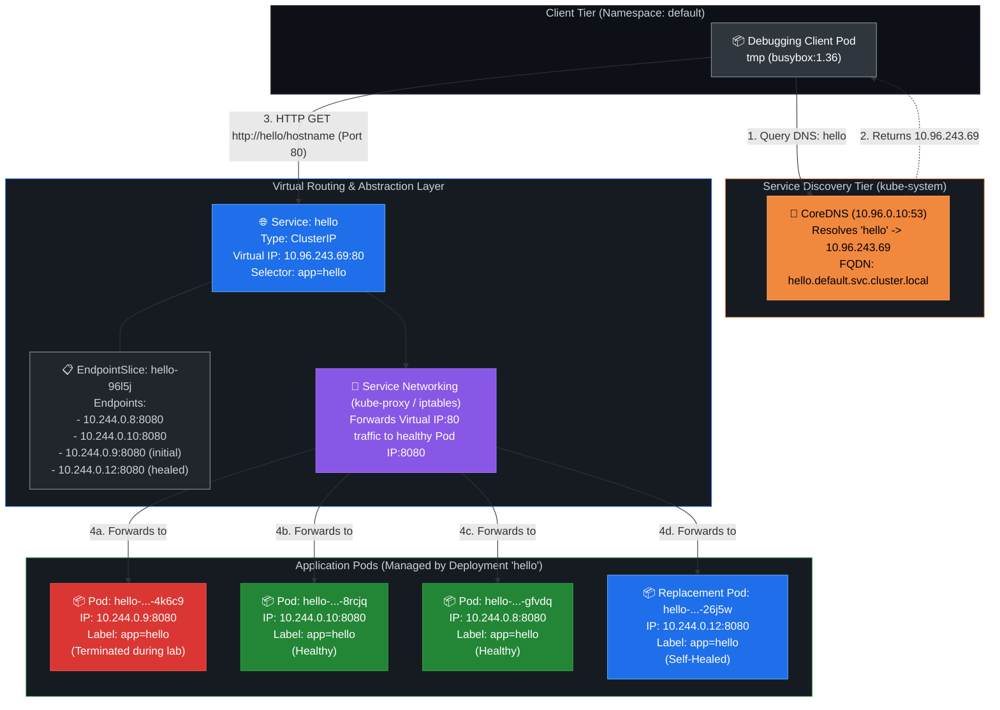

# DevOps Winter Arc — Day 17: Kubernetes Services & Networking

> **90 Days of DevOps Challenge | Week 3: Kubernetes | Learn • Practice • Deploy**  
> **Topic: ClusterIP, Service Discovery, CoreDNS, EndpointSlices, Label Selectors, Traffic Routing, and Network Troubleshooting**

---

## 🎯 Goal for Today

In Day 15, we set up our first Kubernetes workloads and used a NodePort Service to expose Nginx outside the cluster. In Day 16, we explored Deployments, rolling updates, and rollbacks, discovering that Pods are designed to be temporary, disposable entities that are frequently created, destroyed, and rescheduled. 

This dynamic lifecycle introduces a fundamental networking dilemma: **if Pods come and go, and their private IP addresses change every time they are recreated, how can other workloads inside the cluster reliably communicate with them?**

**Today's Goal:** Deeply understand internal Kubernetes networking and service discovery on our local `kind-winter-arc` cluster. We will deploy an application across multiple replicas, expose it using an internal **ClusterIP Service**, inspect how Kubernetes tracks Pod IP addresses using **EndpointSlices**, test in-cluster DNS resolution with **CoreDNS** from an ephemeral debugging Pod, observe how requests are routed across backend replicas, verify self-healing after deleting a live Pod, and intentionally break the Service's label selector to diagnose and fix a zero-endpoint failure scenario.

> [!NOTE]
> **Lab Environment:** Executed locally on Ubuntu (`hrishav@hrishav-LOQ-15IAX9`) using a single-node `kind` cluster named `kind-winter-arc` running Kubernetes v1.36.1 with node `winter-arc-control-plane` in the `Ready` state. All resources were deployed into the `default` namespace. A pre-existing, unrelated `nginx-deployment` (3 replicas) and `nginx-service` (NodePort 30080) from earlier days remained active and undisturbed throughout this lab.

### 🗺️ Today's Mission Blueprint

1. ☸️ **Pre-Flight Context Verification:** Confirm active context `kind-winter-arc`, verify node readiness, and review pre-existing cluster workloads.
2. 🚀 **Deploy Multi-Replica Workload:** Deploy a 3-replica application using the `agnhost` network execution utility (`netexec`) listening on HTTP port `8080`, and capture initial Pod IPs.
3. 🌐 **Publish via ClusterIP Service:** Expose the application internally on standard HTTP port `80`, mapping incoming traffic to backend target port `8080`.
4. 📄 **Declarative YAML Deconstruction:** Walk through the anatomy of an illustrative Service YAML manifest, contrasting declarative specifications with imperative creation.
5. 🧩 **Inspect EndpointSlices:** Uncover how Kubernetes tracks healthy backend Pod IPs and ports behind the Service abstraction.
6. 🔎 **In-Cluster DNS Discovery (CoreDNS):** Spin up an interactive BusyBox debugging Pod to test Service name resolution, analyze search domains, and examine the fully qualified domain name (FQDN).
7. 🔄 **Traffic Routing & Load Distribution:** Send multiple consecutive requests through the Service and observe traffic reaching different backend Pods.
8. 🩹 **Pod Lifecycle & Self-Healing Endpoint Rebalancing:** Manually terminate an active Pod, observe the Deployment spin up an immediate replacement with a new IP, and verify automatic EndpointSlice synchronization.
9. 💥 **Controlled Failure Injection:** Intentionally break the Service selector (`app=hellow`) to reproduce a silent backend disconnection where DNS resolves but connections fail (`Connection refused`).
10. 🩺 **Root-Cause Triage & Remediation:** Diagnose the missing endpoints, restore the matching label selector, and confirm traffic recovery.

---

## 📋 Lab Metadata

| Parameter | Lab Value |
| :--- | :--- |
| **Challenge** | 90 Days of DevOps |
| **Day** | 17 of 90 |
| **Week** | Week 3: Kubernetes |
| **Topic** | Kubernetes Services & Internal Networking |
| **Operational Theme** | Service Discovery → Endpoint Tracking → Fault Injection → Triage |
| **Difficulty** | Intermediate |
| **Host System** | Ubuntu Linux (`hrishav@hrishav-LOQ-15IAX9`) |
| **Cluster Engine** | `kind` (Kubernetes in Docker) |
| **Cluster Context** | `kind-winter-arc` |
| **Kubernetes Version** | `v1.36.1` |
| **Control Plane Node** | `winter-arc-control-plane` (Ready) |
| **Namespace** | `default` |
| **Deployment Name** | `hello` |
| **Workload Image** | `registry.k8s.io/e2e-test-images/agnhost:2.39` |
| **Workload Command** | `/agnhost netexec --http-port=8080` |
| **Replica Count** | 3 |
| **Service Name** | `hello` |
| **Service Type** | `ClusterIP` (Internal Virtual IP) |
| **Allocated ClusterIP** | `10.96.243.69` |
| **Service Port (`port`)** | `80/TCP` |
| **Backend Port (`targetPort`)** | `8080/TCP` |
| **Pod Selector** | `app=hello` |
| **Client Test Pod** | `busybox:1.36` (ephemeral) |
| **Cluster DNS Server** | `10.96.0.10` (CoreDNS) |

---

## 🗺️ Kubernetes Service & Networking Architecture Diagram



### 🧱 Conceptual End-to-End Request Flow

```text
BusyBox Client Pod
       |
       | HTTP request to http://hello/hostname
       v
Kubernetes DNS / CoreDNS
       |
       | Resolves "hello" to 10.96.243.69
       v
Service: hello (ClusterIP 10.96.243.69:80)
       |
       | Service networking forwards traffic
       v
One eligible hello Pod :8080
       |
       v
Returns the Pod hostname
```

> [!IMPORTANT]
> **Understanding the Boundary:** CoreDNS is strictly a name resolver; it translates hostnames into IP addresses. It does not proxy, forward, or inspect application HTTP packets. Once the client receives the ClusterIP (`10.96.243.69`), the client initiates a standard TCP/HTTP handshake to that virtual IP on port `80`. Cluster networking (implemented on nodes via `kube-proxy` configuring packet filter rules like `iptables` or `IPVS`) intercepts the packet and translates the destination address into one of the healthy Pod IP endpoints on port `8080`.

---

## 📖 Key Concepts & Deep Dive

### 1. The Ephemeral Pod Dilemma: Why Kubernetes Services Exist

In traditional virtual machine deployments, a server typically has a persistent hostname and a static IP address that remains unchanged for months or years. If a service needs to talk to the database, you can configure the database IP address directly in an environment variable or configuration file.

In Kubernetes, **Pods are ephemeral and disposable**:
- A Pod might crash and be replaced by a new Pod.
- A node might fail, forcing the scheduler to launch replacement Pods on a completely different node.
- Deployments routinely terminate old Pods and create new ones during rolling updates.
- Horizontal Pod Autoscalers (HPA) scale Pod counts up and down based on real-time CPU or memory load.

Every time a Pod is created, it gets assigned a **new, dynamic IP address** from the cluster's Pod CIDR range (in our `kind` cluster, `10.244.0.0/16`). When that Pod dies, its IP address is released back into the pool. 

If client applications attempted to connect directly to Pod IPs:
1. **Broken Connections:** Whenever a backend Pod restarts, the client's hardcoded IP points to a dead or reassigned address.
2. **Manual Configuration Hell:** Every scale-up or scale-down event would require updating every dependent service in the cluster.
3. **No Central Load Balancing:** The client would need to maintain its own list of active backend Pod IPs and manage health checks and load balancing logic internally.

**The Solution:** A **Kubernetes Service** provides an enduring, stable network abstraction sitting in front of a dynamic group of Pods. The Service is assigned a single virtual IP (**ClusterIP**) and a stable internal DNS name (`hello.default.svc.cluster.local`). Clients send traffic exclusively to this stable front door; Kubernetes automatically takes care of routing that traffic to whichever backend Pods happen to be alive and healthy at that exact millisecond.

---

### 2. Deployments, ReplicaSets, and Replica Pods

A **Deployment** is the higher-level Kubernetes controller responsible for managing the declarative state of an application. Rather than managing individual Pods manually:
- You declare the desired state (e.g., "run 3 replicas of `agnhost:2.39`").
- The Deployment creates and manages an underlying **ReplicaSet**.
- The ReplicaSet continuously reconciles the cluster to ensure that exactly 3 Pods matching the selector are running at all times.
- If a Pod is deleted or crashes, the ReplicaSet controller detects the deficit and immediately provisions a replacement.

In this lab, our Deployment manages 3 identical replica Pods. Each replica runs the same container image and serves the exact same application code, but runs in its own network namespace with its own unique Pod IP address and hostname.

---

### 3. Understanding the Workload: `agnhost netexec` on Port 8080

To inspect internal networking without being obscured by complex web application stacks, we used **`agnhost`** (`registry.k8s.io/e2e-test-images/agnhost:2.39`).

`agnhost` is the official Swiss Army knife container image used by the Kubernetes project for end-to-end testing. When started with:

```bash
/agnhost netexec --http-port=8080
```

It launches an ultra-lightweight HTTP server listening on TCP port `8080`. One of its built-in endpoints is `/hostname`:
- When an HTTP client queries `GET /hostname`, the server immediately responds with the local OS hostname of the container that handled the request.
- In Kubernetes, a Pod's hostname defaults to the Pod's name (e.g., `hello-788fd69d58-4k6c9`).
- This makes `agnhost netexec` the ideal workload for testing Service load balancing: sending requests to the Service and inspecting the returned hostname lets us immediately prove which replica Pod answered each request.

---

### 4. Kubernetes Service Types Overview

Kubernetes offers four primary Service types:

| Service Type | Scope & Accessibility | Primary Use Case |
| :--- | :--- | :--- |
| **`ClusterIP`** *(Default)* | **Internal Only.** Allocates a virtual IP reachable exclusively from within the cluster nodes and Pods. | East-West traffic between microservices (e.g., frontend talking to backend API, backend talking to database). |
| **`NodePort`** | **External & Internal.** Allocates a static port (default `30000–32767`) on every cluster node's IP. | Direct access without a cloud load balancer, local testing, or legacy ingress. Tested in Day 15. |
| **`LoadBalancer`** | **External.** Provisions a native cloud provider load balancer (AWS NLB/ALB, GCP Cloud LB) pointing to NodePorts. | Production entrypoint for external Internet traffic. |
| **`ExternalName`** | **Internal DNS Alias.** Maps a Kubernetes Service name directly to an external CNAME record (e.g., `db.external-domain.com`). | Integrating external SaaS or legacy databases without proxying traffic. |

In this lab, we focus strictly on **`ClusterIP`**, the foundation upon which all other Kubernetes networking concepts are built.

---

### 5. Deconstructing Networking Parameters: `port` vs. `targetPort` vs. `ClusterIP` vs. `selector`

One of the most common pitfalls for beginners is confusing the various port and address definitions in a Service. Here is how they interact:

```text
 Client Pod               ClusterIP Service                   Backend Pod
┌───────────┐         ┌─────────────────────────┐         ┌─────────────────┐
│           │         │ ClusterIP: 10.96.243.69 │         │ Pod IP: 10.244.0.8
│  curl     │ ──────> │                         │ ──────> │                 │
│  :80      │         │ port: 80                │         │ targetPort: 8080│
│           │         │ selector: app=hello     │         │ container: 8080 │
└───────────┘         └─────────────────────────┘         └─────────────────┘
```

- **`port` (Service Port):** The port exposed by the Service itself inside the cluster. In our lab, this is port **`80`**. Client Pods connect to `http://hello:80` (or simply `http://hello`, since 80 is the default HTTP port).
- **`targetPort` (Container/Pod Port):** The port on the backend Pod where the application container is actually listening. In our lab, `agnhost netexec` is configured with `--http-port=8080`, so `targetPort` is set to **`8080`**. Kubernetes forwards incoming traffic arriving at Service port `80` to target port `8080` on the chosen Pod.
- **`ClusterIP`:** A stable virtual IP address dynamically chosen from the cluster's service CIDR (in our cluster, `10.96.0.0/12`). It has no physical network interface attached to any machine; it exists purely as a routing and packet translation rule in the node's kernel.
- **`selector`:** A map of key-value pairs (e.g., `app: hello`) that tells Kubernetes which Pods belong to this Service. Any Pod in the same namespace with matching labels is automatically registered as a backend endpoint.

---

### 6. EndpointSlices: How Kubernetes Actually Tracks Backends

Historically, Kubernetes tracked the backend Pods of a Service inside a single API resource called `Endpoints`. When a Service had thousands of backend Pods, updating a single Pod required writing the entire massive list back to `etcd`, causing significant performance bottlenecks in large clusters.

Kubernetes introduced **`EndpointSlices`** as the modern, scalable replacement:
- Instead of storing all backend Pods in one giant object, Kubernetes splits endpoints into smaller slices (by default, up to 100 endpoints per slice).
- Each EndpointSlice tracks the ready Pod IPs, node locations, and target ports for a specific Service.
- When an EndpointSlice controller detects that a Pod matching the Service selector has become `Ready`, it writes the Pod's IP and port into the corresponding EndpointSlice.
- **Crucial Distinction:** EndpointSlices track *backend IP and port data*. They have nothing to do with resolving DNS names. CoreDNS resolves the Service *name* to the Service *ClusterIP*; EndpointSlices are used by node network proxies (`kube-proxy`) to know *which Pod IPs* can receive the traffic.

---

### 7. Kubernetes Service DNS and CoreDNS Mechanics

Every Kubernetes cluster runs an internal DNS server, almost universally implemented using **CoreDNS** running in the `kube-system` namespace.

When a Pod starts, its `/etc/resolv.conf` file is automatically configured by the `kubelet` with:
- The nameserver IP of CoreDNS (in our cluster: `10.96.0.10`).
- A list of DNS search domains configured to search local namespaces first:
  ```text
  search default.svc.cluster.local svc.cluster.local cluster.local
  nameserver 10.96.0.10
  options ndots:5
  ```

#### Standard Fully Qualified Domain Name (FQDN) Format:
$$\mathbf{<service\text{-}name>.<namespace>.svc.<cluster\text{-}domain>}$$

For our Service:
$$\mathbf{hello.default.svc.cluster.local}$$

#### How DNS Name Resolution Works in Practice:
1. When a client Pod in the `default` namespace runs `curl http://hello`, the OS resolver appends the search domains in order.
2. It queries CoreDNS for `hello.default.svc.cluster.local`.
3. CoreDNS matches the query against its cluster service registry and returns the virtual IP `10.96.243.69`.
4. Because the search domain includes `default.svc.cluster.local`, Pods in the same namespace can use the convenient short name `hello`. Pods in another namespace (e.g., `staging`) would query `hello.default`.

---

## 📄 Declarative Service Specification (YAML Manifest Reference)

While we used `kubectl expose` during the hands-on lab to dynamically generate the Service from the command line, production Kubernetes environments almost universally manage Services declaratively using version-controlled YAML manifests.

Below is the illustrative YAML specification matching the exact Service configuration tested:

```yaml
apiVersion: v1
kind: Service
metadata:
  name: hello
  namespace: default
spec:
  type: ClusterIP
  selector:
    app: hello
  ports:
    - name: http
      port: 80
      targetPort: 8080
      protocol: TCP
```

### Deep Dive Field Breakdown:

- **`apiVersion: v1`:** Core Kubernetes API group containing primary primitives like Pods, Services, Namespaces, and ConfigMaps.
- **`kind: Service`:** Declares that this resource is a network abstraction layer rather than a compute workload.
- **`metadata.name: hello`:** Defines the name of the Service. This value directly dictates the in-cluster DNS hostname registered in CoreDNS (`hello.default.svc.cluster.local`).
- **`spec.type: ClusterIP`:** Explicitly requests an internal-only virtual IP. If omitted, `ClusterIP` is chosen automatically by default.
- **`spec.selector.app: hello`:** The label query. Any Pod in the `default` namespace with the label `app: hello` will have its IP:port added to this Service's EndpointSlice.
- **`spec.ports[*].name: http`:** An optional human-readable identifier for the port mapping, required when defining multi-port Services.
- **`spec.ports[*].port: 80`:** The port on which the Service listens internally.
- **`spec.ports[*].targetPort: 8080`:** The destination port on the application container. Incoming traffic on port 80 is forwarded to port 8080 on the backend Pods.
- **`spec.ports[*].protocol: TCP`:** Layer 4 transport protocol (defaults to `TCP`; `UDP` and `SCTP` are also supported).

---

## 🛠️ Kubernetes Command Reference

This reference outlines the essential commands used throughout this lab for inspecting, verifying, and diagnosing Kubernetes Services and networking:

| Command | Action Performed | What it Diagnoses / Operational Value |
| :--- | :--- | :--- |
| `kubectl get deployments` | Lists active Deployments, desired/available replicas | Verifies that the workload controller is running and maintaining desired replica counts. |
| `kubectl get pods -o wide` | Lists Pods with assigned internal IP addresses and nodes | Reveals individual Pod IPs (`10.244.x.x`) to verify network allocation and Pod health. |
| `kubectl get pods --show-labels` | Lists all Pods and their attached key-value labels | Vital for confirming whether Pods have the exact labels expected by a Service selector. |
| `kubectl get services` | Displays Services, assigned ClusterIPs, and exposed ports | Verifies that the Service exists, has a valid ClusterIP, and maps the expected port numbers. |
| `kubectl describe service hello` | Displays complete Service metadata, selector, and active endpoints | The single most important command for Service triage: reveals the selector and lists healthy backend endpoints. |
| `kubectl get endpointslices -l kubernetes.io/service-name=hello -o wide` | Queries EndpointSlices associated with the target Service | Confirms that Kubernetes has actively populated backend Pod IPs and ports into the routing layer. |
| `kubectl get pods -l app=hello` | Filters Pods matching the valid production label | Verifies which running Pods are eligible to receive traffic through the `app=hello` selector. |
| `kubectl get pods -l app=hellow` | Filters Pods matching the intentionally broken selector | Proves why the broken Service had zero endpoints: zero running Pods match the typo selector `app=hellow`. |

---

## 🏗️ Hands-On Lab Walkthrough & Execution

All commands were executed in an Ubuntu shell session with prompt `hrishav@hrishav-LOQ-15IAX9` targeting cluster `kind-winter-arc`.

---

### Step 1: Pre-Flight Cluster & Workload Verification

Before introducing new resources, we verified connectivity to the `kind-winter-arc` cluster, checked node health, and inspected existing workloads to establish a clean starting baseline:

```bash
kubectl config current-context
kubectl get nodes
kubectl get deployments,services
```

```text
$ kubectl config current-context
kind-winter-arc

$ kubectl get nodes
NAME                       STATUS   ROLES           AGE   VERSION
winter-arc-control-plane   Ready    control-plane   2d    v1.36.1

$ kubectl get deployments,services
NAME                               READY   UP-TO-DATE   AVAILABLE   AGE
deployment.apps/nginx-deployment   3/3     3            3           25h

NAME                    TYPE        CLUSTER-IP      EXTERNAL-IP   PORT(S)        AGE
service/kubernetes      ClusterIP   10.96.0.1       <none>        443/TCP        2d
service/nginx-service   NodePort    10.96.152.36    <none>        80:30080/TCP   25h
```

#### Baseline Observations:
- **Cluster State:** Connected to `kind-winter-arc` running Kubernetes `v1.36.1`. The control-plane node `winter-arc-control-plane` is `Ready`.
- **Pre-Existing Workloads:** `nginx-deployment` (3 replicas) and `nginx-service` (NodePort 30080) from Day 15/16 are active. We will leave these entirely untouched.
- **Starting Point:** Ready to deploy our dedicated Day 17 workload.

---

### Step 2: Creating the Deployment (`hello`) with 3 Replicas

We created a new Deployment named `hello` running 3 replicas of the `agnhost:2.39` test image configured to execute `netexec` on HTTP port `8080`:

```bash
kubectl create deployment hello --replicas=3 \
  --image=registry.k8s.io/e2e-test-images/agnhost:2.39 \
  -- /agnhost netexec --http-port=8080
```

```text
deployment.apps/hello created
```

We tracked the Pods as they were scheduled, initialized, and transitioned to `Running`:

```bash
kubectl get pods -l app=hello -o wide --show-labels
```

```text
NAME                     READY   STATUS    RESTARTS   AGE   IP            NODE                       NOMINATED NODE   READINESS GATES   LABELS
hello-788fd69d58-4k6c9   1/1     Running   0          38s   10.244.0.9    winter-arc-control-plane   <none>           <none>            app=hello,pod-template-hash=788fd69d58
hello-788fd69d58-8rcjq   1/1     Running   0          38s   10.244.0.10   winter-arc-control-plane   <none>           <none>            app=hello,pod-template-hash=788fd69d58
hello-788fd69d58-gfvdq   1/1     Running   0          38s   10.244.0.8    winter-arc-control-plane   <none>           <none>            app=hello,pod-template-hash=788fd69d58
```

#### Initial Pod Allocation Table:

| Pod Name | Pod IP | Container Port | Status | Assigned Label |
| :--- | :--- | :--- | :--- | :--- |
| `hello-788fd69d58-4k6c9` | `10.244.0.9` | `8080/TCP` | `Running` | `app=hello` |
| `hello-788fd69d58-8rcjq` | `10.244.0.10` | `8080/TCP` | `Running` | `app=hello` |
| `hello-788fd69d58-gfvdq` | `10.244.0.8` | `8080/TCP` | `Running` | `app=hello` |

#### Key Takeaways:
- All 3 Pods automatically inherited the label `app=hello` from the Deployment template.
- Each Pod received its own distinct IP address on the `10.244.0.0/16` overlay network.
- At this stage, no Service exists to unite these Pods; anyone wanting to talk to them would have to know their individual IPs.

---

### Step 3: Exposing the Deployment as a ClusterIP Service

Next, we used `kubectl expose` to generate a `ClusterIP` Service named `hello`, exposing port `80` externally to the cluster and directing traffic to target port `8080` on the Pods:

```bash
kubectl expose deployment hello \
  --name=hello \
  --type=ClusterIP \
  --port=80 \
  --target-port=8080
```

```text
service/hello exposed
```

We inspected the created Service using `kubectl describe service`:

```bash
kubectl describe svc hello
```

```text
Name:              hello
Namespace:         default
Labels:            app=hello
Annotations:       <none>
Selector:          app=hello
Type:              ClusterIP
IP Family Policy:  SingleStack
IP Families:       IPv4
IP:                10.96.243.69
IPs:               10.96.243.69
Port:              <unset>  80/TCP
TargetPort:        8080/TCP
Endpoints:         10.244.0.8:8080,10.244.0.10:8080,10.244.0.9:8080
Session Affinity:  None
Events:            <none>
```

#### Critical Field Analysis:
- **`IP: 10.96.243.69`:** The permanent virtual ClusterIP allocated to this Service. This IP will not change as long as the Service object exists.
- **`Port: 80/TCP`:** Clients inside the cluster connect to `10.96.243.69` on standard HTTP port `80`.
- **`TargetPort: 8080/TCP`:** Kubernetes translates the destination port so that requests arrive at the container process listening on port `8080`.
- **`Selector: app=hello`:** The matching rule. Kubernetes queried all Pods in the `default` namespace with this label.
- **`Endpoints: 10.244.0.8:8080, 10.244.0.10:8080, 10.244.0.9:8080`:** All three Pod IPs discovered in Step 2 were automatically registered as healthy backends.

---

### Step 4: Inspecting EndpointSlices and Backend Tracking

To observe the modern backend tracking object under the hood, we queried the cluster's EndpointSlices filtered by the Service ownership label:

```bash
kubectl get endpointslices -l kubernetes.io/service-name=hello -o wide
```

```text
NAME          ADDRESSTYPE   PORTS   ENDPOINTS                            AGE
hello-96l5j   IPv4          8080    10.244.0.8,10.244.0.10,10.244.0.9   78s
```

#### Deep Dive into the Output:
- **EndpointSlice Name:** `hello-96l5j` (automatically named with the Service prefix and a unique hash).
- **AddressType:** `IPv4`.
- **Ports:** `8080` (Notice this matches the **`targetPort`**, not Service port `80`. The EndpointSlice tells the network proxy the exact IP and port where the actual container process is listening).
- **Endpoints:** Lists all 3 active Pod IPs (`10.244.0.8`, `10.244.0.10`, `10.244.0.9`).

> [!NOTE]
> **EndpointSlice vs CoreDNS:** Beginners often confuse EndpointSlices with DNS records. 
> - **CoreDNS** translates the Service name `hello` to the virtual ClusterIP `10.96.243.69`. CoreDNS does **not** know or care about the individual Pod IPs (`10.244.0.8`, etc.).
> - **EndpointSlice** tracks the physical backend Pod IPs so `kube-proxy` on the nodes can program iptables/IPVS rules to distribute packets sent to `10.96.243.69:80` out to `10.244.0.x:8080`.

---

### Step 5: Spinning Up a Client Pod & Testing Kubernetes DNS

Because a `ClusterIP` Service is internal to the cluster, we cannot test it directly from our host machine's browser without port-forwarding. To test it like a real microservice client, we launched an interactive, ephemeral BusyBox container inside the cluster:

```bash
kubectl run tmp --rm -it --image=busybox:1.36 --restart=Never -- sh
```

Inside the client container shell, we first inspected the DNS environment configuration:

```sh
cat /etc/resolv.conf
```

```text
search default.svc.cluster.local svc.cluster.local cluster.local
nameserver 10.96.0.10
options ndots:5
```

The nameserver `10.96.0.10` is our in-cluster CoreDNS service.

Next, we performed name resolution testing using `nslookup`:

```sh
nslookup hello
```

```text
Server:         10.96.0.10
Address:        10.96.0.10:53

** server can't find hello.cluster.local: NXDOMAIN
** server can't find hello.svc.cluster.local: NXDOMAIN

Name:   hello.default.svc.cluster.local
Address: 10.96.243.69
```

#### Honest Look at the Output:
When `nslookup hello` was executed, BusyBox's resolver attempted to resolve the query across its search path. Lookups appending suffixes like `hello.cluster.local` and `hello.svc.cluster.local` returned `NXDOMAIN` (Non-Existent Domain) because those are not valid domain paths. 

However, when the resolver evaluated the correct namespace search domain:

$$\mathbf{hello.default.svc.cluster.local}$$

It resolved successfully to the Service's ClusterIP: **`10.96.243.69`**.

> [!NOTE]
> **Not a CoreDNS Failure:** The intermediate `NXDOMAIN` messages are expected behavior when a DNS client traverses search suffixes. The resolution succeeded fully: the short name `hello` translated to the exact virtual ClusterIP `10.96.243.69`.

---

### Step 6: Testing Traffic Routing via Service

Still inside the BusyBox client container, we tested HTTP connectivity through the Service. We ran a shell loop sending 6 consecutive HTTP GET requests to `http://hello/hostname`:

```sh
for i in 1 2 3 4 5 6; do
  wget -qO- http://hello/hostname
  echo
done
```

#### Actual Terminal Output Observed:

```text
hello-788fd69d58-4k6c9
hello-788fd69d58-gfvdq
hello-788fd69d58-8rcjq
hello-788fd69d58-4k6c9
hello-788fd69d58-4k6c9
hello-788fd69d58-gfvdq
```

#### What This Proves:
1. **Name Resolution Worked:** The client sent requests to `http://hello` (using the Service name on default port 80). CoreDNS resolved `hello` to `10.96.243.69`.
2. **Port Translation Worked:** The client sent traffic to port `80`, yet the application answered from port `8080`.
3. **Multi-Pod Distribution:** All 3 backend Pods answered requests:
   - `hello-788fd69d58-4k6c9` answered 3 requests.
   - `hello-788fd69d58-gfvdq` answered 2 requests.
   - `hello-788fd69d58-8rcjq` answered 1 request.
4. **Load Balancing Behavior:** Kubernetes Service networking distributes traffic across available endpoints probabilistically (typically via random selection in iptables rules). **Kubernetes does not guarantee strict round-robin balancing.** What this test proves is that traffic sent to a single virtual IP is distributed among all eligible backend replicas.

We then exited the temporary container:

```sh
exit
```

```text
pod "tmp" deleted
```

---

### Step 7: Testing Pod Deletion, Self-Healing, and Endpoint Updates

To verify why services are necessary and observe how Kubernetes handles backend churn, we simulated a Pod failure by manually deleting one of the three original Pods:

```bash
kubectl delete pod hello-788fd69d58-4k6c9
```

```text
pod "hello-788fd69d58-4k6c9" deleted
```

We immediately queried the Deployment and Pod list:

```bash
kubectl get pods -l app=hello -o wide
```

```text
NAME                     READY   STATUS    RESTARTS   AGE   IP            NODE                       NOMINATED NODE   READINESS GATES
hello-788fd69d58-26j5w   1/1     Running   0          14s   10.244.0.12   winter-arc-control-plane   <none>           <none>
hello-788fd69d58-8rcjq   1/1     Running   0          4m    10.244.0.10   winter-arc-control-plane   <none>           <none>
hello-788fd69d58-gfvdq   1/1     Running   0          4m    10.244.0.8    winter-arc-control-plane   <none>           <none>
```

#### Updated Pod State Table:

| Pod Name | Pod IP | Status | Lifecycle Event |
| :--- | :--- | :--- | :--- |
| `hello-788fd69d58-26j5w` | `10.244.0.12` | `Running` | **New Replacement Pod** (provisioned automatically) |
| `hello-788fd69d58-8rcjq` | `10.244.0.10` | `Running` | Unchanged (original survivor) |
| `hello-788fd69d58-gfvdq` | `10.244.0.8` | `Running` | Unchanged (original survivor) |
| `hello-788fd69d58-4k6c9` | `10.244.0.9` | *Terminated* | Removed from cluster |

We immediately checked the Service's EndpointSlice:

```bash
kubectl get endpointslices -l kubernetes.io/service-name=hello -o wide
```

```text
NAME          ADDRESSTYPE   PORTS   ENDPOINTS                             AGE
hello-96l5j   IPv4          8080    10.244.0.8,10.244.0.10,10.244.0.12   4m30s
```

#### What Happened Here:
1. **Self-Healing Reconciliation:** When `hello-788fd69d58-4k6c9` was deleted, the `ReplicaSetController` noticed that the current replica count dropped from 3 to 2. It immediately requested a new Pod from the scheduler.
2. **New Identity & IP:** The new Pod `hello-788fd69d58-26j5w` was scheduled and assigned a brand new IP address: **`10.244.0.12`**.
3. **Automatic Endpoint Synchronization:** The EndpointSlice controller instantly pruned dead IP `10.244.0.9` and added new IP `10.244.0.12`.
4. **Architectural Lesson:** If a client had hardcoded `10.244.0.9`, all its requests would now be failing with connection errors. But because clients communicate with the Service (`10.96.243.69` / `hello`), no client reconfiguration was required. The transition was completely transparent.

---

### Step 8: Controlled Failure Experiment: Breaking the Service Selector

In production, one of the most common and confounding errors occurs when a Service exists, has a valid ClusterIP, and resolves cleanly in DNS, but requests suddenly fail. To reproduce this failure mode, we intentionally patched the Service selector with a typo (`app: hellow` instead of `app: hello`):

```bash
kubectl patch service hello \
  -p '{"spec":{"selector":{"app":"hellow"}}}'
```

```text
service/hello patched
```

We inspected the Service using `kubectl describe service hello`:

```bash
kubectl describe svc hello
```

```text
Name:              hello
Namespace:         default
Labels:            app=hello
Annotations:       <none>
Selector:          app=hellow
Type:              ClusterIP
IP Family Policy:  SingleStack
IP Families:       IPv4
IP:                10.96.243.69
IPs:               10.96.243.69
Port:              <unset>  80/TCP
TargetPort:        8080/TCP
Endpoints:         <none>
Session Affinity:  None
Events:            <none>
```

We checked the EndpointSlice:

```bash
kubectl get endpointslices -l kubernetes.io/service-name=hello -o wide
```

```text
NAME          ADDRESSTYPE   PORTS    ENDPOINTS   AGE
hello-96l5j   IPv4          <unset>  <unset>     6m12s
```

#### What the State Tells Us:
- **Selector:** Has changed to `app=hellow`.
- **Endpoints:** Shows **`<none>`**.
- **EndpointSlice:** Shows ports `<unset>` and endpoints `<unset>`.
- **Why:** The 3 running Pods still have label `app=hello`. Not a single Pod in the cluster matches `app=hellow`. Therefore, the Service has zero backend targets.

#### Testing the Failure from Inside the Cluster:
We launched a temporary client container to observe what the client experiences during this failure:

```bash
kubectl run tmp --rm -it --image=busybox:1.36 --restart=Never -- sh
```

First, we checked DNS resolution:

```sh
nslookup hello
```

```text
Server:         10.96.0.10
Address:        10.96.0.10:53

Name:   hello.default.svc.cluster.local
Address: 10.96.243.69
```

**DNS resolved successfully!** The hostname `hello` still points to `10.96.243.69`.

Next, we attempted to send an HTTP request with a 3-second timeout:

```sh
wget -T 3 -qO- http://hello/hostname
```

#### Actual Terminal Output:

```text
wget: can't connect to remote host (10.96.243.69): Connection refused
```

#### The Big Diagnostic Lesson:
- **Successful DNS $\neq$ Successful Connectivity:** CoreDNS only knows that a Service object named `hello` exists with IP `10.96.243.69`. CoreDNS does not perform health checks or verify whether the Service has matching Pods.
- **Why `Connection refused`?** Because the Service has zero endpoints, the node's packet filtering rules have no destination Pod to forward the connection to. In this cluster environment, the network stack actively rejects the TCP SYN packet on port 80, returning an immediate `Connection refused`. In other network configurations (such as certain cloud CNI plugins), this can manifest as a connection timeout (`ETIMEDOUT`).

We exited the temporary container:

```sh
exit
```

---

### Step 9: Root-Cause Fix & Traffic Restoration

To resolve the outage, we corrected the selector typo, pointing it back to `app=hello`:

```bash
kubectl patch service hello \
  -p '{"spec":{"selector":{"app":"hello"}}}'
```

```text
service/hello patched
```

We verified that the Service endpoints were immediately restored:

```bash
kubectl describe svc hello
```

```text
Name:              hello
Namespace:         default
Labels:            app=hello
Annotations:       <none>
Selector:          app=hello
Type:              ClusterIP
IP Family Policy:  SingleStack
IP Families:       IPv4
IP:                10.96.243.69
IPs:               10.96.243.69
Port:              <unset>  80/TCP
TargetPort:        8080/TCP
Endpoints:         10.244.0.10:8080,10.244.0.12:8080,10.244.0.8:8080
Session Affinity:  None
Events:            <none>
```

The three endpoints (`10.244.0.10:8080`, `10.244.0.12:8080`, `10.244.0.8:8080`) are back!

#### Verifying Traffic Recovery:
We launched our temporary client container one final time and ran the 6-request test loop:

```bash
kubectl run tmp --rm -it --image=busybox:1.36 --restart=Never -- sh
```

Inside the client shell:

```sh
for i in 1 2 3 4 5 6; do
  wget -qO- http://hello/hostname
  echo
done
```

#### Actual Terminal Output Observed:

```text
hello-788fd69d58-26j5w
hello-788fd69d58-26j5w
hello-788fd69d58-gfvdq
hello-788fd69d58-gfvdq
hello-788fd69d58-8rcjq
hello-788fd69d58-gfvdq
```

#### Verification Summary:
- Traffic flows smoothly once again.
- All three current Pods answered requests:
  - The new self-healed Pod `hello-788fd69d58-26j5w` answered 2 requests.
  - Pod `hello-788fd69d58-gfvdq` answered 3 requests.
  - Pod `hello-788fd69d58-8rcjq` answered 1 request.
- The lab is complete and verified.

We exited the client container:

```sh
exit
```

---

## 🔍 Troubleshooting Guide: How to Diagnose Kubernetes Service Issues

When an application reports that it cannot communicate with a Kubernetes Service, follow this systematic 5-step triage workflow:

```text
┌──────────────────────────────────────────────────────────────┐
│                  Service Triage Workflow                     │
└──────────────────────────────┬───────────────────────────────┘
                               │
                Step 1: Check Service Object
                $ kubectl get svc <svc-name>
                               │
               ┌───────────────┴───────────────┐
               ▼                               ▼
       Service Missing                Service Exists
       Fix: Deploy Service            Check: ClusterIP & Ports
                                               │
                                               ▼
                                Step 2: Inspect Endpoints
                                $ kubectl describe svc <svc-name>
                                               │
               ┌───────────────────────────────┴───────────────┐
               ▼                                               ▼
       Endpoints: <none>                               Endpoints Present
       Inspect Selector & Labels                       Check Client Connectivity
               │                                               │
               ▼                                               ▼
   Step 3: Compare Labels vs Selector              Step 4: Verify DNS & Reachability
   $ kubectl get pods --show-labels                $ kubectl run tmp --rm -it ...
   $ kubectl get pods -l <selector>                nslookup <svc-name>
   Fix: Patch Service selector or Pod labels       wget http://<svc-name>:<port>
```

### 1. Does the Service exist and have a valid ClusterIP?
Run `kubectl get svc <service-name>`. Ensure that the Service is deployed in the correct namespace and has an assigned virtual `ClusterIP`.

### 2. Does the Service have active Endpoints?
Run `kubectl describe svc <service-name>`. Look directly at the `Endpoints:` line:
- If it shows `<none>`, **stop right there.** No traffic can pass. The issue is between the Service selector and the Pod labels.
- If endpoints are listed, verify that the IP addresses match your active Pods and that the target port matches what your container actually listens on.

### 3. Do the Pod labels match the Service selector?
Run `kubectl get pods --show-labels` and compare the Pod labels letter-for-letter against the `Selector:` shown in `kubectl describe svc`.
- Common culprits: typos (`app=hellow` vs `app=hello`), wrong environment tags (`env=prod` vs `env=production`), or mismatched namespaces.
- Quick test: `kubectl get pods -l <selector-key>=<selector-value>`. If this command returns zero Pods, your selector is pointing to nothing.

### 4. Are the backend Pods healthy and ready?
Even if labels match, a Pod will **not** be added to an EndpointSlice if its readiness probe is failing or if the Pod is in `CrashLoopBackOff` or `Pending`. Check `kubectl get pods` to ensure status is `Running` and `READY` shows `1/1` (or `n/n`).

### 5. Differentiate DNS failure from Network failure
- If `nslookup <service>` fails or times out: the issue is with CoreDNS or local `/etc/resolv.conf` search domains.
- If `nslookup <service>` succeeds (returns the ClusterIP) but `curl`/`wget` fails with `Connection refused` or timeout: DNS is completely innocent. The issue is missing endpoints, wrong `targetPort`, or an application process that is bound to `127.0.0.1` inside the container instead of `0.0.0.0`.

---

## 💡 Key Takeaways & Lessons Learned

### Summary of Core Architectural Principles:

1. **Deployments Manage Pods; Services Manage Access:** A Deployment ensures the desired number of Pod replicas remain running across the cluster. A Service gives clients an immutable, permanent gateway to access those dynamic replicas.
2. **Never Connect Directly to Pod IPs:** Pods are disposable and their IP addresses are temporary. Relying on Pod IPs directly guarantees broken connections during deployments, restarts, and node rebalances.
3. **Labels and Selectors are the Bridge:** A Service has no hardcoded references to Pod names or IPs. It discovers its backends dynamically through key-value label matching (`selector: app=hello`).
4. **`port` vs. `targetPort` Separation of Concerns:** `port` is the external-facing port exposed on the Service ClusterIP (e.g., port 80). `targetPort` is the internal port where the container process listens (e.g., port 8080). This decoupling allows standardizing external ports regardless of internal application defaults.
5. **ClusterIP is an Internal Virtual Construct:** A ClusterIP does not belong to any physical network card. It is a virtual IP managed by cluster networking rules (`kube-proxy` via iptables or IPVS) to intercept and redirect packets within the cluster.
6. **EndpointSlices Track Backend State:** EndpointSlices are the scalable Kubernetes objects that maintain the live registry of healthy backend Pod IPs and target ports for each Service.
7. **CoreDNS Provides In-Cluster Name Resolution:** CoreDNS allows workloads to address services by name (`hello` or `hello.default.svc.cluster.local`) rather than tracking virtual IPs manually.
8. **Self-Healing Updates the Network Automatically:** When a Pod dies, the ReplicaSet creates a replacement with a new name and a new IP address. The EndpointSlice controller detects this change and updates the routing table in near real-time without dropping the Service.
9. **DNS Success Does Not Guarantee Connectivity:** DNS resolution only confirms that the Service name maps to a ClusterIP. If the Service has no matching backends, requests will still fail with `Connection refused` or timeouts.
10. **A Single Character Typo Can Silently Break a Service:** A typo in a selector (`app=hellow`) does not trigger any error during `kubectl apply` or `kubectl patch`. The Service will be created happily, DNS will resolve perfectly, but all traffic will fail because the endpoint list is empty.

---

[← Day 16](Day16.md) | [Home](Day01.md) | [Day 18 →](Day18.md)
