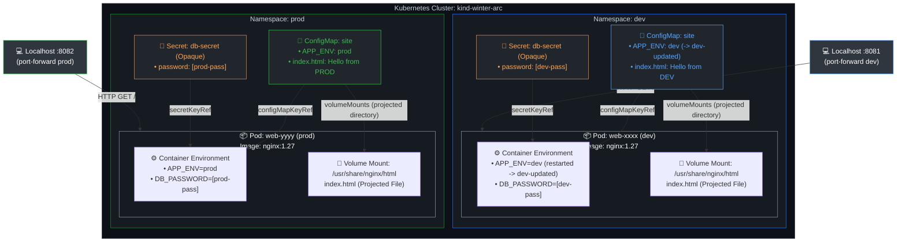

# DevOps Winter Arc — Day 18: Kubernetes ConfigMaps, Secrets & Namespaces

> **90 Days of DevOps Challenge | Week 3: Kubernetes | Learn • Practice • Deploy**  
> **Topic: Namespaces, Multi-Environment Isolation, ConfigMaps, Secrets, In-Container Environment Injection, Directory Volume Mounts, and Configuration Drift**

---

## 🎯 Goal for Today

In Day 15, we laid the foundation of Kubernetes workloads by deploying Pods and ReplicaSets and exposing them with NodePort Services. In Day 16, we mastered application release lifecycles through zero-downtime rolling updates and rollbacks. In Day 17, we dissected internal service discovery, CoreDNS, and EndpointSlices. Across all these exercises, our container images ran with fixed, baked-in configurations.

In modern cloud-native architecture, hardcoding configuration into container images violates the foundational **Twelve-Factor App methodology** (*Factor III: Config — Store config in the environment*). A production-grade software delivery pipeline mandates building **one immutable container image** that is promoted across environments—Development, Staging, and Production—without code changes or container rebuilds. 

This introduces a critical architectural challenge: **how can identical container images and identical Deployment definitions behave dynamically and consume environment-specific configurations and credentials across isolated stages?**

**Today's Goal:** Master Kubernetes configuration management and multi-environment workload isolation on our local `kind-winter-arc` cluster. We will create two isolated namespaces (`dev` and `prod`), deploy namespace-scoped **ConfigMaps** and **Secrets**, and apply a single, unmodified **Deployment** manifest to both environments. We will inject configuration via **environment variables** (`configMapKeyRef`, `secretKeyRef`) and mount dynamic HTML assets as **projected directory volumes**. Finally, we will patch a live ConfigMap to observe the real-world operational difference between mounted-file updates and static environment variables, observing configuration drift and learning how to trigger zero-downtime rolling restarts to reconcile runtime state.

> [!NOTE]
> **Lab Environment:** Executed locally on Ubuntu Linux (`hrishav@hrishav-LOQ-15IAX9`) using a single-node `kind` cluster named `kind-winter-arc` running Kubernetes v1.36.1 with node `winter-arc-control-plane` in the `Ready` state. The two dedicated namespaces created for this drill are `dev` and `prod`. The workloads and services remain active on the cluster.

### 🗺️ Today's Mission Blueprint

1. ☸️ **Pre-Flight Context Verification & Namespace Creation:** Verify cluster context `kind-winter-arc`, create isolated `dev` and `prod` namespaces, and confirm their active lifecycle state.
2. 📄 **Author Declarative ConfigMaps:** Write `configmap-dev.yaml` and `configmap-prod.yaml` defining environment tags (`APP_ENV`) and multiline web content (`index.html`) using identical metadata names (`site`).
3. 🔐 **Provision Namespace-Scoped Secrets:** Create `db-secret` in both `dev` and `prod` with environment-specific dummy credentials using imperative commands, analyzing `Opaque` secret mechanics and base64 encoding vs encryption.
4. 🚀 **Deploy Identical Workload to Both Environments:** Apply a single declarative `deployment.yaml` running `nginx:1.27` to both namespaces, leveraging `configMapKeyRef`, `secretKeyRef`, and directory volume mounts.
5. 🌐 **Multi-Environment Runtime Verification:** Port-forward to both environments on separate local ports (`8081` and `8082`), verifying that identical manifests produce isolated, environment-tailored web pages.
6. 🔎 **Inspect In-Container Environment & Secret Injection:** Execute non-intrusive container commands to verify `APP_ENV` values and safely confirm secret existence without exposing credential values.
7. 🔄 **Live Configuration Update & Propagation Analysis:** Patch the live DEV ConfigMap to observe automatic volume update propagation vs immutable container environment variables.
8. 🩹 **Reconcile Runtime State via Rolling Restart:** Trigger `kubectl rollout restart` on the DEV Deployment to establish the updated environment variable without changing image tags or manifests.
9. 📊 **Comprehensive Cluster Audit:** Review the final cluster state across both namespaces to verify Pod readiness, ConfigMap persistence, and zero container restarts.

---

## 📋 Lab Metadata

| Parameter | Lab Value |
| :--- | :--- |
| **Challenge** | 90 Days of DevOps |
| **Day** | 18 of 90 |
| **Week** | Week 3: Kubernetes |
| **Topic** | ConfigMaps, Secrets & Namespaces |
| **Operational Theme** | Environment Isolation → Decoupled Config → Volume Mounts vs Env Vars → Configuration Drift |
| **Difficulty** | Intermediate |
| **Host System** | Ubuntu Linux (`hrishav@hrishav-LOQ-15IAX9`) |
| **Cluster Engine** | `kind` (Kubernetes in Docker) |
| **Cluster Context** | `kind-winter-arc` |
| **Kubernetes Version** | `v1.36.1` |
| **Target Namespaces** | `dev` & `prod` |
| **ConfigMap Name** | `site` (present in both namespaces) |
| **Secret Name** | `db-secret` (type: `Opaque`, present in both namespaces) |
| **Workload Deployment** | `web` (managed in both namespaces) |
| **Workload Image** | `nginx:1.27` |
| **Injected Env Vars** | `APP_ENV` (from ConfigMap), `DB_PASSWORD` (from Secret) |
| **Volume Mount Path** | `/usr/share/nginx/html` (backed by ConfigMap `site`) |
| **Verification Ports** | Port `8081` (`dev`), Port `8082` (`prod`) |

---

## 🗺️ Kubernetes ConfigMaps, Secrets & Multi-Namespace Architecture Diagram



---

## 📖 Key Concepts & Deep Dive

### 1. Namespaces: Virtual Clusters and Logical Isolation

In Kubernetes, a **Namespace** provides a mechanism for isolating groups of resources within a single physical cluster. Think of a namespace as a virtual cluster or an organizational partition:
- **Name Scoping:** Resource names must be unique within a namespace, but **not across namespaces**. This allows us to create a ConfigMap named `site`, a Secret named `db-secret`, and a Deployment named `web` in both `dev` and `prod` without collision.
- **Resource Segmentation:** Namespaces allow engineering teams to divide cluster capacity, apply granular Role-Based Access Control (RBAC), and attach resource quotas (CPU, memory, object counts).
- **Logical vs. Security Boundaries:**
  > [!IMPORTANT]
  > **Namespaces are logical isolation boundaries, NOT hard security boundaries.** By default, Pods in one namespace can communicate over the network with Pods in another namespace via fully qualified domain names (FQDNs), such as `<service>.<namespace>.svc.cluster.local`. Namespaces share the same underlying Linux kernel on cluster worker nodes, the same container runtime, and the same storage systems. Achieving true multi-tenancy or security isolation requires combining namespaces with **NetworkPolicies**, **RBAC**, and runtime isolation (such as Kata Containers or gVisor).

### 2. ConfigMaps: Decoupling Non-Sensitive Configuration

A **ConfigMap** is a native Kubernetes API resource designed to store non-confidential data in key-value pairs. 
- **Decoupling Artifacts from Configuration:** Instead of modifying source code or baking configuration files into a Dockerfile (`COPY nginx.conf ...`), configuration is kept outside the container image. The container image remains a generic, reusable artifact.
- **The `data` Field:** A ConfigMap contains a `data` map where keys represent property names or filenames, and values represent string data.
- **Multiline Configuration (`|` in YAML):** Using the literal block scalar (`|`) in YAML allows embedding complete multiline configuration files—such as an entire `nginx.conf`, a JSON configuration, or an `index.html` template—directly inside a ConfigMap.

### 3. Secrets: Protecting Confidential Credentials

A **Secret** is specifically designed to store sensitive data, such as database passwords, API tokens, TLS certificates, and SSH keys.
- **Secret Types:** The default type is `Opaque`, which represents arbitrary user-defined key-value data. Other specialized types include `kubernetes.io/service-account-token`, `kubernetes.io/tls`, and `kubernetes.io/dockerconfigjson`.
- **The `generic` Flag:** When running `kubectl create secret generic`, the keyword `generic` specifies the creation of an `Opaque` secret populated from literals, files, or directories.
- **Base64 Encoding vs. Encryption:**
  > [!WARNING]
  > **Base64 encoding is NOT encryption.** In Kubernetes etcd storage and API responses, Secret data values are base64-encoded strings (e.g., `ZGV2LXBhc3M=`). Base64 is merely an encoding algorithm designed to safely transport binary data across text-based protocols; anyone who can read the Secret can decode it instantly (`base64 -d`).
- **Real-World Secret Protection:** In production, true security requires:
  1. **RBAC:** Strictly limiting which users and ServiceAccounts can view or describe Secret objects.
  2. **Encryption at Rest:** Enabling the Kubernetes KMS provider or native `etcd` encryption configuration so secrets are stored encrypted on disk.
  3. **External Secrets Management:** Integrating solutions like HashiCorp Vault, AWS Secrets Manager, or Google Cloud Secret Manager using the External Secrets Operator (ESO) or CSI Secret Store Driver.
  4. **Git Hygiene:** Never committing raw Secret YAML manifests containing plaintext or base64 credentials to public or private Git repositories.

### 4. Configuration Injection: Environment Variables vs. Mounted Volumes

Kubernetes allows containers to consume ConfigMaps and Secrets in two distinct ways:

| Mechanism | Manifest Configuration | Update Behavior | Best Use Case |
| :--- | :--- | :--- | :--- |
| **Environment Variables** | `env.valueFrom.configMapKeyRef`<br>`env.valueFrom.secretKeyRef`<br>`envFrom` | **Static at startup.** Changes to the ConfigMap/Secret do **NOT** update running processes inside existing containers. | Environment flags, database hosts, port definitions, feature toggles. |
| **Mounted Directory Volume** | `volumes.configMap`<br>`volumeMounts.mountPath` | **Dynamic / Auto-Updating.** Kubelet periodically reconciles the volume mount; files update automatically without Pod restart. | Configuration files (`nginx.conf`), static site files (`index.html`), SSL certificates. |
| **Mounted SubPath Volume** | `volumeMounts.subPath` | **Static.** Files mounted using `subPath` do **NOT** receive automatic updates. | Mounting a single file into an existing directory without overwriting sibling files. |

```text
┌────────────────────────────────────────────────────────────────────────┐
│                   HOW KUBERNETES INJECTS CONFIGURATION                 │
└───────────────────────────────────┬────────────────────────────────────┘
                                    │
          ┌─────────────────────────┴─────────────────────────┐
          ▼                                                   ▼
┌───────────────────────────────┐           ┌───────────────────────────────────┐
│     Environment Variables     │           │       Mounted Volume Files        │
│  (configMapKeyRef / secret)   │           │    (volumes -> volumeMounts)      │
├───────────────────────────────┤           ├───────────────────────────────────┤
│ • Evaluated at container init │           │ • Projected into filesystem       │
│ • Fixed for container life    │           │ • Kubelet updates symlinks        │
│ • Updating ConfigMap has NO   │           │ • Changes reflect automatically   │
│   effect on live process      │           │   in container (propagation sync) │
│ • Requires Pod restart        │           │ • No Pod restart needed           │
└───────────────────────────────┘           └───────────────────────────────────┘
```

---

## 🧪 Step-by-Step Practical Lab Implementation & Evidence

### Step 1: Pre-Flight Context Verification & Namespace Creation

Before provisioning resources, we confirmed our active cluster context to ensure operations targeted the local `kind-winter-arc` cluster, and created the two designated namespaces (`dev` and `prod`).

#### Commands Executed:

```bash
kubectl config current-context
kubectl create namespace dev
kubectl create namespace prod
kubectl get namespaces
```

#### Actual Terminal Output:

```text
kind-winter-arc
namespace/dev created
namespace/prod created
NAME                 STATUS   AGE
default              Active   2d
dev                  Active   5s
kube-node-lease      Active   2d
kube-public          Active   2d
kube-system          Active   2d
local-path-storage   Active   2d
prod                 Active   3s
```

#### Architectural Breakdown:
- **`kubectl config current-context`:** Confirmed that the active kubeconfig context is `kind-winter-arc`. This prevents accidental operations against remote or production clusters.
- **`kubectl create namespace dev / prod`:** Created two independent namespace objects in the Kubernetes API.
- **`kubectl get namespaces`:** Confirmed that both `dev` and `prod` entered the `Active` phase. Kubernetes namespaces remain active until an explicit deletion request moves them to `Terminating`.

---

### Step 2: Create the DEV and PROD ConfigMaps

To provide environment-specific configuration and web page content, we authored two separate YAML manifests: `configmap-dev.yaml` and `configmap-prod.yaml`.

#### Manifest 1: `configmap-dev.yaml`

```yaml
apiVersion: v1
kind: ConfigMap
metadata:
  name: site
data:
  APP_ENV: dev
  index.html: |
    <h1>Hello from DEV</h1>
    <p>Winter Arc - Day 18</p>
```

#### Manifest 2: `configmap-prod.yaml`

```yaml
apiVersion: v1
kind: ConfigMap
metadata:
  name: site
data:
  APP_ENV: prod
  index.html: |
    <h1>Hello from PROD</h1>
    <p>Winter Arc - Day 18</p>
```

#### Commands Executed:

```bash
kubectl apply -f configmap-dev.yaml -n dev
kubectl apply -f configmap-prod.yaml -n prod
kubectl get configmap site -n dev
kubectl get configmap site -n prod
kubectl describe configmap site -n dev
kubectl describe configmap site -n prod
```

#### Actual Terminal Output:

```text
configmap/site created
configmap/site created

NAME   DATA   AGE
site   2      12s

NAME   DATA   AGE
site   2      10s

Name:         site
Namespace:    dev
Labels:       <none>
Annotations:  <none>

Data
====
APP_ENV:
----
dev
index.html:
----
<h1>Hello from DEV</h1>
<p>Winter Arc - Day 18</p>

BinaryData
====

Events:  <none>

Name:         site
Namespace:    prod
Labels:       <none>
Annotations:  <none>

Data
====
APP_ENV:
----
prod
index.html:
----
<h1>Hello from PROD</h1>
<p>Winter Arc - Day 18</p>

BinaryData
====

Events:  <none>
```

#### Architectural Breakdown:
- **Identical Resource Names:** Both manifests declare `metadata.name: site`. Because they are applied with `-n dev` and `-n prod` respectively, Kubernetes maintains them as entirely distinct API entities.
- **Data Keys:** Each ConfigMap holds two keys:
  - `APP_ENV`: A scalar string value (`dev` vs `prod`).
  - `index.html`: A multiline text block defined using YAML's literal block indicator (`|`), preserving line breaks.
- **`kubectl describe configmap`:** Output confirms the stored keys and exact string contents for both environments. Notice that `kubectl get configmap` displays only metadata and the key count (`DATA: 2`), whereas `describe` or `-o yaml` renders the actual configuration payload.

---

### Step 3: Create Namespace-Specific Secrets

Next, we provisioned dummy credentials for both environments. We used imperative `kubectl create secret generic` commands to avoid storing credentials in static files.

#### Commands Executed:

```bash
kubectl create secret generic db-secret \
  --from-literal=password=dev-pass \
  -n dev

kubectl create secret generic db-secret \
  --from-literal=password=prod-pass \
  -n prod

kubectl get secret db-secret -n dev
kubectl get secret db-secret -n prod
```

#### Actual Terminal Output:

```text
secret/db-secret created
secret/db-secret created

NAME        TYPE     DATA   AGE
db-secret   Opaque   1      8s

NAME        TYPE     DATA   AGE
db-secret   Opaque   1      6s
```

#### Architectural Breakdown:
- **`secret generic`:** Directs the API server to create a secret of type `Opaque`.
- **`--from-literal=password=...`:** Directly maps the key `password` to the provided dummy value. In `dev`, the password was set to `dev-pass`; in `prod`, it was set to `prod-pass`.
- **Independence Across Namespaces:** Despite sharing the name `db-secret`, the objects are fully decoupled. Modifying or deleting the secret in `dev` has zero effect on `prod`.
- **Security Practice:** Notice that `kubectl get secret` outputs `DATA: 1` without printing the credential. In our notes and public documentation, we adhere to strict security hygiene: we deliberately avoid commands like `kubectl get secret -o jsonpath='{.data.password}' | base64 -d` to ensure secret values are not recorded in persistent logs.

---

### Step 4: Create the Shared Deployment

To demonstrate configuration decoupling, we authored a single `deployment.yaml` file. This manifest was applied **completely unchanged** to both `dev` and `prod`.

#### Manifest: `deployment.yaml`

```yaml
apiVersion: apps/v1
kind: Deployment
metadata:
  name: web
spec:
  replicas: 1
  selector:
    matchLabels:
      app: web
  template:
    metadata:
      labels:
        app: web
    spec:
      containers:
      - name: nginx
        image: nginx:1.27
        ports:
        - containerPort: 80
        env:
        - name: APP_ENV
          valueFrom:
            configMapKeyRef:
              name: site
              key: APP_ENV
        - name: DB_PASSWORD
          valueFrom:
            secretKeyRef:
              name: db-secret
              key: password
        volumeMounts:
        - name: html
          mountPath: /usr/share/nginx/html
      volumes:
      - name: html
        configMap:
          name: site
```

#### Detailed Anatomy of the Deployment Manifest:
1. **`replicas: 1` & `selector.matchLabels: app: web`:** Defines a desired state of 1 replica Pod, continuously reconciled by an underlying ReplicaSet matching the label `app: web`.
2. **`configMapKeyRef`:**
   ```yaml
   - name: APP_ENV
     valueFrom:
       configMapKeyRef:
         name: site
         key: APP_ENV
   ```
   Injects an environment variable named `APP_ENV` into the container. Kubernetes looks for a ConfigMap named `site` **in the Pod's local namespace** and extracts the value associated with key `APP_ENV`.
3. **`secretKeyRef`:**
   ```yaml
   - name: DB_PASSWORD
     valueFrom:
       secretKeyRef:
         name: db-secret
         key: password
   ```
   Injects an environment variable named `DB_PASSWORD`. Kubernetes retrieves the Secret named `db-secret` **in the Pod's local namespace**, base64-decodes the `password` field, and exposes it as plaintext to the container process.
4. **`volumes` & `volumeMounts`:**
   ```yaml
   volumeMounts:
   - name: html
     mountPath: /usr/share/nginx/html
   volumes:
   - name: html
     configMap:
       name: site
   ```
   Declares a volume named `html` backed by the ConfigMap `site`. This volume is mounted into the container at `/usr/share/nginx/html`—the default directory from which Nginx serves static web traffic. Each key in the ConfigMap appears as an individual file inside this directory (`/usr/share/nginx/html/index.html` and `/usr/share/nginx/html/APP_ENV`). Because `index.html` is present, Nginx immediately serves our ConfigMap-projected content rather than its default welcome page!

#### Commands Executed:

```bash
kubectl apply -f deployment.yaml -n dev
kubectl apply -f deployment.yaml -n prod
kubectl rollout status deployment/web -n dev
kubectl rollout status deployment/web -n prod
kubectl get pods -n dev
kubectl get pods -n prod
```

#### Actual Terminal Output:

```text
deployment.apps/web created
deployment.apps/web created

deployment "web" successfully rolled out
deployment "web" successfully rolled out

NAME                   READY   STATUS    RESTARTS   AGE
web-788dfb7764-k5x2q   1/1     Running   0          18s

NAME                   READY   STATUS    RESTARTS   AGE
web-788dfb7764-ml9zp   1/1     Running   0          16s
```

#### Architectural Breakdown:
- **Same Manifest, Different Contexts:** Because `deployment.yaml` references `site` and `db-secret` by unqualified relative names, the Kubernetes control plane resolves those references against the target namespace specified in `-n dev` and `-n prod`.
- **Zero Restarts & Ready 1/1:** Both Pods reached `Running` status with `1/1` containers ready. This confirms that all referenced ConfigMaps and Secrets existed and contained the requested keys at container startup time.

---

### Step 5: Verify the DEV and PROD Pages & Environment State

To verify that the Pods were successfully serving their namespace-specific content and that the environment variables and secrets were loaded, we performed a thorough, non-intrusive runtime audit.

#### 1. Web Content Verification via Port-Forwarding:

We established local port forwarding in separate background terminal sessions:
- Forwarding local port `8081` to port `80` of `deployment/web` in `dev`:
  ```bash
  kubectl port-forward -n dev deployment/web 8081:80
  ```
- Forwarding local port `8082` to port `80` of `deployment/web` in `prod`:
  ```bash
  kubectl port-forward -n prod deployment/web 8082:80
  ```

Both commands reported successful forwarding. We then queried both local endpoints using `curl`:

```bash
curl http://localhost:8081
```

```html
<h1>Hello from DEV</h1>
<p>Winter Arc - Day 18</p>
```

```bash
curl http://localhost:8082
```

```html
<h1>Hello from PROD</h1>
<p>Winter Arc - Day 18</p>
```

#### 2. Environment Variable Verification:

We checked the `APP_ENV` variable inside the live containers using `kubectl exec`:

```bash
kubectl exec -n dev deployment/web -- printenv APP_ENV
kubectl exec -n prod deployment/web -- printenv APP_ENV
```

#### Actual Output:

```text
dev
prod
```

#### 3. Secure Secret Presence Verification:

To prove that the dummy passwords were successfully loaded into the containers without exposing raw credentials in terminal history or documentation logs, we executed conditional test commands:

```bash
kubectl exec -n dev deployment/web -- sh -c \
  'test -n "$DB_PASSWORD" && echo "DEV Secret loaded"'

kubectl exec -n prod deployment/web -- sh -c \
  'test -n "$DB_PASSWORD" && echo "PROD Secret loaded"'
```

#### Actual Output:

```text
DEV Secret loaded
PROD Secret loaded
```

#### Architectural Breakdown:
- **Decoupling Verified:** Both environments run the identical image (`nginx:1.27`) and the exact same Deployment manifest. Yet `curl :8081` served the DEV HTML page and `curl :8082` served the PROD HTML page.
- **Environment Injected:** The container processes have direct access to their environment variables: `APP_ENV` evaluates to `dev` in namespace `dev`, and `prod` in namespace `prod`.
- **Secret Loaded Safely:** The test `test -n "$DB_PASSWORD"` evaluates whether the variable is non-empty. Returning `DEV Secret loaded` and `PROD Secret loaded` proves that the Kubelet retrieved `db-secret` from each respective namespace, decoded the `password` key, and made it available to the container.

---

### Step 6: Update the DEV ConfigMap and Observe Dynamic Propagation vs. Static Env Drift

This step represents the most important architectural experiment of Day 18: **observing the difference between mounted-file updates and environment-variable updates.**

#### 1. The Interactive Edit Attempt (Vim):
We initially ran `kubectl edit configmap site -n dev`. By default, `kubectl edit` launched the Vim editor. Experiencing navigation and editing friction, we chose to cancel and exit without saving changes:

```text
Edit cancelled, no changes made.
```

> [!TIP]
> **Editor Preference:** By default, `kubectl` respects the `$KUBE_EDITOR` or `$EDITOR` shell environment variable. If you prefer `nano`, you can configure your terminal with `export KUBE_EDITOR=nano` in your `~/.bashrc`. However, for automated, repeatable labs and CI/CD pipelines, imperative commands like `kubectl patch` or declarative GitOps re-applications (`kubectl apply`) are far more reliable and eliminate interactive editor errors entirely.

#### 2. Patching the Live ConfigMap:
To execute a deterministic, scriptable update, we used `kubectl patch` with a merge strategy to update both `APP_ENV` and `index.html`:

```bash
kubectl patch configmap site -n dev --type merge \
  -p '{"data":{"APP_ENV":"dev-updated","index.html":"<h1>Hello from DEV - Updated</h1>\n<p>Winter Arc - Day 18</p>\n"}}'
```

#### Actual Output:

```text
configmap/site patched
```

We verified the updated ConfigMap payload:

```bash
kubectl get configmap site -n dev -o yaml
```

The output confirmed the updated contents:
```yaml
apiVersion: v1
data:
  APP_ENV: dev-updated
  index.html: |
    <h1>Hello from DEV - Updated</h1>
    <p>Winter Arc - Day 18</p>
kind: ConfigMap
metadata:
  name: site
  namespace: dev
...
```

#### 3. Verifying the Mounted Web Page (Automatic Update!):

Without restarting the Pod, we sent a request to the DEV web server through our active port-forward:

```bash
curl http://localhost:8081
```

#### Actual Output Observed:

```html
<h1>Hello from DEV - Updated</h1>
<p>Winter Arc - Day 18</p>
```

**The web page updated live!** The container served the new content without a restart.

#### 4. Verifying the Container Environment Variable (Configuration Drift!):

Next, we queried the `APP_ENV` environment variable inside the existing container:

```bash
kubectl exec -n dev deployment/web -- printenv APP_ENV
```

#### Actual Output Observed:

```text
dev
```

**The environment variable did NOT change!** It still returned `dev`, while the ConfigMap on the cluster contained `dev-updated`.

#### 5. Reconciling Environment State via Rolling Restart:

To force the container to ingest the new environment variable value, we triggered a rolling restart of the Deployment:

```bash
kubectl rollout restart deployment/web -n dev
kubectl rollout status deployment/web -n dev
kubectl exec -n dev deployment/web -- printenv APP_ENV
```

#### Actual Output Observed:

```text
deployment.apps/web restarted
deployment "web" successfully rolled out
dev-updated
```

After the rollout completed, `printenv APP_ENV` returned `dev-updated`!

```text
┌────────────────────────────────────────────────────────────────────────┐
│                   CONFIGMAP UPDATE BEHAVIOR COMPARISON                 │
└───────────────────────────────────┬────────────────────────────────────┘
                                    │
                  kubectl patch configmap site -n dev
                                    │
          ┌─────────────────────────┴─────────────────────────┐
          ▼                                                   ▼
┌───────────────────────────────┐           ┌───────────────────────────────────┐
│     Mounted Directory Files   │           │        Environment Variables      │
│   (/usr/share/nginx/html)     │           │             (APP_ENV)             │
├───────────────────────────────┤           ├───────────────────────────────────┤
│ • Kubelet syncs projected     │           │ • Environment variables are set   │
│   files via symlinks          │           │   during container creation       │
│ • curl immediately served:    │           │ • Live container remained:        │
│   "Hello from DEV - Updated"  │           │   "dev" (Stale / Drift)           │
│ • NO POD RESTART REQUIRED     │           │ • Requires rollout restart        │
│                               │           │ • New container reads:            │
│                               │           │   "dev-updated"                   │
└───────────────────────────────┘           └───────────────────────────────────┘
```

#### Deep Dive: Why Did This Happen?

1. **Volume Mount Projection:** When a ConfigMap is mounted as a volume without `subPath`, the Kubelet creates a directory structure backed by atomic symbolic links (pointing to a timestamped hidden `..data` directory). Periodically (governed by the Kubelet sync period and ConfigMap cache TTL), the Kubelet updates these symlinks to point to the newly updated ConfigMap content. Because Nginx reads files directly from `/usr/share/nginx/html/index.html` on each incoming HTTP request, it immediately serves the updated file.
2. **Environment Variable Immutability:** In the Linux operating system model, an application process inherits its environment variables from its parent process during the `execve` system call when the container is initialized. Linux provides no native mechanism for the host kernel or container runtime to alter the `/proc/$PID/environ` table of a running process from the outside. Therefore, environment variables injected into a container remain static for the entire lifespan of that container.
3. **The Role of `kubectl rollout restart`:** Running `kubectl rollout restart deployment/web -n dev` does not change the Deployment's image tag or resource spec; it updates the Pod template's annotations with a new timestamp. This triggers the Deployment controller to spin up a new ReplicaSet and conduct a zero-downtime rolling update. The newly created Pods evaluate `configMapKeyRef` afresh against the current ConfigMap data, successfully loading `dev-updated`.
4. **The `subPath` Caveat:** If a ConfigMap is mounted into a container using `volumeMounts.subPath` (used to mount a single file without obliterating other files in that directory), Kubernetes uses a direct bind mount to the specific file. Direct bind mounts do **not** receive automatic updates when the ConfigMap changes; containers using `subPath` must be restarted to see updates, exactly like environment variables.
5. **Application Caching:** While Nginx reads static files from the filesystem on demand, many backend applications (such as Node.js, Spring Boot, or Go APIs) load configuration files into internal memory during startup and never re-read them from disk. For such applications, even mounted volume updates will not take effect until the application process restarts or implements an internal file watcher / reload hook.

---

### Step 7: Final Cluster Audit & Verification

To verify that both environments remained healthy and stable, we conducted a final audit across both namespaces.

#### Commands Executed:

```bash
kubectl get pods -n dev
kubectl get pods -n prod
kubectl get configmap site -n dev
kubectl get configmap site -n prod
kubectl get deployment web -n dev
kubectl get deployment web -n prod
```

#### Actual Terminal Output:

```text
NAME                   READY   STATUS    RESTARTS   AGE
web-5dc4b47bf-v7k6d    1/1     Running   0          52s

NAME                   READY   STATUS    RESTARTS   AGE
web-788dfb7764-ml9zp   1/1     Running   0          6m14s

NAME   DATA   AGE
site   2      7m20s

NAME   DATA   AGE
site   2      7m15s

NAME   READY   UP-TO-DATE   AVAILABLE   AGE
web    1/1     1            1           6m22s

NAME   READY   UP-TO-DATE   AVAILABLE   AGE
web    1/1     1            1           6m18s
```

#### Verification Summary:
- **DEV Pod State:** Notice that the DEV Pod name changed from `web-788dfb7764-k5x2q` to `web-5dc4b47bf-v7k6d` with an age of `52s`, reflecting the successful rolling restart executed in Step 6. It reports `READY 1/1`, `STATUS Running`, and `RESTARTS 0`.
- **PROD Pod State:** The PROD Pod (`web-788dfb7764-ml9zp`) remained untouched throughout the update, continuously running for over 6 minutes with `READY 1/1` and `RESTARTS 0`.
- **ConfigMap Persistence:** Both `site` ConfigMaps exist with 2 data keys. The DEV ConfigMap holds `APP_ENV=dev-updated`, while the PROD ConfigMap continues to hold `APP_ENV=prod`.
- **Deployments:** Both Deployments report `1/1` ready, up-to-date, and available replicas.

---

## 🔍 Troubleshooting Guide & Common Pitfalls

| Issue / Error | Root Cause | Safe Diagnostic Command | Recommended Remediation |
| :--- | :--- | :--- | :--- |
| **`CreateContainerConfigError`** | Pod references a ConfigMap or Secret that does not exist, or specifies a `key` that is missing from the data map. | `kubectl describe pod <pod-name> -n <ns>` | Inspect `Events:` section. It will explicitly state `configmap "site" not found` or `key "DB_PASSWORD" not found`. Create the missing resource or correct key typos. |
| **Stale Environment Variables** | ConfigMap was updated, but the container continues running with old environment values. | `kubectl exec <pod> -n <ns> -- printenv <KEY>` | Understand that env vars are static at container init. Trigger a rolling restart: `kubectl rollout restart deployment/<name> -n <ns>`. |
| **Mounted File Fails to Update** | The volume was mounted using `volumeMounts.subPath`, or the application process caches configuration in memory at startup. | `kubectl describe pod <pod-name> -n <ns> \| grep -A 5 Mounts` | Remove `subPath` if dynamic updates are needed, or implement an application-level reload signal / restart the Deployment. |
| **Cross-Namespace Reference Failure** | A Pod in namespace `prod` attempts to reference a ConfigMap or Secret located in namespace `dev`. | `kubectl get pod <pod-name> -n prod -o yaml \| grep -A 5 valueFrom` | Kubernetes prohibits cross-namespace ConfigMap/Secret references. Replicate the resource into the target namespace or use an external secret store operator. |
| **Vim Editor Trap in `kubectl edit`** | Running `kubectl edit` drops into Vim without the user knowing how to navigate or exit cleanly (`:q!`). | `echo $KUBE_EDITOR` | Set preferred editor: `export KUBE_EDITOR=nano`. Alternatively, use declarative `kubectl apply -f` or scriptable `kubectl patch`. |
| **Accidental Secret Disclosure** | Running `kubectl get secret -o yaml` prints base64 values, which are easily decoded and exposed in terminal recordings. | `kubectl get secret <name> -n <ns>` | Avoid inspecting raw Secret YAML in shared terminals. Use conditional presence checks (`test -n "$VAR"`) rather than echoing secret contents. |

---

## 🛡️ Kubernetes Configuration Security & Best Practices

1. **Treat Base64 as Plaintext:** Always remember that base64 is not encryption. Any entity with API read permissions on a Secret can decode it in one command. Never treat Kubernetes Secrets as secure by default without implementing underlying controls.
2. **Implement Principle of Least Privilege with RBAC:** Restrict `get`, `list`, and `watch` permissions on `secrets` using Kubernetes ClusterRoles and RoleBindings. Developers who only need to deploy applications should not have permission to view raw production database passwords.
3. **Enable Encryption at Rest:** Ensure the cluster control plane is configured with an `EncryptionConfiguration` provider (or integrated with a cloud KMS like AWS KMS, Google Cloud KMS, or HashiCorp Vault) to encrypt Secret data before storing it in `etcd`.
4. **Decouple Artifacts from Configurations:** Never bake environment-specific configurations into Docker images. Build a single, immutable container image and inject configuration via ConfigMaps and Secrets.
5. **Adopt External Secret Management in Production:** In enterprise production clusters, avoid creating Secrets manually or storing them in Git. Use tools like the **External Secrets Operator (ESO)** or **Sealed Secrets** to synchronize secrets securely from external vaults into Kubernetes.

---

## 🎤 Interview Questions & High-Yield Answers

### Q1: What is the difference between a ConfigMap and a Secret?
- **Answer:** Both ConfigMaps and Secrets are Kubernetes API resources used to decouple configuration data from container images. The fundamental distinction lies in **sensitivity and handling**:
  - **ConfigMap:** Intended strictly for non-sensitive configuration data (application settings, feature flags, server hostnames, configuration files like `nginx.conf`). Data is stored as plaintext UTF-8 strings.
  - **Secret:** Specifically designed to hold sensitive credentials (passwords, tokens, private keys, TLS certificates). Data is base64-encoded by default to support binary data, can be integrated with native etcd encryption at rest, and can be shielded with dedicated RBAC permissions and memory-backed `tmpfs` volumes inside Pods.

### Q2: Why must referenced ConfigMaps and Secrets exist in the Pod's namespace?
- **Answer:** In Kubernetes, ConfigMaps and Secrets are **namespaced resources**. The Pod specification does not include a `namespace` field inside `configMapKeyRef` or `secretKeyRef`; the Kubelet strictly looks for referenced objects within the **same namespace** where the Pod resides. This is an intentional security and multi-tenancy design: allowing Pods to query ConfigMaps and Secrets across namespaces would breach namespace isolation boundaries and allow unprivileged workloads in a development namespace to read production credentials.

### Q3: What is the difference between environment variables and mounted files?
- **Answer:** 
  - **Environment Variables (`valueFrom`):** Injected directly into the container's process environment during container creation (`execve`). They are simple to consume for microservices expecting standard environment variables. However, they are **static**: once the container starts, its environment cannot be updated by modifying the ConfigMap; the Pod must be restarted.
  - **Mounted Files (`volumeMounts`):** Projected into the container's filesystem as actual files or directories. The Kubelet watches the backing ConfigMap and automatically updates the projected files via atomic symlink swaps without requiring a container restart. Furthermore, mounted volumes can accommodate large, multiline configuration files that exceed environment variable size limits.

### Q4: Why does changing a ConfigMap not update an existing container's environment automatically?
- **Answer:** In the Linux operating system architecture, environment variables are established in the process's memory space during process initialization when the operating system launches the binary. The Linux kernel does not provide an external mechanism for a host daemon (like the Kubelet or container runtime) to dynamically rewrite the environment variables of an active, running process. Because Kubernetes respects standard operating system primitives, updating the ConfigMap object in the etcd database does not alter the environment of existing containers. To apply the new values, the Deployment must be restarted (e.g., via `kubectl rollout restart`) to instantiate new Pods whose containers read the updated ConfigMap during startup.

### Q5: Why is base64 not sufficient to protect a Secret?
- **Answer:** Base64 is an **encoding format**, not an encryption algorithm. Encoding is a two-way reversible transformation designed to represent binary data in an ASCII string format so it can be transmitted safely over text protocols without byte corruption. It involves **no secret key, no cryptographic hashing, and no cipher**. Anyone who retrieves the base64-encoded string can decode it instantly back to plaintext using standard utilities (`base64 -d`). To actually protect Secrets, a cluster must implement Role-Based Access Control (RBAC) to restrict Secret access, enable KMS-backed encryption at rest in etcd, and avoid logging secret values.

### Q6: What can cause `CreateContainerConfigError`?
- **Answer:** `CreateContainerConfigError` occurs when the Kubelet attempts to create a container but fails because one of its configuration dependencies cannot be resolved. The most common causes are:
  1. The ConfigMap or Secret referenced in `valueFrom` or `volumes` does not exist in the Pod's namespace (often due to a typo or forgetting to deploy the ConfigMap first).
  2. The specific `key` declared in `configMapKeyRef` or `secretKeyRef` does not exist inside the target ConfigMap or Secret data dictionary.
  3. Insufficient RBAC permissions preventing the node's Kubelet or ServiceAccount from reading the target configuration resource.

### Q7: How do namespaces help separate DEV and PROD resources?
- **Answer:** Namespaces provide **logical partitioning** within a shared cluster. They establish distinct naming scopes, allowing identical resource names (`site`, `db-secret`, `web`) and identical Deployment manifests to run concurrently in `dev` and `prod` without naming conflicts. They enable scoped RBAC policies (granting developers access to `dev` while restricting `prod`), allow setting environment-specific `ResourceQuotas` and `LimitRanges` (preventing DEV workloads from starving PROD of CPU/memory), and allow binding environment-specific configurations while reusing identical container images.

---

## 💡 Key Takeaways & Lessons Learned

1. **Build Once, Deploy Anywhere:** The Twelve-Factor App principle was fully validated in this lab. We deployed the exact same container image (`nginx:1.27`) and the exact same Deployment manifest (`deployment.yaml`) to both `dev` and `prod`, achieving completely different behavior solely through decoupled, namespace-scoped ConfigMaps and Secrets.
2. **Namespaces are Name Scopes, Not Fortresses:** Namespaces allow identical resource names to coexist without collision. However, they are logical partitions, not hard security boundaries. NetworkPolicies and RBAC must be layered on top to restrict cross-namespace traffic and unauthorized access.
3. **Mounted Files vs. Environment Variables:** Mounted ConfigMap directory volumes receive live, automatic updates from the Kubelet. In contrast, environment variables are immutable for the life of a running container.
4. **Configuration Drift is Real:** When a ConfigMap is patched, an application consuming both environment variables and mounted files will experience configuration drift: its filesystem will reflect the new configuration, while its environment variables retain the old values.
5. **Rolling Restarts Reconcile State:** Running `kubectl rollout restart deployment/<name>` is the canonical, zero-downtime way to force containers to re-read updated environment variables from modified ConfigMaps and Secrets without changing container image tags.
6. **Base64 is NOT Security:** Never treat Kubernetes Secrets as encrypted by default. Restrict Secret read access using RBAC and enable encryption at rest on etcd.
7. **Clean Diagnostic Hygiene:** In production and shared environments, never run commands that print raw credentials to stdout. Use boolean existence checks (`test -n "$VAR"`) to verify secret injection safely.

---

[← Day 17](Day17.md) | [Home](Day01.md)
