# DevOps Winter Arc — Day 19: Kubernetes Storage & StatefulSets

> **90 Days of DevOps Challenge | Week 3: Kubernetes | Learn • Practice • Deploy**  
> **Topic: PersistentVolumes, PersistentVolumeClaims, StorageClasses, Dynamic Provisioning, StatefulSets, volumeClaimTemplates, Headless Services, and PostgreSQL Persistence**

---

## 🎯 Goal for Today

In Days 15 through 18, we explored core Kubernetes abstractions: Deployments, ReplicaSets, Rolling Updates, Services, CoreDNS, ConfigMaps, and Secrets. However, every workload we deployed shared one fundamental attribute: **they were completely stateless**. If an Nginx or agnhost Pod crashed or was deleted, Kubernetes replaced it with a fresh container whose ephemeral writable layer was wiped clean. For web servers and stateless microservices, this disposability is ideal.

For stateful applications like relational databases (**PostgreSQL**, **MySQL**), message brokers (**Kafka**, **RabbitMQ**), and distributed caches, ephemeral containers present a catastrophic risk: **if the Pod dies, the entire database disappears with it.**

In production cloud engineering, stateful workloads demand:
1. **Durable, lifecycle-independent storage** that survives Pod restarts, evictions, and node maintenance.
2. **Deterministic, stable Pod network identities** so replication peers and clients can address specific database instances.
3. **Automated, dedicated per-replica volume binding** so each database instance retains its dedicated transaction logs and data files.

**Today's Goal:** Master Kubernetes persistent storage and stateful workload orchestration on our local `kind-winter-arc` cluster. We will inspect dynamic volume provisioning via a **StorageClass**, deploy a single-replica **PostgreSQL 16** database managed by a **StatefulSet**, bind storage dynamically using `volumeClaimTemplates` to create a dedicated **PersistentVolumeClaim (PVC)** and **PersistentVolume (PV)**, and connect the workload to a **Headless Service** (`clusterIP: None`). 

To validate persistence under real-world operational conditions, we will write a persistent record into the PostgreSQL database, **intentionally terminate the database Pod**, observe Kubernetes recreate the Pod, and prove that the new Pod automatically reattaches to the exact same persistent volume with zero data loss.

> [!NOTE]
> **Lab Environment:** Executed locally on Ubuntu Linux using a single-node `kind` cluster named `kind-winter-arc` running Kubernetes `v1.36.1` with node `winter-arc-control-plane` in the `Ready` state. All resources were isolated inside a dedicated namespace: `day19-storage`.

### 🗺️ Today's Mission Blueprint

1. ☸️ **Pre-Flight Context & Node Inspection:** Verify cluster context `kind-winter-arc`, control-plane node readiness, and confirm clean initial storage state.
2. 🗄️ **StorageClass & Dynamic Provisioner Analysis:** Inspect cluster storage classes, verifying `standard` (`rancher.io/local-path`) with `WaitForFirstConsumer` volume binding mode.
3. 📦 **Namespace & Secret Provisioning:** Create the dedicated `day19-storage` namespace and provision dummy database credentials in `pg-secret` with strict credential redaction.
4. 🌐 **Headless Service Architecture:** Deploy `pg-headless.yaml` (`clusterIP: None`) and observe the expected empty initial endpoint list.
5. 🐘 **StatefulSet & Dynamic Volume Deployment:** Deploy `postgres-statefulset.yaml` utilizing `volumeClaimTemplates`, capturing intermediate `ContainerCreating` states and immediate volume binding.
6. ⏱️ **Pod Readiness & CLI Watch Diagnostics:** Monitor `pg-0` transition to `Ready 1/1` and analyze Kubernetes CLI resource-watching syntax constraints.
7. 🔗 **Storage Chain Verification:** Trace the binding between PVC `data-pg-0` and PV `pvc-191c32f1-5f41-41a8-8ac3-261b2c5ce900` via events and annotations.
8. 📜 **PostgreSQL Engine Log Triage:** Inspect database initialization logs, analyzing Alpine Linux locale notices and initialization security semantics.
9. ✍️ **Database Mutation & Initial Record Creation:** Connect via `psql`, initialize table `lab_notes`, and insert record `data-survives-pod-delete`.
10. 💥 **Chaos Drill — Manual Pod Termination:** Terminate Pod `pg-0` to simulate an ungraceful crash or node rescheduling event.
11. 🛡️ **Definitive Persistence Proof:** Connect to the replacement `pg-0` Pod and verify the record survived recreation intact.
12. 📊 **Comprehensive Cluster Audit:** Inspect final resource states, volume retain behavior, and analyze EndpointSlice IP shifts versus stable identities.

---

## 📋 Lab Metadata

| Parameter | Lab Value |
| :--- | :--- |
| **Challenge** | 90 Days of DevOps |
| **Day** | 19 of 90 |
| **Week** | Week 3: Kubernetes |
| **Topic** | Kubernetes Storage & StatefulSets |
| **Operational Theme** | Pod Ephemerality → Dynamic Provisioning → StatefulSet Identity → Data Persistence |
| **Difficulty** | Intermediate to Advanced |
| **Host System** | Ubuntu Linux (`hrishav-LOQ-15IAX9`) |
| **Cluster Engine** | `kind` (Kubernetes in Docker) |
| **Cluster Context** | `kind-winter-arc` |
| **Cluster Node** | `winter-arc-control-plane` (Ready) |
| **Kubernetes Version** | `v1.36.1` |
| **Target Namespace** | `day19-storage` |
| **StorageClass** | `standard` (default) |
| **Storage Provisioner** | `rancher.io/local-path` |
| **Volume Binding Mode** | `WaitForFirstConsumer` |
| **Reclaim Policy** | `Delete` |
| **Database Image** | `postgres:16-alpine` |
| **Database Name / User** | `winterarc` / `appuser` |
| **StatefulSet / Pod** | `pg` / `pg-0` |
| **Headless Service** | `pg-headless` (`clusterIP: None`, port 5432) |
| **PersistentVolumeClaim** | `data-pg-0` (Capacity: 1Gi, AccessMode: `ReadWriteOnce`) |
| **PersistentVolume ID** | `pvc-191c32f1-5f41-41a8-8ac3-261b2c5ce900` |
| **Container Mount Path** | `/var/lib/postgresql/data` |
| **Validation Test** | `INSERT INTO lab_notes VALUES (1, 'data-survives-pod-delete');` |

---

## 🗺️ Kubernetes Storage & StatefulSet Architecture Diagram

```mermaid
flowchart TD
    subgraph K8S_CLUSTER["Kubernetes Cluster: kind-winter-arc (v1.36.1)"]
        
        subgraph NS["Namespace: day19-storage"]
            
            subgraph NETWORKING["Headless Service Discovery"]
                SVC["🌐 Headless Service: pg-headless\n• clusterIP: None\n• Port: 5432/TCP"]
                EPS["🧩 EndpointSlice: pg-headless-xxxx\n• Pod IP (Initial): 10.244.0.14\n• Pod IP (Recreated): 10.244.0.15\n• Port: 5432"]
                SVC -.->|"selects app: pg"| EPS
            end

            subgraph STATEFUL_CONTROLLER["Workload Controller"]
                STS["⚙️ StatefulSet: pg\n• replicas: 1\n• serviceName: pg-headless\n• volumeClaimTemplates: 'data'"]
                SECRET["🔐 Secret: pg-secret\n• POSTGRES_PASSWORD: [REDACTED]"]
            end

            subgraph POD_INSTANCE["Stateful Pod: pg-0"]
                POD["📦 Pod: pg-0\nImage: postgres:16-alpine\nDB: winterarc | User: appuser"]
                MOUNT["📁 Mount Path: /var/lib/postgresql/data\n(PostgreSQL PGDATA storage)"]
                POD --- MOUNT
            end

            subgraph STORAGE_LAYER["Storage Abstraction Layer"]
                PVC["📄 PersistentVolumeClaim: data-pg-0\n• Status: Bound\n• StorageClass: standard\n• Request: 1Gi (ReadWriteOnce)"]
            end
        end

        subgraph CLUSTER_STORAGE["Cluster-Level Storage Infrastructure"]
            SC["🏗️ StorageClass: standard (default)\n• Provisioner: rancher.io/local-path\n• BindingMode: WaitForFirstConsumer\n• ReclaimPolicy: Delete"]
            PV["💾 PersistentVolume: pvc-191c32f1-5f41-41a8-8ac3-261b2c5ce900\n• Capacity: 1Gi | Status: Bound\n• AccessModes: ReadWriteOnce (RWO)"]
        end

        subgraph NODE_INFRA["Node: winter-arc-control-plane"]
            PROVISIONER["⚙️ Local-Path Provisioner Daemon"]
            HOST_DIR["🗄️ Underlying Node-Local Storage\n(Path managed by provisioner)"]
        end
    end

    STS -->|"stamps out with stable ordinal 0"| POD
    STS -->|"volumeClaimTemplates"| PVC
    SECRET -->|"secretKeyRef: env"| POD
    EPS -->|"routes directly to"| POD
    
    PVC -->|"triggers dynamic provisioning via"| SC
    SC -->|"calls"| PROVISIONER
    PROVISIONER -->|"allocates volume on node"| HOST_DIR
    PROVISIONER -->|"creates & binds"| PV
    PVC <== "Bound to" ==> PV
    MOUNT ===|"backed by"| PVC

    style K8S_CLUSTER fill:#0d1117,stroke:#30363d,color:#c9d1d9
    style NS fill:#161b22,stroke:#1f6feb,color:#c9d1d9
    style NETWORKING fill:#21262d,stroke:#58a6ff,color:#c9d1d9
    style STATEFUL_CONTROLLER fill:#21262d,stroke:#8b949e,color:#c9d1d9
    style POD_INSTANCE fill:#161b22,stroke:#3fb950,color:#fff
    style STORAGE_LAYER fill:#21262d,stroke:#f0883e,color:#ffa657
    style CLUSTER_STORAGE fill:#161b22,stroke:#bc8cff,color:#d2a8ff
    style NODE_INFRA fill:#161b22,stroke:#d29922,color:#e3b341
    style SVC fill:#1f6feb,stroke:#388bfd,color:#fff
    style EPS fill:#238636,stroke:#2ea043,color:#fff
    style STS fill:#8957e5,stroke:#a371f7,color:#fff
    style POD fill:#238636,stroke:#3fb950,color:#fff
    style PVC fill:#bd561d,stroke:#f0883e,color:#fff
    style PV fill:#6e40c9,stroke:#8957e5,color:#fff
    style SC fill:#8957e5,stroke:#bc8cff,color:#fff
```



---

## 📖 Key Concepts & Deep Dive

### 1. Why Containers and Pods Need Persistent Storage

By default, containers are built on an immutable image layer topped with a temporary, thin **writable layer** managed by a storage driver (such as `overlay2`). 

- **The Problem with Container Writable Layers:**
  1. **Lifecycle Coupling:** The container writable layer exists only as long as that specific container runtime instance is running. If a container crashes, is deleted by `kubectl delete pod`, or is rescheduled to another node by the kube-scheduler, the container runtime obliterates that writable layer entirely.
  2. **Performance Degradation:** Writing directly to a container's copy-on-write (CoW) union filesystem introduces significant I/O latency compared to writing directly to block storage or a native filesystem. Databases that perform high-frequency disk writes (like PostgreSQL writing Write-Ahead Logs) suffer severe performance penalties on union filesystems.
  3. **No Cross-Pod Sharing:** If a database Pod restarts, the replacement Pod starts completely fresh from the container image. Any tables, transactions, or configuration written inside the container are permanently gone.

To run production stateful services, Kubernetes decouples the **data storage lifecycle** from the **compute lifecycle**. Storage must live outside the container, attached as an external resource that outlives any single Pod.

---

### 2. The Kubernetes Storage Abstraction Chain: PV, PVC, and StorageClass

Kubernetes separates storage responsibilities between cluster administrators (who provision infrastructure) and developers (who consume storage) using a three-tiered architecture:

```text
┌────────────────────────────────────────────────────────────────────────┐
│                   KUBERNETES STORAGE DECOUPLING MODEL                  │
└───────────────────────────────────┬────────────────────────────────────┘
                                    │
    ┌───────────────────────────────┴───────────────────────────────┐
    ▼                                                               ▼
┌────────────────────────────────────────┐      ┌────────────────────────────────────────┐
│        Cluster Administrator           │      │          Application Developer         │
│  (Infrastructure & Storage Classes)    │      │         (Claims & Workload Pods)       │
├────────────────────────────────────────┤      ├────────────────────────────────────────┤
│ • Configures StorageClasses            │      │ • Defines PersistentVolumeClaims (PVC) │
│ • Defines provisioners (AWS EBS, Ceph, │      │ • Requests size (1Gi) and access mode  │
│   local-path, CSI drivers)             │      │ • Attaches PVC to Pod via volumeMounts │
│ • Sets Reclaim Policies (Delete/Retain)│      │ • Ignores physical storage details     │
└────────────────────────────────────────┘      └────────────────────────────────────────┘
```

#### A. PersistentVolume (PV)
A **PersistentVolume (PV)** is a cluster-wide storage resource provisioned either statically by an administrator or dynamically by a Kubernetes StorageClass.
- **Cluster-Scoped:** PVs do not belong to any specific namespace; they exist at the cluster level.
- **Independent Lifecycle:** A PV retains its physical disk representation and state even if the Pod consuming it is terminated or the namespace is deleted.
- **Phase Lifecycle:** Transitions through `Available` (ready to be claimed) → `Bound` (attached to a PVC) → `Released` (PVC deleted, pending reclaim) → `Failed` (automated reclaim failed).

#### B. PersistentVolumeClaim (PVC)
A **PersistentVolumeClaim (PVC)** is a user's request for storage.
- **Namespace-Scoped:** PVCs reside within a specific namespace and can only be mounted by Pods within that identical namespace.
- **Storage Specification:** A PVC requests specific storage requirements: capacity (e.g., `1Gi`), access modes (e.g., `ReadWriteOnce`), and optionally a specific `StorageClass`.
- **The Binding Mechanism:** The Kubernetes control plane matches pending PVCs with existing or dynamically provisioned PVs. Once a match is made, the PVC and PV enter a mutual, one-to-one `Bound` state.

#### C. StorageClass and Dynamic Provisioning
Before StorageClasses were introduced, administrators had to manually pre-provision dozens of static PVs in advance. 
- A **StorageClass** enables **dynamic volume provisioning**. When an application creates a PVC requesting a StorageClass, an automated provisioner daemon automatically provisions the physical volume on demand and registers the corresponding PV in the cluster API.
- In our cluster, the default StorageClass is named `standard`, backed by the `rancher.io/local-path` provisioner.

---

### 3. Volume Binding Modes: Immediate vs. WaitForFirstConsumer

StorageClasses support two volume binding modes:

| Mode | Provisioning Trigger | Operational Behavior & Architectural Impact |
| :--- | :--- | :--- |
| **`Immediate`** | PVC creation | The storage volume is provisioned and bound to a PV immediately when the PVC is created, **before any Pod is scheduled**. |
| **`WaitForFirstConsumer`** | Pod scheduling | Volume provisioning and binding are delayed until a Pod that references the PVC is created and evaluated by the kube-scheduler. |

> [!IMPORTANT]
> **Why `WaitForFirstConsumer` is critical for Node-Local Storage:**  
> When storage is physically tied to a specific node (as with `rancher.io/local-path` or local NVMe disks), Kubernetes cannot provision the volume until it knows **which node** will run the Pod. If provisioning happened immediately, the provisioner might create the volume on `Node-A`, but CPU or memory constraints might later force the scheduler to place the Pod on `Node-B`. The Pod would remain permanently stuck in `FailedScheduling` because it cannot reach a local volume located on a different physical server.  
> With `WaitForFirstConsumer`, the scheduler picks an eligible node first, writes the chosen node into the PVC annotation (`volume.kubernetes.io/selected-node`), and only then triggers the local provisioner to create storage on that specific node.

---

### 4. Storage Reclaim Policies: `Delete` vs. `Retain`

When a user deletes a PVC, the fate of the underlying PV and physical disk is determined by the `reclaimPolicy` of the StorageClass:

- **`Delete` (Default in our lab):** When the PVC is deleted, Kubernetes automatically deletes the associated PersistentVolume object and triggers the underlying storage provisioner to completely wipe the physical storage.
  > [!CAUTION]
  > **High Data-Loss Risk:** If a team deletes a PVC whose StorageClass has `reclaimPolicy: Delete`, all database files are permanently destroyed on the host or cloud disk.
- **`Retain`:** When the PVC is deleted, the PV is preserved in the `Released` phase. The physical disk and data remain completely intact on the underlying storage. An administrator must manually inspect the volume, recover the data, and clean up or scrub the disk before re-binding it.

---

### 5. Access Modes: What `ReadWriteOnce` (RWO) Actually Means

Kubernetes supports three primary access modes for PersistentVolumes:
- **`ReadWriteOnce` (RWO):** Can be mounted as read-write by a **single node** at a time.
- **`ReadOnlyMany` (ROX):** Can be mounted as read-only by **many nodes** simultaneously.
- **`ReadWriteMany` (RWX):** Can be mounted as read-write by **many nodes** simultaneously (requires network filesystems like NFS, CephFS, or AWS EFS).
- **`ReadWriteOncePod` (RWOP):** Can be mounted as read-write by a **single Pod** across the entire cluster (introduced in newer Kubernetes versions to enforce strict single-Pod isolation).

> [!WARNING]
> **A Critical Industry Misconception:**  
> `ReadWriteOnce` means **ReadWriteOnceNode**, not single-Pod! If two separate Pods are scheduled on the **same physical node**, both Pods can technically mount an RWO volume simultaneously. For single-instance relational databases like PostgreSQL, having two instances write to the same data directory will cause immediate database index corruption. This is why StatefulSets manage replicas sequentially and assign distinct PVCs to each Pod.

---

### 6. StatefulSet vs. Deployment: The Architectural Difference

While Deployments manage interchangeable, stateless replicas, **StatefulSets** are engineered specifically for workloads that require stable persistence and unique identities:

| Feature | Deployment | StatefulSet |
| :--- | :--- | :--- |
| **Pod Identity** | Random hash suffix (e.g., `web-788dfb7764-k5x2q`) | Predictable ordinal index (e.g., `pg-0`, `pg-1`) |
| **Pod Replaceability** | Interchangeable; any Pod can handle any request | Unique; each Pod has a dedicated role (e.g., Primary vs. Replica) |
| **Storage Handling** | Shares a single PVC across replicas or runs stateless | Stamps out a dedicated, unique PVC per replica via `volumeClaimTemplates` |
| **Scaling & Rollouts** | Random or parallel spin-up and teardown | Strict sequential ordering (`0` → `1` → `2` on startup; `2` → `1` → `0` on teardown) |
| **Network Identity** | Shared ClusterIP with load balancing across replicas | Dedicated DNS hostname per Pod via a **Headless Service** |

---

### 7. The Role of `volumeClaimTemplates`

In a Deployment, specifying a PVC under `spec.template.spec.volumes` causes all replicas to reference the exact same PVC name. If you scale the Deployment to 3 replicas, all three Pods attempt to mount the identical PVC.

A **StatefulSet** solves this via `spec.volumeClaimTemplates`. Instead of referencing a static PVC, it acts as a factory template:
- For replica `0`, the StatefulSet controller creates a PVC named `<template-name>-<statefulset-name>-0` (`data-pg-0`).
- For replica `1`, it creates `<template-name>-<statefulset-name>-1` (`data-pg-1`).
- If Pod `pg-0` is terminated, its replacement Pod is assigned ordinal `0` and **automatically reconnects to the existing `data-pg-0` claim**, preserving all data without manual intervention.

---

### 8. Headless Services (`clusterIP: None`)

A standard Kubernetes Service assigns a virtual cluster IP (`ClusterIP`) and randomly load-balances incoming TCP/UDP connections across backend Pods. 

For stateful database clusters, random load balancing is catastrophic:
- A database client performing a write transaction must reach the **Primary (Leader)** node specifically, not a Read-Only replica.
- Clustered nodes need to talk directly to each other peer-to-peer for replication, consensus, and state synchronization.

A **Headless Service** declares `spec.clusterIP: None`:
1. It does **not** allocate a virtual IP.
2. It does **not** perform load balancing via kube-proxy.
3. Instead, CoreDNS creates direct `A` records returning the direct IP addresses of the backend Pods, and generates deterministic per-pod FQDNs:
   $$\text{<pod-name>}.\text{<service-name>}.\text{<namespace>}.\text{svc}.\text{cluster}.\text{local}$$
   For example: `pg-0.pg-headless.day19-storage.svc.cluster.local`.

---

### 9. Persistent Storage vs. Backups and Disaster Recovery

A common failure in DevOps engineering is assuming that persistent volumes eliminate the need for backups:

> [!CAUTION]
> **Persistent Storage is NOT a Backup!**  
> - **Crash Durability ≠ Data Protection:** Persistent storage ensures data survives container crashes and Pod rescheduling. It does **not** protect against accidental `DROP TABLE` executions, application-level data corruption, hardware node failures, or ransomware.
> - **Volume Reclaim Vulnerability:** If a developer accidentally deletes a PVC backed by a StorageClass with `reclaimPolicy: Delete`, the persistent volume and all underlying database files are immediately wiped from the host.
> - **Production Requirement:** Resilient stateful infrastructure requires external backup solutions, such as automated database dumps (`pg_dump`), Continuous Write-Ahead Log (WAL) archiving to S3/GCS using tools like **pgBackRest** or **Barman**, and CSI storage snapshots managed by tools like **Velero**.

---

## 🧪 Step-by-Step Practical Lab Implementation & Evidence

### Step 1: Pre-Flight Context Verification & Node Inspection

Before creating stateful resources, we confirmed our active cluster context and verified that the cluster control-plane node was healthy and ready to accept scheduling requests.

#### Commands Executed:

```bash
kubectl config current-context
kubectl get nodes
```

#### Actual Terminal Output:

```text
kind-winter-arc
NAME                       STATUS   ROLES           AGE    VERSION
winter-arc-control-plane   Ready    control-plane   4d1h   v1.36.1
```

#### Architectural Breakdown:
- **`kind-winter-arc`:** Confirms operations are directed to our local Kubernetes-in-Docker winter-arc cluster, preventing unintended modifications to external environments.
- **Node Status `Ready`:** Confirms that the Kubelet on `winter-arc-control-plane` is operational, container runtime interfaces (CRI) are functioning, and the node has sufficient disk and memory to host stateful workloads.

---

### Step 2: StorageClass and Volume Inspection

We examined the pre-configured storage capabilities of the cluster. We queried available StorageClasses and checked for any pre-existing PersistentVolumes or PersistentVolumeClaims across all namespaces.

#### Commands Executed:

```bash
kubectl get storageclass
kubectl get pv
kubectl get pvc -A
```

#### Actual Terminal Output:

```text
NAME                 PROVISIONER             RECLAIMPOLICY   VOLUMEBINDINGMODE      ALLOWVOLUMEEXPANSION   AGE
standard (default)   rancher.io/local-path   Delete          WaitForFirstConsumer   false                  4d1h
No resources found
No resources found
```

#### Architectural Breakdown:
- **`standard (default)`:** The cluster provides a single default StorageClass. Any PVC created without explicitly specifying `storageClassName` will automatically fall back to this class.
- **Provisioner `rancher.io/local-path`:** An in-cluster dynamic storage provisioner that provisions directory-backed storage directly on the worker node filesystem.
- **Reclaim Policy `Delete`:** Indicates that when a PVC bound under this class is deleted, Kubernetes will automatically instruct the local-path provisioner to delete the associated storage directory on the host.
- **Volume Binding Mode `WaitForFirstConsumer`:** Crucial for local storage; Kubernetes will delay volume provisioning until a consumer Pod is scheduled.
- **Initial PV/PVC State:** Both `kubectl get pv` and `kubectl get pvc -A` returned `No resources found`, confirming a clean starting state with zero persistent volumes allocated.

---

### Step 3: Namespace and Secret Creation

To ensure clean isolation and follow least-privilege security practices, we created a dedicated namespace `day19-storage` and provisioned dummy database credentials using a Kubernetes `Opaque` Secret.

#### Commands Executed:

```bash
kubectl create namespace day19-storage

kubectl create secret generic pg-secret \
  --from-literal=POSTGRES_PASSWORD='[REDACTED LAB PASSWORD]' \
  -n day19-storage

kubectl get namespace day19-storage
kubectl get secret pg-secret -n day19-storage
```

#### Actual Terminal Output:

```text
namespace/day19-storage created
secret/pg-secret created
NAME            STATUS   AGE
day19-storage   Active   18s
NAME        TYPE     DATA   AGE
pg-secret   Opaque   1      17s
```

#### Architectural Breakdown:
- **`day19-storage`:** Establishes a namespace boundary, ensuring that all our StatefulSet, PVC, and Service definitions are isolated from existing workloads in `default`, `dev`, or `prod`.
- **`pg-secret`:** Stored as an `Opaque` secret containing the single key `POSTGRES_PASSWORD`.
- **Security Requirement:** The lab password is intentionally redacted (`[REDACTED LAB PASSWORD]`). Database credentials must never be committed to Git repositories or exposed in unencrypted terminal logs.

---

### Step 4: Author and Apply the Headless Service Manifest

StatefulSets require a governing Headless Service to control the network domain of their Pods. We authored `pg-headless.yaml` with `clusterIP: None` and applied it to the `day19-storage` namespace.

#### Manifest: `pg-headless.yaml`

```yaml
apiVersion: v1
kind: Service
metadata:
  name: pg-headless
  namespace: day19-storage
spec:
  clusterIP: None
  selector:
    app: pg
  ports:
  - port: 5432
    name: postgres
```

#### Commands Executed:

```bash
kubectl apply -f pg-headless.yaml
kubectl get svc -n day19-storage
kubectl describe svc pg-headless -n day19-storage
```

#### Actual Terminal Output:

```text
service/pg-headless created
NAME          TYPE        CLUSTER-IP   EXTERNAL-IP   PORT(S)    AGE
pg-headless   ClusterIP   None         <none>        5432/TCP   11s

Name:              pg-headless
Namespace:         day19-storage
Labels:            <none>
Annotations:       <none>
Selector:          app=pg
Type:              ClusterIP
IP Family Policy:  SingleStack
IP Families:       IPv4
IP:                None
IPs:               None
Port:              postgres  5432/TCP
TargetPort:        5432/TCP
Endpoints:         
Session Affinity:  None
Events:            <none>
```

#### Architectural Breakdown:
- **`spec.clusterIP: None`:** Explicitly designates this Service as Headless. Kubernetes assigns `None` to the `CLUSTER-IP` field, bypassing virtual IP allocation and kube-proxy packet filtering.
- **Empty Endpoints (`Endpoints: <none>`):** The initial `describe` command reveals that no endpoints are registered. This is entirely expected at this stage because the PostgreSQL workload matching `selector: app=pg` has not yet been deployed.

---

### Step 5: Author and Apply the PostgreSQL StatefulSet Manifest

We authored `postgres-statefulset.yaml` defining a 1-replica StatefulSet running PostgreSQL 16 Alpine. The manifest binds the workload to `serviceName: pg-headless`, injects configuration and credentials via environment variables, mounts the database directory to `/var/lib/postgresql/data`, and defines a dynamic volume template requesting 1Gi of storage under the `standard` StorageClass.

#### Manifest: `postgres-statefulset.yaml`

```yaml
apiVersion: apps/v1
kind: StatefulSet
metadata:
  name: pg
  namespace: day19-storage
spec:
  serviceName: pg-headless
  replicas: 1
  selector:
    matchLabels:
      app: pg
  template:
    metadata:
      labels:
        app: pg
    spec:
      containers:
      - name: pg
        image: postgres:16-alpine
        env:
        - name: POSTGRES_DB
          value: winterarc
        - name: POSTGRES_USER
          value: appuser
        - name: POSTGRES_PASSWORD
          valueFrom:
            secretKeyRef:
              name: pg-secret
              key: POSTGRES_PASSWORD
        ports:
        - containerPort: 5432
          name: postgres
        volumeMounts:
        - name: data
          mountPath: /var/lib/postgresql/data
  volumeClaimTemplates:
  - metadata:
      name: data
    spec:
      accessModes: [ "ReadWriteOnce" ]
      storageClassName: standard
      resources:
        requests:
          storage: 1Gi
```

#### Commands Executed:

```bash
kubectl apply -f postgres-statefulset.yaml
kubectl get statefulset,pods,pvc -n day19-storage
```

#### Actual Terminal Output:

```text
statefulset.apps/pg created
NAME                  READY   AGE
statefulset.apps/pg   0/1     6s

NAME       READY   STATUS              RESTARTS   AGE
pod/pg-0   0/1     ContainerCreating   0          6s

NAME                                          STATUS   VOLUME                                     CAPACITY   ACCESS MODES   STORAGECLASS   VOLUMEATTRIBUTESCLASS   AGE
persistentvolumeclaim/data-pg-0               Bound    pvc-191c32f1-5f41-41a8-8ac3-261b2c5ce900   1Gi        RWO            standard       <unset>                 6s
```

#### Architectural Breakdown:
- **Deterministic Pod Naming:** The StatefulSet controller automatically named the first replica `pg-0` using its ordinal index `0`.
- **Dynamic PVC Generation:** Through `volumeClaimTemplates`, a new PVC named `data-pg-0` (combining template name `data` with Pod name `pg-0`) was instantiated automatically.
- **`ContainerCreating` is an Intermediate Phase:** At 6 seconds, `pg-0` reported `0/1 ContainerCreating`. This is normal startup behavior: the Kubelet is pulling the container image (`postgres:16-alpine`), setting up namespaces, and mounting the volume to `/var/lib/postgresql/data`.
- **Instant Volume Binding:** Even while the container was still initializing, the PVC `data-pg-0` had already transitioned to `Bound` against dynamically provisioned PersistentVolume `pvc-191c32f1-5f41-41a8-8ac3-261b2c5ce900`.

---

### Step 6: Pod Readiness Monitoring and CLI Diagnostics

We attempted to monitor the Pod and PVC status in real time using the watch flag (`-w`).

#### Initial Attempt:

```bash
kubectl get pods,pvc -n day19-storage -w
```

#### Terminal Error Encountered:

```text
error: you may only specify a single resource type
```

#### Root Cause & Learning:
The `kubectl` CLI does not support streaming watch events (`-w` or `--watch`) across multiple comma-separated resource types simultaneously. To watch resource transitions, you must target a single resource type at a time.

#### Correct Commands Executed:

```bash
kubectl get pods -n day19-storage -w
kubectl get statefulset -n day19-storage
```

#### Actual Terminal Output:

```text
NAME   READY   STATUS    RESTARTS   AGE
pg-0   1/1     Running   0          2m2s

NAME   READY   AGE
pg     1/1     2m25s
```

#### Architectural Breakdown:
- At `2m2s`, Pod `pg-0` transitioned to `Running` with `1/1` containers ready and `0` restarts.
- The parent StatefulSet `pg` reflected `1/1` ready replicas, indicating that all pod lifecycle hooks and readiness requirements completed successfully.

---

### Step 7: Inspecting PersistentVolume and PVC Binding Details

With the workload operational, we verified the cluster-level PersistentVolume and inspected the event history of the claim.

#### Commands Executed:

```bash
kubectl get pv
kubectl describe pvc data-pg-0 -n day19-storage
```

#### Actual Terminal Output:

```text
NAME                                       CAPACITY   ACCESS MODES   RECLAIM POLICY   STATUS   CLAIM                     STORAGECLASS
pvc-191c32f1-5f41-41a8-8ac3-261b2c5ce900   1Gi        RWO            Delete           Bound    day19-storage/data-pg-0   standard

Name:          data-pg-0
Namespace:     day19-storage
StorageClass:  standard
Status:        Bound
Volume:        pvc-191c32f1-5f41-41a8-8ac3-261b2c5ce900
Labels:        app=pg
Annotations:   pv.kubernetes.io/bind-completed: yes
               pv.kubernetes.io/bound-by-controller: yes
               volume.beta.kubernetes.io/storage-provisioner: rancher.io/local-path
               volume.kubernetes.io/selected-node: winter-arc-control-plane
               volume.kubernetes.io/storage-provisioner: rancher.io/local-path
Capacity:      1Gi
Access Modes:  RWO
VolumeMode:    Filesystem
Used By:       pg-0
Events:
  Type    Reason                Age    From                         Message
  ----    ------                ----   ----                         -------
  Normal  WaitForFirstConsumer  2m40s  persistentvolume-controller  waiting for first consumer to be created before binding
  Normal  ExternalProvisioning  2m38s  persistentvolume-controller  Waiting for a volume to be created either by the external provisioner 'rancher.io/local-path' or manually by the system administrator.
  Normal  Provisioning          2m38s  rancher.io/local-path        External provisioner is provisioning volume for claim "day19-storage/data-pg-0"
  Normal  ProvisioningSucceeded 2m36s  rancher.io/local-path        Successfully provisioned volume pvc-191c32f1-5f41-41a8-8ac3-261b2c5ce900
```

#### Architectural Breakdown & Lifecycle Events:
1. **Event 1 (`WaitForFirstConsumer`):** The volume controller paused initial binding because the StorageClass is set to `WaitForFirstConsumer`. It waited until the scheduler placed Pod `pg-0` onto node `winter-arc-control-plane`.
2. **Annotation (`selected-node: winter-arc-control-plane`):** Once scheduled, the scheduler stamped the selected node onto the PVC annotations.
3. **Event 2 & 3 (`ExternalProvisioning` & `Provisioning`):** The `rancher.io/local-path` provisioner picked up the claim, determined the local node directory path, and created the physical directory.
4. **Event 4 (`ProvisioningSucceeded`):** The provisioner created PV `pvc-191c32f1-5f41-41a8-8ac3-261b2c5ce900` with 1Gi capacity and bound it bidirectionally to `day19-storage/data-pg-0`.
5. **Consumer Confirmation (`Used By: pg-0`):** The claim explicitly records that it is mounted by Pod `pg-0`.

---

### Step 8: PostgreSQL Engine Initialization & Log Triage

We inspected the container stdout/stderr logs to ensure the database engine initialized its storage cluster correctly.

#### Command Executed:

```bash
kubectl logs pg-0 -n day19-storage
```

#### Actual Terminal Output (Highlights):

```text
The files belonging to this database system will be owned by user "postgres".
This user must also own the server process.

The database cluster will be initialized with locale "cs_CZ.UTF-8".
The default database encoding has accordingly been set to "UTF8".
The default text search configuration will be set to "czech".

sh: locale: not found
WARNING: no usable system locales were found

... [PostgreSQL engine initialization sequence] ...

PostgreSQL 16.15 database system is ready to accept connections
```

#### Diagnostic Breakdown:
- **`sh: locale: not found` / Locale Warning:** The Alpine Linux base image (`postgres:16-alpine`) uses `musl libc` instead of `glibc` and intentionally excludes heavy locale binary packages to maintain a minimal container image footprint (~40MB). While PostgreSQL prints a warning, fallback C/UTF-8 collations were adopted. This warning did not impede engine operation or data integrity.
- **Trust Authentication Initialization Warning:** Standard PostgreSQL container entrypoint scripts briefly configure `trust` authentication for local connections during bootstrap to run database and user initialization routines before enforcing MD5/SCRAM password authentication. While suitable for isolated hands-on practice, this setup must not be considered production-hardened: production deployments require custom `pg_hba.conf` templates, TLS encryption, and least-privilege host access controls.
- **`PostgreSQL 16.15 database system is ready to accept connections`:** Confirms that the database daemon successfully initialized the database files inside `/var/lib/postgresql/data`, opened port 5432, and entered a healthy operational state.

---

### Step 9: Database Mutation — Inserting Persistent Lab Records

To simulate application workload operations, we established an interactive PostgreSQL terminal session using `psql`, created a dedicated table `lab_notes`, inserted our test payload, and queried the result.

#### Command Executed:

```bash
kubectl exec -it -n day19-storage pg-0 -- \
  psql -U appuser -d winterarc
```

#### Interactive SQL Executed:

```sql
CREATE TABLE lab_notes (
    id INT PRIMARY KEY,
    note TEXT
);

INSERT INTO lab_notes VALUES (1, 'data-survives-pod-delete');

SELECT * FROM lab_notes;
```

#### Actual Terminal Output:

```text
CREATE TABLE
INSERT 0 1
 id |           note           
----+--------------------------
  1 | data-survives-pod-delete
(1 row)
```

#### Architectural Breakdown:
- Table `lab_notes` was created inside the `winterarc` database owned by user `appuser`.
- The tuple `(1, 'data-survives-pod-delete')` was written to PostgreSQL heap tables and flushed to the Write-Ahead Log (WAL) on disk at `/var/lib/postgresql/data/base`.
- Because `/var/lib/postgresql/data` is mounted to our PVC, the physical bytes were committed directly to the persistent volume on the underlying node storage.

---

### Step 10: Chaos Drill — Intentionally Deleting Pod `pg-0`

To test resilience and prove data persistence, we executed an ungraceful termination of Pod `pg-0`. We explicitly targeted **only the Pod**, leaving the StatefulSet, PVC, and PV untouched.

#### Commands Executed:

```bash
kubectl delete pod pg-0 -n day19-storage
kubectl get pods -n day19-storage
kubectl get pvc -n day19-storage
```

#### Actual Terminal Output:

```text
pod "pg-0" deleted from day19-storage namespace

NAME   READY   STATUS    RESTARTS   AGE
pg-0   1/1     Running   0          7s

NAME        STATUS   VOLUME                                     CAPACITY   ACCESS MODES   STORAGECLASS
data-pg-0   Bound    pvc-191c32f1-5f41-41a8-8ac3-261b2c5ce900   1Gi        RWO            standard
```

#### Architectural Breakdown:
- **StatefulSet Self-Healing:** The moment `pg-0` was deleted, the StatefulSet controller detected that desired replicas (`1`) exceeded current replicas (`0`). In accordance with stateful orchestration rules, it immediately created a replacement Pod assigned the exact same ordinal: `pg-0`.
- **PVC Independence:** The PVC `data-pg-0` was not affected by the deletion of `pg-0`. It remained continuously in the `Bound` status, tethered to PV `pvc-191c32f1-5f41-41a8-8ac3-261b2c5ce900`.
- **Automatic Volume Reattachment:** When the replacement `pg-0` container started up, the Kubelet looked at its volume specification, identified existing claim `data-pg-0`, and remounted the existing persistent volume back into `/var/lib/postgresql/data`.

---

### Step 11: Definitive Persistence Proof — Querying Recreated Workload

With the replacement `pg-0` running (with an uptime of just seconds), we executed a non-interactive SQL query against the new container to verify if our record survived.

#### Command Executed:

```bash
kubectl exec -n day19-storage pg-0 -- \
  psql -U appuser -d winterarc -c \
  "SELECT * FROM lab_notes;"
```

#### Actual Terminal Output:

```text
 id |           note           
----+--------------------------
  1 | data-survives-pod-delete
(1 row)
```

#### 🎉 Core Mission Validation:
The record `data-survives-pod-delete` was successfully retrieved! 
- Even though the original Linux container, its memory space, and its ephemeral writable layer were completely destroyed during Pod deletion, the PostgreSQL engine started up in the replacement container, discovered the existing database files on the mounted PV, completed startup recovery, and served the exact data written prior to termination.
- **This proves that the application's state is completely decoupled from the container lifecycle.**

---

### Step 12: Final Comprehensive Cluster Audit & Endpoint Inspection

To close the loop, we conducted an audit across all stateful and networking resources, and examined how the Headless Service tracked the Pod's lifecycle.

#### Command Executed:

```bash
kubectl get statefulset,pods,pvc,pv -n day19-storage
```

#### Actual Terminal Output:

```text
NAME                  READY   AGE
statefulset.apps/pg   1/1     10m

NAME       READY   STATUS    RESTARTS   AGE
pod/pg-0   1/1     Running   0          2m59s

NAME                                          STATUS   VOLUME                                     CAPACITY   ACCESS MODES   STORAGECLASS
persistentvolumeclaim/data-pg-0               Bound    pvc-191c32f1-5f41-41a8-8ac3-261b2c5ce900   1Gi        RWO            standard

NAME                                       CAPACITY   ACCESS MODES   RECLAIM POLICY   STATUS   CLAIM                     STORAGECLASS
pvc-191c32f1-5f41-41a8-8ac3-261b2c5ce900   1Gi        RWO            Delete           Bound    day19-storage/data-pg-0   standard
```

#### Network Identity & EndpointSlice Analysis:
We inspected the EndpointSlice for `pg-headless` before and after the Pod was deleted:
- **Endpoint IP Before Deletion:** `10.244.0.14`
- **Endpoint IP After Recreation:** `10.244.0.15`

```text
┌────────────────────────────────────────────────────────────────────────┐
│              STABLE STATEFULSET IDENTITY VS. DYNAMIC POD IP            │
└───────────────────────────────────┬────────────────────────────────────┘
                                    │
    ┌───────────────────────────────┴───────────────────────────────┐
    ▼                                                               ▼
┌────────────────────────────────────────┐      ┌────────────────────────────────────────┐
│           What Changed (Ephemeral)     │      │            What Remained Stable        │
├────────────────────────────────────────┤      ├────────────────────────────────────────┤
│ • Linux container process ID           │      │ • Pod Name: pg-0                       │
│ • Container uptime (reset to 0s)       │      │ • DNS FQDN: pg-0.pg-headless...        │
│ • Ephemeral IP: 10.244.0.14 -> .15     │      │ • PVC Name: data-pg-0                  │
│ • EndpointSlice target IP updated      │      │ • Bound PV: pvc-191c32f1-5f41...       │
│                                        │      │ • Database Records: 100% Intact        │
└────────────────────────────────────────┘      └────────────────────────────────────────┘
```

> [!IMPORTANT]
> **Key Insight:** In Kubernetes, **Pod IP addresses are NEVER stable**, even inside a StatefulSet! When `pg-0` was recreated, it received a completely new private IP (`10.244.0.15`). What remained stable was its **name (`pg-0`)**, its **governing DNS hostname (`pg-0.pg-headless.day19-storage.svc.cluster.local`)**, and its **PersistentVolumeClaim (`data-pg-0`)**.

---

## 🔍 Troubleshooting Guide & Common Pitfalls

| Scenario / Error | Root Cause | Diagnostic Command | Remediation & Best Practice |
| :--- | :--- | :--- | :--- |
| **PVC Stuck in `Pending`** | 1. StorageClass not found or misspelled.<br>2. Storage provisioner daemon is down.<br>3. `WaitForFirstConsumer` mode waiting for a Pod to be scheduled.<br>4. Insufficient cluster storage capacity. | `kubectl describe pvc <name> -n <ns>` | Inspect `Events:` in `describe pvc`. If the reason is `WaitForFirstConsumer`, this is normal—deploy the Pod. If the StorageClass is missing, fix the class name in YAML or deploy the provisioner. |
| **Pod Stuck in `ContainerCreating`** | 1. Volume is still being mounted or formatted.<br>2. Volume is an RWO disk attached to a different node that has not detached cleanly.<br>3. Secret/ConfigMap referenced in `env` is missing. | `kubectl describe pod <pod-name> -n <ns>` | Check `Events:` for `FailedMount` or `FailedAttachVolume`. Verify referenced Secret (`pg-secret`) exists in the same namespace. |
| **Pod Not `Ready` (`0/1`)** | 1. PostgreSQL engine failed initialization.<br>2. Incorrect database environment variables (e.g., missing password).<br>3. Readiness probe failing. | `kubectl logs <pod-name> -n <ns>` | Inspect database logs. If PostgreSQL panics due to dirty shutdown or file permission issues, verify volume directory ownership (`chown 999:999`). |
| **PostgreSQL Locale Warnings** | Alpine Linux image lacks full GNU `glibc` locale packages. | `kubectl logs <pod-name> -n <ns> \| grep locale` | Harmless in test labs. For strict enterprise localization, use standard Debian-based PostgreSQL images (`postgres:16`) instead of Alpine. |
| **Headless Service with Empty Endpoints** | Pod label selector mismatch (`app=pg`), or backend Pod is not yet in `Running` / `Ready` state. | `kubectl get endpointslices -l kubernetes.io/service-name=<svc>` | Confirm that `spec.selector` on the Service exactly matches `spec.template.metadata.labels` on the StatefulSet. |
| **Database Record Missing After Recreation** | Database files were written outside the persistent mount path (e.g., writing to `/tmp` instead of `/var/lib/postgresql/data`). | `kubectl exec <pod> -- df -h` | Verify the application's data directory setting (`PGDATA`) points directly inside the path declared in `volumeMounts.mountPath`. |
| **PVC Remains After StatefulSet Deletion** | Kubernetes intentionally avoids cascading PVC deletion to prevent data loss. | `kubectl get pvc -n <ns>` | StatefulSets deliberately do **not** delete PVCs upon deletion or scale-down. PVCs must be inspected and deleted manually if no longer needed. |
| **Destructive Data Loss from PVC Deletion** | The StorageClass has `reclaimPolicy: Delete`, wiping the physical disk when the PVC is deleted. | `kubectl get sc <name> -o yaml \| grep reclaimPolicy` | In production environments, configure critical database StorageClasses with `reclaimPolicy: Retain` to protect against accidental claim deletion. |

---

## 🎤 Interview Questions & High-Yield Answers

### Q1: What is the difference between a PersistentVolume (PV) and a PersistentVolumeClaim (PVC)?
- **Answer:** A **PersistentVolume (PV)** is a cluster-level storage resource that represents an actual physical disk (e.g., an AWS EBS volume, an NFS export, or a local directory on a worker node). It exists independently of any namespace or Pod.  
A **PersistentVolumeClaim (PVC)** is a namespace-scoped request for storage made by a user or workload. It specifies requirements such as size (e.g., `10Gi`), access mode (`ReadWriteOnce`), and optionally a `StorageClass`.  
Think of a PV as a physical hotel room and a PVC as a room reservation voucher. When a PVC is created, Kubernetes matches it to an available PV (or dynamically provisions one) and binds them in a 1-to-1 relationship.

---

### Q2: Why shouldn't database files be stored only in a container writable layer?
- **Answer:** Storing database files in a container's writable layer violates production standards for three reasons:
  1. **Ephemerality:** The container writable layer is strictly coupled to the container instance lifecycle. If the container crashes, is deleted, or is rescheduled to another node, the writable layer is completely deleted, resulting in total data loss.
  2. **I/O Performance Penalty:** Container writable layers use union filesystems (like `overlay2`) which implement Copy-on-Write (CoW). CoW introduces heavy file-system write overhead and latency, severely degrading database operations like Write-Ahead Log (WAL) flushes.
  3. **No Mobility:** A replacement Pod created by Kubernetes cannot mount or access the writable layer of an earlier, terminated container. Persistent storage must exist externally so replacement Pods can attach to it seamlessly.

---

### Q3: What does a StorageClass do?
- **Answer:** A **StorageClass** provides an abstraction for dynamic volume provisioning. Instead of requiring cluster administrators to manually provision static disks and create PV objects in advance, a StorageClass defines:
  - **The Provisioner:** The driver or CSI plugin responsible for creating the storage (e.g., `ebs.csi.aws.com`, `rancher.io/local-path`).
  - **Parameters:** Infrastructure-specific properties (e.g., disk type `gp3`, IOPS, filesystem `ext4`).
  - **Reclaim Policy:** What happens to the storage when the PVC is deleted (`Delete` vs. `Retain`).
  - **Volume Binding Mode:** Whether storage is created immediately (`Immediate`) or delayed until a Pod is scheduled (`WaitForFirstConsumer`).

---

### Q4: What is `volumeClaimTemplates` in a StatefulSet?
- **Answer:** In a Deployment, all replicas share whatever volumes are defined in `spec.template.spec.volumes`. If you specify a PVC there, all 3 replicas attempt to mount the exact same PVC simultaneously.  
In a **StatefulSet**, `volumeClaimTemplates` defines a blueprint for creating a **unique, dedicated PVC for each individual Pod ordinal**. When a StatefulSet with 3 replicas scales up, it creates `data-pg-0`, `data-pg-1`, and `data-pg-2`. Each Pod gets its own independent storage volume, which is essential for distributed stateful systems where each node must manage its own distinct data partition or transaction log.

---

### Q5: Why did our PostgreSQL data survive deleting Pod `pg-0`?
- **Answer:** Data survived because the storage lifecycle was completely decoupled from the Pod lifecycle:
  1. The database files were written to `/var/lib/postgresql/data`, which was mounted to PVC `data-pg-0`, backed by PersistentVolume `pvc-191c32f1-5f41-41a8-8ac3-261b2c5ce900` on the host node.
  2. When we ran `kubectl delete pod pg-0`, Kubernetes terminated the container and Pod object, but **did not delete the PVC or PV**.
  3. The StatefulSet controller immediately noticed that replica `0` was missing and created a new Pod named `pg-0`.
  4. Because the replacement Pod retained ordinal `0`, it automatically requested claim `data-pg-0`, remounting the exact same physical volume with all previously committed tables and records intact.

---

### Q6: What is the difference between a Deployment and a StatefulSet?
- **Answer:** 
  - **Deployment:** Designed for **stateless applications** (web servers, REST APIs). Pods have randomized hash names (`web-788dfb-x8z2a`), are completely interchangeable, scale in parallel, share common storage, and have no guaranteed startup ordering.
  - **StatefulSet:** Designed for **stateful applications** (databases, Kafka, ZooKeeper). Pods receive deterministic, stable identities with zero-indexed ordinals (`pg-0`, `pg-1`), start and terminate in strict sequential order, retain dedicated per-replica persistent volumes via `volumeClaimTemplates`, and communicate using stable network hostnames via a Headless Service.

---

### Q7: What does `ReadWriteOnce` actually mean?
- **Answer:** `ReadWriteOnce` (RWO) specifies that the volume can be mounted as read-write by a **single Kubernetes node at a time**.  
A common misconception is that RWO means single-Pod. If two Pods happen to be scheduled onto the **same worker node**, both Pods can mount an RWO volume concurrently. To strictly restrict volume access to exactly one Pod across the entire cluster, newer Kubernetes versions provide the `ReadWriteOncePod` (RWOP) access mode.

---

### Q8: Why use a Headless Service (`clusterIP: None`) with a StatefulSet?
- **Answer:** A standard Service provides a single virtual IP (`ClusterIP`) that load-balances traffic randomly across all healthy backend Pods. For stateful database clusters, random load balancing is unacceptable because clients and replicas must address specific nodes (e.g., routing writes exclusively to the Primary node and reads to Replicas).  
A **Headless Service** (`clusterIP: None`) bypasses virtual IP allocation and proxying. Instead, CoreDNS returns direct `A` records for the individual Pod IPs and establishes predictable per-pod domain names:
$$\text{<pod-name>}.\text{<service-name>}.\text{<namespace>}.\text{svc}.\text{cluster}.\text{local}$$
This allows applications to address individual stateful nodes directly and reliably.

---

### Q9: Why can a PersistentVolumeClaim (PVC) stay in the `Pending` status?
- **Answer:** A PVC can remain stuck in `Pending` for several common reasons:
  1. **`WaitForFirstConsumer` Mode:** The StorageClass uses `WaitForFirstConsumer`, meaning the volume will not provision until a Pod that mounts the PVC is scheduled. This is an intentional waiting state, not an error.
  2. **Non-Existent or Misspelled StorageClass:** The PVC references a `storageClassName` that does not exist in the cluster.
  3. **Storage Provisioner Failure:** The CSI driver or provisioner plugin (e.g., `local-path`, AWS EBS CSI) is crashing, missing necessary cloud IAM permissions, or failing to communicate with cloud APIs.
  4. **Unsatisfiable Requirements:** The PVC requests a capacity, volume mode, or access mode (such as `ReadWriteMany`) that the underlying storage provider does not support or cannot fulfill due to insufficient disk quota.

---

### Q10: Does deleting a StatefulSet Pod delete its PersistentVolumeClaim (PVC)?
- **Answer:** **No, absolutely not.** Kubernetes intentionally designs StatefulSet controllers so that scaling down or deleting a StatefulSet or its Pods **never** deletes the associated PVCs or PVs. This safety mechanism prevents catastrophic data loss: if a human accidentally scales a database StatefulSet from 3 replicas to 0, the data remains safely preserved on disk in the claims. The claims must be audited and deleted explicitly by an administrator if decommissioning is truly intended.

---

### Q11: What is the risk of deleting a PVC?
- **Answer:** The primary risk is **permanent, irreversible data loss**. If the backing StorageClass has its `reclaimPolicy` set to `Delete` (which is the default in many managed Kubernetes environments, including `kind`), deleting the PVC triggers the automatic deletion of the PersistentVolume and the immediate destruction of the underlying physical storage on disk. If the database was not backed up externally, all company data is permanently destroyed.

---

### Q12: Is persistent storage the same as a backup?
- **Answer:** **No. Persistent storage provides crash durability, NOT disaster recovery.**  
Persistent storage guarantees that data survives container crashes, Pod deletions, and node reboots. However, it provides zero protection against:
  - User error (accidental `DROP DATABASE` or malicious tampering).
  - Physical disk failure or node hardware corruption.
  - Data corruption propagating directly to disk blocks.
  - Accidental PVC deletion when the reclaim policy is `Delete`.  
A true production disaster recovery strategy requires point-in-time database dumps (`pg_dump`), continuous Write-Ahead Log (WAL) archiving to off-site cloud object storage (like AWS S3 or Google Cloud Storage), and regular automated backup restoration drills.

---

## 💡 Key Takeaways & Lessons Learned

1. **Decouple Compute from Storage:** Containers are meant to be ephemeral; database files are not. Decoupling storage using PersistentVolumes and PersistentVolumeClaims ensures that container terminations do not lead to data loss.
2. **StatefulSets are the Backbone of Stateful Workloads:** Unlike Deployments, StatefulSets provide ordered deployment, predictable ordinals (`pg-0`), stable network identities via Headless Services, and dedicated per-replica storage claims via `volumeClaimTemplates`.
3. **Pods are Ephemeral, PVCs are Durable:** Deleting Pod `pg-0` destroyed the container and allocated a new Pod IP (`10.244.0.14` → `10.244.0.15`), but the replacement Pod automatically re-bound to the existing claim `data-pg-0` and retrieved 100% of the committed database records.
4. **`WaitForFirstConsumer` Prevents Scheduling Deadlocks:** For node-local storage, delaying volume provisioning until Pod scheduling guarantees that the physical disk directory is provisioned on the exact node where the Pod is placed.
5. **ReadWriteOnce Means Node-Exclusive:** RWO limits volume attachment to a single **node**, not a single Pod. Never rely on RWO alone to prevent concurrent Pod access on the same physical host.
6. **Watch Command Syntax Matters:** The Kubernetes CLI does not permit watching multiple resource types in a single command (`kubectl get pods,pvc -w` fails). Watch resources individually.
7. **Storage is Not a Backup:** Persistent storage protects against runtime failure, but does not protect against disk corruption, human error, or catastrophic hardware loss. Always implement independent WAL archiving and external snapshots.

---

## ✅ Day 19 Verification Checklist

- [x] **Cluster Context Verified:** Confirmed active context `kind-winter-arc` and node `winter-arc-control-plane` in `Ready` status.
- [x] **Default StorageClass Inspected:** Confirmed `standard` (`rancher.io/local-path`) with `Delete` reclaim policy and `WaitForFirstConsumer` mode.
- [x] **Namespace & Secrets Provisioned:** Created isolated `day19-storage` namespace and securely injected database credentials via `pg-secret`.
- [x] **Headless Service Applied:** Deployed `pg-headless` (`clusterIP: None`) and verified initial zero-endpoint behavior.
- [x] **StatefulSet & Volume Templates Deployed:** Deployed `pg` StatefulSet and observed dynamic provisioning of claim `data-pg-0`.
- [x] **Storage Chain Bound:** Verified bidirectional binding between claim `data-pg-0` and PersistentVolume `pvc-191c32f1-5f41-41a8-8ac3-261b2c5ce900`.
- [x] **Engine Initialization Triaged:** Inspected PostgreSQL engine logs, analyzed Alpine Linux locale notices, and verified readiness.
- [x] **Database Mutated via SQL:** Created table `lab_notes` and inserted record `data-survives-pod-delete`.
- [x] **Chaos Drill Executed:** Deleted Pod `pg-0`, observed StatefulSet self-healing, and captured replacement Pod startup.
- [x] **Data Persistence Verified:** Queried replacement Pod and proved 100% data survival of the initial record.
- [x] **Networking & Identity Audited:** Documented EndpointSlice IP shift from `10.244.0.14` to `10.244.0.15` while confirming stable DNS and storage identity.

---

[← Day 18](Day18.md) | [Home](Day01.md)
