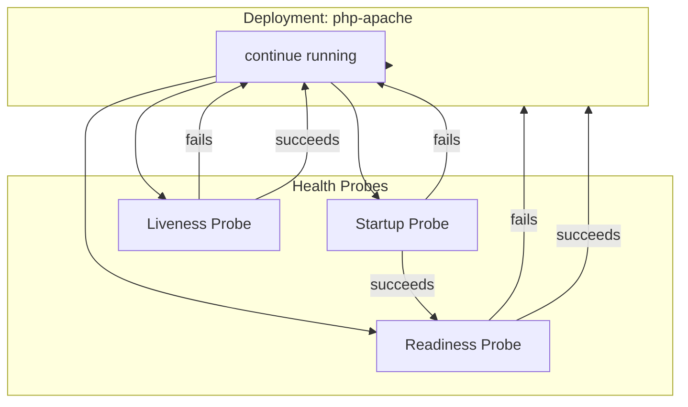
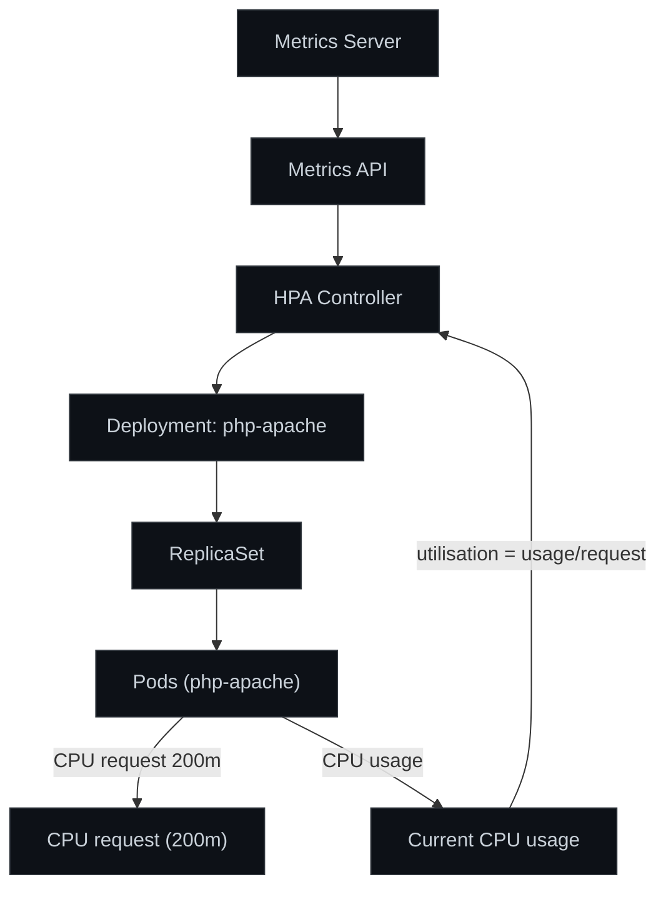
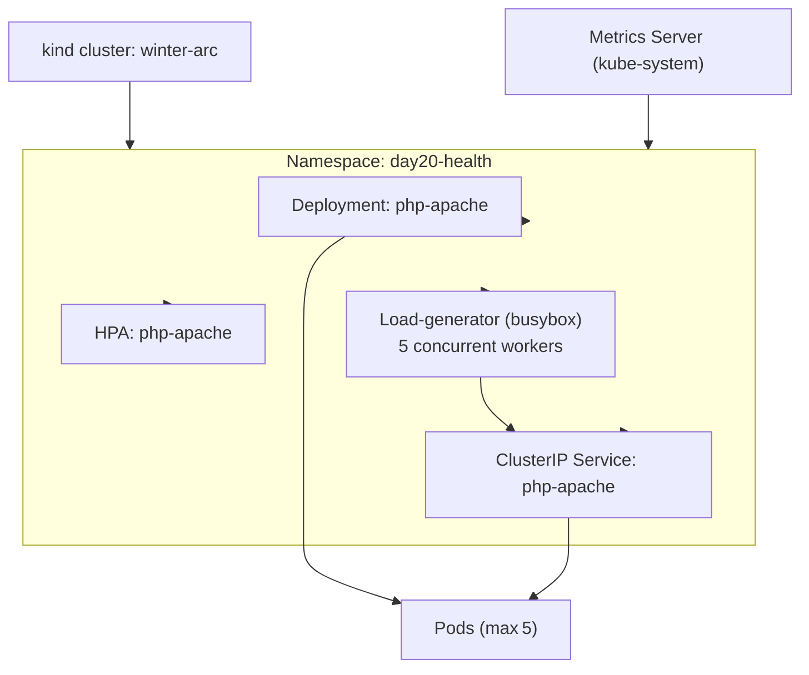

# DevOps Winter Arc — Day 20: Kubernetes Health Checks, Resource Management & Autoscaling

> **Topic:** Building self‑healing, resource‑aware applications with Kubernetes Probes, Requests, Limits, Metrics Server, and Horizontal Pod Autoscaler (HPA).

---

## 🎯 Goal for Today

- Understand **Startup**, **Readiness**, and **Liveness** probes and how Kubernetes reacts to each.
- Define **CPU/Memory requests** and **limits**, and see how they affect scheduling and the QoS class of a Pod.
- Install **Metrics Server**, explore the Metrics API and why it is required for autoscaling.
- Create an **HPA** that scales a `php‑apache` Deployment based on **CPU utilisation**.
- Observe scaling behaviour, troubleshoot probe failures, and understand why Kubernetes does not always scale down instantly.

---

## 📚 Learning Objectives

1. **Kubernetes Probes** – Startup, Readiness, Liveness, HTTP‑GET configuration, timing fields.
2. **Resource Requests & Limits** – CPU (millicores), Memory (Mi), throttling, OOM‑Killed.
3. **QoS Classes** – Guaranteed, Burstable, BestEffort and the class of our lab Pod.
4. **Metrics Server** – installation, TLS‑insecure flag for `kind`, difference from Prometheus.
5. **Horizontal Pod Autoscaler** – calculation of CPU utilisation, min/max replicas, stabilization, unknown metrics.
6. **Troubleshooting** – probe failures, Metrics Server errors, HPA unknown state, readiness failures.

---

## 🗺️ Architecture & Workflow Diagrams

### Diagram 1 – Kubernetes Health‑Check Workflow


### Diagram 2 – HPA Autoscaling Architecture

*Target CPU utilisation:* **50 %**
*Minimum replicas:* **1**
*Maximum replicas:* **5**

### Diagram 3 – Day 20 Lab Architecture

---

## 🧩 Detailed Theory & Notes

### A. Kubernetes Probes
| Probe | Purpose | Key Fields | Typical Values |
| :--- | :--- | :--- | :--- |
| **Startup** | Determines when the application has finished its boot sequence. Until success, **Readiness** and **Liveness** are ignored. | `httpGet`, `initialDelaySeconds`, `periodSeconds`, `failureThreshold`, `successThreshold` | `initialDelaySeconds: 10`, `periodSeconds: 5`, `failureThreshold: 30` |
| **Readiness** | Indicates whether the Pod is ready to receive traffic. Failed probes keep the Pod out of Service endpoints. | `httpGet`, `initialDelaySeconds`, `periodSeconds`, `failureThreshold` | `initialDelaySeconds: 5`, `periodSeconds: 10`, `failureThreshold: 3` |
| **Liveness** | Detects a hung container and triggers a restart. | `httpGet`, `initialDelaySeconds`, `periodSeconds`, `failureThreshold` | `initialDelaySeconds: 15`, `periodSeconds: 15`, `failureThreshold: 5` |

**HTTP‑GET Probe Example** (used in the lab):
```yaml
startupProbe:
  httpGet:
    path: /ready
    port: 80
  initialDelaySeconds: 10
  periodSeconds: 5
  failureThreshold: 30
readinessProbe:
  httpGet:
    path: /
    port: 80
  initialDelaySeconds: 5
  periodSeconds: 10
  failureThreshold: 3
livenessProbe:
  httpGet:
    path: /healthz
    port: 80
  initialDelaySeconds: 15
  periodSeconds: 15
  failureThreshold: 5
```

**What happens on failure**
- **Startup** failure → container is repeatedly restarted until the probe succeeds or the pod reaches its `restartPolicy` limit.
- **Readiness** failure → Pod stays **NotReady**; the Service removes its IP from the endpoint list, so no traffic is sent.
- **Liveness** failure → container is killed and started again by the kubelet.

---

### B. Resource Requests & Limits
| Resource | Request | Limit |
| :--- | :--- | :--- |
| **CPU** | `200m` | `500m` |
| **Memory** | `64Mi` | `128Mi` |

- **`200m` CPU** = 0.2 CPU core (≈200 millicores). The scheduler guarantees that amount of CPU cycles.
- If a container tries to use > `500m` it will be **throttled** (CFS quota).
- If memory usage exceeds the limit, the container is **OOMKilled**.
- **Requests** are crucial for the **HPA** – utilisation is measured as `currentUsage / request`.

---

### C. Kubernetes QoS Classes
| Class | Conditions | Behaviour |
| :--- | :--- | :--- |
| **Guaranteed** | **Requests = Limits** for **CPU** *and* **Memory** on *every* container. | Never throttled, protected from eviction until best‑effort pods are gone. |
| **Burstable** | **Requests** are set, but **Limits** are higher (or omitted). | Preferred over BestEffort; may be throttled when node is contended. |
| **BestEffort** | No requests/limits defined. | First to be evicted under resource pressure. |

Our **php‑apache** Pod had **CPU request 200m, limit 500m** and **memory request 64Mi, limit 128Mi**, therefore it was classified as **Burstable** (verified with `kubectl get pod … -o jsonpath='{.status.qosClass}'`).

---

### D. Metrics Server
- A lightweight aggregator that reads **/stats/summary** from each kubelet and exposes the **Metrics API** (`/apis/metrics.k8s.io`).
- **Difference to Prometheus** – Metrics Server only provides *resource usage* (CPU/Memory) for the HPA; Prometheus stores historic time‑series and can scrape custom metrics.
- In the lab the first `kubectl top pods` returned **`Error: the server does not support the Metrics API`** because the server component was missing.
- Installation steps (see Lab section) required the `--kubelet-insecure-tls` flag – a **lab‑only** workaround for the self‑signed certs used by `kind`. **Never use this in production**.

---

### E. Horizontal Pod Autoscaler
- **CPU utilisation %** = `(current CPU usage / CPU request) × 100`
- Example: request **200m**, current usage **100m** → `100m/200m × 100 = 50 %`.
- HPA reads the target utilisation (**50 %**), compares it to the actual, and adjusts `replicas` accordingly.
- **Stabilisation window** (default 5 min) prevents rapid flapping.
- **Unknown** appears when the Metrics Server has not yet supplied a metric for a newly‑created Pod.

---

## 🧪 Hands‑on Lab: Commands & Real Output

### 1️⃣ Check the Kubernetes Cluster
```bash
kubectl get nodes
```
*Output:* (cluster uses a single‑node `kind` control‑plane – omitted for brevity).

### 2️⃣ Install Metrics Server
```bash
kubectl apply -f https://github.com/kubernetes-sigs/metrics-server/releases/latest/download/components.yaml
kubectl patch deployment metrics-server -n kube-system \
  --type=json -p='[{"op":"add","path":"/spec/template/spec/containers/0/args/-","value":"--kubelet-insecure-tls"}]'
```
*Result:* `kubectl top nodes` now shows CPU/Memory usage.

### 3️⃣ Create Namespace
```bash
kubectl create namespace day20-health
```

### 4️⃣ Create the PHP‑Apache Deployment
```yaml
apiVersion: apps/v1
kind: Deployment
metadata:
  name: php-apache
  namespace: day20-health
spec:
  replicas: 1
  selector:
    matchLabels:
      app: php-apache
  template:
    metadata:
      labels:
        app: php-apache
    spec:
      containers:
      - name: php-apache
        image: registry.k8s.io/hpa-example
        ports:
        - containerPort: 80
        resources:
          requests:
            cpu: "200m"
            memory: "64Mi"
          limits:
            cpu: "500m"
            memory: "128Mi"
        startupProbe:
          httpGet:
            path: /ready
            port: 80
          initialDelaySeconds: 10
          periodSeconds: 5
          failureThreshold: 30
        readinessProbe:
          httpGet:
            path: /
            port: 80
          initialDelaySeconds: 5
          periodSeconds: 10
          failureThreshold: 3
        livenessProbe:
          httpGet:
            path: /healthz
            port: 80
          initialDelaySeconds: 15
          periodSeconds: 15
          failureThreshold: 5
```
*Applied with `kubectl apply -f deployment.yaml`.*

### 5️⃣ Verify Pod Health & QoS
```bash
kubectl get pods -n day20-health
kubectl describe pod <pod-name> -n day20-health
kubectl get pod <pod-name> -n day20-health -o jsonpath='{.status.qosClass}'
kubectl top pod <pod-name> -n day20-health
```
*The QoS class reported **Burstable**.*

### 6️⃣ Create a ClusterIP Service
```yaml
apiVersion: v1
kind: Service
metadata:
  name: php-apache
  namespace: day20-health
spec:
  selector:
    app: php-apache
  ports:
  - port: 80
    targetPort: 80
```
*`wget` against `http://php-apache.day20-health.svc.cluster.local` succeeded after the Service was created (initial `bad address` error resolved).

### 7️⃣ Create the HPA
```bash
kubectl autoscale deployment php-apache -n day20-health \
  --cpu-percent=50 --min=1 --max=5
```
*Warning:* `--cpu-percent` is deprecated; newer versions prefer `--cpu=50%` – behaviour unchanged.

### 8️⃣ Generate Load
```bash
kubectl run load-generator -n day20-health \
  --image=busybox:1.36 --restart=Never \
  -- /bin/sh -c 'for i in 1 2 3 4 5; do ( while true; do wget -q -O /dev/null http://php-apache.day20-health.svc.cluster.local; done ) & done; wait'
```
*Five concurrent workers produced sustained CPU load on the application Pods.*

### 9️⃣ Observe Autoscaling (captured logs)
```bash
# watch HPA metrics
kubectl get hpa -n day20-health -w
```
**Captured output** (excerpt):
```text
NAME         REFERENCE               TARGETS       MINPODS   MAXPODS   REPLICAS   AGE
php-apache   Deployment/php-apache   cpu: 6%/50%   1         5         1          2m36s
...
php-apache   Deployment/php-apache   cpu: 94%/50%         1         5         1          15m
php-apache   Deployment/php-apache   cpu: 250%/50%        1         5         2          15m
php-apache   Deployment/php-apache   cpu: <unknown>/50%   1         5         4          15m
php-apache   Deployment/php-apache   cpu: 81%/50%         1         5         4          16m
php-apache   Deployment/php-apache   cpu: 182%/50%        1         5         5          16m
... (continues until scaling down to 1 replica) ...
```
```bash
# watch Deployment rollout status
kubectl get deployment -n day20-health -w
```
**Captured output** (excerpt):
```text
NAME         READY   UP-TO-DATE   AVAILABLE   AGE
php-apache   1/1     1            1           9m56s
php-apache   0/1     1            0           16m
php-apache   1/1     1            1           16m
... scaling up to 5 replicas ...
php-apache   5/5     5            5           18m
php-apache   1/1     1            1           26m   # after load stopped and HPA scaled down
```

### 10️⃣ Scale Down
Stopping the load‑generator caused CPU utilisation to fall; HPA eventually reported:
```
SuccessfulRescale   New size: 1; reason: All metrics below target
```

### 11️⃣ Test Readiness Probe Failure
```yaml
readinessProbe:
  httpGet:
    path: /wrong-path   # intentional
    port: 80
```
*Event observed:*
```
Readiness probe failed: HTTP probe failed with statuscode: 404
```
Pod remained **Running** (readiness failure does **not** restart the container). Restoring the correct path (`/`) returned the pod to **Ready** state (`1/1 Running`).

---

## 🛠️ Troubleshooting & Lessons Learned
| Issue | Root Cause | Solution | What I Learned |
| :--- | :--- | :--- | :--- |
| **Metrics API not available** | Metrics Server not installed. | Install Metrics Server (`kubectl apply …`). | HPA cannot function without the Metrics API. |
| **Metrics Server TLS issue in kind** | `kind` uses self‑signed kubelet certs. | Patch deployment with `--kubelet-insecure-tls`. | This flag is a lab shortcut; production clusters need proper TLS. |
| **`wget: bad address`** | Service not created yet. | Apply Service manifest before load test. | Services are not auto‑created by Deployments. |
| **Insufficient load first attempt** | Only a single worker generated too little CPU. | Use five concurrent workers. | HPA scales only when utilisation crosses the target. |
| **HPA shows `<unknown>`** | New Pods have not yet reported metrics. | Wait for the Metrics Server to scrape the Pod. | Transient unknown state is normal during scaling. |
| **Readiness probe 404** | Wrong path in probe definition. | Fix `path:` to `/`. | Readiness failures keep Pod out of Service endpoints but do not restart container. |
| **`AlreadyExists` when creating load‑generator** | Load generator Pod already existed from a previous run. | Delete with `kubectl delete pod load-generator -n day20-health` before re‑creating. | Clean up resources before re‑run. |

---

## 📋 Important Commands Cheat Sheet
| Command | Explanation |
| :--- | :--- |
| `kubectl top nodes` | Shows node‑level CPU/Memory usage (requires Metrics Server). |
| `kubectl top pods -n day20-health` | Shows pod‑level resource consumption. |
| `kubectl describe pod <pod> -n day20-health` | Detailed pod spec, events, and probe status. |
| `kubectl get hpa -n day20-health` | List HPA objects and current utilisation. |
| `kubectl describe hpa php-apache -n day20-health` | Full HPA configuration and recent scaling events. |
| `kubectl autoscale deployment php-apache -n day20-health --cpu-percent=50 --min=1 --max=5` | Create an HPA with 50 % CPU target. |
| `kubectl get events -n day20-health` | View recent cluster events (e.g., probe failures). |
| `kubectl rollout status deployment/php-apache -n day20-health` | Watch rollout progress after changes. |
| `kubectl rollout restart deployment/php-apache -n day20-health` | Force a Pod restart (useful after changing probe paths). |
| `kubectl get apiservices` | Verify that `v1beta1.metrics.k8s.io` is **Available**. |
| `kubectl delete namespace day20-health` | Clean up the entire lab environment. |

---

## 🎤 Interview Questions & Detailed Answers
1. **Difference between Readiness and Liveness probes?**
   - *Readiness* determines if a Pod should receive traffic; a failing readiness removes the Pod from Service endpoints but does **not** restart the container. *Liveness* detects a hung container; a failing liveness triggers a container restart by the kubelet.
2. **Why need a Startup Probe if we already have a Liveness Probe?**
   - Startup Probe gives the application extra time to initialise before Liveness checks start. Without it, a slow‑starting app may be killed by Liveness before it becomes healthy.
3. **What happens when a container exceeds its Memory Limit?**
   - The kernel OOM killer terminates the container process; the Pod enters `OOMKilled` status and may be restarted according to the restart policy.
4. **Difference between CPU Requests and CPU Limits?**
   - *Request* is the guaranteed amount of CPU the scheduler reserves for the container. *Limit* is the maximum CPU the container can use; exceeding it results in throttling.
5. **Difference between Guaranteed, Burstable, and BestEffort QoS?**
   - *Guaranteed*: request = limit for all resources → highest priority, never throttled. *Burstable*: request < limit → may be throttled, prioritized over BestEffort. *BestEffort*: no requests/limits → lowest priority, first to be evicted.
6. **Why does HPA need Metrics Server?**
   - HPA reads current CPU/Memory usage via the Metrics API (`metrics.k8s.io`). Without Metrics Server there are no utilisation metrics, so HPA cannot make scaling decisions.
7. **How does HPA calculate CPU utilisation percentage?**
   - `utilisation = (current CPU usage in millicores) / (CPU request in millicores) × 100`.
8. **Why is setting CPU Requests important for HPA?**
   - The request is the denominator of the utilisation formula; without it the HPA cannot compute a percentage.
9. **What happens if you create an HPA without Metrics Server?**
   - The HPA reports `Unable to get metrics for resource cpu` and remains at the current replica count.
10. **Difference between HPA and VPA?**
    - *HPA* scales the **number of Pods** based on utilisation. *VPA* (Vertical Pod Autoscaler) adjusts **resource requests/limits** of individual Pods.
11. **Why might HPA show `unknown` metrics?**
    - New Pods have not yet reported usage to Metrics Server, or the Metrics Server is temporarily unable to scrape them.
12. **Why does HPA not scale down immediately after load decreases?**
    - The default **stabilisation window** (5 min) requires the low utilisation to persist before decreasing replicas, preventing thrashing.
13. **Difference between a Deployment and a Service?**
    - *Deployment* manages Pod lifecycles (create, update, scale). *Service* provides a stable network endpoint (ClusterIP, LoadBalancer) that proxies traffic to the Pods selected by labels.
14. **How would you troubleshoot a Pod that repeatedly fails its health probes?**
    - `kubectl describe pod …` to see probe events, check container logs, verify the probe endpoint works (`curl` from a sidecar), adjust `initialDelaySeconds`/`periodSeconds`, and ensure the application is listening on the expected path/port.

---

## 🔑 Day 20 Key Learnings
- Installed and configured **Metrics Server** (including insecure‑TLS patch for `kind`).
- Monitored node and Pod resource usage with `kubectl top`.
- Defined **CPU/Memory requests & limits** and observed their effect on QoS (Burstable).
- Implemented **startup, readiness, and liveness probes** and understood their lifecycle impact.
- Created a **ClusterIP Service** to expose the Deployment.
- Configured an **HPA** with a 50 % CPU target, watched automatic scaling from **1 → 5 replicas** and back down to **1**.
- Explored why HPA temporarily shows **unknown** metrics and why scaling down is delayed.
- Tested a **readiness probe failure** and restored the Pod to a healthy state.

---

[← Day 19](Day19.md) | [Home](Day01.md) | [Day 21 →](Day21.md)
