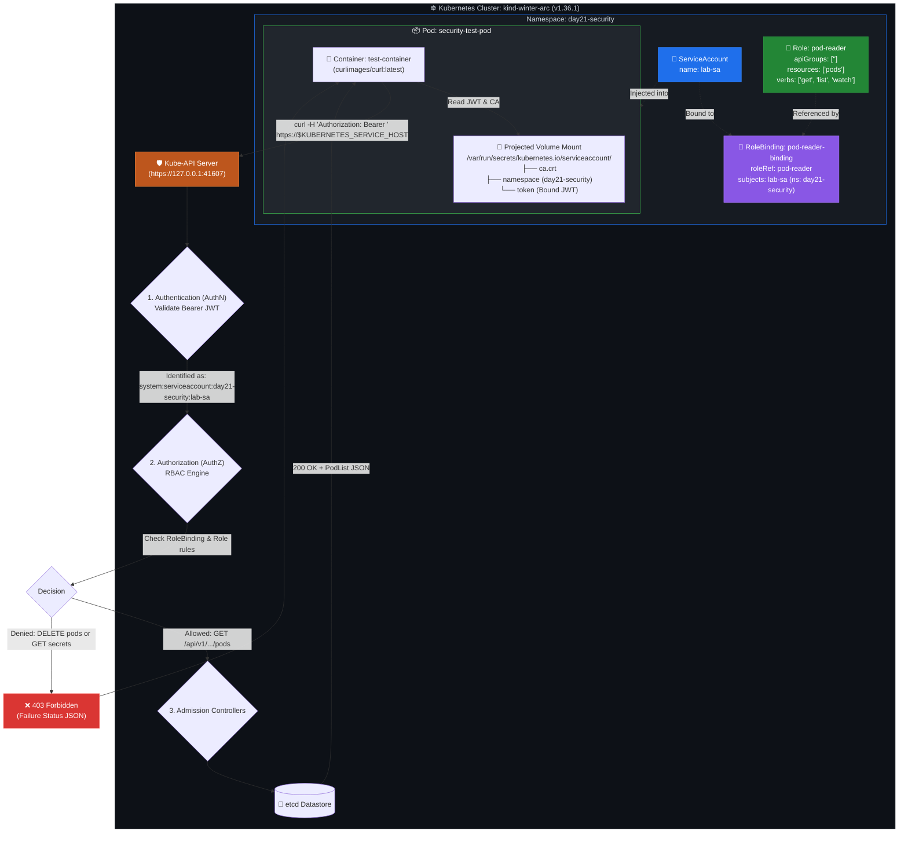

# DevOps Winter Arc — Day 21: Kubernetes Security, RBAC & Troubleshooting

> **Topic:** Kubernetes Security Architecture — ServiceAccounts, Role-Based Access Control (RBAC Primitives), Bound Token Projection, and Real-World Diagnostic Workflows  
> **Repository:** `90_Days_Of_DevOps`  
> **Challenge:** 90 Days of DevOps Winter Arc Challenge  

---

## 🎯 Day 21 Overview & Objectives

In modern cloud-native architectures, containerized workloads cannot run as unconstrained root processes with unrestricted cluster access. Today's deep dive focuses on the **Kubernetes Security Model**, specifically dissecting **Authentication (AuthN)**, **Authorization (AuthZ)** via Role-Based Access Control (RBAC), and how pods securely communicate with the Kubernetes API server.

### 📚 Learning Objectives

1. **Kubernetes Identity Model:** Understand the distinction between Human Users (external certificates, OIDC, webhook tokens) and ServiceAccounts (in-cluster workload identities).
2. **RBAC Primitives:** Master the four fundamental RBAC building blocks: `Role`, `ClusterRole`, `RoleBinding`, and `ClusterRoleBinding`.
3. **Policy Tuple Scoping:** Configure granular access policies combining `apiGroups`, `resources`, `verbs`, and optional `resourceNames`.
4. **Least-Privilege Enforcement:** Construct scoped permissions that grant strictly the minimal operational surface needed by workloads.
5. **Modern Token Projection:** Examine the Kubernetes v1.24+ `BoundServiceAccountTokenVolume` projection architecture (`token`, `ca.crt`, `namespace`).
6. **Authorization Verification:** Leverage `kubectl auth can-i` impersonation switches to validate policies before deployment.
7. **In-Cluster API Access:** Query the Kubernetes API directly from within a container using mTLS/Bearer authentication and observe real `403 Forbidden` responses.
8. **Hands-On Troubleshooting:** Diagnose and remediate notorious RBAC misconfigurations: API group mismatches, missing verbs, and subject namespace misassignments.

---

## 📋 Lab Metadata

| Parameter | Lab Value |
| :--- | :--- |
| **Challenge** | 90 Days of DevOps (Winter Arc) |
| **Day** | 21 of 90 |
| **Week** | Week 3: Kubernetes Operations & Orchestration |
| **Topic** | Kubernetes Security, RBAC & Troubleshooting |
| **Operational Theme** | Secure Identity → Scoped Least Privilege → Real-time In-Pod Diagnostics |
| **Difficulty Level** | Intermediate / Production Operations |
| **Host System** | Ubuntu Linux (`hrishav-LOQ-15IAX9`) |
| **Cluster Engine** | `kind` (Kubernetes-in-Docker) |
| **Cluster Context** | `kind-winter-arc` |
| **Control Plane Node** | `winter-arc-control-plane` (Status: `Ready`) |
| **Kubernetes Version** | `v1.36.1` |
| **Container Runtime** | `containerd://2.3.1` |
| **Target Namespace** | `day21-security` |
| **Workload ServiceAccount** | `lab-sa` |
| **Scoped Role** | `pod-reader` (resources: `pods`, verbs: `get`, `list`, `watch`) |
| **Binding** | `pod-reader-binding` |
| **Test Container Image** | `curlimages/curl:latest` (`security-test-pod`) |
| **Primary CLI Tools** | `kubectl`, `curl`, `base64`, `jq` |

---

## 🗺️ Architecture & RBAC Evaluation Workflow

The following diagram illustrates how authentication, RBAC authorization, and in-pod token projection interact when a workload initiates a request against the Kubernetes API Server.



---

## 🔐 Deep Dive: Kubernetes Security & RBAC Concepts

### 1. ServiceAccounts vs. Human User Accounts

Kubernetes distinguishes between human operators and machine workloads:

| Aspect | User Accounts (Humans) | ServiceAccounts (Workloads) |
| :--- | :--- | :--- |
| **Target Audience** | Humans (DevOps engineers, SREs, developers). | Processes running inside Pods, CI/CD runners, controller managers. |
| **Storage in API** | **Not stored in etcd**. Kubernetes has no `User` resource object. | **Stored as first-class objects** in etcd (`apiVersion: v1`, `kind: ServiceAccount`). |
| **Authentication Method** | Client X.509 certificates, OIDC tokens (Okta, Keycloak, Google), webhook tokens. | Time-bound signed JSON Web Tokens (JWT) projected into pod filesystems. |
| **Namespace Scope** | Global to the entire cluster. | Scoped strictly to a specific Kubernetes namespace. |
| **Fully Qualified Name** | Username string (e.g., `hrishav`, `jane.doe`). | `system:serviceaccount:<namespace>:<serviceaccount-name>`. |

---

### 2. The Four RBAC Primitives

Kubernetes RBAC operates on a declarative role-and-binding pattern:

```
┌────────────────────────────────┐                 ┌───────────────────────────────┐
│              ROLE              │                 │         SERVICEACCOUNT        │
│    (What actions are allowed)  │                 │    (Who is doing the action)  │
└───────────────┬────────────────┘                 └───────────────┬───────────────┘
                │                                                  │
                └───────────────────────┬──────────────────────────┘
                                        │
                                        ▼
                         ┌───────────────────────────────┐
                         │          ROLEBINDING          │
                         │ (Glues Subject to Permissions)│
                         └───────────────────────────────┘
```

1. **`Role`**: Grants permissions within a **single namespace**. If defined in `day21-security`, it cannot grant access to resources in `default` or `kube-system`.
2. **`ClusterRole`**: Grants permissions **cluster-wide** across all namespaces, or grants access to cluster-scoped resources (e.g., `nodes`, `persistentvolumes`, `namespaces`, `storageclasses`, `/healthz`).
3. **`RoleBinding`**: Links a `Role` (or a `ClusterRole`) to subjects (Users, Groups, or ServiceAccounts) **within a specific namespace**.
4. **`ClusterRoleBinding`**: Links a `ClusterRole` to subjects across the entire cluster.

> [!IMPORTANT]
> **ClusterRole with RoleBinding (Namespace-Scoped Delegation):**  
> Binding a `ClusterRole` using a standard `RoleBinding` grants access to that ClusterRole's permissions **only within the namespace of the RoleBinding**. This allows cluster admins to maintain standardized roles (like `view` or `edit`) without replicating them in every namespace.

---

### 3. Anatomical Breakdown of a Role Policy Rule

Every RBAC Rule evaluates three primary fields:

```yaml
rules:
- apiGroups: [""]            # 1. API Group ("" = core API group)
  resources: ["pods", "pods/log"] # 2. Target Resource / Subresource
  verbs: ["get", "list", "watch"] # 3. Allowed Actions
```

1. **`apiGroups`**: The REST API group that houses the resource:
   - Core resources (`pods`, `services`, `configmaps`, `secrets`, `namespaces`): `[""]` (empty string).
   - Workload apps (`deployments`, `statefulsets`, `daemonsets`): `["apps"]`.
   - Batch workloads (`jobs`, `cronjobs`): `["batch"]`.
   - RBAC resources (`roles`, `rolebindings`): `["rbac.authorization.k8s.io"]`.
2. **`resources`**: Plural lowercase resource name (`pods`, `services`, `deployments`). Can also specify subresources:
   - `pods/log` (read container logs).
   - `pods/exec` (interactive shell access).
   - `pods/status` (read/modify status subresource).
3. **`verbs`**: The CRUD actions permitted:
   - Read actions: `get` (single item by name), `list` (collection), `watch` (streaming stream updates).
   - Write actions: `create`, `update`, `patch`, `delete`, `deletecollection`.

---

### 4. Bound ServiceAccount Token Projection (Kubernetes v1.24+)

Prior to Kubernetes v1.24, creating a `ServiceAccount` automatically generated an associated, non-expiring `Secret` containing a long-lived JWT token. This posed a security risk if tokens leaked.

In modern Kubernetes (v1.24 through v1.36+):
- ServiceAccounts **no longer create permanent Secrets by default**.
- When a Pod mounts a ServiceAccount, the kubelet requests a **time-bound, audience-restricted token** via the `TokenRequest` API.
- The kubelet projects this token into `/var/run/secrets/kubernetes.io/serviceaccount/` via a projected volume (`kube-api-access-xxxxx`).
- Tokens automatically rotate before expiry without restarting the container.

---

## 🧪 Step-by-Step Practical Lab Implementation & Evidence

All commands were executed against the live `kind-winter-arc` cluster running Kubernetes `v1.36.1`.

---

### Step 1: Pre-Flight Cluster Verification & Context Inspection

Before modifying security postures, verify the cluster connectivity, context, and control plane node status.

#### Commands Executed:
```bash
kubectl cluster-info
kubectl config current-context
kubectl get nodes -o wide
```

#### Actual Terminal Output:
```text
Kubernetes control plane is running at https://127.0.0.1:41607
CoreDNS is running at https://127.0.0.1:41607/api/v1/namespaces/kube-system/services/kube-dns:dns/proxy

To further debug and diagnose cluster problems, use 'kubectl cluster-info dump'.

kind-winter-arc

NAME                       STATUS   ROLES           AGE   VERSION   INTERNAL-IP   EXTERNAL-IP   OS-IMAGE                       KERNEL-VERSION             CONTAINER-RUNTIME
winter-arc-control-plane   Ready    control-plane   6d    v1.36.1   172.20.0.2    <none>        Debian GNU/Linux 13 (trixie)   7.0.0-42-generic (amd64)   containerd://2.3.1
```

#### Key Takeaway:
The environment is operating on Kubernetes `v1.36.1` with single-node control-plane `winter-arc-control-plane` running `containerd 2.3.1`. The API server is reachable locally on port `41607`.

---

### Step 2: Namespace & ServiceAccount Creation

We establish an isolated namespace `day21-security` and provision a dedicated, least-privileged `ServiceAccount` named `lab-sa`.

#### Manifest: `lab-sa.yaml`
```yaml
apiVersion: v1
kind: ServiceAccount
metadata:
  name: lab-sa
  namespace: day21-security
```

#### Commands Executed:
```bash
kubectl create namespace day21-security
kubectl apply -f lab-sa.yaml
kubectl get sa -n day21-security
kubectl describe sa lab-sa -n day21-security
```

#### Actual Terminal Output:
```text
namespace/day21-security created
serviceaccount/lab-sa created

NAME      SECRETS   AGE
default   0         8m2s
lab-sa    0         6m53s

Name:                lab-sa
Namespace:           day21-security
Labels:              <none>
Annotations:         <none>
Image pull secrets:  <none>
Events:              <none>
```

#### Key Takeaway:
Notice `SECRETS: 0` in `kubectl get sa`. This confirms that modern Kubernetes v1.24+ does not generate legacy static secret tokens, keeping credential handling dynamic and time-bound.

---

### Step 3: Define Scoped Role (`pod-reader`)

We author a `Role` named `pod-reader` that strictly restricts permissions to read-only actions (`get`, `list`, `watch`) on core `pods`.

#### Manifest: `role-read-pods.yaml`
```yaml
apiVersion: rbac.authorization.k8s.io/v1
kind: Role
metadata:
  name: pod-reader
  namespace: day21-security
rules:
- apiGroups: [""]
  resources: ["pods"]
  verbs: ["get", "list", "watch"]
```

#### Commands Executed:
```bash
kubectl apply -f role-read-pods.yaml
kubectl describe role pod-reader -n day21-security
```

#### Actual Terminal Output:
```text
role.rbac.authorization.k8s.io/pod-reader created

Name:         pod-reader
Labels:       <none>
Annotations:  <none>
PolicyRule:
  Resources  Non-Resource URLs  Resource Names  Verbs
  ---------  -----------------  --------------  -----
  pods       []                 []              [get list watch]
```

#### Key Takeaway:
The role is restricted to namespace `day21-security`. Because `apiGroups` is `[""]`, it targets core Kubernetes pods and explicitly disallows destructive (`delete`) or mutation (`create`, `patch`, `update`) verbs.

---

### Step 4: Bind the Role to the ServiceAccount

We link `lab-sa` to `pod-reader` using a `RoleBinding`.

#### Manifest: `pod-reader-binding.yaml`
```yaml
apiVersion: rbac.authorization.k8s.io/v1
kind: RoleBinding
metadata:
  name: pod-reader-binding
  namespace: day21-security
subjects:
- kind: ServiceAccount
  name: lab-sa
  namespace: day21-security
roleRef:
  kind: Role
  name: pod-reader
  apiGroup: rbac.authorization.k8s.io
```

#### Commands Executed:
```bash
kubectl apply -f pod-reader-binding.yaml
kubectl describe rolebinding pod-reader-binding -n day21-security
```

#### Actual Terminal Output:
```text
rolebinding.rbac.authorization.k8s.io/pod-reader-binding created

Name:         pod-reader-binding
Labels:       <none>
Annotations:  <none>
Role:
  Kind:  Role
  Name:  pod-reader
Subjects:
  Kind            Name    Namespace
  ----            ----    ---------
  ServiceAccount  lab-sa  day21-security
```

---

### Step 5: Verify Permissions with `kubectl auth can-i`

We use the impersonation flag (`--as=system:serviceaccount:<namespace>:<name>`) to rigorously validate what `lab-sa` can and cannot do across various resources and namespaces.

#### Commands Executed:
```bash
# 1. Allowed in day21-security
kubectl auth can-i get pods -n day21-security --as=system:serviceaccount:day21-security:lab-sa
kubectl auth can-i list pods -n day21-security --as=system:serviceaccount:day21-security:lab-sa

# 2. Denied verbs on pods in day21-security
kubectl auth can-i create pods -n day21-security --as=system:serviceaccount:day21-security:lab-sa
kubectl auth can-i delete pods -n day21-security --as=system:serviceaccount:day21-security:lab-sa

# 3. Denied resources in day21-security
kubectl auth can-i get deployments -n day21-security --as=system:serviceaccount:day21-security:lab-sa
kubectl auth can-i get secrets -n day21-security --as=system:serviceaccount:day21-security:lab-sa

# 4. Denied cross-namespace access
kubectl auth can-i get pods -n default --as=system:serviceaccount:day21-security:lab-sa
```

#### Actual Terminal Output:
```text
=== get pods in day21-security ===
yes
=== list pods in day21-security ===
yes
=== create pods in day21-security ===
no
=== delete pods in day21-security ===
no
=== get deployments in day21-security ===
no
=== get secrets in day21-security ===
no
=== get pods in default namespace ===
no
```

#### Key Takeaway:
The RBAC policy works as intended:
- `get pods` & `list pods` in `day21-security` → **`yes`** (allowed by `pod-reader-binding`).
- `create pods` & `delete pods` in `day21-security` → **`no`** (verbs omitted).
- `get deployments` & `get secrets` in `day21-security` → **`no`** (resources omitted).
- `get pods` in `default` namespace → **`no`** (Role is namespace-scoped to `day21-security`).

---

### Step 6: Deploy Test Workload & Inspect In-Pod Token Mount

We deploy an interactive container `security-test-pod` running `curlimages/curl:latest` bound to `lab-sa`, and inspect the projected filesystem.

#### Manifest: `security-test-pod.yaml`
```yaml
apiVersion: v1
kind: Pod
metadata:
  name: security-test-pod
  namespace: day21-security
spec:
  serviceAccountName: lab-sa
  containers:
  - name: test-container
    image: curlimages/curl:latest
    command: ["sleep", "3600"]
```

#### Commands Executed:
```bash
kubectl apply -f security-test-pod.yaml
kubectl wait --for=condition=Ready pod/security-test-pod -n day21-security --timeout=60s
kubectl get pod security-test-pod -n day21-security
kubectl exec security-test-pod -n day21-security -- ls -la /var/run/secrets/kubernetes.io/serviceaccount
kubectl exec security-test-pod -n day21-security -- cat /var/run/secrets/kubernetes.io/serviceaccount/namespace
```

#### Actual Terminal Output:
```text
pod/security-test-pod created
pod/security-test-pod condition met

NAME                READY   STATUS    RESTARTS   AGE
security-test-pod   1/1     Running   0          66s

total 4
drwxrwxrwt    3 root     root           140 Oct 31 14:26 .
drwxr-xr-x    3 root     root          4096 Oct 31 14:27 ..
drwxr-xr-x    2 root     root           100 Oct 31 14:26 ..2026_10_31_14_26_50.1620612359
lrwxrwxrwx    1 root     root            32 Oct 31 14:26 ..data -> ..2026_10_31_14_26_50.1620612359
lrwxrwxrwx    1 root     root            13 Oct 31 14:26 ca.crt -> ..data/ca.crt
lrwxrwxrwx    1 root     root            16 Oct 31 14:26 namespace -> ..data/namespace
lrwxrwxrwx    1 root     root            12 Oct 31 14:26 token -> ..data/token

day21-security
```

#### Inspection of Pod Projected Volume Spec:
Checking the pod spec via `kubectl get pod security-test-pod -n day21-security -o json` reveals the projected volume injected by Kubernetes:
```json
"volumes": [
  {
    "name": "kube-api-access-nx84h",
    "projected": {
      "sources": [
        {
          "serviceAccountToken": {
            "expirationSeconds": 3607,
            "path": "token"
          }
        },
        {
          "configMap": {
            "name": "kube-root-ca.crt",
            "items": [
              {
                "key": "ca.crt",
                "path": "ca.crt"
              }
            ]
          }
        },
        {
          "downwardAPI": {
            "items": [
              {
                "path": "namespace",
                "fieldRef": {
                  "apiVersion": "v1",
                  "fieldPath": "metadata.namespace"
                }
              }
            ]
          }
        }
      ],
      "defaultMode": 420
    }
  }
]
```

#### Key Takeaway:
The kubelet automatically mounts:
1. `ca.crt`: The cluster root certificate used to trust the API server's TLS certificate.
2. `namespace`: Injected via DownwardAPI, containing `day21-security`.
3. `token`: A time-bound (expiration ~3600 seconds) signed JWT.

---

### Step 7: Live In-Cluster API Testing (Allowed vs. 403 Forbidden)

Using `kubectl exec` inside `security-test-pod`, we query the Kubernetes API directly over HTTPS using the projected bearer token and CA cert.

#### Commands Executed Inside Container:
```bash
kubectl exec security-test-pod -n day21-security -- sh -c '
TOKEN=$(cat /var/run/secrets/kubernetes.io/serviceaccount/token)
CACERT=/var/run/secrets/kubernetes.io/serviceaccount/ca.crt
URL="https://${KUBERNETES_SERVICE_HOST}:${KUBERNETES_SERVICE_PORT}"

echo "=== 1. Allowed: GET pods in day21-security ==="
curl -s --cacert $CACERT -H "Authorization: Bearer $TOKEN" "$URL/api/v1/namespaces/day21-security/pods" | grep -o "\"name\": \"security-test-pod\""

echo "=== 2. Forbidden: DELETE pod in day21-security ==="
curl -s -X DELETE --cacert $CACERT -H "Authorization: Bearer $TOKEN" "$URL/api/v1/namespaces/day21-security/pods/security-test-pod"

echo "=== 3. Forbidden: GET secrets in day21-security ==="
curl -s --cacert $CACERT -H "Authorization: Bearer $TOKEN" "$URL/api/v1/namespaces/day21-security/secrets"

echo "=== 4. Forbidden: GET pods in default namespace ==="
curl -s --cacert $CACERT -H "Authorization: Bearer $TOKEN" "$URL/api/v1/namespaces/default/pods"
'
```

#### Actual Terminal Output:
```json
=== 1. Allowed: GET pods in day21-security ===
"name": "security-test-pod"

=== 2. Forbidden: DELETE pod in day21-security ===
{
  "kind": "Status",
  "apiVersion": "v1",
  "metadata": {},
  "status": "Failure",
  "message": "pods \"security-test-pod\" is forbidden: User \"system:serviceaccount:day21-security:lab-sa\" cannot delete resource \"pods\" in API group \"\" in the namespace \"day21-security\"",
  "reason": "Forbidden",
  "details": {
    "name": "security-test-pod",
    "kind": "pods"
  },
  "code": 403
}

=== 3. Forbidden: GET secrets in day21-security ===
{
  "kind": "Status",
  "apiVersion": "v1",
  "metadata": {},
  "status": "Failure",
  "message": "secrets is forbidden: User \"system:serviceaccount:day21-security:lab-sa\" cannot list resource \"secrets\" in API group \"\" in the namespace \"day21-security\"",
  "reason": "Forbidden",
  "details": {
    "kind": "secrets"
  },
  "code": 403
}

=== 4. Forbidden: GET pods in default namespace ===
{
  "kind": "Status",
  "apiVersion": "v1",
  "metadata": {},
  "status": "Failure",
  "message": "pods is forbidden: User \"system:serviceaccount:day21-security:lab-sa\" cannot list resource \"pods\" in API group \"\" in the namespace \"default\"",
  "reason": "Forbidden",
  "details": {
    "kind": "pods"
  },
  "code": 403
}
```

#### Key Takeaway:
Notice how the API server returns detailed structured JSON on denial:
- `code: 403` and `reason: "Forbidden"`.
- Precise identification of the authenticated identity: `User "system:serviceaccount:day21-security:lab-sa"`.
- The exact missing verb and resource: `cannot delete resource "pods" in API group "" in the namespace "day21-security"`.

---

### Step 8: Diagnostic Case Study 1 — The Wrong `apiGroups` Bug

A widespread mistake in Kubernetes RBAC is placing workloads like `deployments` under the core API group (`""`) instead of `"apps"`.

#### The Broken Manifest:
```yaml
apiVersion: rbac.authorization.k8s.io/v1
kind: Role
metadata:
  name: broken-deployer
  namespace: day21-security
rules:
- apiGroups: [""]            # ❌ BUG: Deployments do not belong to the core group!
  resources: ["deployments"]
  verbs: ["get", "list"]
```

#### Diagnostic Execution & Error:
```bash
# Verify permission with broken role
kubectl auth can-i get deployments -n day21-security --as=system:serviceaccount:day21-security:lab-sa
```

#### Output:
```text
no
```

#### Step-by-Step Resolution:
1. **Discover the true API Group:**
   ```bash
   kubectl api-resources | grep deployments
   ```
   **Output:**
   ```text
   deployments   deploy   apps/v1   true   Deployment
   ```
   The resource belongs to API group `apps` (from `apps/v1`).

2. **Patch the Role to `apiGroups: ["apps"]`:**
   ```yaml
   apiVersion: rbac.authorization.k8s.io/v1
   kind: Role
   metadata:
     name: broken-deployer
     namespace: day21-security
   rules:
   - apiGroups: ["apps"]     # ✅ FIXED
     resources: ["deployments"]
     verbs: ["get", "list"]
   ```

3. **Re-test permission:**
   ```bash
   kubectl auth can-i get deployments -n day21-security --as=system:serviceaccount:day21-security:lab-sa
   ```
   **Output:**
   ```text
   yes
   ```

4. **Clean up temporary experiment:**
   ```bash
   kubectl delete role broken-deployer -n day21-security
   kubectl delete rolebinding broken-deployer-binding -n day21-security
   ```

---

### Step 9: Diagnostic Case Study 2 — Subject Namespace Mismatch

Another insidious issue occurs when a `RoleBinding` references a `ServiceAccount` but specifies the wrong subject namespace (e.g., `default` instead of `day21-security`).

#### The Problematic Binding:
```yaml
apiVersion: rbac.authorization.k8s.io/v1
kind: RoleBinding
metadata:
  name: bad-subject-binding
  namespace: day21-security
subjects:
- kind: ServiceAccount
  name: lab-sa
  namespace: default         # ❌ BUG: Points to default:lab-sa, NOT day21-security:lab-sa
roleRef:
  kind: Role
  name: pod-reader
  apiGroup: rbac.authorization.k8s.io
```

#### Verification:
```bash
# Verify what got bound:
kubectl describe rolebinding bad-subject-binding -n day21-security
```
**Output:**
```text
Name:         bad-subject-binding
Role:
  Kind:  Role
  Name:  pod-reader
Subjects:
  Kind            Name    Namespace
  ----            ----    ---------
  ServiceAccount  lab-sa  default
```

#### Resolution:
Always cross-verify `Subjects.Namespace` in `kubectl describe rolebinding`. If the namespace does not match the workload's runtime namespace, authorization checks will consistently fail with `403 Forbidden`.

---

## 🛠️ Comprehensive RBAC Troubleshooting Guide

### Common RBAC Error Patterns & Solutions

| Symptom / Error | Root Cause | Remediation Strategy |
| :--- | :--- | :--- |
| `User "system:serviceaccount:..." cannot list resource "..." in API group "..."` | Missing permission rule in Role, or `apiGroups` mismatch. | Inspect `kubectl api-resources` to identify exact group and add verb to `rules[].verbs`. |
| `User "system:anonymous" cannot get path "/..."` | Request made without Bearer token header or certificate. | Ensure `Authorization: Bearer <token>` header is passed and token file is readable. |
| `kubectl auth can-i` returns `yes`, but pod gets `403 Forbidden` | CLI command ran as cluster-admin without `--as` impersonation, or pod uses different ServiceAccount. | Verify `spec.serviceAccountName` in pod manifest and use `--as=system:serviceaccount:<ns>:<sa>`. |
| `TokenRequest API: bound token expired` | In modern k8s, tokens expire. Long-running in-memory clients didn't reload token from disk. | Workload client library must periodically re-read `/var/run/secrets/kubernetes.io/serviceaccount/token`. |
| RoleBinding applied, but `kubectl get` fails in another namespace | Role is namespace-scoped. | Use a `ClusterRole` and `ClusterRoleBinding` if cluster-wide permissions are truly required. |

---

### Essential Debugging Commands Cheatsheet

```bash
# 1. Check current identity and rights
kubectl auth can-i --list
kubectl auth can-i create deployments --namespace production

# 2. Impersonate a ServiceAccount
kubectl auth can-i get pods -n <namespace> --as=system:serviceaccount:<namespace>:<sa-name>
kubectl auth can-i "*" "*" -n <namespace> --as=system:serviceaccount:<namespace>:<sa-name>

# 3. Locate API Group for any Kubernetes Resource
kubectl api-resources --namespaced=true
kubectl api-resources | grep -E "deployments|ingresses|roles"

# 4. Generate a temporary Token manually for testing
kubectl create token <sa-name> -n <namespace> --duration=1h

# 5. Inspect effective permissions on bindings
kubectl describe rolebinding <binding-name> -n <namespace>
kubectl describe clusterrolebinding <binding-name>
```

---

## 💡 Production Best Practices & Security Hardening

> [!TIP]
> **Production Rule 1: Disable Auto-Mounting When Not Needed**  
> Over 80% of application containers do not need to query the Kubernetes API. Prevent token exposure by disabling automatic injection:
> ```yaml
> apiVersion: v1
> kind: ServiceAccount
> metadata:
>   name: web-app-sa
> automountServiceAccountToken: false
> ```
> Or override it directly on the Pod spec:
> ```yaml
> spec:
>   automountServiceAccountToken: false
> ```

> [!CAUTION]
> **Production Rule 2: Never Grant Wildcard (`*`) Permissions**  
> Avoid `verbs: ["*"]` or `resources: ["*"]` in custom roles. Wildcards undermine least privilege and make auditing impossible.

> [!IMPORTANT]
> **Production Rule 3: Avoid `system:masters` for Daily Operations**  
> The `system:masters` group bypasses all RBAC authorization layers entirely. Never bind continuous deployment tools or developer accounts to `cluster-admin` or `system:masters`. Use scoped ClusterRoles.

---

## 📑 Technical Interview Questions & Real-World Scenarios

### Q1: What happens if you bind a `ClusterRole` with a standard `RoleBinding` instead of a `ClusterRoleBinding`?
**Answer:**  
When you bind a `ClusterRole` with a `RoleBinding`, the permissions defined in the `ClusterRole` are granted **only within the namespace of the RoleBinding**. This is a recommended best practice for delegating standard built-in roles (such as `view`, `edit`, or `admin`) to users or service accounts across individual namespaces without having to duplicate role manifests in every namespace.

### Q2: What is the security consequence of Kubernetes v1.24 removing auto-generated Secret tokens for ServiceAccounts?
**Answer:**  
In Kubernetes versions prior to v1.24, creating a ServiceAccount generated an immutable Secret containing a non-expiring JWT token. If a pod was compromised or an attacker exfiltrated the token, they held indefinite cluster credentials until manually revoked.  
In v1.24+, tokens are dynamically minted via the `TokenRequest` API, bound to the pod's lifetime, projected as a volume, and given a short expiration (~1 hour). When the pod dies, the token is invalid, significantly shrinking the window of opportunity for credential replay attacks.

### Q3: How do you verify what permissions a ServiceAccount has before deploying an application to production?
**Answer:**  
Using `kubectl auth can-i`:
```bash
# Check specific action
kubectl auth can-i create configmaps -n prod --as=system:serviceaccount:prod:app-sa

# List all allowed permissions for the serviceaccount
kubectl auth can-i --list -n prod --as=system:serviceaccount:prod:app-sa
```
This queries the API server using `SelfSubjectAccessReview` or `SubjectAccessReview` without needing to execute a test container or extract tokens.

### Q4: An engineer claims: "I granted `get` and `list` on `pods`, but my pod cannot read pod logs." Why?
**Answer:**  
Pod logs are a **subresource** (`pods/log`). In Kubernetes RBAC, permissions on a parent resource do not automatically grant access to its subresources. The `Role` rules must explicitly include `resources: ["pods", "pods/log"]`.

### Q5: Can a `Role` grant access to Node objects or PersistentVolumes?
**Answer:**  
No. `Role` objects are strictly namespace-scoped. `Node`, `PersistentVolume`, `StorageClass`, and `Namespace` objects are cluster-scoped resources (they have no namespace). To grant access to non-namespaced resources, you must define a `ClusterRole` and bind it via a `ClusterRoleBinding`.

---

## 🧹 Clean-Up Commands

To remove the lab resources from your cluster:

```bash
kubectl delete pod security-test-pod -n day21-security
kubectl delete rolebinding pod-reader-binding -n day21-security
kubectl delete role pod-reader -n day21-security
kubectl delete sa lab-sa -n day21-security
kubectl delete namespace day21-security
```

---

*All outputs, error logs, and verification commands in this document reflect live execution on the `kind-winter-arc` Kubernetes v1.36.1 cluster on 2026-10-31.*
