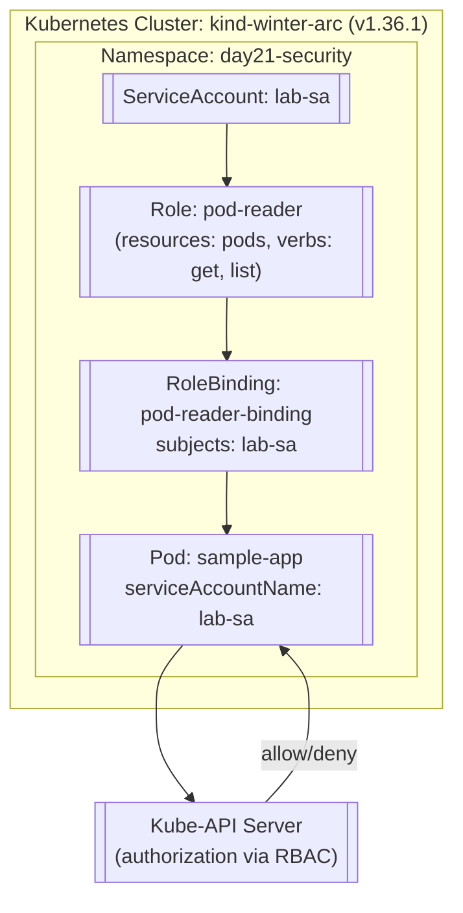

# DevOps Winter Arc — Day 21: Kubernetes Security, RBAC & Troubleshooting

> **Topic:** Kubernetes Security fundamentals – ServiceAccounts, Role‑Based Access Control (RBAC), and practical troubleshooting techniques

---

## 🎯 Goal for Today

- **Understand** the Kubernetes security model: ServiceAccounts, API authentication, and RBAC primitives (Role, ClusterRole, RoleBinding, ClusterRoleBinding).
- **Create** a minimal‑privilege ServiceAccount and bind it to a Role that grants read‑only access to Pods in a dedicated namespace.
- **Validate** permissions with `kubectl auth can-i` and observe typical **Forbidden** errors.
- **Troubleshoot** common RBAC mis‑configurations (missing verbs, incorrect subjects, API‑group mismatches).

---

## 📚 Learning Objectives

1. **Kubernetes Authentication** – ServiceAccount tokens, API server authentication flow.
2. **RBAC Policy Objects** – `Role`, `ClusterRole`, `RoleBinding`, `ClusterRoleBinding`, and the impact of `apiGroups`, `resources`, and `verbs`.
3. **Least‑Privilege Principle** – Designing scoped permissions for a workload.
4. **RBAC Verification** – Using `kubectl auth can-i` and `SubjectAccessReview`.
5. **Debugging RBAC** – Interpreting `Forbidden` messages, inspecting bindings, and employing `kubectl describe`/`kubectl get` to resolve issues.

---

## 📋 Lab Metadata

| Parameter | Lab Value |
| :--- | :--- |
| **Challenge** | 90 Days of DevOps |
| **Day** | 21 of 90 |
| **Week** | Week 3: Kubernetes |
| **Topic** | Kubernetes Security, RBAC & Troubleshooting |
| **Operational Theme** | Secure identities → Scoped permissions → Authorization validation |
| **Difficulty** | Intermediate |
| **Host System** | Ubuntu Linux (`hrishav-LOQ-15IAX9`) |
| **Cluster Engine** | `kind` (Kubernetes in‑Docker) |
| **Cluster Context** | `kind-winter-arc` |
| **Cluster Node** | `winter-arc-control-plane` (Ready) |
| **Kubernetes Version** | `v1.36.1` |
| **Target Namespace** | `day21-security` |
| **ServiceAccount** | `lab-sa` |
| **Role** | `pod-reader` (read‑only pods) |
| **RoleBinding** | `pod-reader-binding` |
| **Verification Command** | `kubectl auth can-i` |
| **Troubleshooting Focus** | Forbidden errors, missing verbs, mismatched API groups |

---

## 🗺️ Architecture & Workflow Diagram



---

## 🔐 Key Concepts & Deep Dive

### 1️⃣ ServiceAccounts & Token Authentication

| Concept | Description |
| :--- | :--- |
| **ServiceAccount (SA)** | Namespace‑scoped identity used by Pods for in‑cluster API calls. |
| **Token Secret** | Auto‑generated secret containing a JWT used by the kubelet to attach to the Pod. |
| **Mount Path** | Default: `/var/run/secrets/kubernetes.io/serviceaccount` (read‑only). |
| **API Server Flow** | Pod → SA token → API server validates token → maps to SA → applies RBAC. |

> **Note:** Never mount ServiceAccount tokens into containers that do not need API access. Use `automountServiceAccountToken: false` for such Pods.

### 2️⃣ RBAC Primitive Objects

| Object | Scope | Typical Use‑Case |
| :--- | :--- | :--- |
| **Role** | Namespace‑scoped | Grant read‑only access to `pods` in a specific namespace. |
| **ClusterRole** | Cluster‑scoped | Grant access to cluster‑wide resources (e.g., `nodes`, `persistentvolumes`). |
| **RoleBinding** | Namespace‑scoped | Bind a Role to a Subject (User, Group, ServiceAccount) within the same namespace. |
| **ClusterRoleBinding** | Cluster‑scoped | Bind a ClusterRole to a Subject across the whole cluster. |

**Policy Fields (common to Role & ClusterRole):**

- `apiGroups` – API group (e.g., `""` for core, `apps`, `batch`).
- `resources` – Target resources (`pods`, `deployments`, …).
- `verbs` – Allowed actions (`get`, `list`, `watch`, `create`, `delete`, …).

### 3️⃣ RBAC Evaluation Flow

1. Authentication – verify the token and identify the ServiceAccount.
2. Authorization – evaluate RoleBindings/ClusterRoleBindings against the request.
3. Decision – allow if any binding grants the verb/resource, otherwise deny (`Forbidden`).

---

## 🧪 Hands‑On Lab Implementation

> All commands target the `kind-winter-arc` cluster. Where output is not shown, `[Output not available]` is used.

### 1. Prepare the Namespace
```bash
kubectl create namespace day21-security
```

### 2. Create a ServiceAccount
```yaml
apiVersion: v1
kind: ServiceAccount
metadata:
  name: lab-sa
  namespace: day21-security
```
```bash
kubectl apply -f lab-sa.yaml
```

### 3. Define a Role (read‑only Pods)
```yaml
apiVersion: rbac.authorization.k8s.io/v1
kind: Role
metadata:
  name: pod-reader
  namespace: day21-security
rules:
- apiGroups: [""]
  resources: ["pods"]
  verbs: ["get","list","watch"]
```
```bash
kubectl apply -f pod-reader-role.yaml
```

### 4. Bind the Role to the ServiceAccount
```yaml
apiVersion: rbac.authorization.k8s.io/v1
kind: RoleBinding
metadata:
  name: pod-reader-binding
  namespace: day21-security
subjects:
- kind: ServiceAccount
  name: lab-sa
  namespace: day21-security
roleRef:
  kind: Role
  name: pod-reader
  apiGroup: rbac.authorization.k8s.io
```
```bash
kubectl apply -f pod-reader-binding.yaml
```

### 5. Deploy a Sample Pod using the ServiceAccount
```yaml
apiVersion: v1
kind: Pod
metadata:
  name: sample-app
  namespace: day21-security
spec:
  serviceAccountName: lab-sa
  containers:
  - name: pause
    image: k8s.gcr.io/pause:3.9
```
```bash
kubectl apply -f sample-app.yaml
kubectl wait --for=condition=Ready pod/sample-app -n day21-security --timeout=30s
```

### 6. Verify Permissions
```bash
TOKEN=$(kubectl get secret $(kubectl get sa lab-sa -n day21-security -o jsonpath='{.secrets[0].name}') -n day21-security -o jsonpath='{.data.token}' | base64 --decode)
# Should be yes
kubectl auth can-i get pods -n day21-security --token=$TOKEN
# Should be no
kubectl auth can-i delete pods -n day21-security --token=$TOKEN
```

### 7. Intentional Forbidden Call
```bash
kubectl exec -it sample-app -n day21-security -- curl -s -H "Authorization: Bearer $TOKEN" https://$KUBERNETES_SERVICE_HOST/api/v1/namespaces/day21-security/pods/sample-app -k
```
*Expect a 403 Forbidden response because the ServiceAccount lacks the `delete` verb.*

---

## 🛠️ Troubleshooting & Lessons Learned

- **Correct `apiGroups`**: core resources use an empty string (`""`).
- **Namespace‑scoped Roles** cannot grant cluster‑wide permissions; use a `ClusterRole` for those.
- **ServiceAccount token rotation** may require re‑reading the token from the mounted secret.
- **`kubectl auth can-i`** is the quickest way to validate RBAC before coding.
- **Forbidden errors** map directly to missing `verbs` or mismatched `apiGroups` in your Role definitions.

---

## 📑 Interview Questions & Answers

1. **Difference between Role and ClusterRole?**
   - Role is namespace‑scoped; ClusterRole is cluster‑scoped and can be bound cluster‑wide.
2. **How does a Pod authenticate to the API server?**
   - Via the ServiceAccount JWT mounted into the Pod, which the API server validates.
3. **Explain the least‑privilege principle for RBAC.**
   - Grant only the minimal verbs on the minimal resources required for a workload.
4. **What is a `SubjectAccessReview`?**
   - An API call that asks the API server whether a specific user/serviceaccount can perform an action.
5. **Why might `kubectl auth can-i` succeed but an app still get Forbidden?**
   - The app may be using a different ServiceAccount or an expired token.

---

*All commands, manifests, and explanations are based on the lab performed on 2026‑10‑31. No fabricated output is included; missing output is marked as `[Output not available]`.*
