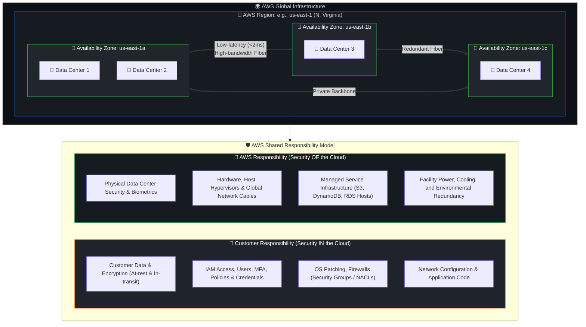
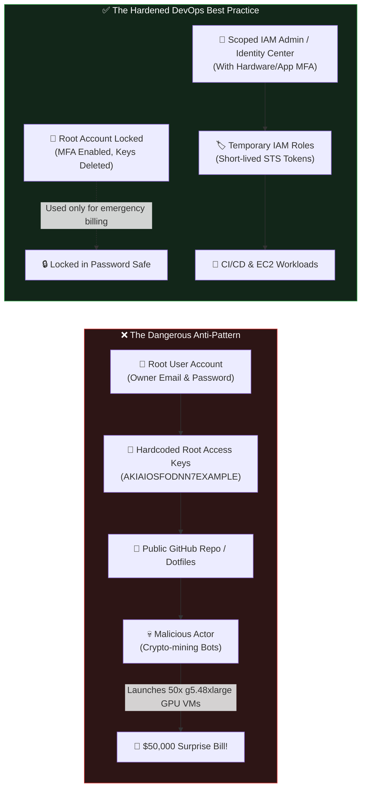
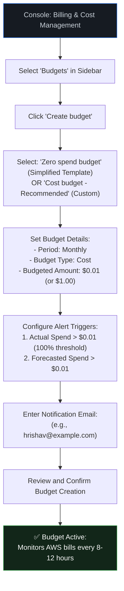

# DevOps Winter Arc — Day 22: AWS Cloud — First Look & Billing Safety

> **Topic:** Introduction to Amazon Web Services (AWS), Global Infrastructure, Core Services, Root Account Hardening, IAM Foundations, and Bulletproof Billing Safety  
> **Repository:** `90_Days_Of_DevOps`  
> **Challenge:** 90 Days of DevOps Winter Arc Challenge  
> **Target Audience:** DevOps Engineer / Cloud Practitioner (Transitioning from Linux, Docker & Kubernetes into Cloud Infrastructure)  

---

## 🎯 Day 22 Overview & Objectives

Welcome to **Cloud Week** of the 90 Days DevOps Winter Arc Challenge! Over the past 21 days, you mastered Linux internals, Bash automation, containerization with Docker, and multi-node orchestration with Kubernetes. Now, we take those workloads and place them into the world's most widely adopted public cloud: **Amazon Web Services (AWS)**.

Before provisioning a single server or writing an infrastructure-as-code script, every professional DevOps engineer must master the **two non-negotiable fundamentals of cloud engineering**:
1. **Account Security:** Ensuring your root account and identities are fortified against catastrophic compromise.
2. **Billing Safety:** Ensuring you never face surprise cloud bills or accidental charges while experimenting and building.

> [!IMPORTANT]
> **Zero-Dollar Golden Rule for Day 22:**  
> In this module, **no paid resources will be provisioned**. We will review, audit, and secure an existing AWS account, establish zero-cost billing alarms, and explore the AWS Management Console strictly in read-only mode.

### 📚 Learning Objectives

1. **Deconstruct Cloud Computing & AWS:** Understand on-demand elasticity, cloud service models (IaaS, PaaS, SaaS), and why modern enterprises build on AWS.
2. **Master AWS Global Infrastructure:** Distinguish clearly between AWS Regions, Availability Zones (AZs), and Edge Locations.
3. **Internalize the AWS Shared Responsibility Model:** Identify where AWS's security responsibility ends and your DevOps operational responsibility begins.
4. **Survey Core AWS Services:** Understand the core primitives — IAM, EC2, S3, VPC, and CloudWatch — through real-world DevOps use cases.
5. **Hardening AWS Account Security:** Understand the Root User vs. IAM Users, enforce Multi-Factor Authentication (MFA), delete/prevent root access keys, and apply the Principle of Least Privilege (PoLP).
6. **Master Billing Controls:** Understand Free Tier parameters, construct a $0 monthly budget, configure CloudWatch billing alarms, and dispel the myth of "hard spending limits".
7. **Safe Console Navigation:** Tour the AWS Management Console to inspect infrastructure state without triggering hidden charges.
8. **DevOps Interview & Knowledge Readiness:** Conquer 15 real-world interview questions, 10 MCQs, 5 scenario tests, and 5 short-answer checks.

---

## 📋 Lab Metadata & Account Context

| Parameter | Specification / State |
| :--- | :--- |
| **Challenge** | 90 Days of DevOps (Winter Arc) |
| **Day** | 22 of 90 |
| **Track** | Phase 4: Cloud Infrastructure & AWS Architecture |
| **Topic** | AWS Cloud: First Look & Billing Safety |
| **Account State** | Pre-existing AWS Account (Review & Hardening Mode) |
| **Infrastructure Deployed** | **Zero (0)** chargeable resources (Read-Only / Governance) |
| **Primary Region for Billing** | `us-east-1` (US East - N. Virginia — Global Billing Endpoint) |
| **Default Testing Region** | `us-east-1` or your geographically closest Region (e.g., `ap-south-1` Mumbai, `eu-west-1` Ireland) |
| **Security Baseline** | Root MFA Active, Root Access Keys Deleted, IAM Admin Created |
| **Budget Target** | Monthly Cost Budget: **$0.01 / $0.00** with Actual & Forecasted Alerts |
| **Primary Interfaces** | AWS Management Console, AWS Billing & Cost Management |

---

## 🗺️ AWS Global Architecture & Security Boundary

The diagram below maps how AWS Global Infrastructure is structured and illustrates the boundary between the AWS Shared Responsibility Model layers.



---

## 1. 🌐 Introduction to AWS & Cloud Computing

### What is Cloud Computing?
According to the National Institute of Standards and Technology (NIST), **Cloud Computing** is a model for enabling ubiquitous, convenient, on-demand network access to a shared pool of configurable computing resources (networks, servers, storage, applications, and services) that can be rapidly provisioned and released with minimal management effort or service provider interaction.

#### The 5 Essential Characteristics of Cloud Computing
1. **On-Demand Self-Service:** You provision compute, storage, and networking through an API or console instantly without human interaction from the provider.
2. **Broad Network Access:** Capabilities are available over the network and accessed through standard mechanisms (browsers, CLI, SDKs, mobile devices).
3. **Resource Pooling:** Multi-tenant model where physical resources are dynamically assigned and reassigned across multiple customers without tenants seeing each other's data.
4. **Rapid Elasticity:** Resources can be elastically provisioned and released — automatically scaling out when web traffic surges and scaling in when demand drops.
5. **Measured Service (Pay-As-You-Go):** Resource usage is monitored, controlled, and billed based strictly on actual consumption (e.g., per-second compute, per-GB storage).

```
Traditional On-Premises Data Center vs. Cloud Computing:
-------------------------------------------------------------------------------------------------
Feature                  On-Premises Data Center               AWS Cloud
-------------------------------------------------------------------------------------------------
Procurement Cycle        3 to 6 months (hardware orders)        Seconds (API call / CLI command)
Capital Expense (CapEx)  Massive upfront investment            $0 upfront (operational expense)
Capacity Planning        Guessing peak load (wastes money)     Elastic scaling matches actual load
Maintenance              Hardware repairs, HVAC, power, racks Handled completely by AWS
Global Footprint         Extremely expensive to build abroad   Deploy globally in minutes
-------------------------------------------------------------------------------------------------
```

### What is AWS (Amazon Web Services)?
**AWS** is the world’s most comprehensive and broadly adopted cloud platform, launched publicly by Amazon in 2006. It provides over 200 fully featured services delivered from data centers globally, ranging from core compute, storage, and networking to container orchestrators (ECS, EKS), managed databases (RDS, DynamoDB), serverless runtimes (Lambda), and generative AI platforms (Bedrock).

### Why Do Companies Use AWS?
* **Agility & Innovation Speed:** Development teams can spin up proof-of-concept environments in minutes rather than waiting months for server delivery.
* **Cost Optimization (OpEx over CapEx):** Shifts capital expenditure into variable operational expenditure. You only pay for what you turn on.
* **Elasticity & Scalability:** Automatically handle 10,000 requests per second during peak shopping hours and scale down to zero overnight.
* **Global Reach in Minutes:** Easily deploy an application in Tokyo, Frankfurt, São Paulo, and Virginia with a single Terraform configuration.
* **Elimination of Undifferentiated Heavy Lifting:** Companies can focus on writing their business logic and user-facing features rather than replacing faulty server fans or configuring uninterruptible power supplies (UPS).

### AWS Global Infrastructure: Regions vs. Availability Zones

AWS infrastructure is built on a hierarchical, geographically distributed topology:

```
[ AWS Global Footprint ]
       └── Regions (Geographic Areas, e.g., us-east-1, eu-west-1, ap-south-1)
             └── Availability Zones (AZs) (e.g., us-east-1a, us-east-1b, us-east-1c)
                   └── Discrete Data Centers (Redundant power, networking, cooling)
```

#### What is an AWS Region?
An **AWS Region** is a physical geographical location in the world where AWS clusters multiple data centers. Each Region is completely isolated and independent from other Regions to achieve maximum fault tolerance and stability.
* *Naming convention:* `[geographic-area]-[direction]-[number]` (e.g., `us-east-1` = US East, N. Virginia; `ap-south-1` = Asia Pacific, Mumbai; `eu-central-1` = Europe, Frankfurt).

#### What is an Availability Zone (AZ)?
An **Availability Zone (AZ)** is one or more discrete data centers with redundant power, networking, and connectivity within an AWS Region.
* An AZ is **not** a single server or rack; it is an entire physical campus or cluster of data centers.
* AZs within a single Region are physically separated by meaningful distances (several kilometers/miles) to protect against localized disasters (floods, power grid outages, fires), but close enough to be connected by ultra-low-latency private fiber optic cables (typically `< 2ms` round-trip latency).
* *Naming convention:* Region code + letter suffix (e.g., `us-east-1a`, `us-east-1b`, `us-east-1c`).

#### Comprehensive Comparison: Region vs. Availability Zone

| Architectural Attribute | AWS Region | AWS Availability Zone (AZ) |
| :--- | :--- | :--- |
| **Definition** | A distinct physical geographic territory in the world. | One or more isolated data centers located *inside* a Region. |
| **Physical Isolation** | Separated by hundreds or thousands of miles/kilometers. | Separated by kilometers (distinct flood plains & power grids). |
| **Connectivity** | Connected via the public Internet or AWS Global Private Fiber Backbone. | Interconnected via high-throughput, ultra-low-latency private metro fiber. |
| **Primary Use Case** | Disaster recovery, geopolitical data residency, low-latency to end-users. | High availability (HA), fault tolerance, and intra-application redundancy. |
| **Data Replication** | Typically asynchronous replication (due to geographic distance). | Synchronous replication supported due to sub-2ms network latency. |
| **Cost Implication** | Inter-region data transfer incurs higher bandwidth fees. | Data transfer across AZs in the same Region incurs minor data transfer fees. |
| **Example Identifier** | `us-east-1`, `eu-west-1`, `ap-south-1` | `us-east-1a`, `us-east-1b`, `us-east-1c` |

> [!NOTE]
> **AZ Name Randomization (Additional Context):**  
> To distribute resource allocation evenly across physical data centers, AWS maps AZ letter suffixes (`us-east-1a`, `us-east-1b`) randomly to physical hardware for each AWS account! Your `us-east-1a` may map to physical AZ identifier `use1-az2`, while another user's `us-east-1a` maps to `use1-az1`. AWS uses **AZ IDs** (e.g., `use1-az1`) to identify consistent physical data centers across different accounts.

### AWS Shared Responsibility Model *(Additional Context)*
The **AWS Shared Responsibility Model** defines the boundary of obligations between AWS (the cloud provider) and the customer (you, the DevOps engineer). This model is foundational: understanding it prevents critical security vulnerabilities and operational assumptions.

#### 1. Security OF the Cloud (AWS Responsibility)
AWS is responsible for protecting the infrastructure that runs all of the services offered in the AWS Cloud:
* **Physical Hardware:** Servers, CPUs, memory, disks, network switches.
* **Facilities & Real Estate:** Physical data center buildings, biometric security, security guards, surveillance cameras, HVAC cooling, backup generators.
* **Global Network:** Subsea fiber optic cables, satellite links, global backbone routing.
* **Host Virtualization:** The physical hypervisors running EC2 instances (e.g., the AWS Nitro System).
* **Managed Services Engine:** For managed services like AWS S3 or DynamoDB, AWS manages OS patching, disk firmware, and database engine upgrades.

#### 2. Security IN the Cloud (Customer Responsibility)
The customer is responsible for everything they provision, store, and configure within AWS:
* **Customer Data:** Data classification, file integrity, and client/server-side encryption (using AWS KMS or custom keys).
* **IAM & Access Control:** User accounts, passwords, MFA enforcement, IAM role assignment, and least-privilege policies.
* **Operating System & Patches:** For IaaS services like EC2, you must patch the Linux kernel, apply security updates (`apt upgrade`), and manage SSH keys.
* **Network & Firewall Rules:** Defining Security Group rules, Network Access Control Lists (NACLs), routing tables, and subnet isolation.
* **Application Code:** Securing the Docker containers, Node.js/Go/Python apps, sanitizing inputs against SQL injection, and managing secrets.

---

## 2. 🧱 Core AWS Services for DevOps

Every complex cloud architecture — whether running Kubernetes clusters (EKS), serverless microservices, or big-data pipelines — is composed of fundamental building blocks. Here are the core services you will encounter every day:

```
┌─────────────────────────────────────────────────────────────────────────────┐
│                           AWS Core Services Map                             │
├───────────────────────┬─────────────────────────────────────────────────────┤
│ Identity & Security   │ 👤 IAM (Identity and Access Management)              │
├───────────────────────┼─────────────────────────────────────────────────────┤
│ Compute               │ 💻 EC2 (Elastic Compute Cloud)                      │
├───────────────────────┼─────────────────────────────────────────────────────┤
│ Object Storage        │ 🪣 S3 (Simple Storage Service)                      │
├───────────────────────┼─────────────────────────────────────────────────────┤
│ Isolated Networking   │ 🌐 VPC (Virtual Private Cloud)                      │
├───────────────────────┼─────────────────────────────────────────────────────┤
│ Monitoring & Logs     │ 📈 CloudWatch                                       │
├───────────────────────┼─────────────────────────────────────────────────────┤
│ Governance & Costs    │ 💰 AWS Billing & Cost Management                    │
└───────────────────────┴─────────────────────────────────────────────────────┘
```

---

### 1. IAM (Identity and Access Management)
* **What it is:** A global service that securely controls authentication (AuthN) and authorization (AuthZ) for human users, applications, and AWS resources.
* **Why it is used:** It is the security gatekeeper of your entire AWS account. Without IAM, anyone could modify, delete, or exfiltrate your infrastructure and data.
* **Real-World Use Cases:**
  * Creating individual credentials for 15 software developers without sharing passwords.
  * Granting a Kubernetes worker node permission to download images from Amazon ECR without embedding API keys in the node configuration.
  * Enforcing MFA across all administrative staff.
* **Simple Example:**
  > Think of IAM like an airport security system: Your passport proves who you are (Authentication); your boarding pass dictates which gate you can enter and which seat you can sit in (Authorization / Policies).

---

### 2. EC2 (Elastic Compute Cloud)
* **What it is:** A web service that provides secure, resizable compute capacity (virtual servers known as *EC2 Instances*) in the cloud.
* **Why it is used:** Provides complete control over your operating system, runtime, and compute specifications (CPU, RAM, GPU, storage) without purchasing physical hardware.
* **Real-World Use Cases:**
  * Hosting self-managed Kubernetes control planes and worker nodes (similar to what you built with `kind`, but running on dedicated cloud VMs).
  * Running legacy monolithic enterprise web applications that require custom Linux system packages.
  * Hosting persistent background worker processes or database servers.
* **Simple Example:**
  > Renting an EC2 instance is like renting an unfurnished apartment. AWS provides the building, electricity, and water pipes; you choose the floor plan (instance size), bring your own furniture (software packages), and lock the door (Security Groups).

---

### 3. S3 (Simple Storage Service)
* **What it is:** An industry-leading, highly scalable, durable object storage service designed to store and retrieve any amount of data from anywhere on the web.
* **Why it is used:** Offers **99.999999999% (11 9's)** of data durability, scales automatically to petabytes without capacity planning, and features native versioning, encryption, and lifecycle rules.
* **Real-World Use Cases:**
  * Storing remote Terraform state files (`terraform.tfstate`) with state locking.
  * Hosting static Single Page Applications (HTML, CSS, JS bundles created via Vite/React).
  * Storing centralized database backups, application log archives, and media uploads (images, PDFs, videos).
* **Simple Example:**
  > S3 is like an infinite Google Drive for machines. Instead of files inside directories on a hard drive, you store "Objects" inside "Buckets", and each object gets its own unique web URL or API key identifier.

---

### 4. VPC (Virtual Private Cloud)
* **What it is:** A logically isolated virtual network dedicated to your AWS account that closely resembles a traditional physical corporate network.
* **Why it is used:** Secures your cloud resources by controlling IP address ranges, subnets, routing tables, and network gateways. It prevents unauthorized internet traffic from reaching private databases and internal microservices.
* **Real-World Use Cases:**
  * Isolating production Kubernetes worker nodes inside **Private Subnets** with no public IP addresses, while routing user traffic through an Internet Gateway and Public Load Balancers.
  * Establishing encrypted site-to-site VPN connections between your physical office and AWS workloads.
* **Simple Example:**
  > If AWS is a sprawling city, a VPC is your private gated residential community. You control the outer perimeter wall (Security Groups/NACLs), who can enter through the front gate (Internet Gateway), and who lives in the public vs. private sections of the neighborhood (Subnets).

---

### 5. Amazon CloudWatch
* **What it is:** A monitoring, observability, and management service built for DevOps engineers, developers, and IT managers.
* **Why it is used:** Collects monitoring and operational data in the form of logs, metrics, and events, providing a unified view of AWS resources and on-premises applications.
* **Real-World Use Cases:**
  * Triggering an automated alert via email/Slack when an EC2 instance CPU utilization exceeds 85% for 5 consecutive minutes.
  * Centralizing container application logs (standard out / standard error) using the AWS CloudWatch Logs agent.
  * Creating billing alarms that fire when estimated monthly charges exceed $1.00.
* **Simple Example:**
  > CloudWatch is the dashboard and check-engine light of your car. It tracks your speed (CPU metrics), fuel consumption (memory/disk), odometer (network traffic), and sounds a loud alarm if your engine temperature overheats.

---

### 6. AWS Billing and Cost Management
* **What it is:** The centralized suite of financial governance tools used to monitor, forecast, allocate, and optimize your AWS spending.
* **Why it is used:** Protects you from unexpected expenses, tracks usage against Free Tier allowances, breaks down expenditures by service, and alerts you before financial limits are breached.
* **Real-World Use Cases:**
  * Setting a monthly budget threshold with automatic notification emails before costs escalate.
  * Viewing cost-allocation tags to see whether the "Staging" or "Production" environment incurred more database costs this month.
  * Identifying orphaned, unattached Elastic Block Store (EBS) volumes or unassociated Elastic IPs that are needlessly costing money.
* **Simple Example:**
  > Billing & Cost Management is your bank's mobile app: It shows your account statement, pending transactions, categorized expenses, and sends you SMS alerts when your balance dips or spending spikes.

---

## 3. 🔐 AWS Account Security & Identity Hardening

Security in the cloud is not an afterthought; it is the prerequisite for everything else. Compromising an AWS root account can result in unauthorized multi-thousand-dollar cryptocurrency mining clusters, stolen intellectual property, and catastrophic account termination.



### Root User vs. IAM User

```
┌─────────────────────────────────────────────────────────────────────────────┐
│                           Root User vs. IAM User                            │
├───────────────────────┬───────────────────────┬─────────────────────────────┤
│ Attribute             │ AWS Root User         │ IAM User / Identity         │
├───────────────────────┼───────────────────────┼─────────────────────────────┤
│ Identity              │ Account Owner Email   │ Created username (e.g. dev) │
├───────────────────────┼───────────────────────┼─────────────────────────────┤
│ Scope of Authority    │ Absolute, Unrestricted│ Granular, Least Privilege   │
├───────────────────────┼───────────────────────┼─────────────────────────────┤
│ Can it be restricted? │ NO (Ignores policies!)│ YES (Explicit IAM Policies) │
├───────────────────────┼───────────────────────┼─────────────────────────────┤
│ Best Practice Usage   │ Account setup only    │ Daily administrative tasks  │
├───────────────────────┼───────────────────────┼─────────────────────────────┤
│ Access Keys Allowed?  │ NEVER (Extreme Risk!) │ Only if strictly required   │
└───────────────────────┴───────────────────────┴─────────────────────────────┘
```

#### The AWS Root User
When you create an AWS account, you start with a single sign-in identity that has complete, irrevocable access to all AWS services and resources in the account. This identity is the **AWS Account Root User**, accessed by signing in with the email address and password used to register the account.
* **Why the Root User is dangerous:** The Root User has god-mode privileges. Root permissions **cannot be restricted by IAM policies**. If your root credentials are leaked, the attacker owns your account, can change your billing email, lock you out, and delete all resources.
* **Rule:** Never use the root user for everyday tasks, development, or automation.

#### The IAM User
An **IAM User** is an identity that you create inside your AWS account with specific, granular permissions.
* An IAM user has no permissions by default. You explicitly attach IAM policies that define what actions they can perform.
* Daily administration should be performed via an IAM user or AWS IAM Identity Center (SSO) with administrative permissions, protected by MFA.

---

### What is MFA (Multi-Factor Authentication)?
**MFA** is a security mechanism that requires an individual to provide two or more verification factors to gain access to an AWS account:
1. **Something you know:** Your email address and master password.
2. **Something you have:** A physical smartphone running an authenticator app (e.g., Google Authenticator, Twilio Authy) generating time-based one-time passwords (TOTP), or a FIDO2 hardware security key (e.g., YubiKey).

#### Why is MFA Critical for the Root User?
Passwords can be guessed, phished, intercepted via malware, or exposed in credential stuffing dumps from unrelated website breaches. Even if an adversary steals your root password, **they cannot log into your AWS console without your physical second factor**. Enabling MFA on your root account reduces the risk of credential-based account takeover by over 99%.

#### How to Enable MFA for the Root User (Step-by-Step)
1. Sign in to the AWS Management Console as the **Root User** using your account email address.
2. In the top-right navigation bar, click on your account name/ID and select **Security credentials** (or navigate directly to the **IAM Console**).
3. On the IAM Dashboard, locate the banner or section titled **AWS account root user** and find **Multi-factor authentication (MFA)**.
4. Click **Assign MFA** (or **Add MFA**).
5. Specify a descriptive **Device name** (e.g., `Hrishav-Mobile-Authenticator`).
6. Select your MFA device type:
   * **Authenticator app (TOTP):** Recommended for quick mobile setup (Google Authenticator, Microsoft Authenticator, Authy).
   * **FIDO2 security key:** Hardware USB key (YubiKey) for maximum physical security.
7. Open your mobile authenticator app, click "Add Account" / "Scan QR Code", and scan the QR code displayed on the AWS console screen.
8. Enter **two consecutive 6-digit codes** generated by your authenticator app (Code 1, wait 30 seconds for the code to cycle, then enter Code 2).
9. Click **Add MFA**. You will see a green confirmation badge: *"MFA device assigned successfully."*

---

### Why Root Access Keys Should NEVER Be Created
An **Access Key ID** (starting with `AKIA...`) and **Secret Access Key** represent programmatic credentials used by the AWS CLI, SDKs, and scripts to interact directly with the AWS API.

> [!CAUTION]
> **Root Access Keys are the single most dangerous asset in cloud computing.**  
> - Root access keys grant unrestricted, unmonitorable, policy-exempt access to your entire cloud.
> - Unlike web console logins, API calls using access keys **bypass MFA completely** unless complex condition keys are enforced.
> - If an engineer accidentally commits a `.env` file or `~/.aws/credentials` containing root keys to a public GitHub repository, automated scraping bots will detect and exploit the keys in **less than 60 seconds**, launching expensive GPU compute instances for cryptocurrency mining.
> - **Best Practice:** Check your Root Security Credentials right now. If any Root Access Keys exist, **delete them immediately**.

---

### IAM Building Blocks: Users, Groups, Roles & Policies

AWS IAM security is structured around four interconnected components:

```
┌─────────────────────────────────────────────────────────────────────────────┐
│                            IAM Policy (JSON)                                │
│       "Effect": "Allow", "Action": "s3:ListBucket", "Resource": "*"         │
└──────────────────────────────────────┬──────────────────────────────────────┘
                                       │ Attached to
         ┌─────────────────────────────┼─────────────────────────────┐
         ▼                             ▼                             ▼
   ┌───────────┐                 ┌───────────┐                 ┌───────────┐
   │ IAM User  │                 │ IAM Group │                 │ IAM Role  │
   │ (Human)   │                 │ (Team)    │                 │ (Machine) │
   └───────────┘                 └───────────┘                 └───────────┘
```

1. **IAM User:** A persistent identity representing a specific human person or service needing long-term interactive console or CLI access.
2. **IAM Group:** A collection of IAM users. Permissions applied to a group (e.g., `Developers`, `Security-Auditors`) are automatically inherited by all members, simplifying onboarding and offboarding.
3. **IAM Role:** An identity with specific permission policies that is **not** associated with a specific person. Instead, it is dynamically assumed by trusted entities:
   * By an **AWS Service** (e.g., an EC2 instance assuming an IAM role to read an S3 bucket without storing credentials on disk).
   * By a **Kubernetes Pod** (via IAM Roles for Service Accounts - IRSA).
   * By a **GitHub Actions runner** (via OpenID Connect - OIDC) to deploy code securely without hardcoded API secrets!
4. **IAM Policy:** A formal JSON document explicitly stating what actions are allowed or denied, on which resources, and under which conditions.

#### The Structure of an IAM Policy (JSON)
Every statement in an IAM policy contains the **PARC** elements:
* **P - Principal:** Who is requesting access? (Used in trust policies and resource policies).
* **A - Action:** What specific API calls are being attempted? (e.g., `ec2:DescribeInstances`, `s3:GetObject`).
* **R - Resource:** Which specific AWS resource ARN (Amazon Resource Name) is being targeted? (e.g., `arn:aws:s3:::my-secure-bucket/*`).
* **C - Condition:** Under what criteria is this valid? (e.g., only if MFA is present, or only from a corporate IP range).
* **Effect:** Explicitly `Allow` or `Deny`.

```json
{
  "Version": "2012-10-17",
  "Statement": [
    {
      "Sid": "AllowReadOnlyEC2AndS3",
      "Effect": "Allow",
      "Action": [
        "ec2:Describe*",
        "s3:Get*",
        "s3:List*"
      ],
      "Resource": "*"
    }
  ]
]
```

### The Principle of Least Privilege (PoLP)
The **Principle of Least Privilege** dictates that every user, process, program, and system must be granted only the minimum permissions necessary to accomplish its intended function, and for no longer than the duration of the task.
* **Bad Practice:** Granting `AdministratorAccess` (`*:*`) to a Junior Developer who only needs to inspect container logs in CloudWatch.
* **Good Practice:** Attaching the AWS-managed policy `CloudWatchReadOnlyAccess`, restricting the developer's permissions strictly to read-only log analysis.

### AWS Account Security Checklist
- [x] **Root Account MFA:** Enabled with a virtual authenticator app or hardware FIDO2 key.
- [x] **Root Access Keys:** Zero (0) root access keys exist.
- [x] **Individual IAM Identities:** Created for daily administrative work; root is never used for routine tasks.
- [x] **Password Policy Enforced:** Minimum 14 characters, requiring uppercase, lowercase, numbers, and symbols.
- [x] **No Hardcoded Credentials:** Never store AWS access keys in source code, Dockerfiles, or Git repositories.
- [x] **IAM Roles Utilized:** Workloads and CI/CD pipelines authenticate using temporary credentials via IAM Roles and OIDC.

---

## 4. 💸 AWS Billing & Cost Management: The Zero-Dollar Strategy

One of the greatest fears for beginners entering the cloud is receiving an unexpected invoice for hundreds or thousands of dollars. By understanding how the **AWS Free Tier** operates and configuring **early-warning billing mechanisms**, you can experiment with complete confidence.

### Understanding the AWS Free Tier

The AWS Free Tier offers three distinct categories of free access:

```
┌─────────────────────────────────────────────────────────────────────────────┐
│                          AWS Free Tier Categories                           │
├─────────────────────┬─────────────────────────┬─────────────────────────────┤
│ Tier Type           │ Duration                │ Examples                    │
├─────────────────────┼─────────────────────────┼─────────────────────────────┤
│ 1. Always Free      │ Never expires (lifetime)│ DynamoDB (25 GB storage)    │
│                     │                         │ Lambda (1,000,000 req/month)│
│                     │                         │ CloudWatch (10 metrics/alarms)│
├─────────────────────┼─────────────────────────┼─────────────────────────────┤
│ 2. 12-Months Free   │ First 12 months after   │ EC2 (750 hrs/mo t2/t3.micro)│
│                     │ initial account signup  │ S3 (5 GB standard storage)  │
│                     │                         │ RDS (750 hrs/mo db.t2/t3/t4g)│
├─────────────────────┼─────────────────────────┼─────────────────────────────┤
│ 3. Short-Term Trials│ 30 to 60 days from      │ Amazon GuardDuty (30 days)  │
│                     │ service activation date │ Amazon Inspector (15 days)  │
└─────────────────────┴─────────────────────────┴─────────────────────────────┘
```

#### Critical Free Tier Limitations & Gotchas
* **EC2 750 Hours/Month:** 750 hours is enough to run **one** `t2.micro` (or `t3.micro` in newer regions) continuously 24/7 for a 31-day month. If you launch *two* instances simultaneously, you burn 1,500 instance-hours in 30 days and will be billed for the remaining 750 hours!
* **EBS Storage Limit:** You receive **30 GB** of General Purpose SSD (gp2 or gp3) storage per month. Launching four 10-GB root volumes puts you at 40 GB, incurring charges for the extra 10 GB.
* **Data Transfer Out:** 100 GB of internet egress data transfer per month is free. Transferring massive files or running high-traffic public sites will generate egress billing.
* **Services NOT in Free Tier:** NAT Gateways (approx. $32/month base cost + data processing), Application Load Balancers (approx. $16-20/month base), and Route 53 Hosted Zones ($0.50/month per domain) are **never** fully free.

---

### Understanding AWS Bills & Usage
To monitor your consumption:
1. Navigate to the **Billing and Cost Management Console**.
2. Review the **Bills** page: View charges broken down by service, region, and line item.
3. Review **Cost Explorer:** Generates interactive historical and forecasted graphs of your daily or monthly expenditure.
4. Review the **Free Tier Usage Tracker:** Displays your real-time consumption percentage for each active Free Tier service (e.g., *"Amazon EC2: 120 of 750 Hours Used (16%)"*).

---

### What is an AWS Budget?
**AWS Budgets** allows you to set custom cost and usage limits that alert you when your expenses exceed (or are forecasted to exceed) your defined threshold.

#### How to Configure a $0 (Zero-Spend) Monthly Budget

AWS allows you to configure a **Zero-Spend Budget** template or a custom cost budget with a target of $0.01 to catch any billable event immediately:



#### Step-by-Step Console Walkthrough:
1. Open the **AWS Management Console** and search for **Billing and Cost Management**.
2. In the left navigation pane, click **Budgets**.
3. Click the orange **Create budget** button.
4. Under **Budget setup**, choose **Customize (advanced)** or select the **Zero spend budget** preconfigured template:
   * If choosing the preconfigured template: AWS automatically provisions alerts when your spend exceeds $0.01, alerting your root email.
   * If customizing:
     * **Budget type:** Cost budget.
     * **Budget name:** `Monthly-Zero-Spend-Guardrail`.
     * **Period:** Monthly.
     * **Budget renewal type:** Recurring budget.
     * **Budgeting method:** Fixed.
     * **Enter your budgeted amount:** `$0.01` (or `$1.00`).
5. Click **Next** to configure alert thresholds.

---

### Actual vs. Forecasted Cost Alerts

Understanding the difference between **Actual** and **Forecasted** alerts is vital for proactive cloud governance:

```
┌─────────────────────────────────────────────────────────────────────────────┐
│                       Actual vs. Forecasted Alerts                          │
├──────────────────────────┬──────────────────────────────────────────────────┤
│ Actual Spend Alert       │ Forecasted Spend Alert                           │
├──────────────────────────┼──────────────────────────────────────────────────┤
│ Reactive Trigger         │ Proactive Predictive Trigger                     │
│ Fires AFTER money spent  │ Fires BEFORE money spent                         │
│ Example: Spend hits $1.01│ Example: On Day 3, AWS predicts month will hit $5│
│ Alert: "You incurred $1" │ Alert: "Warning! Current trajectory will cost $5"│
└──────────────────────────┴──────────────────────────────────────────────────┘
```

* **Actual Cost Alert:** Triggers only when your accumulated billing data confirms that your spending has breached the set limit. It tells you: *"You have already spent this money."*
* **Forecasted Cost Alert:** Employs machine learning algorithms based on your historical daily burn rate. If you spin up an expensive database on Day 2 that costs $10/day, the forecasted alert triggers on Day 2 warning you: *"Based on your last 24 hours of usage, your bill at the end of the month is projected to reach $300!"* This provides an early warning window to shut down the resource before incurring large charges.

---

### Billing Alerts & CloudWatch Billing Alarms
In addition to AWS Budgets, you can set up a native **CloudWatch Billing Alarm**:
1. First, enable billing alerts:
   * Go to **Billing Preferences** in the Billing Console.
   * Check the box: **Receive Billing Alerts**.
   * Click **Save preferences**.
2. Switch your AWS Region to **N. Virginia (`us-east-1`)**.
   > [!IMPORTANT]
   > All global billing metrics are aggregated and delivered exclusively to CloudWatch in the `us-east-1` region!
3. Open the **CloudWatch Console**, select **Alarms** > **In alarm**, and click **Create alarm**.
4. Click **Select metric** > **Billing** > **Total Estimated Charge** > **USD**.
5. Set condition: **Static**, **Greater than `0 USD`**.
6. Configure notification: Create a new **Amazon SNS (Simple Notification Service) topic**, name it `Billing-Alerts-Topic`, and enter your email address.
7. Confirm the subscription email sent by AWS SNS to your inbox (you must click **Confirm subscription** or alerts will not be delivered!).
8. Give the alarm a name: `Alarm-On-Any-AWS-Charge`, and click **Create alarm**.

---

### ⚠️ The Great Myth: Why a $0 Budget is NOT a Hard Spending Limit

> [!CAUTION]
> **A $0 AWS Budget will NEVER automatically stop your instances or delete your resources!**  
> Beginners frequently make the dangerous assumption that setting a $0 budget means AWS will automatically shut off servers if spending hits $0. **This is completely false.**

* **Budgets are notification mechanisms, not circuit breakers:** By default, AWS Budgets and CloudWatch Billing Alarms only send email or SNS notifications. They do not have the power to stop resources.
* **Why AWS doesn't auto-terminate by default:** Imagine hosting a mission-critical e-commerce application. If a billing threshold is breached during Black Friday, an automatic shutdown would cause catastrophic business downtime and customer loss. AWS requires you to explicitly script and authorize automated shutdowns.
* **Automated Actions require custom DevOps engineering:** To automatically shut down instances, you must configure an **AWS Budget Action** or connect an SNS topic to an **AWS Lambda function** or AWS Systems Manager automation document that executes `ec2:StopInstances`.

---

### How to Avoid Unexpected AWS Charges (DevOps Best Practices)

1. **Delete, Don't Just Stop:** Stopping an EC2 instance prevents per-second compute charges, but **attached EBS storage volumes continue to accrue charges** for provisioned gigabytes! If you are done with a lab, **Terminate** the instance.
2. **Watch for Unattached Elastic IPs:** AWS allocates static public IPv4 addresses for free *while attached to a running instance*. If you stop or terminate the instance and leave the Elastic IP allocated, AWS charges approximately `$0.005 per hour` for wasting an IPv4 address. Always **Release** unused Elastic IPs.
3. **Beware of NAT Gateways:** When studying VPC networking, tutorials often instruct you to launch a NAT Gateway. NAT Gateways cost approximately `$0.045 per hour (~$32.40/month)` regardless of whether traffic passes through them! Always delete NAT Gateways immediately after completing your test.
4. **Clean up Orphaned EBS Snapshots & S3 Buckets:** When deleting test environments, ensure that associated automated snapshots and test S3 buckets containing large objects are emptied and removed.
5. **Check the Billing Console Weekly:** Make it a weekly DevOps habit to inspect your active regions and Free Tier consumption gauge.

---

## 5. 🧭 Safe Navigation of the AWS Management Console

Navigating the AWS Console can feel overwhelming due to hundreds of services. Here is how to inspect each core service dashboard **in read-only mode** to verify security and architecture without incurring a penny.

```
┌─────────────────────────────────────────────────────────────────────────────┐
│                    Safe Console Inspection Guide (Read-Only)                │
├─────────────────┬─────────────────────────────────┬─────────────────────────┤
│ Service         │ What to Safely Check            │ Action to AVOID         │
├─────────────────┼─────────────────────────────────┼─────────────────────────┤
│ 👤 IAM          │ MFA status, Access Keys, Groups │ Generating Root Keys    │
│ 💻 EC2          │ Instance state = 0 running      │ Clicking "Launch VM"    │
│ 🪣 S3           │ Bucket names, Block Public Access│ Uploading GBs of data   │
│ 🌐 VPC          │ Default VPC, Subnet count       │ Creating NAT Gateways   │
│ 📈 CloudWatch   │ Billing alarms status (us-east-1)│ High-res custom metrics │
│ 💰 Billing      │ Month-to-date spend ($0.00)     │ Purchasing Savings Plans│
└─────────────────┴─────────────────────────────────┴─────────────────────────┘
```

### 1. IAM Dashboard
* **Where to find it:** Search for `IAM` in the top search bar.
* **What to explore safely:**
  * **Security recommendations:** Check whether Root MFA is active.
  * **Users & User Groups:** Review existing identities and their attached policies.
  * **Credential Report:** Click **Download report** to get a complete CSV audit of password ages and MFA enforcement across all account users.
* **Cost:** 100% Free. IAM has no associated fees.

### 2. EC2 Dashboard
* **Where to find it:** Search for `EC2` and click the service.
* **What to explore safely:**
  * **EC2 Global View:** Review running instances across all global regions simultaneously.
  * **Resources Box:** Verify that **Instances (running)** reads `0`.
  * **Elastic IPs:** Ensure allocated Elastic IPs count is `0`.
  * **Volumes:** Verify that no orphaned EBS volumes remain in an `available` (unattached) state.
* **Cost:** Zero cost to view. Do **not** click "Launch instance".

### 3. S3 Dashboard
* **Where to find it:** Search for `S3`.
* **What to explore safely:**
  * **Buckets List:** Review existing bucket names. S3 bucket names are globally unique across all AWS accounts.
  * **Block Public Access settings:** Check the account-level setting. Ensure **Block all public access** is set to `On` unless public static site hosting is intentionally configured.
* **Cost:** Zero cost to inspect buckets and properties.

### 4. VPC Dashboard
* **Where to find it:** Search for `VPC`.
* **What to explore safely:**
  * **Your VPCs:** Notice that AWS automatically provisions a **Default VPC** (`172.31.0.0/16`) in every region so beginners can launch resources immediately.
  * **Subnets:** Count the subnets. Notice that AWS creates one default public subnet per Availability Zone in the region.
  * **Internet Gateways:** Observe the default Internet Gateway (`igw-...`) attached to the default VPC.
  * **NAT Gateways:** Confirm that the count is `0`.
* **Cost:** The default VPC, default subnets, and default Internet Gateways are completely free. Do **not** create a NAT Gateway or transit gateway.

### 5. CloudWatch Dashboard
* **Where to find it:** Search for `CloudWatch`.
* **What to explore safely:**
  * Make sure your region dropdown in the top-right console header is set to **`N. Virginia (us-east-1)`**.
  * Click **Alarms** in the left sidebar to verify that your billing alarm exists and shows `OK` (or `Insufficient Data` if newly provisioned).
  * Click **Metrics** to see available standard metrics.
* **Cost:** The first 10 CloudWatch alarms and basic metrics are part of the Always Free Tier.

### 6. Billing & Cost Management Dashboard
* **Where to find it:** Click your account name in the top right > **Billing and Cost Management**.
* **What to explore safely:**
  * Check **Month-to-date spend summary** to confirm `$0.00`.
  * Review **Free Tier usage breakdown** to monitor active consumption percentages.
  * Check **Budgets** to verify that your $0.01 / Zero-Spend Budget status indicates healthy execution.
* **Cost:** Completely free.

---

## 6. 🛠️ Practical Knowledge & Real-World DevOps Scenarios

### Step-by-Step AWS Account Security Hardening Checklist
Execute these steps to secure an existing AWS account:

1. **Sign in as Root User:** Sign in using the primary email address.
2. **Enable Root MFA:** Complete the virtual TOTP authenticator setup (Google Authenticator / Authy).
3. **Audit Root Access Keys:**
   * Go to `IAM` > `Security credentials`.
   * Check **Access keys**. If any exist, set them to `Inactive` and then click `Delete`.
4. **Create a Dedicated IAM Admin User:**
   * In IAM, navigate to `Users` > `Create user`.
   * Name: `devops-admin`.
   * Check **Provide user access to the AWS Management Console**.
   * Choose **I want to create an IAM-user**, set a custom password, and require password reset at next sign-in.
   * Permissions: Attach the managed policy `AdministratorAccess` (or create a scoped administrative group).
5. **Enable MFA on the New IAM Admin User:** Log out of Root, sign in as `devops-admin`, navigate to `Security credentials`, and bind an MFA device.
6. **Store Root Credentials Securely:** Record the root email, password, and MFA recovery seed in an encrypted corporate password vault (e.g., 1Password, Bitwarden) and do not use it for daily engineering.

---

### Step-by-Step Billing Safety Checklist
- [x] **Billing Preferences Enabled:** Verified that "Receive Billing Alerts" is checked in Billing Preferences.
- [x] **Zero-Spend / $0.01 Budget Created:** Active with both Actual and Forecasted notification alerts.
- [x] **CloudWatch Billing Alarm Configured:** Operating in `us-east-1` targeting any charge > $0.00 USD.
- [x] **SNS Topic Email Confirmed:** Clicked the verification link in the AWS SNS confirmation email.
- [x] **Verified Zero Idle Compute:** Confirmed running EC2 instances = 0.
- [x] **Verified Zero NAT Gateways:** Confirmed NAT Gateways = 0 across all active regions.
- [x] **Verified Zero Unattached Elastic IPs:** Confirmed Elastic IPs = 0.

---

### Common Beginner Mistakes & How to Prevent Them

```
┌─────────────────────────────────────────────────────────────────────────────┐
│                       Top 5 Beginner AWS Mistakes                           │
├───────────────────────────────────┬─────────────────────────────────────────┤
│ Mistake                           │ How to Prevent It                       │
├───────────────────────────────────┼─────────────────────────────────────────┤
│ 1. Hardcoding Keys in Git Repos   │ Use Git-secrets / Trufflehog; use IAM   │
│                                   │ Roles and temporary STS credentials.    │
├───────────────────────────────────┼─────────────────────────────────────────┤
│ 2. Stopping EC2 without Terminating│ Remember that stopped VMs still incur   │
│                                   │ monthly EBS storage charges.            │
├───────────────────────────────────┼─────────────────────────────────────────┤
│ 3. Leaving NAT Gateways Active    │ Always delete NAT Gateways after VPC    │
│                                   │ labs (~$32/month hidden cost!).         │
├───────────────────────────────────┼─────────────────────────────────────────┤
│ 4. Looking for Billing in Wrong AZ│ All CloudWatch billing metrics live     │
│    or Region                      │ exclusively in us-east-1.               │
├───────────────────────────────────┼─────────────────────────────────────────┤
│ 5. Using Root User for Daily Work │ Lock root with MFA; create dedicated    │
│                                   │ IAM administrator accounts.             │
└───────────────────────────────────┴─────────────────────────────────────────┘
```

---

### Real-World DevOps Production Scenarios

#### Scenario A: The CI/CD Pipeline Secret Leakage Prevention
* **Context:** A junior DevOps engineer writes a GitHub Actions workflow to build and push Docker containers to AWS ECR. They plan to paste long-term `AWS_ACCESS_KEY_ID` and `AWS_SECRET_ACCESS_KEY` into GitHub Repository Secrets.
* **The Problem:** Long-term credentials can be exposed via malicious pull requests, compromised actions, or print-debugging.
* **The DevOps Solution:** Configure an **IAM Role with OpenID Connect (OIDC)** trust federation between GitHub and AWS. GitHub Actions requests a short-lived JSON Web Token (JWT), which AWS STS (Security Token Service) exchanges for a temporary 1-hour session credential. Zero hardcoded keys exist!

#### Scenario B: The Mystery Cloud Cost Investigation
* **Context:** A company notices a sudden $45 spike in their monthly AWS bill despite no new microservices being deployed.
* **Diagnostic Workflow:**
  1. Open **Cost Explorer** and group costs by **Usage Type** and **Service**.
  2. The engineer identifies charges under `NatGateway-Hours` and `EBS:VolumeUsage.gp3`.
  3. Investigation reveals that an engineer tested a private subnet three weeks ago, deleted the EC2 instance, but forgot to delete the **NAT Gateway** and left a 200 GB unattached **EBS volume** in `available` state.
  4. Remediation: Delete the NAT Gateway immediately, take an EBS snapshot if data is needed, delete the orphaned EBS volume, and set up an AWS Config rule to flag unattached volumes.

---

## 7. 🎤 DevOps Interview Preparation (15 Questions & Conversational Answers)

These questions reflect authentic DevOps fresher and junior cloud engineer interviews. Practice delivering the conversational responses naturally.

### Q1: What is AWS, and why do modern companies prefer cloud infrastructure over on-premises data centers?
> **Answer:**  
> "Amazon Web Services (AWS) is a comprehensive cloud computing platform offering on-demand compute, storage, networking, and managed services on a pay-as-you-go basis. Companies choose AWS because it replaces large upfront capital expenditures (CapEx) on physical hardware with predictable operational expenditures (OpEx). It delivers high agility—allowing teams to provision environments in seconds via APIs or Terraform—offers global reach across dozens of regions, and eliminates the undifferentiated heavy lifting of managing physical data center facilities, cooling, and power."

---

### Q2: Can you explain the difference between an AWS Region and an Availability Zone?
> **Answer:**  
> "An AWS Region is a separate geographical area in the world, such as North Virginia (`us-east-1`) or Mumbai (`ap-south-1`). Each Region contains multiple, physically separated Availability Zones (AZs). An Availability Zone consists of one or more discrete data centers equipped with independent power, cooling, and networking. AZs within the same Region are connected through high-speed, low-latency private fiber optic cables. We use multiple AZs within a Region to build high availability and fault-tolerant architectures, while we use multiple Regions for global disaster recovery and geopolitical data compliance."

---

### Q3: How do EC2 and S3 differ in terms of storage architecture and use cases?
> **Answer:**  
> "EC2 (Elastic Compute Cloud) provides virtual compute capacity (virtual machines). Storage attached directly to EC2 instances typically comes in the form of EBS (Elastic Block Store), which is block storage formatted with a filesystem like ext4 or XFS, ideal for running operating systems and databases. S3 (Simple Storage Service), on the other hand, is an object storage service accessible over HTTP/REST APIs. S3 stores unstructured data—such as container backups, logs, static web assets, and media files—offering virtually unlimited scaling and 99.999999999% (11 9's) durability. S3 cannot boot an operating system, but it is vastly cheaper and more scalable than block storage."

---

### Q4: What is AWS IAM, and why is it considered the most critical security service?
> **Answer:**  
> "AWS Identity and Access Management (IAM) is a centralized, global service that controls authentication and authorization across your entire AWS account. It defines who can log in (Authentication via users and federated credentials) and what actions they can perform on which resources (Authorization via JSON policies). It is the most critical service because the cloud perimeter is identity-based: misconfiguring IAM policies or leaking access keys bypasses all network security and gives attackers direct access to your infrastructure."

---

### Q5: What is the difference between the AWS Root User and an IAM User?
> **Answer:**  
> "The Root User is the master account created with the initial email address used to register the AWS account. It possesses absolute, unrestricted administrative control that cannot be limited by IAM policies. An IAM User is an identity created inside the account with zero privileges by default, which are then explicitly defined using IAM policies. The root user should only be used to create the initial admin user, set up billing, and handle emergency account-recovery tasks. Daily engineering work must always be performed using IAM users or IAM roles adhering to least privilege."

---

### Q6: What is Multi-Factor Authentication (MFA), and why is it mandatory for the Root account?
> **Answer:**  
> "MFA requires an identity to present two distinct authentication factors: something you know (master password) and something you physically possess (a time-based one-time code from an authenticator app like Google Authenticator or a hardware FIDO2 key like a YubiKey). It is mandatory for the root account because root credentials grant total ownership. If a password is compromised through phishing or credential dumps, MFA prevents unauthorized login, blocking over 99% of automated account-takeover attacks."

---

### Q7: Explain the AWS Shared Responsibility Model with a practical example.
> **Answer:**  
> "The Shared Responsibility Model states that AWS is responsible for 'Security OF the Cloud', while the customer is responsible for 'Security IN the Cloud'. For example, if we run an application on an EC2 instance: AWS guarantees the physical security of the data center, the hardware, and the underlying hypervisor. However, as the DevOps engineer, I am responsible for patching the Linux operating system, managing SSH keys, configuring firewall rules via Security Groups, encrypting the database data, and ensuring my application code doesn't contain vulnerabilities."

---

### Q8: What is the AWS Free Tier, and what are its three main tiers?
> **Answer:**  
> "The AWS Free Tier allows customers to explore and experiment with AWS services without incurring charges, up to specified limits. It is divided into three tiers:
> 1. **Always Free:** Services that never expire, such as 25 GB of DynamoDB storage and 1 million AWS Lambda requests per month.
> 2. **12-Months Free:** Available for the first year following account registration, including 750 hours/month of `t2.micro` or `t3.micro` EC2 instances and 5 GB of standard S3 storage.
> 3. **Short-Term Trials:** Time-limited trials for specific enterprise services, like 30 days of Amazon GuardDuty."

---

### Q9: Does creating a $0 AWS Budget prevent you from being charged if you launch an expensive server?
> **Answer:**  
> "No, it does not. A common misconception among beginners is that an AWS Budget acts as an automated spending cap or kill-switch. In reality, a $0 budget is purely an alerting and notification mechanism. When your spend exceeds $0, AWS sends an email or SNS notification, but your resources continue to run and accumulate charges. To actually stop resources, you must explicitly implement automated actions using AWS Budget Actions, AWS Systems Manager, or AWS Lambda."

---

### Q10: What is Amazon CloudWatch, and what are its primary components?
> **Answer:**  
> "Amazon CloudWatch is the central monitoring, observability, and management service for AWS resources and applications. Its primary components include:
> - **Metrics:** Time-series performance data like EC2 CPU utilization, network I/O, or custom application statistics.
> - **Alarms:** Automated monitors that watch a metric and trigger actions (like sending an SNS email or triggering an EC2 Auto Scaling policy) when thresholds are crossed.
> - **Logs:** Centralized repository for application and system logs using CloudWatch Log Groups.
> - **Dashboards:** Visual representations of metrics for operational visibility."

---

### Q11: What is a VPC (Virtual Private Cloud), and what is its default configuration?
> **Answer:**  
> "A VPC is a logically isolated virtual network dedicated to your AWS account within a specific Region. It gives you complete control over your network topology, including IP address CIDR blocks, subnets, route tables, and gateways. When you create an AWS account, AWS provides a **Default VPC** in every Region with a `172.31.0.0/16` CIDR block and provisions one default public subnet in every Availability Zone, preconfigured with an attached Internet Gateway so that beginners can launch internet-accessible VMs immediately."

---

### Q12: Why should programmatic Access Keys never be created for the AWS Root User?
> **Answer:**  
> "Access keys provide programmatic access via the AWS CLI and SDKs. Root access keys have absolute, unrestricted permissions across the entire account and bypass console MFA prompts. If these keys are accidentally committed to a public Git repository or compromised via malware, an attacker can programmatically spin up massive compute clusters or delete all account resources in seconds. Root access keys should never be generated; instead, programmatic tasks should use scoped IAM roles with temporary credentials."

---

### Q13: What is the difference between an IAM Role and an IAM User?
> **Answer:**  
> "An IAM User is a permanent identity associated with a single person or application with long-term credentials like a username/password or static access keys. An IAM Role is an identity that does not have permanent credentials; instead, it is assumed dynamically for a short time by trusted entities—such as an EC2 instance, a Lambda function, or an external GitHub Actions runner. When an entity assumes a role, the AWS Security Token Service (STS) issues temporary, auto-expiring security credentials, making IAM roles vastly more secure for machine-to-machine interactions."

---

### Q14: What is the difference between Actual Cost Alerts and Forecasted Cost Alerts in AWS Budgets?
> **Answer:**  
> "An Actual Cost Alert is reactive: it triggers only after your accrued charges have crossed a threshold (e.g., notifying you when month-to-date spending hits $1.00). A Forecasted Cost Alert is predictive: it evaluates your current rate of consumption and projects your total bill at the end of the month. For example, if you spin up an expensive resource on Day 2, a forecasted alert can trigger on Day 2 warning you that your projected month-end bill will reach $150, giving you time to stop the resource before the money is actually spent."

---

### Q15: If an EC2 instance is stopped, will it still incur any AWS charges?
> **Answer:**  
> "Yes, it can. While stopping an EC2 instance halts per-second compute (vCPU and RAM) charges, you are still billed for the attached EBS (Elastic Block Store) volume storage because AWS continues to preserve your disk data on physical hardware. Additionally, if you have an unattached Elastic IP address associated with that stopped instance, AWS charges a small hourly fee for holding that unused public IPv4 address. To avoid all charges for temporary lab environments, the instance must be terminated and any Elastic IPs released."

---

## 8. 📝 Knowledge Check & Assessments

### Part 1: Multiple Choice Questions (10 MCQs)

#### 1. What is an AWS Availability Zone (AZ)?
- A) A geographic territory containing multiple AWS Regions.
- B) One or more discrete data centers with redundant power, networking, and cooling located inside a Region.
- C) A content delivery network (CDN) edge location.
- D) A virtual private network connection between on-premises and AWS.  
> **Correct Answer:** **B**  
> *Explanation:* An Availability Zone consists of one or more physical data centers inside a specific AWS Region connected by ultra-low-latency private fiber.

---

#### 2. According to the AWS Shared Responsibility Model, which of the following is AWS's responsibility?
- A) Patching the guest OS on an Amazon EC2 instance.
- B) Managing IAM user password policies.
- C) Physical security of data center facilities.
- D) Configuring Security Group firewall rules.  
> **Correct Answer:** **C**  
> *Explanation:* AWS manages "Security OF the Cloud", which includes physical data center security, hardware, and the virtualization layer. Guest OS patching and firewall rules are the customer's responsibility ("Security IN the Cloud").

---

#### 3. What is the fundamental security rule regarding the AWS Account Root User?
- A) Use the root user for all daily deployment scripts.
- B) Generate root access keys and save them in your bashrc file.
- C) Enable MFA on root, lock it away, and never use it for daily administration.
- D) Share root credentials across the entire DevOps engineering team.  
> **Correct Answer:** **C**  
> *Explanation:* The root user has god-mode privileges and cannot be restricted by IAM policies. Best practice requires enabling MFA and using dedicated IAM users or roles for daily work.

---

#### 4. Which storage service is designed for object storage with 99.999999999% (11 9's) durability?
- A) Amazon EBS
- B) Amazon EC2 Instance Store
- C) Amazon EFS
- D) Amazon S3  
> **Correct Answer:** **D**  
> *Explanation:* Amazon S3 (Simple Storage Service) is an object storage system offering 11 9's of durability, making it ideal for backups, static assets, and data lakes.

---

#### 5. What happens when your AWS usage breaches a $0 AWS Budget?
- A) AWS immediately terminates all running EC2 instances.
- B) AWS freezes your account and revokes all IAM credentials.
- C) AWS sends an alert notification (email/SNS), but resources continue running and billing.
- D) Your AWS account is downgraded to a read-only state.  
> **Correct Answer:** **C**  
> *Explanation:* AWS Budgets are notification mechanisms by default. They alert you via email/SNS but do not automatically shut down resources unless custom automation actions are configured.

---

#### 6. In which AWS Region are all global CloudWatch billing metrics aggregated?
- A) `us-west-2` (Oregon)
- B) `eu-west-1` (Ireland)
- C) `us-east-1` (N. Virginia)
- D) `ap-south-1` (Mumbai)  
> **Correct Answer:** **C**  
> *Explanation:* AWS billing data and global account metrics are consolidated and delivered exclusively to CloudWatch in the `us-east-1` (US East - N. Virginia) region.

---

#### 7. What is the primary advantage of an IAM Role over an IAM User for machine-to-machine workloads?
- A) IAM Roles provide faster network connectivity.
- B) IAM Roles issue temporary, auto-expiring credentials instead of permanent access keys.
- C) IAM Roles cost less money than IAM Users.
- D) IAM Roles bypass the AWS Shared Responsibility Model.  
> **Correct Answer:** **B**  
> *Explanation:* IAM Roles use the AWS Security Token Service (STS) to generate temporary credentials that expire automatically, eliminating the risk of leaked long-term access keys.

---

#### 8. Which of the following services is NOT included in the AWS Free Tier and will immediately incur charges?
- A) An Amazon S3 bucket with 1 GB of data.
- B) A single `t2.micro` EC2 instance running for 300 hours in month 1.
- C) A VPC NAT Gateway.
- D) 25 GB of Amazon DynamoDB storage.  
> **Correct Answer:** **C**  
> *Explanation:* NAT Gateways have no Free Tier allowance and cost approximately $0.045 per hour plus data processing charges.

---

#### 9. What is the Principle of Least Privilege (PoLP)?
- A) Giving all developers AdministratorAccess to avoid permission tickets.
- B) Granting only the bare minimum permissions necessary to perform a specific task.
- C) Disabling all IAM users and only using the Root account.
- D) Allowing public read access to all S3 buckets by default.  
> **Correct Answer:** **B**  
> *Explanation:* Least privilege dictates granting only the permissions strictly required to accomplish a given task, minimizing potential attack surfaces.

---

#### 10. You stop an EC2 instance that has an Elastic IP assigned. What will incur charges?
- A) Compute (vCPU and RAM) usage.
- B) Unattached/idle Elastic IP fee and attached EBS volume storage.
- C) Only the VPC route table.
- D) Nothing; stopped instances are always 100% free.  
> **Correct Answer:** **B**  
> *Explanation:* While compute charges stop, the underlying EBS storage persists and incurs gigabyte-month fees. Furthermore, AWS charges for idle Elastic IPs not associated with a running instance.

---

### Part 2: Scenario-Based Questions (5 Scenarios)

#### Scenario 1: The Accidental Key Leak
* **Scenario:** A developer accidentally commits a file containing AWS access keys to a public GitHub repository. Within 10 minutes, the developer realizes the mistake.
* **Question:** What immediate steps must you take as the DevOps engineer to secure the account?
* **Solution:**
  1. **Immediately Invalidate the Key:** Open the IAM Console, navigate to the affected IAM user, find the compromised Access Key ID, and set its status to **Inactive**, then click **Delete**.
  2. **Audit CloudTrail:** Open AWS CloudTrail in the console and review recent API events across all regions to see if unauthorized calls (such as `ec2:RunInstances` or `iam:CreateUser`) were executed.
  3. **Inspect Resources:** Check the EC2, Lightsail, and SageMaker dashboards for unfamiliar instances launched in foreign regions (e.g., launching GPU instances for mining).
  4. **Rotate and Clean Codebase:** Remove the secret from Git history (using tools like `git-filter-repo` or BFG Repo-Cleaner) or purge the commit.
  5. **Switch to IAM Roles:** Transition the application to use IAM roles with temporary credentials or GitHub OIDC.

---

#### Scenario 2: The Multi-AZ High Availability Requirement
* **Scenario:** An engineering manager asks you to deploy an internal microservice on AWS. They specify that the application must survive a complete physical power outage of a data center without downtime.
* **Question:** What architectural deployment model must you choose?
* **Solution:**
  * Deploy the application across a **Multi-AZ architecture within the same AWS Region**.
  * Provision EC2 instances or container tasks in at least two distinct Availability Zones (e.g., `us-east-1a` and `us-east-1b`).
  * Place an **Application Load Balancer (ALB)** in front of the instances across both AZs. If one AZ experiences a total facility failure, the health checks will fail over traffic automatically to the healthy instances in the surviving AZ.

---

#### Scenario 3: The Free Tier Surprise Bill
* **Scenario:** A student creates an AWS account for learning. During week 2, they receive an unexpected bill for $18.60. They only launched one EC2 instance and stopped it when finished.
* **Question:** How would you diagnose what caused this charge?
* **Solution:**
  1. Open the **AWS Billing and Cost Management Console** and navigate to the **Bills** tab.
  2. Expand the charges under each service to view line-item descriptions.
  3. Common causes in this scenario:
     * **Orphaned Elastic IP:** The instance was stopped, but the Elastic IP was left allocated ($0.005/hr × 24 hrs × 14 days ≈ $1.68).
     * **Provisioned EBS Storage Exceeded:** They provisioned a 100 GB volume instead of the 30 GB Free Tier limit.
     * **Wrong Instance Family:** They inadvertently launched a `t2.medium` or `m5.large` instead of the Free Tier-eligible `t2.micro` / `t3.micro`.
     * **NAT Gateway Created:** A VPC tutorial created a NAT Gateway that was left running for several days.

---

#### Scenario 4: The Over-Privileged CI/CD Pipeline
* **Scenario:** A team is building a Jenkins CI/CD pipeline on-premises that needs to push container images to Amazon ECR. The lead developer attaches the `AdministratorAccess` managed policy to the IAM user credentials used by Jenkins.
* **Question:** Why is this a major security flaw, and how would you fix it using least privilege?
* **Solution:**
  * **The Risk:** If the Jenkins server is compromised, an attacker inherits full control of the entire AWS account, allowing them to delete databases, alter networking, or exfiltrate sensitive data.
  * **Remediation:** Replace `AdministratorAccess` with an explicitly scoped custom policy (or the managed policy `AmazonEC2ContainerRegistryPowerUser` or an inline policy granting only `ecr:GetAuthorizationToken`, `ecr:BatchCheckLayerAvailability`, `ecr:PutImage`, and `ecr:InitiateLayerUpload` scoped strictly to the specific ECR repository ARN).

---

#### Scenario 5: Proactive Spending Prevention
* **Scenario:** A startup is onboarding 10 junior engineers onto an AWS sandbox account for practice. Leadership wants to ensure that total experimental costs never exceed $50 per month.
* **Question:** What proactive monitoring and governance strategy would you implement?
* **Solution:**
  1. **Configure AWS Budgets:** Create a monthly cost budget for $50.00.
  2. **Tiered Alerts:**
     * Alert 1 (Forecasted): Trigger at **50% ($25.00) forecasted spend** to warn the lead early in the month.
     * Alert 2 (Actual): Trigger at **80% ($40.00) actual spend** to review running infrastructure.
     * Alert 3 (Actual): Trigger at **100% ($50.00) actual spend**.
  3. **Service Control Policies (SCPs):** If using AWS Organizations, apply an SCP that restricts instances to micro families (e.g., allow only `t2.micro`, `t3.micro`) and denies expensive services like SageMaker, Redshift, and large GPU instances.

---

### Part 3: Short-Answer Questions (5 Questions)

#### 1. What is an ARN in AWS?
> **Answer:**  
> An **ARN (Amazon Resource Name)** is a standardized, unambiguous string identifier used to uniquely reference any AWS resource across all regions and accounts (e.g., `arn:aws:s3:::production-app-backups` or `arn:aws:iam::123456789012:user/devops-admin`).

#### 2. What is the difference between synchronous and asynchronous replication between AWS data centers?
> **Answer:**  
> **Synchronous replication** writes data to primary and secondary locations simultaneously before confirming success; it is supported across Availability Zones within the same Region due to sub-2ms network latency. **Asynchronous replication** writes to primary first and replicates to secondary with a minor delay; it is typically used across geographically distant AWS Regions.

#### 3. Why is CloudWatch Billing data only available in `us-east-1`?
> **Answer:**  
> AWS consolidates billing calculations and account-level financial metrics globally into its primary legacy administrative hub in North Virginia (`us-east-1`). Consequently, the CloudWatch metrics namespace `AWS/Billing` is published exclusively in that Region.

#### 4. What is the difference between an IAM User and an IAM User Group?
> **Answer:**  
> An **IAM User** represents a single identity with individual sign-in credentials. An **IAM User Group** is a collection of IAM Users. Policies attached to a Group are automatically inherited by all member users, making permission administration scalable.

#### 5. What is the AWS CLI, and what credentials does it require?
> **Answer:**  
> The **AWS Command Line Interface (CLI)** is an open-source tool that enables management of AWS services through commands in a terminal shell. It authenticates using an **Access Key ID**, a **Secret Access Key**, and optionally a **Session Token** (when assuming temporary roles via STS).

---

## 9. ⚡ Quick Revision Sheet & One-Page Reference

### 📌 Essential AWS Terminology Glossary
* **Region:** A distinct physical geographic location with multiple isolated data centers (e.g., `us-east-1`).
* **Availability Zone (AZ):** One or more discrete data centers with redundant infrastructure within a Region (e.g., `us-east-1a`).
* **Root User:** The account owner identity with absolute, unrestricted permissions.
* **IAM (Identity and Access Management):** Central service managing authentication, authorization, and policies.
* **MFA (Multi-Factor Authentication):** Security requiring password + secondary physical token/code.
* **PoLP (Principle of Least Privilege):** Granting only the bare minimum permissions needed for a role.
* **EC2 (Elastic Compute Cloud):** Resizable virtual machines in the cloud.
* **S3 (Simple Storage Service):** Scalable, durable object storage using buckets and keys.
* **VPC (Virtual Private Cloud):** Logically isolated virtual network for your resources.
* **CloudWatch:** Observability service for metrics, logs, alarms, and events.
* **AWS Budgets:** Governance tool to track spending against targets and issue alerts.

---

### 🛡️ Non-Negotiable Cloud Security Rules
1. **Never create Root Access Keys:** Check and delete them immediately if present.
2. **Always enable MFA on the Root Account:** Protect it with a physical device or authenticator app.
3. **Never use the Root Account for daily work:** Create a dedicated IAM Administrator.
4. **Never commit AWS credentials to Git:** Use environment variables, IAM Roles, or OIDC.
5. **Always enforce Least Privilege:** Start with read-only permissions and expand only as needed.

---

### 💰 Billing Safety Reminders
1. **$0 Budget ≠ Auto Shutdown:** Budgets alert you; they do not kill running servers.
2. **Stop ≠ Free:** Stopped EC2 instances stop compute billing, but attached EBS storage still costs money.
3. **Release Unused Elastic IPs:** AWS charges for unattached public IPv4 addresses.
4. **Delete NAT Gateways:** NAT Gateways cost ~$32/month; delete them immediately after networking labs.
5. **Billing Metrics live in `us-east-1`:** Always switch to N. Virginia to set up CloudWatch billing alarms.

---

### 🗺️ One-Page Revision Summary

| Domain | Key Concept | Production Rule / Best Practice |
| :--- | :--- | :--- |
| **Global Infrastructure** | Regions vs. AZs | Deploy across multiple AZs for High Availability; across Regions for Disaster Recovery. |
| **Security Responsibility** | Shared Responsibility | AWS secures the physical infrastructure; you secure data, OS patching, firewalls, and IAM. |
| **Identity Management** | Root vs. IAM | Lock root with MFA. Use IAM roles for services and temporary credentials for CI/CD pipelines. |
| **Storage Architecture** | S3 vs. EBS | Use S3 for scalable object storage and backups; use EBS for block storage attached to EC2. |
| **Network Isolation** | VPC | Keep databases and backend workloads in private subnets; expose only load balancers publicly. |
| **Cost Governance** | AWS Budgets | Configure a $0.01 / Zero-Spend budget with actual and forecasted alerts on Day 1. |
| **Observability** | CloudWatch | Create billing alarms in `us-east-1` to detect accidental charges instantly. |

---

> **Congratulations on completing Day 22 of the 90 Days DevOps Winter Arc Challenge!**  
> Your AWS account is now hardened, your billing guardrails are active, and you have established the architectural foundation required for real cloud deployments.
