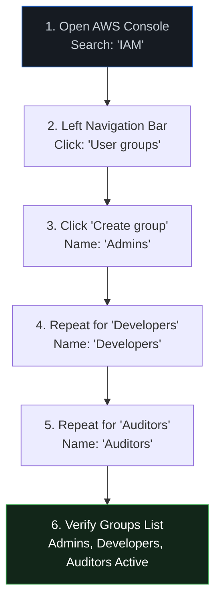
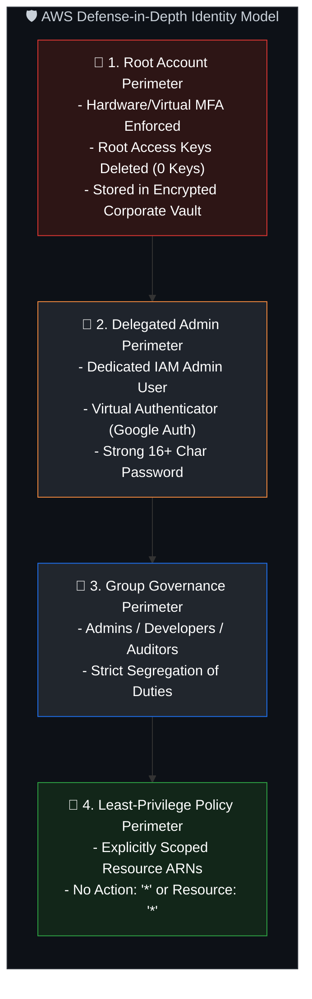
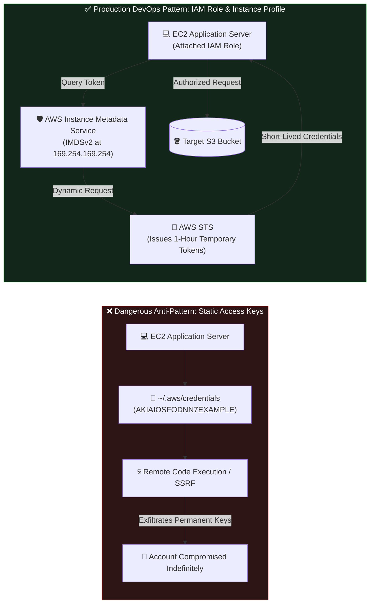

# DevOps Winter Arc — Day 23: AWS IAM & Access Management

> **Topic:** AWS Week, Day 1: Identity and Access Management (IAM), Least Privilege Architecture, Policy Engineering, and Group Governance  
> **Repository:** `90_Days_Of_DevOps`  
> **Challenge:** 90 Days of DevOps Winter Arc Challenge  
> **Target Audience:** DevOps Engineer / Cloud Security Practitioner  

---

## 🎯 Day 23 Overview & Objectives

Following yesterday's comprehensive review of AWS global infrastructure and billing safety, **Day 23 marks Day 1 of AWS Week**, diving straight into the foundational security backbone of Amazon Web Services: **AWS Identity and Access Management (IAM)**.

In cloud and DevOps engineering, identity is the **new network perimeter**. Traditional physical firewalls cannot protect cloud resources if API access credentials or permissions are improperly configured. Today's focus is on mastering the primitives of IAM, constructing secure role-based group architectures, dissecting JSON policy evaluation logic, and implementing the **Principle of Least Privilege (PoLP)** without launching chargeable cloud infrastructure.

> [!IMPORTANT]
> **Account State & Lab Scope Notice:**  
> - **Pre-existing Security Baseline:** Root User MFA and IAM User MFA were **already configured prior to this session**.  
> - **Zero-Cost Guarantee:** No compute instances, databases, or chargeable resources were provisioned during this practical lab.  
> - **Design vs. Attachment Distinction:** Policies designed in this lab are documented as architectural specifications; only temporary organizational groups were created and subsequently deleted.

### 📚 Learning Objectives

1. **Understand AWS IAM Fundamentals:** Master the mechanics of authentication (AuthN) versus authorization (AuthZ) in the cloud.
2. **Examine Core IAM Components:** Understand IAM Users, User Groups, IAM Roles, IAM Policies, and Multi-Factor Authentication (MFA).
3. **Deconstruct JSON Policy Anatomy:** Analyze the formal JSON grammar of IAM policies (`Version`, `Statement`, `Effect`, `Action`, `Resource`, `Condition`, `Sid`).
4. **Architect Small-Team Group Hierarchies:** Model an enterprise-grade group structure for Admins, Developers, and Auditors.
5. **Differentiate Policy Types:** Distinguish between AWS-managed policies and customer-managed policies.
6. **Master IAM Evaluation Logic:** Understand Default Deny, Explicit Allow, and how Explicit Deny overrides all permissions.
7. **Adopt Modern DevOps Machine Identity:** Understand why EC2 instances and workloads must use attached IAM Roles and temporary STS tokens rather than permanent access keys.
8. **Diagnose Common IAM Misconfigurations:** Troubleshoot real-world permission failures including S3 bucket vs. object scoping and role trust policy mismatches.

---

## 📋 Lab Metadata & Environment State

| Parameter | Specification / State |
| :--- | :--- |
| **Challenge** | 90 Days of DevOps (Winter Arc) |
| **Day** | 23 of 90 (AWS Week, Day 1) |
| **Topic** | AWS IAM & Access Management |
| **Primary Service** | AWS Identity and Access Management (IAM) — Global Scope |
| **Target AWS Region** | Global (IAM is an AWS Global Service; endpoint: `iam.amazonaws.com`) |
| **Chargeable Resources Created** | **Zero (0)** (IAM is a 100% free service) |
| **Pre-existing Security Baseline** | Root MFA (Google Authenticator) active; IAM User MFA active |
| **Lab Groups Created** | `Admins`, `Developers`, `Auditors` |
| **Lab Groups Post-Session State** | **Cleaned up / Deleted** (No orphaned groups retained) |
| **IAM Users Created for Lab** | **Zero (0)** (No unnecessary user accounts generated) |
| **Primary Interfaces** | AWS Management Console, IAM JSON Policy Editor |

---

## 🗺️ AWS IAM Architecture & Request Evaluation Workflow

The following diagram illustrates how an identity (human or machine) initiates an AWS API call, how IAM verifies identity (Authentication), and how the IAM Policy Evaluation Engine evaluates statements to make an authorization decision.

```mermaid
flowchart TD
    subgraph IDENTITIES["👥 Identity Layer (Authentication - AuthN)"]
        U["👤 IAM User\n(Console Password / Access Keys)"]
        R["🏷️ IAM Role\n(Temporary STS Token)"]
        F["🌐 Federated Identity / OIDC\n(GitHub Actions / Okta)"]
    end

    subgraph AWS_API["🛡️ AWS API Endpoint (iam.amazonaws.com / s3.amazonaws.com)"]
        AUTHN{"1. Authentication Valid?\n(Signature / Token / MFA Check)"}
        
        subgraph EVAL_ENGINE["⚙️ IAM Policy Evaluation Engine (Authorization - AuthZ)"]
            START_EVAL["Start Evaluation\n(Default: DENY)"]
            EXPLICIT_DENY{"Explicit DENY\nStatement Match?"}
            EXPLICIT_ALLOW{"Explicit ALLOW\nStatement Match?"}
            FINAL_DENY["❌ Request Denied\n(403 AccessDenied)"]
            FINAL_ALLOW["✅ Request Allowed\n(200 OK)"]
        end
        
        TARGET_RES[("📦 Target AWS Resource\ne.g., S3 Bucket / EC2 Instance")]
    end

    U -->|API Request with Signed Headers| AUTHN
    R -->|API Request with Session Token| AUTHN
    F -->|Assumes Role via STS| AUTHN

    AUTHN -->|Valid Signature| START_EVAL
    AUTHN -->|Invalid / Expired| FINAL_DENY

    START_EVAL --> EXPLICIT_DENY
    EXPLICIT_DENY -->|Yes (Deny overrides everything)| FINAL_DENY
    EXPLICIT_DENY -->|No| EXPLICIT_ALLOW
    
    EXPLICIT_ALLOW -->|Yes| FINAL_ALLOW
    EXPLICIT_ALLOW -->|No (Default Deny remains)| FINAL_DENY

    FINAL_ALLOW --> TARGET_RES

    style IDENTITIES fill:#161b22,stroke:#1f6feb,color:#c9d1d9
    style AWS_API fill:#0d1117,stroke:#30363d,color:#c9d1d9
    style EVAL_ENGINE fill:#21262d,stroke:#8957e5,color:#fff
    style FINAL_DENY fill:#2d1515,stroke:#da3633,color:#fff
    style FINAL_ALLOW fill:#122619,stroke:#2ea043,color:#fff
    style TARGET_RES fill:#1f242c,stroke:#f0883e,color:#fff
```

---

## 1. 🌐 Introduction to AWS IAM

### What is IAM?
**AWS Identity and Access Management (IAM)** is a foundational, globally managed AWS web service that provides fine-grained access control across your entire AWS infrastructure. IAM is **global** by design; you do not select a region when configuring users, groups, roles, or policies—your configurations apply across all AWS regions worldwide.

IAM manages two distinct domains:
1. **Who can access** your AWS account resources (Authentication).
2. **What actions** they are allowed or denied from performing on specific resources (Authorization).

### Why IAM is Critical in DevOps and Cloud Engineering
In traditional on-premises infrastructure, the security boundary was primarily physical and network-oriented (perimeter firewalls, VLANs, bastion hosts). In the public cloud, **identity is the security perimeter**:
* **Every Interaction is an API Call:** Whether you click a button in the AWS Console, run `aws s3 ls` in your terminal, or execute `terraform apply`, you are issuing an HTTPS REST API call to an AWS service endpoint. IAM validates every single call.
* **Blast Radius Reduction:** Properly configured IAM boundaries ensure that if a developer workstation or continuous integration (CI) runner is compromised, the attacker cannot delete production databases or hijack domain routing.
* **Compliance and Auditability:** IAM integrates natively with **AWS CloudTrail**, recording exactly which identity executed every API request, from which IP address, and at what timestamp.
* **Machine-to-Machine Security:** Modern DevOps workflows run automated pipelines (Jenkins, GitHub Actions, GitLab CI) and containerized workloads (Kubernetes, ECS). IAM enables these machines to authenticate securely without hardcoding static passwords or secrets.

### Authentication vs. Authorization

Understanding the distinction between Authentication (AuthN) and Authorization (AuthZ) is fundamental to cloud security:

```
┌─────────────────────────────────────────────────────────────────────────────┐
│                    Authentication vs. Authorization                         │
├──────────────────────────┬──────────────────────────────────────────────────┤
│ Authentication (AuthN)   │ Authorization (AuthZ)                            │
├──────────────────────────┼──────────────────────────────────────────────────┤
│ "Who are you?"           │ "What are you allowed to do?"                    │
│ Verifies identity.       │ Verifies permissions and privileges.             │
│ Validates credentials    │ Evaluates JSON policies, conditions,             │
│ (Password, MFA, API key).│ boundaries, and resource access rules.           │
│ Happens FIRST.           │ Happens SECOND (only after successful AuthN).    │
│ Example: Logging in with │ Example: Checking if user can execute            │
│ username and MFA token.  │ s3:PutObject on a specific S3 bucket.            │
└──────────────────────────┴──────────────────────────────────────────────────┘
```

### IAM’s Role in AWS Security
IAM is the first line of defense in the **AWS Shared Responsibility Model**. While AWS guarantees the security of the underlying hardware, hypervisors, and data centers, **you are completely responsible for access management (Security IN the Cloud)**. A single overly permissive policy statement (`"Action": "*", "Resource": "*"`) can negate thousands of dollars in perimeter defenses.

---

## 2. 🧱 Core IAM Components

AWS IAM consists of several fundamental building blocks that interact to govern identity and access.

```
┌─────────────────────────────────────────────────────────────────────────────┐
│                           Core IAM Components Map                           │
├─────────────────────┬───────────────────────────────────────────────────────┤
│ Identity Primitives │ 👤 IAM User (Individual human or long-term identity)  │
│                     │ 👥 IAM User Group (Collection of users for governance)│
│                     │ 🏷️ IAM Role (Temporary identity for services/machines) │
├─────────────────────┼───────────────────────────────────────────────────────┤
│ Policy Primitives   │ 📜 Identity-Based Policies (Attached to User/Group/Role)│
│                     │ 🔒 Resource-Based Policies (Attached to S3, SQS, etc.) │
│                     │ 🤝 Trust Policies (Defines WHO can assume a Role)     │
├─────────────────────┼───────────────────────────────────────────────────────┤
│ Governance & Guard  │ 🔐 Multi-Factor Authentication (MFA - Virtual/FIDO2)  │
│                     │ 🛡️ Principle of Least Privilege (PoLP)                │
│                     │ ⛔ Default Deny / Explicit Deny Rules                 │
└─────────────────────┴───────────────────────────────────────────────────────┘
```

---

### 1. IAM Users
* **What it is:** A persistent identity created within your AWS account representing an individual human (e.g., a developer, sysadmin) or a legacy application requiring long-term credentials.
* **Credentials:** An IAM user can have two forms of credentials:
  1. **Console Password:** For interactive sign-in through the AWS Management Console web UI.
  2. **Access Keys (Access Key ID & Secret Access Key):** For programmatic requests via the AWS CLI, AWS SDKs, or direct REST APIs.
* **Best Practice:** IAM users should not be shared between team members. Every human engineer must have their own distinct IAM user with MFA enabled.

### 2. IAM User Groups
* **What it is:** A collection of IAM users.
* **Why it is used:** Instead of attaching policies individually to each user (which becomes unmanageable as teams scale), policies are attached to a **Group**. All users added to the group automatically inherit its permissions.
* **Crucial Rule:** A Group cannot be identified as a `Principal` in an IAM policy statement; a Group is merely a management mechanism for aggregating users. Groups cannot belong to other groups (no nested groups in AWS IAM).

### 3. IAM Roles
* **What it is:** An identity with specific permission policies that is **not** tied to a single persistent person or static password.
* **How it works:** A Role is intended to be **assumed** by anyone or anything that needs temporary access:
  * An **AWS Service** (e.g., an EC2 instance assuming an IAM role to upload log files to S3).
  * A **Kubernetes Pod** (via EKS IAM Roles for Service Accounts - IRSA).
  * An **External Identity** (via OIDC with GitHub Actions or SAML 2.0 with corporate Okta/Active Directory).
* **Security Benefit:** When an identity assumes a role, the **AWS Security Token Service (STS)** generates temporary security credentials (`AccessKeyId`, `SecretAccessKey`, and `SessionToken`) that automatically expire after a configurable duration (15 minutes to 12 hours).

### 4. IAM Policies
* **What it is:** A formal JSON document that defines permissions by explicitly specifying what actions are allowed or denied on which AWS resources.
* **Types of Policies:**
  * **Identity-Based Policies:** Attached directly to an IAM User, Group, or Role.
  * **Resource-Based Policies:** Attached directly to a resource (e.g., an S3 Bucket Policy, KMS Key Policy) stating who can access that resource.

### 5. Multi-Factor Authentication (MFA)
* **What it is:** A mandatory security control requiring two verification factors: a password (something you know) plus a dynamic 6-digit TOTP code from a physical device or mobile app (something you have).
* **Status in this Lab:** As confirmed during our Day 22 account hardening, **Root MFA and IAM User MFA were already configured prior to this session** using Google Authenticator.

### 6. Least Privilege Principle (PoLP)
The **Principle of Least Privilege** requires that any identity (human or machine) must be granted **only the minimal permissions strictly necessary** to complete its intended tasks, and nothing more.
* *Example:* If an engineer needs to inspect container metrics in CloudWatch, they must be granted `CloudWatchReadOnlyAccess`, not `AdministratorAccess`.

### 7. Default Deny vs. Explicit Deny
* **Default Deny (Implicit Deny):** By default, all requests in AWS IAM are denied. If no policy explicitly allows an action, the request is blocked.
* **Explicit Deny:** A policy statement with `"Effect": "Deny"`. An explicit deny **always overrides any explicit allow**, regardless of how many allow policies are attached.

### 8. Trust Policies
A **Trust Policy** (or *Assume Role Policy Document*) is a specialized resource-based policy attached to an IAM Role that defines **who or what is permitted to assume that role**.
* *Example:* A trust policy might specify that only the `ec2.amazonaws.com` service is allowed to assume the role.

---

### Comparison: IAM Users vs. IAM Roles

| Architectural Dimension | IAM User | IAM Role |
| :--- | :--- | :--- |
| **Intended Entity** | A specific human team member or legacy system. | Applications, AWS services (EC2, Lambda), or federated users. |
| **Credentials** | Long-term static credentials (Password, permanent Access Keys). | Temporary, dynamic credentials generated on-demand by AWS STS. |
| **Credential Lifetime** | Valid indefinitely until manually rotated or revoked. | Auto-expiring (15 minutes to 12 hours). |
| **Risk of Credential Leak** | High (if access keys are committed to Git). | Extremely low (credentials automatically expire). |
| **MFA Support** | Directly assigned virtual or hardware MFA. | Enforced via Condition keys (`aws:MultiFactorAuthPresent`). |
| **Cross-Account Access** | Difficult to manage securely. | Standard best practice for cross-account delegation. |

---

## 3. 📜 IAM Policy Structure & Anatomy

An IAM policy is written in standard JSON format. Understanding every key within this JSON document is essential for policy authoring and security auditing.

```
┌─────────────────────────────────────────────────────────────────────────────┐
│                          IAM Policy JSON Anatomy                            │
├─────────────┬───────────────────────────────────────────────────────────────┤
│ Version     │ Policy language version (Always use "2012-10-17")             │
├─────────────┼───────────────────────────────────────────────────────────────┤
│ Statement   │ Array containing one or more permission blocks               │
│  ├── Sid    │ Statement ID: Optional human-readable description             │
│  ├── Effect │ Either "Allow" or "Deny"                                      │
│  ├── Action │ Specific API calls allowed or denied (e.g., "s3:GetObject")   │
│  ├── Resource│ Target AWS resource ARN(s) affected by the action            │
│  └── Condition│ (Optional) Contextual rules for policy validity             │
└─────────────┴───────────────────────────────────────────────────────────────┘
```

### The Reference Lab Policy Example

```json
{
  "Version": "2012-10-17",
  "Statement": [
    {
      "Sid": "AllowLabBucketObjectAccess",
      "Effect": "Allow",
      "Action": [
        "s3:GetObject",
        "s3:PutObject"
      ],
      "Resource": "arn:aws:s3:::YOUR-LAB-BUCKET/*"
    }
  ]
}
```

### Detailed Breakdown of Policy Elements

#### 1. `Version`
* Specifies the language syntax version of the policy.
* **Must always be set to `"2012-10-17"`**. Do not use today's date! `"2012-10-17"` represents the current, modern policy grammar version that supports advanced policy variables and conditions.

#### 2. `Statement`
* The main container block of the policy. It can contain a single statement object or an array of multiple statement objects.

#### 3. `Sid` (Statement Identifier)
* An optional, human-readable identifier assigned to the statement (e.g., `"AllowLabBucketObjectAccess"`).
* Best practice in DevOps is to give every statement a descriptive `Sid` explaining its business intent.

#### 4. `Effect`
* Specifies whether the statement results in an explicit allow or an explicit deny.
* Permitted values: `"Allow"` or `"Deny"`.

#### 5. `Action`
* Specifies the exact AWS API actions that are permitted or denied.
* In our example:
  * `"s3:GetObject"` allows downloading and reading objects stored inside S3.
  * `"s3:PutObject"` allows uploading, writing, and creating new objects inside S3.
  * **Critical Distinction:** These actions **do not grant `s3:ListBucket`**! The user cannot open the AWS console and view the list of files in the bucket; they can only read or write an object if they already know its exact key path.

#### 6. `Resource`
* Identifies the specific AWS resource(s) using an **Amazon Resource Name (ARN)**.
* In our example: `"arn:aws:s3:::YOUR-LAB-BUCKET/*"`
  * The trailing `/*` is critical: it explicitly scopes the permission to **objects inside the bucket**.
  * It does not apply to the bucket itself (bucket-level actions like `s3:ListBucket` or `s3:GetBucketLocation` require `"arn:aws:s3:::YOUR-LAB-BUCKET"` without `/*`).
  * **Configuration Reminder:** The placeholder string `YOUR-LAB-BUCKET` must be replaced with the exact name of your targeted S3 bucket before applying the policy in production.

#### 7. `Condition` (Optional)
* Specifies circumstances under which the policy grants or denies permission (e.g., requiring MFA: `{"Bool": {"aws:MultiFactorAuthPresent": "true"}}` or restricting source IP addresses: `{"IpAddress": {"aws:SourceIp": "203.0.113.0/24"}}`).

---

## 4. 🏢 Practical Lab: Small-Team IAM Architecture

### Scenario Overview
A growing technology company needs to establish a clean, secure IAM structure for three functional teams without granting excessive privileges.

```
                       ┌────────────────────────────────┐
                       │       AWS Account Root         │
                       │ (MFA Active, Locked in Vault)  │
                       └───────────────┬────────────────┘
                                       │
                 ┌─────────────────────┼─────────────────────┐
                 ▼                     ▼                     ▼
        ┌─────────────────┐   ┌─────────────────┐   ┌─────────────────┐
        │  Group: Admins  │   │Group: Developers│   │ Group: Auditors │
        ├─────────────────┤   ├─────────────────┤   ├─────────────────┤
        │ Intended:       │   │ Intended:       │   │ Intended:       │
        │ Administrator   │   │ Scoped S3       │   │ Read-Only /     │
        │ Access          │   │ Read/Write      │   │ SecurityAudit   │
        └─────────────────┘   └─────────────────┘   └─────────────────┘
```

### Team Groups Designed During the Session

| Group Name | Team Function | Intended Permissions & Governance |
| :--- | :--- | :--- |
| **`Admins`** | Designated Cloud Administrators | Full administrative permissions to manage cloud operations, governance, and networking. |
| **`Developers`** | Software & Application Engineers | Strictly limited S3 read/write access to a specific lab bucket; **zero** administrative control. |
| **`Auditors`** | Compliance & Security Reviewers | Read-only access across the account to inspect configurations without modification privileges. |

---

### Step-by-Step Practical Console Navigation

The following console steps document how the three IAM user groups were provisioned during the practical session:



1. Sign in to the AWS Management Console and navigate to the **IAM Dashboard** (`https://console.aws.amazon.com/iam/`).
2. In the left navigation pane under **Access management**, select **User groups**.
3. Click the orange **Create group** button.
4. In the **User group name** field, enter `Admins`.
5. *(Optional Policy Attachment for Admins):* In the attached policies list, search for the AWS-managed policy `AdministratorAccess` and check the box. Click **Create group**.
6. Repeat the process to create the `Developers` group without attaching broad administrative policies.
7. Repeat the process to create the `Auditors` group (attaching an audit policy like `SecurityAudit` or `ReadOnlyAccess`).

---

### Why Developers Should NEVER Receive `AdministratorAccess`
In novice setups, teams often grant `AdministratorAccess` to all engineers to avoid dealing with permission requests. In a production DevOps environment, this is an unacceptable vulnerability:
1. **Accidental Deletion:** A developer testing a local script could inadvertently delete a production RDS database or wipe out a VPC route table.
2. **Security Compromise:** If a developer's laptop is compromised by malware, the attacker inherits full administrative power over the company's AWS cloud.
3. **Regulatory Non-Compliance:** Frameworks like SOC 2, ISO 27001, and PCI-DSS require strict segregation of duties between production administration and application development.
4. **Financial Safeguard:** Developers with admin access can inadvertently spin up massive GPU compute clusters (e.g., `p4d.24xlarge` at ~$32/hour), causing severe billing spikes.

---

### AWS-Managed Policies vs. Customer-Managed Policies

```
┌─────────────────────────────────────────────────────────────────────────────┐
│              AWS-Managed Policies vs. Customer-Managed Policies             │
├──────────────────────────┬──────────────────────────────────────────────────┤
│ AWS-Managed Policy       │ Customer-Managed Policy                          │
├──────────────────────────┼──────────────────────────────────────────────────┤
│ Created and maintained   │ Created, authored, and maintained by YOU         │
│ directly by AWS.         │ (your cloud/DevOps team).                        │
│ Generic, broad scoping   │ Precise, tailored scoping following least        │
│ (e.g., AmazonS3FullAccess)│ privilege (e.g., access to only 1 bucket).       │
│ Automatically updated by │ Only updated when your team modifies the JSON    │
│ AWS when services expand.│ document.                                        │
│ Cannot be edited by users│ Supports up to 5 policy versions with instant    │
│                          │ rollback capability.                             │
└──────────────────────────┴──────────────────────────────────────────────────┘
```

> [!NOTE]
> **Lab Record: Permissions Designed vs. Policies Attached**  
> During this practical session, the least-privilege S3 policy for the `Developers` group (`AllowLabBucketObjectAccess`) was **prepared and verified as a policy design**. To ensure zero risk to existing account assets and adhere to clean governance, the custom policy was formulated as an architectural specification rather than permanently deployed to the account.

---

## 5. 🛡️ AWS Account Security & Identity Best Practices

Securing an AWS account requires defense-in-depth across the root user, IAM identities, and authentication mechanisms.



### 1. Root Account Security Baseline
* The Root user is the master account created with the registration email. It possesses unrestricted, permanent administrative control that **cannot be restricted by any IAM policy**.
* **Session Record:** As established in our Day 22 account hardening, **Root MFA was already active** prior to today's lab.
* **Operational Rule:** Never use the root user for daily development, deployment, or administration. Lock the credentials in an encrypted password safe and access them only for emergency account-level changes (e.g., closing the account, changing support plans, or updating payment methods).

### 2. IAM User Security Baseline
* Every team member must have an individual IAM user with a unique username.
* Enforce strong password requirements: minimum 14 characters, uppercase, lowercase, numbers, and symbols.
* **Session Record:** **IAM User MFA was already configured prior to this session** using Google Authenticator on a mobile device.

### 3. Why Root Access Keys Must Never Be Created for Daily CLI Usage
Programmatic access keys (`AKIA...`) have no expiration date unless manually rotated. If root access keys are generated:
* They bypass web console MFA checks entirely.
* If an engineer accidentally commits an `.env` file or terminal history containing root access keys to GitHub, automated scanners extract them in under 60 seconds.
* An attacker with root keys can terminate all account infrastructure, lock out administrators, and launch thousands of dollars of cryptocurrency mining VMs.

### 4. Why Credentials Must Never Be Shared
* **Loss of Accountability:** If five developers share an account named `dev-team`, CloudTrail logs will only show that `dev-team` terminated a production database. It becomes impossible to identify who took the action.
* **Revocation Friction:** When an employee leaves the company, sharing credentials requires resetting the password and updating access keys across every single developer machine and automated script. With individual IAM users, offboarding simply requires deactivating that single user.

---

## 6. ⚖️ IAM Permission Evaluation Logic

When an identity attempts an action against an AWS resource, the IAM Policy Evaluation Engine processes all applicable policies using a strict algorithmic workflow.

```
┌─────────────────────────────────────────────────────────────────────────────┐
│                          IAM Evaluation Flowchart                           │
└──────────────────────────────────────┬──────────────────────────────────────┘
                                       ▼
                         ┌───────────────────────────┐
                         │   Decision: DENY (Default)│
                         └─────────────┬─────────────┘
                                       ▼
                       Is there an EXPLICIT DENY?
                                    /     \
                                  YES      NO
                                  /         \
                 ┌───────────────────┐       ▼
                 │ Decision: DENY    │   Is there an EXPLICIT ALLOW?
                 └───────────────────┘             /     \
                                                 YES      NO
                                                 /         \
                               ┌───────────────────┐    ┌───────────────────┐
                               │ Decision: ALLOW   │    │ Decision: DENY    │
                               └───────────────────┘    └───────────────────┘
```

### The Three Golden Rules of IAM Evaluation

#### Rule 1: Default Deny (Implicit Deny)
By default, all requests are denied. If no policy statement explicitly allows the requested action, the request is rejected with `AccessDenied`.

#### Rule 2: Explicit Allow
An action is permitted only if an applicable policy contains an `"Effect": "Allow"` statement matching the requested action and resource ARN.

#### Rule 3: Explicit Deny Overrides Everything ("Deny Trumps All")
If any applicable policy statement contains an `"Effect": "Deny"` that matches the request, **the request is denied immediately**, regardless of how many other statements explicitly grant `"Allow"`.

---

### Practical Evaluation Scenarios

| Scenario | Policy A (Attached to User) | Policy B (Attached to Group) | Final Evaluation Decision | Rationale |
| :--- | :--- | :--- | :--- | :--- |
| **Case 1** | No policies attached | No policies attached | ❌ **DENY** | Default Deny: No explicit allow exists. |
| **Case 2** | `Allow s3:GetObject` on `bucket-a` | None | ✅ **ALLOW** | Explicit Allow matches the action and resource. |
| **Case 3** | `Allow s3:*` on `*` | `Deny s3:DeleteObject` on `bucket-a` | ❌ **DENY** (on delete) | **Explicit Deny overrides Allow**: The user can do everything except delete objects in `bucket-a`. |
| **Case 4** | `Allow s3:GetObject` on `bucket-a/*` | None (Request: `s3:ListBucket`) | ❌ **DENY** | Scoping mismatch: Object read permission does not grant bucket listing. |

---

## 7. 🚀 DevOps Real-World Architecture: EC2 IAM Roles vs. Static Access Keys

One of the most frequent security errors in cloud engineering is storing permanent AWS access keys on an EC2 instance or virtual machine.



### Why EC2 Instances Must Use IAM Roles Instead of Static Keys

1. **Elimination of Secret Management:** If you hardcode `AWS_ACCESS_KEY_ID` and `AWS_SECRET_ACCESS_KEY` inside `~/.aws/credentials` or an application `.env` file, anyone who gains shell access to the instance, or any attacker who exploits a Server-Side Request Forgery (SSRF) vulnerability, can steal those permanent credentials.
2. **Automated Credential Rotation:** When an IAM Role is attached to an EC2 instance via an **Instance Profile**, the operating system queries the link-local **Instance Metadata Service (IMDSv2)** at `http://169.254.169.254/latest/meta-data/iam/security-credentials/`. AWS STS automatically provisions temporary, auto-expiring security tokens and refreshes them before expiration.
3. **Auditability:** API calls made using temporary role credentials appear in AWS CloudTrail logs tied to the specific role session name, making forensics clear and traceable.

---

## 8. 🔍 Troubleshooting Real-World IAM Failures

DevOps engineers frequently encounter IAM permission errors. Below are the most common failure scenarios and their diagnostic workflows.

---

### Failure 1: `AccessDenied` When Creating an IAM User
* **Symptom:** An administrator attempts to create a new user via the console or CLI and receives:
  ```
  An error occurred (AccessDenied) when calling the CreateUser operation:
  User: arn:aws:iam::123456789012:user/junior-admin is not authorized to perform: iam:CreateUser
  ```
* **Root Cause:** The calling identity does not have the `iam:CreateUser` permission, or an attached **Permissions Boundary** or **Service Control Policy (SCP)** is blocking IAM modifications.
* **Remediation:**
  1. Inspect the identity's attached policies for `iam:CreateUser`.
  2. Verify if an organizational SCP is enforcing centralized identity creation through IAM Identity Center (SSO).
  3. Ensure the administrator has appropriate delegation permissions.

---

### Failure 2: `s3:GetObject` Works, but `s3:ListBucket` Fails
* **Symptom:** A developer can download a file if they know the full URL (`aws s3 cp s3://my-bucket/app.log .`), but running `aws s3 ls s3://my-bucket/` returns `Access Denied`.
* **Root Cause:** **Resource ARN Mismatch!**  
  The developer's policy is scoped to objects:
  ```json
  "Resource": "arn:aws:s3:::my-bucket/*"
  ```
  `s3:ListBucket` is a **bucket-level operation**, not an object-level operation. It evaluates against the bucket ARN, not the object ARN.
* **Remediation:** Add a separate statement allowing `s3:ListBucket` against the bucket itself:
  ```json
  {
    "Effect": "Allow",
    "Action": "s3:ListBucket",
    "Resource": "arn:aws:s3:::my-bucket"
  }
  ```

---

### Failure 3: Role Assumption Failure (`AssumeRole` Denied)
* **Symptom:** An EC2 instance, Lambda function, or external workflow attempts to assume an IAM role and receives:
  ```
  An error occurred (AccessDenied) when calling the AssumeRole operation:
  Not authorized to perform sts:AssumeRole
  ```
* **Root Cause:**
  1. The calling entity's identity policy lacks `Action: "sts:AssumeRole"`.
  2. **The Role's Trust Policy is misconfigured.** The trust policy does not list the calling principal (e.g., `ec2.amazonaws.com` or the caller's ARN) in the `Principal` block.
* **Remediation:** Open the IAM Role in the console, click the **Trust relationships** tab, and verify that the `Principal` block matches the entity attempting assumption:
  ```json
  {
    "Version": "2012-10-17",
    "Statement": [
      {
        "Effect": "Allow",
        "Principal": {
          "Service": "ec2.amazonaws.com"
        },
        "Action": "sts:AssumeRole"
      }
    ]
  }
  ```

---

### Failure 4: Overly Broad Wildcard Policies (`Action: "*"` and `Resource: "*"`)
* **Symptom:** Security scanners (AWS Security Hub, Prowler, Checkov) flag high-severity findings for excessive privilege grants.
* **The Danger:** An attacker who compromises this credential has unrestricted administrative power to delete backups, expose data, and hijack infrastructure.
* **Remediation:**
  1. Use **IAM Access Analyzer** to review recent CloudTrail events and generate a policy based solely on the actual actions performed.
  2. Replace wildcards with explicit service actions (e.g., replace `s3:*` with `s3:GetObject`, `s3:PutObject`).
  3. Scope resource ARNs to specific bucket or instance identifiers rather than `*`.

---

## 9. 🎤 DevOps Interview Preparation (10 Questions & Answers)

These 10 questions represent standard DevOps and Cloud Engineering interview topics on AWS IAM.

### Q1: What is AWS IAM?
> **Answer:**  
> "AWS Identity and Access Management (IAM) is a globally managed service that controls authentication and authorization across an AWS account. It enables administrators to manage who can access resources (Authentication via users, groups, and roles) and what actions they can perform on specific resources (Authorization via JSON policies) without any additional service fees."

---

### Q2: What is the difference between an IAM User and an IAM Role?
> **Answer:**  
> "An IAM User is a permanent identity associated with a specific person or service, utilizing long-term credentials like passwords or static access keys. An IAM Role is an identity that does not possess permanent credentials; instead, it is assumed dynamically by authorized entities (such as EC2 instances, Lambda functions, or external GitHub Actions runners) to obtain temporary, auto-expiring security tokens from AWS STS."

---

### Q3: What is the Principle of Least Privilege, and why is it essential in DevOps?
> **Answer:**  
> "The Principle of Least Privilege (PoLP) dictates that an identity or service must be granted only the minimal permissions strictly necessary to perform its intended job, and for no longer than required. In DevOps, enforcing PoLP minimizes the blast radius: if an application container, CI/CD runner, or developer laptop is compromised, the attacker cannot pivot to delete databases, modify networks, or exfiltrate sensitive data."

---

### Q4: What is an IAM Policy, and what are its key components?
> **Answer:**  
> "An IAM Policy is a formal JSON document defining permissions. Its primary elements are:
> - **Version:** Language syntax version (standard: `2012-10-17`).
> - **Statement:** Array containing the permission blocks.
> - **Effect:** Explicitly `Allow` or `Deny`.
> - **Action:** The specific API calls permitted or blocked (e.g., `s3:GetObject`).
> - **Resource:** The ARN of the targeted AWS resource.
> - **Condition:** Optional contextual rules (e.g., requiring MFA or restricting IP ranges)."

---

### Q5: What is the difference between AWS-Managed Policies and Customer-Managed Policies?
> **Answer:**  
> "AWS-Managed Policies are created and maintained directly by AWS. They provide generic roles (like `AdministratorAccess` or `AmazonS3ReadOnlyAccess`) and update automatically as new service features are released, but they are often overly permissive. Customer-Managed Policies are authored and maintained by your team, allowing precise, least-privilege scoping to specific resources and supporting version history with rollback capabilities."

---

### Q6: What is Multi-Factor Authentication (MFA), and why is it critical?
> **Answer:**  
> "MFA requires an identity to present two distinct authentication factors: something you know (master password) and something you possess (a dynamic 6-digit TOTP code generated by an authenticator app like Google Authenticator or a hardware key like a YubiKey). MFA is critical because it prevents account compromise even if passwords are leaked through phishing or credential stuffing."

---

### Q7: What is an IAM Trust Policy?
> **Answer:**  
> "A Trust Policy (or Assume Role Policy Document) is a specialized resource-based policy attached to an IAM Role that explicitly defines **which principals are trusted to assume that role**. For example, it specifies whether an EC2 service (`ec2.amazonaws.com`), another AWS account, or an OIDC identity provider has permission to request temporary credentials via `sts:AssumeRole`."

---

### Q8: How does AWS evaluate IAM permissions when multiple policies apply?
> **Answer:**  
> "AWS follows a three-step evaluation logic:
> 1. **Default Deny:** All requests are denied by default.
> 2. **Explicit Deny Check:** If any policy contains an explicit `Deny` matching the request, the request is immediately denied (Deny overrides everything).
> 3. **Explicit Allow Check:** If no explicit deny exists, the request is allowed only if an applicable policy contains an explicit `Allow`. If no allow is found, the default deny remains in effect."

---

### Q9: Why should an organization use IAM User Groups?
> **Answer:**  
> "IAM User Groups streamline permission governance at scale. Instead of attaching policies individually to dozens of separate users—which leads to permission drift and human error—policies are attached to functional groups (e.g., `Admins`, `Developers`, `Auditors`). Users inherit permissions by membership, making onboarding, role changes, and offboarding simple and auditable."

---

### Q10: Why should an EC2 instance use an attached IAM Role instead of hardcoded access keys?
> **Answer:**  
> "Hardcoding static access keys in configuration files (`~/.aws/credentials`) creates severe security risks: keys can be compromised via application vulnerabilities (like SSRF), disk snapshots, or accidental Git commits. By attaching an IAM Role via an Instance Profile, the instance securely retrieves temporary, auto-expiring security credentials from the link-local Instance Metadata Service (IMDSv2). AWS STS automatically rotates these tokens, eliminating secret management overhead."

---

## 10. 🧹 Lab Cleanup & Resource Audit

To maintain impeccable cloud hygiene and prevent configuration drift, all temporary resources created during this session were audited and removed.

```
┌─────────────────────────────────────────────────────────────────────────────┐
│                           Post-Lab Cleanup Audit                            │
├───────────────────────┬──────────────┬──────────────────────────────────────┤
│ Resource Name         │ Action Taken │ Post-Lab Verification State          │
├───────────────────────┼──────────────┼──────────────────────────────────────┤
│ Group: `Admins`       │ **DELETED**  │ Confirmed removed from IAM console.  │
│ Group: `Developers`   │ **DELETED**  │ Confirmed removed from IAM console.  │
│ Group: `Auditors`     │ **DELETED**  │ Confirmed removed from IAM console.  │
│ IAM Users             │ None Created │ User count unchanged.                │
│ Custom Policies       │ Design Only  │ No custom policies left attached.    │
│ Root & User MFA       │ **RETAINED** │ Pre-existing security baselines kept.│
│ Chargeable Resources  │ None Created │ Spend verified at $0.00.             │
└───────────────────────┴──────────────┴──────────────────────────────────────┘
```

### Exact Cleanup Steps Performed in Console:
1. Navigated to **IAM Console** > **User groups**.
2. Selected the checkboxes for `Admins`, `Developers`, and `Auditors`.
3. Clicked the **Delete** button at the top right of the table.
4. Confirmed the deletion modal by entering the required confirmation text.
5. Verified the user groups list returned to its clean baseline state.
6. Confirmed zero compute, storage, or database resources were created or left running.

---

## 11. ✅ Day 23 Completion Checklist

Review this checklist to confirm complete mastery of Day 23 topics:

- [x] **Understood IAM Fundamentals:** Mastered global scope, authentication vs. authorization, and identity perimeter concepts.
- [x] **Reviewed Core Components:** Studied the roles and boundaries of IAM Users, User Groups, IAM Roles, and Policies.
- [x] **Confirmed Existing Security Baseline:** Verified that Root MFA and IAM User MFA were already configured prior to this session.
- [x] **Created Enterprise Groups:** Provisioned `Admins`, `Developers`, and `Auditors` user groups in the console.
- [x] **Designed Least-Privilege Structure:** Formulated role-appropriate boundaries preventing developer administrative sprawl.
- [x] **Analyzed Policy JSON Grammar:** Dissected `Version`, `Statement`, `Effect`, `Action`, `Resource`, `Sid`, and S3 object scoping.
- [x] **Internalized IAM Evaluation Logic:** Mastered Default Deny, Explicit Allow, and the "Explicit Deny Overrides All" rule.
- [x] **Mastered Machine Identity:** Understood why EC2 and CI/CD must use attached IAM Roles and STS rather than static access keys.
- [x] **Deleted Temporary IAM Groups:** Successfully cleaned up `Admins`, `Developers`, and `Auditors` groups after the lab.
- [x] **Maintained Zero Cost:** Verified that no chargeable AWS infrastructure was launched.

---

## 12. 💡 Key Takeaways & Real-World DevOps Context

1. **Identity is the Production Firewall:** In cloud-native architectures, network IP addresses are ephemeral (containers and VMs scale dynamically). IAM identity policies are the only persistent, deterministic defense layer across multi-cloud and hybrid environments.
2. **Never Grant Full Admin Access by Default:** Segregation of duties protects production stability. Developers should have scoped access to their application resources and dev/staging buckets, while administrative power is restricted to designated operators.
3. **Roles Over Keys for All Automation:** Modern DevOps practices completely deprecate long-term access keys for servers. Whether configuring EC2 instance profiles, Kubernetes Pod identities (IRSA), or GitHub Actions runners via OIDC, always leverage IAM Roles and temporary STS credentials.
4. **Deny Trumps Allow:** When crafting security boundaries or emergency lockdown policies, remember that a single explicit `Deny` statement immediately shuts down all matching access across all users, regardless of existing allows.
5. **Infrastructure-as-Code (IaC) Readiness:** The JSON policy structures mastered today form the exact syntax you will write in Terraform (`aws_iam_policy`, `aws_iam_role`) and Kubernetes security manifests in future modules.
---

[← Day 22](Day22.md) | [Home](Day01.md) | [Day 24 →](Day24.md)
