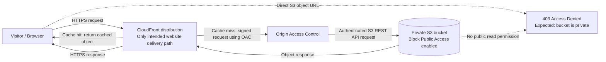

# DevOps Winter Arc — Day 24: Amazon S3 + CloudFront

> **Topic:** AWS Week, Day 2 — Amazon S3 and CloudFront  
> **Repository:** `90_Days_Of_DevOps`  
> **Challenge:** 90 Days of DevOps Winter Arc Challenge  
> **Practical scope:** Local HTML preparation and conceptual/console learning. No S3 bucket or CloudFront distribution was created.

---

## Day 24 Overview

Today connects object storage with global content delivery. Amazon S3 stores website files as objects. Amazon CloudFront caches and delivers those files from edge locations closer to visitors. A secure design keeps the S3 bucket private and allows CloudFront to read it through **Origin Access Control (OAC)**.

### Learning objectives

- Explain S3 object storage, buckets, objects, and object keys.
- Understand Block Public Access, bucket policies, Versioning, and object recovery.
- Explain CloudFront, CDN architecture, OAC, HTTPS, caching, TTL, default root objects, and invalidations.
- Describe a private S3 origin delivered through CloudFront.
- Prepare a simple local static website and understand an optional AWS workflow.
- Recognize cost drivers, cleanup steps, and common delivery failures.

## 1. Amazon S3 and object storage

**Amazon Simple Storage Service (S3)** is an object storage service. Applications store and retrieve complete objects through API requests. S3 is commonly used for static website assets, backups, logs, data lakes, and software artifacts. It is not a mounted filesystem: folders shown in the console are usually a visual grouping based on key prefixes.

| Term | Meaning | Example |
| --- | --- | --- |
| Bucket | A named container for objects. Bucket names are globally unique within an AWS partition. | `my-team-site-prod` |
| Object | The stored data plus metadata, such as content type and timestamps. | An HTML document or image |
| Object key | The object's full name within a bucket. Prefixes make keys look like paths. | `assets/logo.svg` |
| Version | A stored revision of an object when Versioning is enabled. | Current and previous `index.html` revisions |

For example, in `s3://my-team-site-prod/assets/logo.svg`, `my-team-site-prod` is the bucket and `assets/logo.svg` is the key. S3 does not treat `assets/` as a real directory; it is part of the key.

## 2. S3 access and protection

### Block Public Access

S3 **Block Public Access (BPA)** provides account- and bucket-level settings that block public access granted through policies or access control lists. Keep all appropriate BPA settings enabled for a private origin. BPA is an important safeguard, but it does not replace reviewing identity permissions, bucket policies, or other access paths.

### Bucket policies

A bucket policy is a resource-based JSON policy attached to a bucket. It can allow or deny requests to the bucket and its objects. Use a narrow policy that names the intended CloudFront distribution and only grants the read action needed by the site. Avoid public principals such as `"Principal": "*"` for a private-origin design.

Conceptual policy shape (replace placeholders and validate before use):

```json
{
  "Version": "2012-10-17",
  "Statement": [{
    "Sid": "AllowThisCloudFrontDistributionReadOnly",
    "Effect": "Allow",
    "Principal": { "Service": "cloudfront.amazonaws.com" },
    "Action": "s3:GetObject",
    "Resource": "arn:aws:s3:::BUCKET_NAME/*",
    "Condition": {
      "StringEquals": {
        "AWS:SourceArn": "arn:aws:cloudfront::ACCOUNT_ID:distribution/DISTRIBUTION_ID"
      }
    }
  }]
}
```

This grants the named distribution read access to object keys. It does not make the bucket public, and it does not grant upload or delete access.

### Versioning and recovery

With **Versioning** enabled, S3 retains multiple versions of an object key. Re-uploading a key creates a newer current version while preserving earlier versions. Deleting an object generally adds a delete marker, which makes the key appear deleted while prior versions remain recoverable. Versioning helps recover from accidental overwrite or deletion, but stored versions can incur storage charges. It is not a backup against every failure, such as compromised credentials that permanently delete versions.

Recovery normally means finding the desired version ID and copying that version back as the current object, or removing a delete marker when appropriate. Protect version deletion permissions and consider lifecycle policies for old versions.

## 3. CloudFront and CDN architecture

**Amazon CloudFront** is a content delivery network (CDN). A CDN serves content through a distributed network of edge locations, reducing the distance between a visitor and the content. CloudFront can cache static objects and retrieve cache misses from an origin such as S3.

- **Origin:** The source CloudFront fetches from, such as an S3 bucket.
- **Edge location:** A CloudFront point of presence that handles viewer requests and can serve cached content.
- **Cache behavior:** Rules for paths, allowed methods, protocols, caching, and origin selection.
- **TTL (time to live):** How long an object may remain fresh in a cache before CloudFront checks or fetches it again, subject to cache policy settings and origin cache headers.

### Private S3 origin with OAC

**Origin Access Control (OAC)** lets CloudFront sign requests to an S3 REST API origin. The bucket policy trusts the CloudFront service principal only for the specified distribution. Visitors access the site through CloudFront; direct unauthenticated S3 object requests receive `403 AccessDenied` by design.

OAC is the preferred option for new S3-origin deployments. **Origin Access Identity (OAI)** is the older mechanism. OAC supports newer signing and origin scenarios and uses a service principal plus a distribution-scoped bucket policy; OAI uses a CloudFront identity associated with the origin and older policy patterns. Existing OAI setups may still work, but new designs should generally use OAC.



CloudFront is the intended public website delivery path in this design. OAC is how CloudFront is authorized to fetch from the private bucket; it is not a separate public endpoint.

### HTTPS, viewer protocol policy, and default root object

Configure the viewer protocol policy to **Redirect HTTP to HTTPS** (or HTTPS only where appropriate) so browser traffic uses TLS. CloudFront to S3 origin communication is also protected in the AWS service path. A distribution's **default root object**, commonly `index.html`, tells CloudFront what to return for a request to the distribution root such as `/`. It does not automatically make every nested path behave like a single-page application route.

### Caching and invalidations

CloudFront caches objects according to its cache policy and origin headers. A long TTL reduces origin requests and can improve response time, but a changed file may not appear immediately at every edge. Use versioned filenames (for example, `app.4f92c1.js`) for frequently changed assets. For a small set of files, an invalidation asks CloudFront to remove cached entries so later requests fetch fresh content. Invalidation can take time and may have charges beyond the free allowance; repeated broad invalidations are a poor substitute for a sensible cache strategy.

## 4. Local static site preparation

Today's local project structure:

```text
day24-site/
├── index.html
└── error.html
```

Example `day24-site/index.html`:

```html
<!doctype html>
<html lang="en">
<head>
  <meta charset="utf-8">
  <meta name="viewport" content="width=device-width, initial-scale=1">
  <title>Day 24 — S3 + CloudFront</title>
</head>
<body>
  <main>
    <h1>My static site</h1>
    <p>This page is prepared locally for the Day 24 learning exercise.</p>
  </main>
</body>
</html>
```

Example `day24-site/error.html`:

```html
<!doctype html>
<html lang="en">
<head>
  <meta charset="utf-8">
  <meta name="viewport" content="width=device-width, initial-scale=1">
  <title>Page unavailable</title>
</head>
<body>
  <main>
    <h1>We couldn't find that page</h1>
    <p>Check the address or return to the home page.</p>
    <a href="/">Go to the home page</a>
  </main>
</body>
</html>
```

These files were prepared locally. The commands below describe an **optional AWS hands-on workflow**; they do not indicate that AWS resources were created today.

### Useful AWS CLI commands

Run read-only checks first and confirm which account and credentials the CLI will use. `BUCKET_NAME` is a placeholder.

| Command | What it does |
| --- | --- |
| `aws sts get-caller-identity` | Shows the AWS account, caller ARN, and user/role ID for the active credentials. |
| `aws configure list` | Shows which profile, region, and credential sources the CLI resolved (sensitive values are masked). |
| `aws s3 ls` | Lists buckets visible to the current identity; it does not list bucket contents unless a bucket is specified. |
| `aws s3 sync ./day24-site s3://BUCKET_NAME` | Uploads and synchronizes local files to the bucket. It can write objects and cause charges; without `--delete`, it does not remove destination-only objects. |
| `aws s3api get-public-access-block --bucket BUCKET_NAME` | Reads the bucket-level S3 Block Public Access configuration. |
| `aws s3api get-bucket-versioning --bucket BUCKET_NAME` | Reads the bucket's Versioning status. |
| `aws s3api list-object-versions --bucket BUCKET_NAME` | Lists object versions and delete markers; output may be large. |
| `aws cloudfront list-distributions` | Lists CloudFront distributions visible to the current identity. |

### Optional AWS implementation workflow

1. Confirm the active account and CLI profile using the identity commands above.
2. Create an S3 bucket in the chosen region, keep BPA enabled, and enable Versioning if recovery of overwrites/deletes is desired.
3. Create a CloudFront distribution with the bucket's S3 REST endpoint as origin. Configure OAC and set the distribution as the only intended public delivery path.
4. Add a bucket policy limited to that distribution's `s3:GetObject` access. Keep public access blocked.
5. Set `index.html` as the default root object and configure HTTPS viewer behavior.
6. Upload the local files, wait for the distribution deployment, and validate the CloudFront URL. Confirm direct S3 access remains denied.
7. Choose cache settings and invalidate only when needed. Review charges and clean up if the experiment is finished.

This is a learning workflow, not a record of completed provisioning.

## 5. Security best practices

- Keep S3 Block Public Access enabled for a private CloudFront origin.
- Prefer OAC over the older OAI approach for new deployments.
- Require HTTPS from viewers by redirecting HTTP or using HTTPS-only behavior.
- Apply least privilege: allow only the intended distribution to read only the required object path; grant no unnecessary writes.
- Never upload credentials, private keys, personal data, or other sensitive files to a public website location.
- Never create root access keys. Use appropriately scoped identities and temporary credentials for CLI work.
- A private S3 bucket returning 403 for direct object access is expected. Test the CloudFront URL for the intended visitor path.
- Review both bucket and account-level public access controls and avoid ACL-based public access.

## 6. Cost awareness and cleanup

S3 charges can include stored data, requests (such as GET and PUT), data retrieval or transfer, and optional features. CloudFront charges can include distribution data transfer, HTTP/HTTPS requests, and optional features. Exact rates depend on region, usage, and current pricing. Invalidations may incur charges after the applicable free allowance. Even a small test can generate charges, particularly if objects are repeatedly requested or left in place.

AWS Budgets and billing alerts notify you when actual or forecasted spend reaches a threshold. They are monitoring tools, **not hard spending caps**: usage can continue while notifications are delivered or resources remain active.

### Cleanup considerations

For a versioned bucket, deleting only the current object key is not enough. List all object versions and delete markers, then remove every version and marker before deleting the bucket. Review the target bucket carefully: bulk deletion is destructive.

Illustrative cleanup commands (replace the bucket; review output and permissions before use):

```bash
# Inspect versions and delete markers first
aws s3api list-object-versions --bucket BUCKET_NAME

# After preserving anything needed, delete all versions and delete markers.
# This uses jq to build the required per-object entries and may need batching
# for buckets with more than 1,000 listed entries.
aws s3api list-object-versions --bucket BUCKET_NAME --output json \
  | jq -r '.Versions[]?, .DeleteMarkers[]? | [.Key, .VersionId] | @tsv' \
  | while IFS="$(printf '\t')" read -r key version_id; do
      aws s3api delete-object --bucket BUCKET_NAME --key "$key" --version-id "$version_id"
    done

# Once empty, delete the bucket
aws s3api delete-bucket --bucket BUCKET_NAME
```

The illustrative pipeline needs pagination handling for buckets larger than one API page; use a reviewed script or SDK paginator for production cleanup. CloudFront distributions must first be disabled, then allowed to finish deploying that change, and then deleted. A distribution with an attached custom domain may require additional DNS/certificate cleanup. Verify no other workloads depend on the bucket or distribution before removal.

### Two learning tracks

| Track | Scope | Cost expectation |
| --- | --- | --- |
| Zero-cost learning | Read this note, prepare local HTML, and study architecture/console concepts without provisioning S3 or CloudFront resources. | No AWS resource charges from this work. |
| Optional AWS hands-on | Create and configure an S3 bucket and CloudFront distribution, upload files, validate delivery, then clean up. | May incur S3, CloudFront, request, transfer, and related charges. |

## 7. Interview questions and answers

### 1. What is Amazon S3?

Amazon S3 is AWS object storage. It stores data as objects inside buckets and exposes APIs to upload, download, list, and manage those objects. It is often used for static files, backups, logs, and datasets.

### 2. What is an S3 bucket?

A bucket is a named container for S3 objects. It is the top-level namespace for object keys and has settings such as region, Versioning, encryption, and public access controls. Bucket names must be unique within the applicable AWS partition.

### 3. What is an S3 object?

An object is the stored content plus metadata. An object has a key, such as `images/logo.png`, and may have metadata such as content type. When Versioning is enabled, the same key can have multiple versions.

### 4. What is S3 Versioning?

Versioning preserves multiple revisions of an object key. A new upload creates a current version while previous versions remain available. It helps recover from accidental overwrites or deletes, though retained versions use storage and must be protected from permanent deletion.

### 5. What is Block Public Access?

Block Public Access is a set of S3 controls that block public permissions from policies or ACLs at the account or bucket level. It is a guardrail that helps prevent accidental public exposure; it should be enabled for a private origin.

### 6. What is a bucket policy?

A bucket policy is JSON attached to an S3 bucket that controls access to bucket and object resources. It can name principals, actions, resources, and conditions. A private CloudFront origin policy should grant only the distribution the read access it needs.

### 7. What is CloudFront?

CloudFront is AWS's content delivery network service. It accepts viewer requests at edge locations, serves cached content when available, and retrieves misses from configured origins such as S3.

### 8. What is a CDN?

A content delivery network is a distributed system that caches and serves content from locations closer to users. This can reduce latency and reduce repeated requests to the origin.

### 9. What is an edge location?

An edge location is a CloudFront point of presence that receives and processes viewer requests. It can return a cached object or fetch it from the origin when needed.

### 10. What is Origin Access Control?

OAC is a CloudFront feature that signs requests to supported origins such as an S3 REST endpoint. The bucket policy can then allow the CloudFront service principal only when the request comes from a specified distribution.

### 11. What is the difference between OAC and OAI?

OAI is the older CloudFront mechanism for private S3 access. OAC is the newer recommended control for new S3-origin setups and supports modern request signing and policy patterns. OAC policies typically use the CloudFront service principal scoped by distribution ARN; OAI policies reference the OAI identity.

### 12. Why should an S3 bucket remain private?

Keeping the bucket private reduces accidental exposure and ensures the website is delivered through the intended controls at CloudFront. It also avoids bypassing CloudFront caching, HTTPS behavior, logging, and other distribution settings.

### 13. How does CloudFront access a private S3 bucket?

CloudFront uses OAC to sign the origin request. The bucket policy allows `s3:GetObject` to the CloudFront service principal only for the intended distribution, so ordinary visitors cannot read objects directly from S3.

### 14. Why does direct S3 access return 403?

The bucket is private and does not grant anonymous public reads. A 403 on the direct object URL is expected in this design; users should access the website through the CloudFront distribution.

### 15. What is a default root object?

It is the object CloudFront returns for the distribution's root path, commonly `index.html`. It makes a request to `/` resolve to that file without the visitor typing the filename.

### 16. What is TTL?

TTL means time to live: the period an object can remain fresh in a cache. CloudFront cache policy limits and origin cache headers influence how long content is cached before revalidation or another origin fetch.

### 17. What is cache invalidation?

An invalidation requests that CloudFront remove selected cached paths. The next request can then fetch fresh content from the origin. It is useful for urgent updates but can take time and may have usage charges.

### 18. What happens when you update a file in S3?

With Versioning on, S3 stores a new version and makes it current. CloudFront may continue serving a cached old copy until its TTL expires or the path is invalidated. Versioned asset filenames reduce ambiguity for frequently changed files.

### 19. How do you recover an older S3 object version?

List the versions, identify the desired version ID, then copy that version to the same key as a new current version or remove an appropriate delete marker. Ensure permissions allow recovery and avoid deleting the old version until recovery is verified.

### 20. How do you safely delete a versioned S3 bucket?

Inspect the bucket and confirm its contents are no longer needed. Delete all object versions and delete markers (handling pagination), verify it is empty, and then delete the bucket. Deleting only current keys leaves historical versions behind.

### 21. What is the difference between S3 static website hosting and using S3 as a private CloudFront origin?

S3 website hosting uses the website endpoint and website-specific behavior, which is generally a public website origin and does not provide the same OAC private REST-origin pattern. A private CloudFront origin uses the S3 REST endpoint and OAC, with CloudFront as the public entry point. CloudFront can also provide HTTPS and edge caching for the private-origin design.

### 22. How would you troubleshoot a CloudFront 403 error?

Check whether the S3 object exists and the key's capitalization/path is correct; verify the default root object for `/`; inspect the bucket policy's distribution ARN, service principal, and `s3:GetObject` resource; confirm OAC is attached to the correct S3 REST origin; ensure BPA is not conflicting with an attempted public-access design; and review CloudFront response details and deployment status. Test the CloudFront URL separately from the direct S3 URL, which should remain denied.

## 8. Troubleshooting scenarios

| Symptom | Possible causes | Practical solution |
| --- | --- | --- |
| CloudFront homepage returns 403, but an object path works | Default root object is missing or misspelled; `index.html` was not uploaded. | Set the default root object to `index.html`, verify the object key and case, then wait for distribution deployment. |
| CloudFront returns 403 for every S3 object | Bucket policy has the wrong distribution ARN, missing `s3:GetObject`, wrong resource ARN, or OAC is not attached to the origin. | Check the origin is the S3 REST endpoint, attach the intended OAC, and scope the bucket policy to that distribution. |
| Direct S3 URL returns 403 while CloudFront works | Private bucket has no anonymous read permission. | This is expected. Use the CloudFront URL for website delivery; do not make the bucket public to silence the error. |
| Updated page still shows old content | CloudFront edge has a cached version, or browser cache is stale. | Check the response headers and cache policy; wait for TTL, invalidate the specific path if urgent, or publish a versioned asset name. |
| CSS or image files return 404/403 | Incorrect relative path, capitalization mismatch, missing uploaded object, or bucket policy/resource scope excludes the key. | Compare the browser request URL with the exact S3 key, upload the missing file, and check policy scope. |
| Browser redirects or reports an HTTPS issue | Viewer protocol policy/certificate configuration is incorrect, or the site links to HTTP resources. | Configure redirect-to-HTTPS or HTTPS-only, verify the CloudFront certificate and alternate domain setup if used, and update insecure asset links. |

## 9. Revision

### Key takeaways

- S3 stores objects under keys in buckets; apparent folders are key prefixes.
- Keep a CloudFront origin bucket private and Block Public Access enabled.
- OAC signs CloudFront origin requests and can be scoped to one distribution in the bucket policy.
- HTTPS viewer behavior, a default root object, and sensible cache settings are core delivery configuration.
- Versioning supports recovery, but old versions and delete markers must be removed to empty a versioned bucket.
- CloudFront can serve stale cached content until TTL expiry or invalidation.
- Today's work covered local HTML and conceptual/console learning only; AWS provisioning remains optional.

### Important AWS CLI commands

```bash
aws sts get-caller-identity
aws configure list
aws s3 ls
aws s3 sync ./day24-site s3://BUCKET_NAME
aws s3api get-public-access-block --bucket BUCKET_NAME
aws s3api get-bucket-versioning --bucket BUCKET_NAME
aws s3api list-object-versions --bucket BUCKET_NAME
aws cloudfront list-distributions
```

The identity, configuration, listing, public-access, versioning, and distribution commands are inspection commands. `aws s3 sync` uploads files and changes AWS state, so use it only in the optional hands-on track after confirming the account and bucket.

### Five quick revision questions

1. Why should a private S3 origin deny direct public requests?
2. What does OAC sign, and how does the bucket policy scope access?
3. What does the CloudFront default root object do?
4. Name two ways to make an updated object visible through CloudFront.
5. Why must you delete versions and delete markers before deleting a versioned bucket?

### Today's learning checklist

- [x] Explain object storage, buckets, objects, and keys.
- [x] Describe Block Public Access, bucket policies, Versioning, and recovery.
- [x] Explain CDN, CloudFront, edge locations, OAC, and OAI.
- [x] Trace the private S3 + CloudFront request path and expected direct-S3 403.
- [x] Explain HTTPS viewer behavior, default root object, TTL, and invalidation.
- [x] Prepare local `index.html` and `error.html` examples.
- [x] Review optional CLI workflow, cost awareness, and cleanup.
- [x] Practice interview questions and troubleshooting scenarios.

---

**Day 24 complete — Amazon S3 + CloudFront.**
