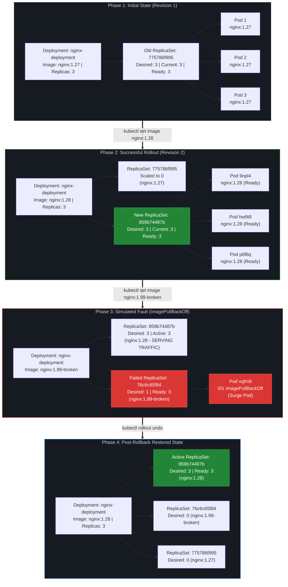

# DevOps Winter Arc — Day 16: Kubernetes Deployments & Rollouts

> **90 Days of DevOps Challenge | Week 3: Kubernetes | Release • Observe • Break • Roll Back**  
> **Topic: Deployments & Rollouts — Rolling Updates, ReplicaSets, Revision History, Change-Cause Annotations, maxSurge / maxUnavailable, Broken Image Diagnosis, and Zero-Downtime Rollback**

---

## 🎯 Goal for Today

In Day 15, we laid the foundation of Kubernetes by deploying an Nginx workload, exposing it via a NodePort Service, and understanding how Pods are scheduled across nodes in a local `kind` cluster. However, real-world DevOps engineers rarely manage static workloads. Software is deployed constantly: features are released, configuration changes, and container images are updated. 

If an update is pushed carelessly, users experience downtime or outages. If an invalid image tag is deployed, applications can break mid-release. 

**Today's Goal:** Master the complete deployment lifecycle on our local `kind-winter-arc` Kubernetes cluster following the operational loop: **Release → Observe → Break → Roll Back**. We inspect existing Deployment configuration, apply a change-cause release audit annotation, execute a controlled rolling image update (`nginx:1.27` → `nginx:1.28`), analyze ReplicaSet scaling dynamics, intentionally deploy an invalid image tag (`nginx:1.99-broken`) to observe failure isolation (`ErrImagePull` / `ImagePullBackOff`), and safely roll back to our verified known-good revision with zero downtime for our active users.

> [!NOTE]
> **Lab Environment Disclaimer:** This lab was executed entirely within a local learning environment running on a single-node `kind` (Kubernetes in Docker) cluster named `kind-winter-arc`. All commands, logs, and outputs documented here are authentic records of this local cluster session and are not from a live production cluster.

### 🗺️ Today's Mission Blueprint

```text
  [Step 1: Inspect]      Check kind-winter-arc context, existing nginx-deployment, and ReplicaSet state
         │
         ▼
  [Step 2: Audit & Tag]  Annotate deployment with kubernetes.io/change-cause release message
         │
         ▼
  [Step 3: Rollout v2]   Deploy nginx:1.28 via kubectl set image and monitor rollout status
         │
         ▼
  [Step 4: Verify v2]    Inspect ReplicaSet scale-down (775786f995 -> 859b74487b) and Pod health
         │
         ▼
  [Step 5: Break Release] Deploy non-existent image nginx:1.99-broken to trigger deployment failure
         │
         ▼
  [Step 6: Triage Error] Diagnose Pod state (ErrImagePull -> ImagePullBackOff) and Pod Events
         │
         ▼
  [Step 7: Rollback]     Execute kubectl rollout undo, address apply warning, and restore nginx:1.28
         │
         ▼
  [Step 8: Final Health] Verify 3/3 Ready Pods, inactive failed ReplicaSet, and final revision state
```

---

## 📋 Lab Metadata

| Parameter | Lab Value |
| :--- | :--- |
| **Challenge** | 90 Days of DevOps |
| **Day** | 16 of 90 |
| **Week** | Week 3: Kubernetes |
| **Topic** | Deployments & Rollouts |
| **Operational Theme** | Release → Observe → Break → Roll Back |
| **Difficulty** | Beginner / Advanced Beginner |
| **Estimated Duration** | 3–4 hours |
| **Cluster Context** | `kind-winter-arc` |
| **Namespace** | `default` |
| **Deployment Name** | `nginx-deployment` |
| **Target Container** | `nginx` |
| **Desired Replicas** | 3 |
| **Initial Image** | `nginx:1.27` |
| **Target Image** | `nginx:1.28` |
| **Simulated Fault Image** | `nginx:1.99-broken` |

---

## 🎯 Learning Objectives

By working through this hands-on lab, we achieve the following core competencies:

1. **Kubernetes Deployment Rolling Updates:** Understand how the Deployment controller orchestrates gradual Pod replacement without taking the entire application offline.
2. **ReplicaSets and Revision History:** Understand why every change to a Deployment's Pod template spins up a new ReplicaSet, retaining previous ReplicaSets for fast rollbacks.
3. **Change-Cause Audit Annotations:** Learn how to record human-readable release causes using the `kubernetes.io/change-cause` annotation and understand its scoping behavior.
4. **Valid Image Rollout & Observation:** Update an active container image and track rollout progression synchronously using `kubectl rollout status`.
5. **Simulated Failure Diagnosis:** Intentionally deploy a non-existent container image tag, observe how Kubernetes isolates failures, and differentiate between `ErrImagePull` and `ImagePullBackOff`.
6. **Cluster Event Triage:** Use `kubectl describe pod` and cluster events to extract actionable root-cause error messages from container runtimes.
7. **Safe Rollback Operations:** Execute `kubectl rollout undo` to recover from an in-flight broken release and understand the warning regarding `kubectl.kubernetes.io/last-applied-configuration`.
8. **Mathematical Rolling Strategy Tuning:** Master the calculation and rounding logic behind `maxSurge` and `maxUnavailable` for arbitrary replica counts.
9. **Final Application Health Verification:** Validate that active traffic is served exclusively by verified Pods and verify that inactive ReplicaSets remain safely scaled to zero.

---

## 🗺️ Deployment Rollout & Rollback Architecture Diagram

The diagram below illustrates the exact state transitions observed during today's lab across the three distinct phases: the valid update to `nginx:1.28`, the isolated failure of `nginx:1.99-broken`, and the final rollback restoration.



---

## 📖 Key Concepts & Deep Dive

### 1. What is a Rolling Update?

In Kubernetes, a **Deployment** represents a declarative description of your application. When you change any field in the Deployment's Pod template (`spec.template`)—such as updating an environment variable, changing CPU requests, or bumping a container image tag—the Deployment controller does not terminate all existing Pods at once. 

Instead, it executes a **Rolling Update**:
- It introduces new Pods incrementally using a new ReplicaSet.
- It verifies that new Pods pass their readiness gates.
- It gradually routes traffic to the newly created Pods while systematically terminating Pods belonging to the previous ReplicaSet.

This strategy ensures that application capacity remains available during normal healthy releases, preventing sudden downtime.

### 2. The Deployment → ReplicaSet → Pod Hierarchy

Understanding the relationship between these three API primitives is crucial for debugging rollouts:

```text
┌────────────────────────────────────────────────────────┐
│                      Deployment                        │
│            Manages release strategy & history          │
└───────────────────────────┬────────────────────────────┘
                            │
              ┌─────────────┴─────────────┐
              ▼                           ▼
   ┌──────────────────────┐    ┌──────────────────────┐
   │ Old ReplicaSet (v1)  │    │ New ReplicaSet (v2)  │
   │ Desired Replicas: 0  │    │ Desired Replicas: 3  │
   └──────────┬───────────┘    └──────────┬───────────┘
              │                           │
        (No active pods)            ┌─────┼─────┐
                                    ▼     ▼     ▼
                                  Pod 1 Pod 2 Pod 3
```

- **Deployment:** The orchestrator that manages releases, rollout pauses/resumes, and revision history. You declare your desired state here.
- **ReplicaSet:** The low-level controller that guarantees an exact count of identical Pods match a given label selector at any given moment. **Deployments never create Pods directly; they create and scale ReplicaSets.** Every unique Pod template generates a unique 10-character hash (e.g., `pod-template-hash=859b74487b`) which is appended to the ReplicaSet name.
- **Pod:** The running container instance with its network namespace and shared storage.

### 3. Deciphering `maxSurge` and `maxUnavailable`

The pace and safety bounds of a rolling update are governed by two configuration parameters defined under `spec.strategy.rollingUpdate`:

```yaml
spec:
  strategy:
    type: RollingUpdate
    rollingUpdate:
      maxSurge: 25%
      maxUnavailable: 25%
```

Both parameters can be expressed as an absolute count (e.g., `1`) or as a percentage of `spec.replicas`. When percentages are used, Kubernetes applies strict mathematical rounding rules:

| Setting | Default | Definition | Rounding Rule | Lab Impact (`replicas: 3`) |
| :--- | :--- | :--- | :--- | :--- |
| **`maxSurge`** | `25%` | The maximum number of Pods that can be scheduled **above** the desired replica count. | Always rounds **UP** | $25\% \times 3 = 0.75 \rightarrow \mathbf{1}$ extra Pod.<br>Max total Pods allowed: $3 + 1 = \mathbf{4}$. |
| **`maxUnavailable`** | `25%` | The maximum number of Pods that can be unavailable during the update process. | Always rounds **DOWN** | $25\% \times 3 = 0.75 \rightarrow \mathbf{0}$ unavailable Pods.<br>Min available Pods required: $3 - 0 = \mathbf{3}$. |

#### 🔬 What this math means in practice for our lab:
Because `maxUnavailable` rounded down to `0`, Kubernetes was **forbidden from terminating any of our existing `nginx:1.27` Pods** until at least one new `nginx:1.28` Pod became fully Ready! 

Simultaneously, because `maxSurge` rounded up to `1`, Kubernetes had permission to create **exactly 1 extra Pod** (totaling 4 Pods across the cluster) to begin testing the new release.

> [!WARNING]
> **No Universal Guarantee of Zero Downtime:** While a rolling update strategy with `maxUnavailable: 0` is designed to prevent downtime during updates, it does not magically guarantee zero downtime under all failure conditions. If your cluster lacks compute capacity to schedule surge Pods, if network policies block new Pods, or if an application has breaking database schema migrations that are incompatible with older Pods, users will still experience disruption.

---

## 🛠️ Step-by-Step Hands-On Lab Walkthrough

### Step 1: Initial Cluster Inspection & Context Validation

Before making any infrastructure modifications, an operational engineer must inspect the target cluster environment. This baseline inspection verifies our context, ensures we are interacting with the intended cluster, and captures the starting state of our workloads.

#### Commands Executed:

```bash
# 1. Verify current kubectl context
kubectl config current-context

# 2. Inspect active Deployments in default namespace
kubectl get deployments

# 3. Inspect active Pods
kubectl get pods

# 4. Inspect active ReplicaSets
kubectl get rs
```

#### Actual Terminal Session Output:

```text
$ kubectl config current-context
kind-winter-arc

$ kubectl get deployments
NAME               READY   UP-TO-DATE   AVAILABLE   AGE
nginx-deployment   3/3     3            3           23h

$ kubectl get rs
NAME                          DESIRED   CURRENT   READY   AGE
nginx-deployment-775786f995   3         3         3       23h
```

#### 🔍 Analysis of Initial State:
- **Cluster Context:** We are connected to `kind-winter-arc`, our local cluster created via `kind`.
- **Target Deployment:** `nginx-deployment` has been running for 23 hours with `3/3` Ready replicas and `3` Available replicas.
- **Initial ReplicaSet:** The existing ReplicaSet is `nginx-deployment-775786f995`. The hash suffix `775786f995` represents the deterministic SHA-1 hash of the initial Pod template. All 3 desired Pods are actively managed by this controller.

---

### Step 2: Deep Inspection of Deployment Configuration

Next, we inspect the detailed specification of `nginx-deployment` to extract its rollout strategy, container configurations, and historical revision status.

#### Commands Executed:

```bash
# Describe the Deployment metadata and strategy parameters
kubectl describe deployment nginx-deployment

# Query container name and image directly via jsonpath
kubectl get deployment nginx-deployment \
  -o jsonpath='{.spec.template.spec.containers[*].name}{"\n"}{.spec.template.spec.containers[*].image}{"\n"}'

# Check existing rollout history
kubectl rollout history deployment/nginx-deployment
```

#### Observed Configuration Excerpt:

```text
StrategyType:           RollingUpdate
RollingUpdateStrategy:  25% max unavailable, 25% max surge
Replicas:               3 desired | 3 updated | 3 total | 3 available | 0 unavailable

Containers:
 nginx:
  Image: nginx:1.27

$ kubectl rollout history deployment/nginx-deployment
deployment.apps/nginx-deployment
REVISION  CHANGE-CAUSE
1         <none>
```

#### 🔍 Technical Analysis:
- **Rolling Strategy:** `StrategyType: RollingUpdate` with `25% max unavailable, 25% max surge`.
- **Active Container Image:** The container named `nginx` is running image `nginx:1.27`.
- **Revision History:** Revision 1 is the only revision recorded, and its `CHANGE-CAUSE` column reports `<none>`. 
- **The Issue with `<none>`:** Without recording change causes, engineers troubleshooting an outage have no immediate clue what commit, change ticket, or human action generated a specific revision without deeply inspecting raw manifests.

---

### Step 3: Record Release Reason & Perform Valid Update (`nginx:1.28`)

We now initiate a controlled image upgrade from `nginx:1.27` to `nginx:1.28`. Prior to triggering the update, we annotate the deployment with a descriptive release message.

#### Commands Executed:

```bash
# 1. Annotate the deployment with a descriptive release reason
kubectl annotate deployment/nginx-deployment \
  kubernetes.io/change-cause="Day 16: update Nginx from 1.27 to 1.28 for rollout practice"

# 2. Update the container image to nginx:1.28
kubectl set image deployment/nginx-deployment \
  nginx=nginx:1.28

# 3. Synchronously wait and observe rollout progress
kubectl rollout status deployment/nginx-deployment
```

#### Actual Terminal Session Output:

```text
$ kubectl annotate deployment/nginx-deployment kubernetes.io/change-cause="Day 16: update Nginx from 1.27 to 1.28 for rollout practice"
deployment.apps/nginx-deployment annotated

$ kubectl set image deployment/nginx-deployment nginx=nginx:1.28
deployment.apps/nginx-deployment image updated

$ kubectl rollout status deployment/nginx-deployment
deployment "nginx-deployment" successfully rolled out
```

#### 🔍 Why `kubectl rollout status` is Essential:
Imperative commands like `kubectl set image` or declarative commands like `kubectl apply` return almost immediately after sending the update to the `kube-apiserver`. They do **not** wait for the container image to download, containers to start, or readiness probes to pass. 

`kubectl rollout status` blocks execution until the rollout reaches a terminal state (either complete success or timeout/failure). In CI/CD pipelines (e.g., GitHub Actions, Jenkins, ArgoCD), `kubectl rollout status` provides the critical exit code ($0$ for success, non-zero for failure) needed to gate deployment stages.

---

### Step 4: Verify Successful Release & Inspect Revision History

With the rollout successfully concluded, we inspect the updated cluster state, verify the new ReplicaSet, and examine the revision history.

#### Commands Executed:

```bash
# Check rollout history summary
kubectl rollout history deployment/nginx-deployment

# Deep dive into revision #2 details
kubectl rollout history deployment/nginx-deployment --revision=2

# Inspect Deployment wide output
kubectl get deployment nginx-deployment -o wide

# Inspect all ReplicaSets and Pods across the deployment
kubectl get rs,pods -o wide
```

#### Actual Terminal Session Output:

```text
$ kubectl rollout history deployment/nginx-deployment
deployment.apps/nginx-deployment
REVISION  CHANGE-CAUSE
1         Day 16: update Nginx from 1.27 to 1.28 for rollout practice
2         Day 16: update Nginx from 1.27 to 1.28 for rollout practice

$ kubectl rollout history deployment/nginx-deployment --revision=2
deployment.apps/nginx-deployment with revision #2
Pod Template:
  Labels:	app=nginx
	pod-template-hash=859b74487b
  Annotations:	kubernetes.io/change-cause: Day 16: update Nginx from 1.27 to 1.28 for rollout practice
  Containers:
   nginx:
    Image:	nginx:1.28
    Port:	80/TCP

$ kubectl get deployment nginx-deployment -o wide
NAME               READY   UP-TO-DATE   AVAILABLE   AGE   CONTAINERS   IMAGES       SELECTOR
nginx-deployment   3/3     3            3           23h   nginx        nginx:1.28   app=nginx

$ kubectl get rs,pods -o wide
NAME                                          DESIRED   CURRENT   READY   AGE    CONTAINERS   IMAGES       SELECTOR
replicaset.apps/nginx-deployment-775786f995   0         0         0       23h    nginx        nginx:1.27   app=nginx,pod-template-hash=775786f995
replicaset.apps/nginx-deployment-859b74487b   3         3         3       113s   nginx        nginx:1.28   app=nginx,pod-template-hash=859b74487b

NAME                                    READY   STATUS    RESTARTS   AGE    IP            NODE
pod/nginx-deployment-859b74487b-9npl4   1/1     Running   0          96s    10.244.0.10   winter-arc-control-plane
pod/nginx-deployment-859b74487b-hw9t9   1/1     Running   0          113s   10.244.0.8    winter-arc-control-plane
pod/nginx-deployment-859b74487b-p6f6q   1/1     Running   0          96s    10.244.0.9    winter-arc-control-plane
```

#### 🔍 Key Observations & The Change-Cause Annotation Behavior:
1. **New Active ReplicaSet:** A brand-new ReplicaSet, `nginx-deployment-859b74487b`, was automatically created. It has 3 desired, 3 current, and 3 ready Pods running image `nginx:1.28`.
2. **Old ReplicaSet Preserved:** The old ReplicaSet, `nginx-deployment-775786f995`, was **not deleted**. Its desired count was scaled down to `0`. It remains in cluster metadata as an inert historical snapshot ready for rollback.
3. **Three Verified Healthy Pods:**
   - `nginx-deployment-859b74487b-9npl4` (IP: `10.244.0.10`, Node: `winter-arc-control-plane`)
   - `nginx-deployment-859b74487b-hw9t9` (IP: `10.244.0.8`, Node: `winter-arc-control-plane`)
   - `nginx-deployment-859b74487b-p6f6q` (IP: `10.244.0.9`, Node: `winter-arc-control-plane`)

> [!IMPORTANT]
> **Honest Operational Finding — Change-Cause Scoping:**  
> Notice that in our terminal output, both Revision 1 and Revision 2 display the exact same change-cause text: `"Day 16: update Nginx from 1.27 to 1.28 for rollout practice"`.  
> 
> **Why did this happen?** When we executed `kubectl annotate deployment/nginx-deployment kubernetes.io/change-cause="..."`, we annotated the top-level Deployment object *while Revision 1 was still the active template*. Revision 1 inherited that annotation. When `kubectl set image` ran next, Revision 2 copied the Deployment's existing template annotations, carrying the same string forward.  
> 
> **Production Best Practice:** To ensure release notes strictly map to new revisions, annotate the **Pod template** directly or apply declarative manifests via GitOps where each commit message naturally tracks the change:
> ```bash
> kubectl patch deployment nginx-deployment -p \
>   '{"spec":{"template":{"metadata":{"annotations":{"kubernetes.io/change-cause":"Release v1.28"}}}}}}'
> ```

---

### Step 5: Save & Confirm the Known-Good Release

Before intentionally introducing a failure, professional DevOps practice requires establishing and confirming the **known-good baseline**. If a rollback is needed later, we must know with certainty what version the system should return to.

#### Commands Executed:

```bash
# Query the live container image from the running Deployment
kubectl get deployment nginx-deployment \
  -o jsonpath='{.spec.template.spec.containers[0].image}{"\n"}'

# Verify history baseline
kubectl rollout history deployment/nginx-deployment
```

#### Confirmed Baseline:
- **Known-Good Image:** `nginx:1.28`
- **Known-Good Active ReplicaSet:** `nginx-deployment-859b74487b`
- **Known-Good Revision:** Revision 2

---

### Step 6: Simulate a Broken Release (`nginx:1.99-broken`)

To test how Kubernetes isolates failures during a rollout, we deliberately trigger an update using an image tag that does not exist on Docker Hub: `nginx:1.99-broken`.

#### Commands Executed:

```bash
# 1. Update image to non-existent tag
kubectl set image deployment/nginx-deployment \
  nginx=nginx:1.99-broken

# 2. Watch Pod state transitions
kubectl get pods
```

#### Actual Terminal Session Output:

```text
$ kubectl set image deployment/nginx-deployment nginx=nginx:1.99-broken
deployment.apps/nginx-deployment image updated

$ kubectl get pods
NAME                                READY   STATUS         RESTARTS   AGE
nginx-deployment-76c6c65f84-xqfm8   0/1     ErrImagePull   0          37s
nginx-deployment-859b74487b-9npl4   1/1     Running        0          7m36s
nginx-deployment-859b74487b-hw9t9   1/1     Running        0          7m53s
nginx-deployment-859b74487b-p6f6q   1/1     Running        0          7m36s
```

#### 🔍 Critical Analysis — Why Production is Still Safe:
Look closely at the output:
1. **Surge Pod Created:** The Deployment controller attempted to roll out the new image by spinning up a new surge Pod: `nginx-deployment-76c6c65f84-xqfm8`.
2. **Failure Isolated:** This new Pod failed to pull its image, entering `ErrImagePull`.
3. **Old Pods Protected:** **All three healthy `nginx:1.28` Pods remained 100% Running and Ready!**
4. **Why didn't the site crash?** Because `maxUnavailable: 25%` rounded down to `0`, Kubernetes was prohibited from terminating any of the healthy `nginx:1.28` Pods until the replacement Pod passed its readiness checks. Because `nginx-deployment-76c6c65f84-xqfm8` never became Ready, the rolling update halted. Traffic continued uninterrupted to the three healthy v1.28 Pods.

---

### Step 7: Diagnose the Failure with Pod Inspection & Events

When a rollout stalls, the first place to look is `kubectl describe pod` and cluster events. We inspect the failing surge Pod `nginx-deployment-76c6c65f84-xqfm8`.

#### Commands Executed:

```bash
# Inspect Pod status, container state, and event log
kubectl describe pod nginx-deployment-76c6c65f84-xqfm8

# Review recent cluster events sorted by creation timestamp
kubectl get events --sort-by=.metadata.creationTimestamp
```

#### Actual Terminal Session Output:

```text
Name:             nginx-deployment-76c6c65f84-xqfm8
Namespace:        default
Status:           Pending
Controlled By:    ReplicaSet/nginx-deployment-76c6c65f84

Containers:
  nginx:
    Image: nginx:1.99-broken
    State: Waiting
      Reason: ImagePullBackOff
    Ready: False

Events:
  Type     Reason   Message
  Normal   Pulling  Pulling image "nginx:1.99-broken"
  Warning  Failed   Failed to pull image "nginx:1.99-broken": rpc error: code = NotFound desc = failed to pull and unpack image "docker.io/library/nginx:1.99-broken": failed to resolve reference "docker.io/library/nginx:1.99-broken": docker.io/library/nginx:1.99-broken: not found
  Warning  Failed   Error: ErrImagePull
  Normal   BackOff  Back-off pulling image "nginx:1.99-broken"
  Warning  Failed   Error: ImagePullBackOff
```

#### 🔍 Root-Cause Analysis:
The Event stream provides concrete, undeniable proof of the failure:
```text
Failed to pull image "nginx:1.99-broken": rpc error: code = NotFound desc = failed to pull and unpack image "docker.io/library/nginx:1.99-broken": failed to resolve reference "docker.io/library/nginx:1.99-broken": docker.io/library/nginx:1.99-broken: not found
```

#### Differentiating `ErrImagePull` vs `ImagePullBackOff`:
- **`ErrImagePull`:** An immediate error indicating that the kubelet failed in its active attempt to pull the image from the registry (e.g., HTTP 404 tag not found, DNS resolution failure, network timeout, or invalid authentication credentials).
- **`ImagePullBackOff`:** A waiting state. Kubernetes does not want to overwhelm network connections or public image registries with infinite rapid-fire requests. It implements an exponential backoff algorithm (e.g., 10s, 20s, 40s, up to 5 minutes) before re-attempting the pull. The status `ImagePullBackOff` indicates that Kubernetes is currently in this waiting backoff period.

> [!NOTE]
> This simulated failure was strictly an **image resolution failure at pull time**. It was not an in-container runtime application crash (`CrashLoopBackOff`) nor a failing readiness probe.

---

### Step 8: Roll Back to the Known-Good Revision

Having diagnosed the broken release, we issue a rollback command to restore our Deployment to its previous working state.

#### Commands Executed:

```bash
# 1. Trigger rollback to the previous revision
kubectl rollout undo deployment/nginx-deployment

# 2. Wait for rollback reconciliation to finish
kubectl rollout status deployment/nginx-deployment

# 3. Check Deployment wide status
kubectl get deployment nginx-deployment -o wide

# 4. Check all ReplicaSets and Pods
kubectl get rs,pods -o wide

# 5. Check final revision history
kubectl rollout history deployment/nginx-deployment
```

#### Actual Terminal Session Output:

```text
$ kubectl rollout undo deployment/nginx-deployment
Warning: resource deployments/nginx-deployment was previously managed with 'kubectl apply'. Rolling back will not update the kubectl.kubernetes.io/last-applied-configuration annotation, which may cause unexpected behavior on future 'kubectl apply' operations. Consider using 'kubectl apply' with your previous configuration file instead.
deployment.apps/nginx-deployment rolled back

$ kubectl rollout status deployment/nginx-deployment
deployment "nginx-deployment" successfully rolled out

$ kubectl get deployment nginx-deployment -o wide
NAME               READY   UP-TO-DATE   AVAILABLE   AGE   CONTAINERS   IMAGES       SELECTOR
nginx-deployment   3/3     3            3           23h   nginx        nginx:1.28   app=nginx

$ kubectl get rs,pods -o wide
NAME                                          DESIRED   CURRENT   READY   AGE     CONTAINERS   IMAGES              SELECTOR
replicaset.apps/nginx-deployment-76c6c65f84   0         0         0       7m43s   nginx        nginx:1.99-broken   app=nginx,pod-template-hash=76c6c65f84
replicaset.apps/nginx-deployment-775786f995   0         0         0       23h     nginx        nginx:1.27          app=nginx,pod-template-hash=775786f995
replicaset.apps/nginx-deployment-859b74487b   3         3         3       14m     nginx        nginx:1.28          app=nginx,pod-template-hash=859b74487b

NAME                                    READY   STATUS    RESTARTS   AGE   IP            NODE
pod/nginx-deployment-859b74487b-9npl4   1/1     Running   0          14m   10.244.0.10   winter-arc-control-plane
pod/nginx-deployment-859b74487b-hw9t9   1/1     Running   0          14m   10.244.0.8    winter-arc-control-plane
pod/nginx-deployment-859b74487b-p6f6q   1/1     Running   0          14m   10.244.0.9    winter-arc-control-plane
```

#### 🔍 Demystifying the `last-applied-configuration` Warning:
When executing `kubectl rollout undo`, Kubernetes printed this warning:
```text
Warning: resource deployments/nginx-deployment was previously managed with 'kubectl apply'. Rolling back will not update the kubectl.kubernetes.io/last-applied-configuration annotation, which may cause unexpected behavior on future 'kubectl apply' operations. Consider using 'kubectl apply' with your previous configuration file instead.
```

**What does this warning mean?**  
When resources are managed declaratively using `kubectl apply`, Kubernetes stores the original JSON/YAML configuration in the metadata annotation `kubectl.kubernetes.io/last-applied-configuration` to perform three-way merge patching. 

Because `kubectl rollout undo` is an **imperative cluster-side operation**, it swaps the Deployment's live `spec.template` with the target revision's template directly inside the cluster, but it does **not** recalculate or update the `last-applied-configuration` annotation. 

> [!TIP]
> **Key Takeaway:** This is **not an error** and does **not indicate rollback failure**. The rollback completed with complete success (`deployment.apps/nginx-deployment rolled back`). However, in a GitOps workflow, you should reconcile your Git repository to match the rolled-back state so future `kubectl apply` commands do not unexpectedly overwrite live changes.

---

### Step 9: Final State Verification & Revision History Details

Let us evaluate the final state of all ReplicaSets, Pods, and the revision history:

1. **Active Workload Restored:** The Deployment is running image `nginx:1.28`.
2. **Replicas Confirmed:** `3/3` Ready, `3` Available.
3. **Pods Preserved:** The three Pods (`9npl4`, `hw9t9`, `p6f6q`) survived throughout the test and are healthy with zero restarts.
4. **Historical ReplicaSets Kept Intact:**
   - `nginx-deployment-76c6c65f84` (the failed `nginx:1.99-broken` ReplicaSet) was scaled to `0`. Its Pod was immediately terminated, eliminating resource waste.
   - `nginx-deployment-775786f995` (the original `nginx:1.27` ReplicaSet) remains at `0`.
   - `nginx-deployment-859b74487b` (the `nginx:1.28` ReplicaSet) is at desired `3`, current `3`, ready `3`.

#### The Final Observed Revision History:

```text
$ kubectl rollout history deployment/nginx-deployment
deployment.apps/nginx-deployment
REVISION  CHANGE-CAUSE
1         Day 16: update Nginx from 1.27 to 1.28 for rollout practice
3         Day 16: update Nginx from 1.27 to 1.28 for rollout practice
4         Day 16: update Nginx from 1.27 to 1.28 for rollout practice
```

#### 🔬 Understanding Revision Number Behavior:
Notice that Revision 2 is no longer listed in `kubectl rollout history`! Instead, we see Revisions 1, 3, and 4.

**Why did Revision 2 disappear?**  
When you execute `kubectl rollout undo`, Kubernetes does not simply "rewind time" or delete historical entries. Instead:
- It creates a **new revision** reflecting the restored Pod template (Revision 4).
- The historical revision index is updated. In Kubernetes revision management, when a rollback targets an existing template, that target revision is promoted to become the new head revision, adjusting the list of active historical records.
- Revision history is capped by `spec.revisionHistoryLimit` (default is 10). Revisions are not guaranteed to remain a continuous contiguous list ($1, 2, 3\dots$) when repeated updates and rollbacks occur.

---

## 🛠️ Kubernetes Rollout Command Cheat Sheet

| Task | Command | Real-World Purpose |
| :--- | :--- | :--- |
| **Check Current Revision** | `kubectl rollout history deployment/<name>` | Lists all recorded deployment revisions and change causes. |
| **Inspect Specific Revision** | `kubectl rollout history deployment/<name> --revision=<N>` | Displays the complete Pod template, annotations, and images for revision $N$. |
| **Wait for Rollout** | `kubectl rollout status deployment/<name>` | Blocks script execution until all Pods are updated and ready. Essential for CI/CD. |
| **Set Image Imperatively** | `kubectl set image deployment/<name> <cname>=` | Triggers a rolling update to a new container image tag. |
| **Annotate Change Cause** | `kubectl annotate deployment/<name> kubernetes.io/change-cause="<msg>"` | Attaches an audit message explaining the purpose of the release. |
| **Roll Back to Previous** | `kubectl rollout undo deployment/<name>` | Immediately reverts the Deployment to the immediately preceding revision. |
| **Roll Back to Specific Revision** | `kubectl rollout undo deployment/<name> --to-revision=<N>` | Reverts the Deployment directly to revision $N$. |
| **Pause an In-Flight Rollout** | `kubectl rollout pause deployment/<name>` | Freezes rolling updates mid-flight (canary deployment pattern). |
| **Resume a Paused Rollout** | `kubectl rollout resume deployment/<name>` | Resumes a previously paused rolling update. |
| **Restart Workload** | `kubectl rollout restart deployment/<name>` | Triggers a rolling restart of all Pods without modifying image or configuration. |

---

## 🚨 Practical Troubleshooting Guide

| Issue / Error | Root Cause | Safe Diagnostic Command | Recommended Remediation |
| :--- | :--- | :--- | :--- |
| **`ErrImagePull`** | Kubelet cannot fetch the image from registry (non-existent tag, typo, private registry missing pull secret, registry network outage). | `kubectl describe pod <pod-name>` | Inspect `Events:` section to see exact registry error. Fix image tag typo or add `imagePullSecrets`. |
| **`ImagePullBackOff`** | Exponential backoff delay after repeated failed pull attempts. Kubelet waits before retrying. | `kubectl get events --sort-by=.metadata.creationTimestamp` | Diagnose root cause via events. If image tag is invalid, trigger `kubectl rollout undo` or update to a valid tag. |
| **Rollout Status Hangs / Timeouts** | New Pods fail readiness probes, crash on startup, or cannot be scheduled due to insufficient CPU/memory. | `kubectl rollout status deployment/<name>`<br>`kubectl get pods`<br>`kubectl logs -l app=<label>` | Inspect container logs (`kubectl logs`) and probe configurations. Roll back if root cause cannot be fixed immediately. |
| **Confusing / Duplicate Change-Cause** | Change-cause annotation was applied to top-level Deployment instead of the Pod template, copying old cause forward. | `kubectl rollout history deployment/<name>` | Annotate the Pod template directly via `spec.template.metadata.annotations` or use declarative Git commits in CI/CD. |
| **`last-applied-configuration` Rollback Warning** | `kubectl rollout undo` was used on a resource previously created via `kubectl apply`. The annotation was not updated. | `kubectl get deployment <name> -o yaml \| grep -A 5 last-applied` | Safe to ignore for immediate recovery. For long-term hygiene, update the YAML manifest in Git and re-apply using `kubectl apply -f`. |

---

## 🎤 Interview Questions & High-Yield Answers

### Q1: What is a Kubernetes rolling update?
- **Answer:** A rolling update is the default deployment strategy in Kubernetes (`type: RollingUpdate`). It gradually replaces instances of the previous version of an application with new instances, verifying that new Pods are ready before terminating old ones. This process ensures application availability and prevents downtime during routine releases.

### Q2: What is the relationship between a Deployment and a ReplicaSet?
- **Answer:** A Deployment is a higher-level declarative controller that manages the release lifecycle of an application, while a ReplicaSet is a lower-level controller responsible for maintaining an exact number of identical running Pods. Deployments do not create Pods directly; when a Deployment's Pod template is updated, the Deployment controller creates a new ReplicaSet and manages the scaling up of the new ReplicaSet and the scaling down of the old ReplicaSet.

### Q3: What does `maxSurge` control?
- **Answer:** `maxSurge` defines the maximum number (or percentage) of Pods that Kubernetes can create **above** the desired replica count during a rolling update. For example, with 3 desired replicas and `maxSurge: 25%`, Kubernetes rounds up ($0.75 \rightarrow 1$), allowing up to 4 Pods to run simultaneously while the update is in progress.

### Q4: What does `maxUnavailable` control?
- **Answer:** `maxUnavailable` defines the maximum number (or percentage) of Pods that can be unavailable (non-ready or terminated) during a rolling update. With 3 desired replicas and `maxUnavailable: 25%`, Kubernetes rounds down ($0.75 \rightarrow 0$), meaning 0 Pods may be unavailable—guaranteeing that all 3 initial Pods remain ready and serving traffic until at least one replacement Pod becomes ready.

### Q5: How do you inspect the rollout revision history of a Deployment?
- **Answer:** Use `kubectl rollout history deployment/<deployment-name>` to see a summary table of all recorded revisions and their change causes. To inspect the specific configuration, labels, container images, and annotations of a particular revision, add the `--revision` flag: `kubectl rollout history deployment/<deployment-name> --revision=2`.

### Q6: How do you diagnose a Pod stuck in `ImagePullBackOff`?
- **Answer:** Execute `kubectl describe pod <pod-name>` and scroll down to the `Events` section at the bottom of the output. The event log provides the exact error message from the container runtime (e.g., `404 Not Found` for missing image tags, `authorization failed` for missing registry credentials, or connection timeout errors).

### Q7: What does `kubectl rollout undo` do under the hood?
- **Answer:** `kubectl rollout undo` reverts a Deployment to a previous revision (the immediate prior revision by default, or a specific revision if `--to-revision` is supplied). Under the hood, it extracts the Pod template stored in the target historical ReplicaSet, applies it to the Deployment's `spec.template`, scales the target ReplicaSet back up to the desired replica count, and scales down the currently active ReplicaSet.

### Q8: Why are change-cause annotations useful, and what is their limitation?
- **Answer:** The `kubernetes.io/change-cause` annotation records human-readable audit notes (e.g., Jira ticket ID, Git commit SHA, release description) in the `kubectl rollout history` table, allowing engineers to quickly identify what changed in each revision. However, if annotated imperatively on the Deployment resource rather than inside `spec.template`, the annotation can be erroneously carried forward or applied to the current revision rather than the upcoming one.

### Q9: Why might a failed rollout leave the old Pods running?
- **Answer:** Kubernetes enforces safety thresholds via `maxUnavailable`. When `maxUnavailable` is configured such that existing Pods cannot be terminated until replacement Pods are ready (such as `maxUnavailable: 25%` on 3 replicas rounding to 0), any failure in the new Pods (such as `ErrImagePull`, startup crashes, or failing health checks) prevents the Deployment controller from shutting down the old Pods. The existing ReplicaSet continues serving live traffic uninterrupted.

### Q10: How do you verify that a rollback succeeded?
- **Answer:** Execute a 3-step verification:
  1. Check the rollout progression using `kubectl rollout status deployment/<deployment-name>` and confirm it prints `successfully rolled out`.
  2. Inspect the live container image using `kubectl get deployment <name> -o wide` to ensure the correct image is active.
  3. Run `kubectl get rs,pods -o wide` to verify that the healthy ReplicaSet has all desired replicas in `Ready` state, that the failed ReplicaSet has scaled down to `0`, and that all running Pods are reporting `Running` with `1/1` Ready containers.

---

## 💡 Key Takeaways & Operational Lessons

1. **Inspect Before Changing:** Never issue an update without first knowing your active context, current image tag, and healthy replica baseline (`kubectl get rs,pods -o wide`).
2. **Record Meaningful Release Causes:** An unannotated revision history (`<none>`) forces engineers to guess during a high-stress outage. Always record release reasons or integrate GitOps commit tracking.
3. **Always Await Rollout Completion:** Never fire-and-forget an image update. Use `kubectl rollout status` in your deployment scripts to ensure problems are caught immediately.
4. **Failure Isolation by Default:** Kubernetes protects running applications. When a bad image was released, the cluster contained the blast radius to a single failing surge Pod while the remaining 3 healthy Pods continued serving traffic.
5. **Cluster Events are Ground Truth:** Terminal status codes like `ErrImagePull` are merely symptoms. The `Events` table in `kubectl describe pod` reveals the exact root cause directly from the container runtime interface.
6. **Roll Back Decisively:** When an update fails and cannot be immediately rectified with a hotfix, executing `kubectl rollout undo` brings the cluster back to the last known-good state within seconds.
7. **Verify Beyond the Command:** A successful return code from `kubectl rollout undo` is not the finish line. Always verify that Pods are healthy, IPs are assigned, and historical broken ReplicaSets have scaled down to zero.

---

## 📁 Repository Evidence Links

All verified terminal outputs and logs from this lab are recorded in the `evidence/` directory:

- 📄 [Rollout Success Evidence (`rollout-success.txt`)](evidence/rollout-success.txt): Terminal logs for annotation, image update, rollout status, and ReplicaSet transition.
- 📄 [Rollout Revision History Evidence (`rollout-history.txt`)](evidence/rollout-history.txt): Logs showing initial state, 2-revision history, revision #2 template details, and final post-rollback history.
- 📄 [Failed Rollout & Events Evidence (`failed-rollout-events.txt`)](evidence/failed-rollout-events.txt): Logs capturing `ErrImagePull`, `ImagePullBackOff`, and Docker Hub 404 error events.
- 📄 [Rollback Verification Evidence (`rollback-verified.txt`)](evidence/rollback-verified.txt): Logs showing the `kubectl rollout undo` warning, successful rollback status, and final 3/3 ready state.
- 📑 [Evidence Index & Documentation (`evidence/README.md`)](evidence/README.md): Detailed index and context for all captured artifacts.

---

## ✅ Final Verification Checklist

- [x] Existing Deployment inspected on cluster `kind-winter-arc`.
- [x] Initial image (`nginx:1.27`) and rollout strategy documented.
- [x] Release annotation (`kubernetes.io/change-cause`) applied.
- [x] Valid image update completed (`nginx:1.28`).
- [x] Rollout status verified (`deployment "nginx-deployment" successfully rolled out`).
- [x] Revision history inspected (`REVISION 1` & `REVISION 2`).
- [x] Invalid image update tested (`nginx:1.99-broken`).
- [x] Image-pull failure diagnosed using Events (`docker.io/library/nginx:1.99-broken: not found`).
- [x] Rollback completed (`deployment.apps/nginx-deployment rolled back`).
- [x] Final image (`nginx:1.28`) and three Ready replicas (`3/3`) verified.
- [ ] Evidence screenshots captured separately if required for presentation or portfolio assets.
- [ ] Files reviewed and committed to GitHub.

---

[← Day 15](../Day15.md) | [Home](../Day01.md)
